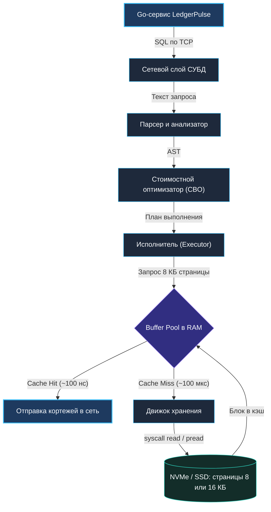

*От JSON-файла в BookmarkFlow к математическим множествам, 8-килобайтным страницам диска, Buffer Pool и архитектуре биллинга LedgerPulse.*

> «В идеальном мире прикладному программисту достаточно знать только API — без того, как этот API реализован и к какому железу он обращается. В реальности же чуть более глубокие знания порой оказываются весьма кстати.»  
> — Чарльз Петцольд, *Code* (2-е изд.)

## Когда иллюзия «чёрного ящика» рассыпается

В Томе 1 наш учебный сервис `BookmarkFlow` хранил закладки в одном JSON-файле `FileStore`. Когда пользователей единицы, а записей сотни, этот подход подкупает простотой: вы читаете структуру с диска, меняете срез в памяти и перезаписываете файл целиком. База данных на старте карьеры кажется примерно таким же услужливым шкафом или бесконечной хеш-таблицей: передал структуру в метод репозитория, а библиотека сама разложила байты по диску. Вызвал `FindByID` — и объект ожил в оперативной памяти.

Но как только бэкенд сталкивается с реальной промышленной нагрузкой — тысячами конкурентных запросов, пиковыми распродажами, финансовыми списаниями и внезапным падением питания, — иллюзия «чёрного ящика» рушится. В этом томе мы строим `LedgerPulse`: систему финансового учёта с двойной записью, где каждая копейка на счёте обязана сходиться до нуля при любых сбоях и параллельных переводах. На таком классе задач выясняется, что современная система управления базами данных (СУБД) устроена сложнее, чем сам Go-сервис, который отправляет в неё запросы.

Внутри СУБД непрерывно взаимодействуют виртуальная память операционной системы, планировщик дискового ввода-вывода (I/O), стоимостной оптимизатор запросов, менеджер блокировок и журнал упреждающей записи. Для опытного Go-инженера база данных перестаёт быть безликим «хранилищем». Она становится математической системой обработки множеств, подчинённой физике кремния, кэш-линий процессора и блочных накопителей.

## Сдвиг парадигмы: от объектов к множествам

Многие инженеры приходят в Go из языков с сильной объектно-ориентированной традицией — Java, C#, Ruby или PHP. Десятилетиями там доминировал подход **ORM** (Object-Relational Mapping: Hibernate, Entity Framework, ActiveRecord). Такие библиотеки приучают думать графами объектов и вложенных коллекций: разработчик описывает классы, а SQL за него генерирует фреймворк.

На высоких нагрузках попытка перенести эту привычку в реляционную базу порождает фундаментальный конфликт — **объектно-реляционное несоответствие (Object-Relational Impedance Mismatch)**. В памяти Go-программы удобно держать структуру `Account` со вложенным слайсом `[]Entry` или дерево указателей. В реляционной базе данных никаких вложенных списков внутри строки нет: там лежат отдельные плоские отношения `accounts`, `transactions` и `ledger_entries`.

> [!warning] Ловушка: слепое доверие магии ORM
> Попытка перенести паттерн Active Record или тяжёлые ORM в Go без понимания SQL почти всегда оборачивается деградацией под нагрузкой. Идиоматичный Go-код опирается на явность и простоту. Скрытые автоподгрузки связей внутри циклов порождают лавину лишних запросов (знаменитую проблему `N+1`, которую мы детально разберём в Модуле 4), а сгенерированный запрос нередко тянет лишние колонки и обходит индексы.

Чтобы избежать этого разрыва, нужно сменить оптику: **думать не единичными объектами, а множествами (Sets) и потоками данных**. SQL — декларативный язык, построенный на реляционной алгебре. Вы формулируете для СУБД *что* хотите получить — какие множества соединить, по каким предикатам отфильтровать и какие столбцы спроецировать, — а не *как* императивно перебирать элементы в цикле `for`.

Именно поэтому в экосистеме Go прижились инструменты, которые не прячут SQL от программиста: генератор типобезопасного кода по сырым запросам `sqlc`, драйвер `pgx`, лёгкие сканеры вроде `sqlx` или простые конструкторы запросов вроде Squirrel. С их плюсами, минусами и местом ORM в продакшене мы подробно разберёмся в Модуле 10.

## Что происходит на железе, когда вы выполняете `SELECT`

Когда разработчик читает запрос к базе данных, ему легко забыть о стоимости каждой строчки SQL. Однако любое выражение транслируется в конкретные операции процессора, оперативной памяти и накопителя. Разница в скорости между уровнями иерархии памяти составляет порядки: чтение из оперативной памяти занимает около **100 наносекунд**, обращение к современному NVMe SSD — порядка **100 микросекунд** (в тысячу раз медленнее), а к механическому HDD — около **10 миллисекунд** (ещё в сто раз медленнее).

Проследим путь простого запроса из домена `LedgerPulse`:

```sql
SELECT id, external_id, balance
FROM accounts
WHERE currency = 'RUB';
```

На физическом уровне этот запрос проходит пять обязательных этапов:

1. **Сетевой транспорт.** Go-приложение отправляет байты запроса по TCP-соединению через системные вызовы ядра Linux. Сервер СУБД принимает поток байтов из сокета.
2. **Синтаксический разбор и проверка схемы.** Парсер превращает текст SQL в абстрактное синтаксическое дерево (AST), сверяет существование таблицы `accounts`, столбцов `id`, `external_id`, `balance`, `currency` и проверяет права доступа по системному каталогу.
3. **Стоимостная оптимизация.** Планировщик на основе стоимости (**Cost-Based Optimizer, CBO**) обращается к накопленной статистике распределения значений. Если счетов в `'RUB'` всего 2% от таблицы, выгоднее пойти по B-Tree индексу. Если рублёвых счетов 90%, дешевле не прыгать по индексу, а прочитать всю таблицу подряд (**Sequential Scan**).
4. **Чтение страницами, а не строками.** Движок хранения СУБД никогда не вычитывает с диска произвольные 100 байт одной записи. Все файлы таблиц и индексов разбиты на неделимые блоки фиксированного размера — **страницы (Pages)**: в **PostgreSQL** это по умолчанию **8 КБ**, а в **MySQL InnoDB** — **16 КБ**.
5. **Buffer Pool: Cache Hit против Cache Miss.** Чтобы достать единственную строку длиной 100 байт, СУБД обязана поднять в свой кэш в оперативной памяти (**Buffer Pool**) всю 8-килобайтную страницу целиком. Если нужная страница уже лежит в ОЗУ, происходит **Cache Hit** — диск вообще не просыпается. Если страницы в памяти нет, случается **Cache Miss**: ядро ОС выполняет дорогой системный вызов `read` / `pread` (либо работает через отображение памяти `mmap`), и контроллер NVMe/SSD считывает блок с накопителя.



Здесь проявляется критическая разница между **случайным чтением (Random I/O)** и **последовательным чтением (Sequential I/O)**. Если нужные строки разбросаны по сотням разных страниц из-за неудачного порядка записи или фрагментации, СУБД запускает сотни случайных обращений к диску. Даже на быстрых NVMe SSD случайное чтение ощутимо проигрывает последовательному из-за накладных расходов на команды контроллера, прерывания и механизм упреждающего чтения (**read-ahead**) в ядре Linux, который бесплатно подтягивает соседние блоки при линейном проходе.

Когда инженер держит в голове эту цепочку, привычка писать `SELECT *` в цикле исчезает сама. Лишние столбцы раздувают сетевые пакеты, тратят CPU на сериализацию и вымывают полезные страницы из Buffer Pool, замедляя быстрые запросы соседних пользователей.

## От `BookmarkFlow` к `LedgerPulse`: зачем нам база данных

В финале Тома 1 сервис `BookmarkFlow` принимал HTTP-запросы, менял структуры под мьютексом и сбрасывал срез закладок в один JSON-файл через `os.WriteFile`. В задаче биллинга `LedgerPulse` на счетах `accounts` и проводках `ledger_entries` деньги хранятся строго в целых минимальных единицах (`int64` в Go, `BIGINT` в PostgreSQL), без погрешностей двоичной арифметики.

При переходе к СУБД меняются три вещи: данные не помещаются в один файл, с ними одновременно работают десятки горутин и несколько реплик сервиса, а списания и зачисления обязаны оставаться согласованными даже при падении питания.

Ниже показан базовый контракт между моделью в Go и выборкой множества в SQL на домене `LedgerPulse` (подробнее эта схема раскрыта в `project/step01/`):

```go
package ledger

// Account отражает одну строку отношения accounts в памяти Go.
type Account struct {
	ID         int64
	ExternalID string
	Currency   string
	Balance    int64 // Хранится в копейках/центах, никогда во float64
}
```

В Go мы читаем или проверяем баланс отдельной структуры, но в SQL формулируем правило сразу для всего множества активных счетов выбранной валюты:

```sql
SELECT id, external_id, currency, balance
FROM accounts
WHERE currency = 'RUB'
  AND status = 'active'
ORDER BY id
LIMIT 50;
```

Обратите внимание, как изменился подход к взаимодействию с хранилищем. В Go стандартная библиотека задаёт единый интерфейс через пакет `database/sql`, а конкретный протокол реализует драйвер (для PostgreSQL стандартом стал `pgx`). При этом объект `*sql.DB` — не одиночный TCP-сокет, который открывается на каждый HTTP-запрос, а потокобезопасный пул соединений, обслуживающий сотни конкурентных горутин. Детальное устройство `database/sql`, настройку пула (`MaxOpenConns`, `MaxIdleConns`), отмену запросов через `context.Context` и защиту от утечки соединений мы подробно разберём в Модуле 10, когда за спиной уже будут SQL, индексы и транзакции.

> [!tip] Собеседование [Middle]
> **Вопрос:** Почему даже на современных NVMe SSD для базы данных так важен высокий процент попаданий в кэш (Cache Hit Ratio) и почему `SELECT *` вредит не только сети?  
> **Ответ:** Память RAM работает на уровне ~100 нс, а чтение страницы с NVMe SSD — ~100 мкс, то есть в тысячу раз медленнее (плюс накладные расходы системного вызова `pread` и ядра ОС). Поскольку СУБД читает данные страницами по 8–16 КБ, лишние ненужные столбцы (особенно крупные текстовые поля и `JSONB`) занимают место в страницах, уменьшают число полезных строк на одной 8-килобайтной странице, вымывают горячие данные из Buffer Pool и заставляют CPU тратить время на декодирование и передачу байтов по сети.

## Карта Тома 2: от множеств до HighLoad

Том 2 ведёт от теории множеств к устройству движков и промышленной эксплуатации на Go:

1. **Модуль 1. Фундамент баз данных и моделирование** (вы здесь): роль СУБД, OLTP против OLAP, реляционная модель Кодда, ключи, ограничения целостности, трёхзначная логика `NULL`, нормализация (1NF–5NF), денормализация и схема `LedgerPulse`.
2. **Модуль 2. Базовый SQL с нуля**: DDL/DML, фильтрация, keyset-пагинация, все виды `JOIN`, `GROUP BY`/`HAVING`, подзапросы, `EXISTS` против `IN` и `NULL`.
3. **Модуль 3. Продвинутый SQL и аналитика**: CTE и рекурсивные запросы, оконные функции, `JSONB`, массивы, PL/pgSQL, триггеры и материализованные представления.
4. **Модуль 4. Индексы, планировщик и EXPLAIN**: устройство 8 КБ страниц $B^+$-деревьев, составные, покрывающие, частичные и GIN/GiST индексы, планы `EXPLAIN (ANALYZE, BUFFERS)` и устранение `N+1`.
5. **Модуль 5. Транзакции, ACID, MVCC и WAL**: уровни изоляции, аномалии, блокировки, MVCC, журнал WAL с `fsync`, Checkpointing, восстановление ARIES и `VACUUM`.
6. **Модули 6 и 7. PostgreSQL и MySQL под капотом**: процессы против потоков, heap-таблицы против кластерного индекса, `xmin`/`xmax` против Undo Log и репликация.
7. **Модуль 8. Распределённые базы, репликация и шардирование**: кворумы, шардирование, согласованность, CAP/PACELC и распределённые транзакции.
8. **Модуль 9. NoSQL и аналитические движки**: LSM-деревья, Redis/Valkey, MongoDB, Cassandra, ClickHouse (`MergeTree`) и векторный поиск.
9. **Модуль 10. Практика БД в Go и HighLoad**: пулы `database/sql` и `pgx`, Repository и Unit of Work, миграции, кэширование, Outbox, бэкапы, мониторинг и защита от SQL-инъекций.

## Упражнения

### Упражнение 1 (Базовое). Оценка затрат на страницу и Cache Miss
В PostgreSQL размер страницы равен 8 КБ (8 192 байта), из которых часть уходит на заголовок страницы и указатели на строки. Допустим, одна запись таблицы `accounts` с заголовком занимает на странице 128 байт.
1. Примерно сколько записей поместится на одной 8-килобайтной странице (для оценки считайте полезную ёмкость страницы ~8 000 байт)?
2. Пусть запрос ищет 500 конкретных счетов по их `id`, и все 500 строк лежат на разных, не закэшированных страницах. Сколько мегабайт данных контроллер SSD поднимет в Buffer Pool, хотя приложению нужно лишь $500 \times 128 = 64\,000$ байт (~62.5 КБ)?

> [!solution] Показать решение
> 1. $8\,000 / 128 \approx 62$ записи на одной странице (на практике чуть меньше из-за выравнивания и линейных указателей, но порядок ~60 строк на страницу).
> 2. При 500 случайных Cache Miss СУБД считает 500 целых страниц по 8 КБ:
>    $$500 \times 8\,\text{КБ} = 4\,000\,\text{КБ} \approx 3.91\,\text{МБ}$$
>    То есть для получения ~62.5 КБ полезных данных будет прочитано почти **в 64 раза больше** байт с накопителя. На 500 000 разбросанных строк это превратится уже почти в 4 ГБ случайного чтения. Отсюда и берётся цена плохой локальности данных и отсутствия покрывающих или кластеризованных индексов.

### Упражнение 2 (Практическое). Сдвиг от объекта к множеству
В Go-коде старого прототипа биллинга программист перенёс привычку работы со слайсами и написал такой псевдокод для расчёта суммарного баланса активных рублёвых счетов:

```go
accounts := repo.FindAllAccounts() // загружает все строки таблицы accounts в []Account
var total int64
for _, acc := range accounts {
	if acc.Currency == "RUB" && acc.Status == "active" {
		total += acc.Balance
	}
}
```

1. Какие три проблемы с точки зрения сетевого трафика, памяти Go-процесса и Buffer Pool СУБД создаёт этот код на таблице из 5 млн строк?
2. Перепишите задачу в декларативном виде на SQL, чтобы вычисление выполнила сама СУБД.

> [!solution] Показать решение
> 1. Три проблемы императивной выгрузки всех строк в Go:
>    - **Buffer Pool и диск:** при полном сканировании таблицы СУБД прочитает все страницы всех счетов (включая закрытые и в других валютах), вымывая горячие страницы из Buffer Pool.
>    - **Сеть и сериализация:** миллионы ненужных строк и лишние столбцы (`owner_name`, `metadata`) передаются по TCP и парсятся драйвером.
>    - **Память Go и GC:** аллокация слайса на 5 млн структур перегрузит кучу Go и сборщик мусора (GC) ради одного числа `int64`.
> 2. Декларативный SQL-запрос, перекладывающий фильтрацию и агрегацию на движок БД:
>    ```sql
>    SELECT COALESCE(SUM(balance), 0) AS total_balance
>    FROM accounts
>    WHERE currency = 'RUB'
>      AND status = 'active';
>    ```
>    СУБД может использовать индекс по `(currency, status)` и вернуть по сети единственное 8-байтовое число вместо гигабайтов сырых строк.

### Упражнение 3 (\*). Почему в `LedgerPulse` нельзя использовать `float64` и один JSON-файл
Представьте, что вы проектируете прототип `LedgerPulse` и решаете отказаться от JSON-файла в пользу СУБД. Объясните:
1. Почему для поля `balance` в `Account` выбран `int64` (целые копейки/центы), а не `float64`? Проверьте на примере суммы `0.1 + 0.2` в двоичной арифметике IEEE 754.
2. Почему даже при хранении `int64` JSON-файл `FileStore` из Тома 1 сломается на первом же параллельном переводе между двумя счетами при сбое питания?

> [!solution] Показать решение
> 1. Числа с плавающей точкой (`float64` / `DOUBLE PRECISION`) используют двоичную экспоненциальную запись по стандарту IEEE 754. Дроби `0.1` и `0.2` в двоичной системе бесконечны, поэтому `0.1 + 0.2 == 0.30000000000000004`. В финансовом учёте, где инвариант двойной записи требует точного равенства суммы проводок нулю (`SUM(amount) = 0`), накопление ошибки округления сделает баланс невосстановимым. Целочисленный тип `int64` (`BIGINT`) в копейках/центах даёт точную арифметику без потери ни одной единицы.
> 2. При записи в один JSON-файл две конкурентные горутины без внешней транзакционной координации затрут изменения друг друга (потерянное обновление). Хуже того, если питание пропадёт во время перезаписи файла, старая версия может быть уже усечена, а новая дописана лишь наполовину — потеряются данные обоих счетов сразу, без возможности атомарно откатить перевод к согласованному состоянию до сбоя.

---

Мы увидели, почему база данных для Go-бэкенда — это не пассивный JSON-шкаф, а система работы со множествами поверх 8-килобайтных страниц и Buffer Pool. Но что именно разделяет файл на диске и ту программу, которая защищает эти страницы от гонок и сбоев? Разберёмся в следующей главе: [[2. Что такое база данных и СУБД]].
