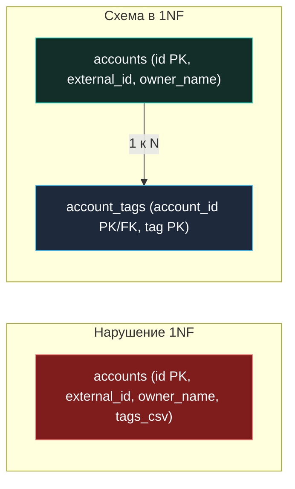

*От списков через запятую к атомарным атрибутам: почему B-Tree бессилен против подстрок, как устроены четыре правила 1NF и когда JSONB становится осознанным компромиссом.*

В главе [[9. Нормализация — зачем избавляться от аномалий]] мы убедились, что хранение повторяющихся фактов в плоской таблице разрушает согласованность данных и раздувает страницы памяти. Чтобы навести строгий порядок, схему пропускают через последовательность **нормальных форм** — математических фильтров, каждый из которых отсекает свой класс зависимостей.

Самая частая ошибка на старте проектирования выглядит безобидно. В Go разработчик привык, что у сущности может быть слайс тегов или ролей `[]string`. Перенося структуру в базу данных, он склеивает слайс через `strings.Join(tags, ",")` и кладёт в текстовую колонку `tags`:

| id | external_id | owner_name | tags (нарушение 1NF) |
| :--- | :--- | :--- | :--- |
| 1 | `acc_alpha` | Анна Соколова | `vip,usd,high_risk` |
| 2 | `acc_beta` | Илья Морозов | `eur,retail,vip` |

Из кода на Go это кажется удобным: прочитал одну строку, вызвал `strings.Split` и получил готовый слайс. На уровне СУБД такое решение ломает и скорость поиска, и целостность схемы.

---

## Почему списки в ячейке убивают производительность

Представим простую задачу комплаенса в `LedgerPulse`: найти все счета с тегом `vip`. Поскольку значения упакованы в единую строку через запятую, точное равенство `WHERE tags = 'vip'` пропустит обе строки таблицы. Единственный способ дотянуться до элемента внутри строки — поиск подстроки:

```sql
SELECT id, owner_name FROM accounts WHERE tags LIKE '%vip%';
```

На десяти счетах запрос отработает мгновенно. На десяти миллионах счетов он положит сервер базы данных.

```text
-- Фрагмент плана выполнения:
Seq Scan on accounts  (cost=0.00..218432.00 rows=12040 width=48)
  Filter: (tags ~~ '%vip%'::text)
```

Чтобы понять причину этого `Seq Scan` (последовательного сканирования всей таблицы), посмотрим на поток данных с диска. Классический **B-Tree индекс** устроен как отсортированный словарь (детально его структуру разберём в Модуле 4). Он мгновенно находит префиксы вида `LIKE 'vip%'`, потому что все слова на `vip` лежат в соседних листьях дерева.

Но когда шаблон начинается с символа подстановки `%` (`'%vip%'`), сортировка теряет смысл: слово `vip` может скрываться в начале, середине или конце текста. Индекс бесполезен, и движок вынужден прочитать таблицу целиком от первой страницы до последней:

1. Через системные вызовы ОС база загружает в Buffer Pool абсолютно все 8-килобайтные страницы таблицы `accounts`, вымывая из оперативной памяти (~100 нс) горячие балансы и провоцируя обращения к NVMe SSD (~100 мкс).
2. Если текстовая строка `tags` или соседнее поле разрослись примерно сверх 2 КБ, PostgreSQL выносит их в служебную область **TOAST** (сжатое внешнее хранилище, о нём подробнее в Модуле 6) — процессор тратит такты на распаковку каждой строки.
3. Ядра CPU посимвольно проверяют подстроку в миллионах записей, вдобавок рискуя поймать ложное совпадение вроде `super_vip_old`.

Помимо деградации I/O, строка через запятую обходит ограничения схемы из [[7. Ограничения целостности данных — NOT NULL, UNIQUE, CHECK|главы 7]]. На отдельные элементы списка нельзя повесить `FOREIGN KEY` на справочник допустимых тегов и нельзя запретить дубликаты внутри одной ячейки (`"vip,vip"`).

---

## Четыре правила Первой нормальной формы (1NF)

В [[4. Реляционная модель данных — отношения, кортежи и множества|главе 4]] мы опирались на математическое понятие **отношения (relation)** Эдгара Кодда. **Первая нормальная форма (1NF)** проводит чёткую границу между неструктурированным потоком байтов и корректным реляционным отношением. Если таблица нарушает хотя бы одно требование 1NF, она не считается нормализованной вообще.

Отношение находится в 1NF тогда и только тогда, когда выполняются четыре правила:

1. **Атомарность (скалярность) атрибутов.** На пересечении строки и столбца лежит строго *одно* неделимое с точки зрения предметной области значение. Списки через запятую, упакованные битовые маски разнородных флагов и повторяющиеся группы колонок вроде `tag1`, `tag2`, `tag3` запрещены.
2. **Однородность домена.** Все значения в столбце принадлежат одному типу данных (домену). Недопустимо в числовой колонке `fee_bps` хранить `150` у одних клиентов и строку `"exempt"` у других — для неизвестного или отсутствующего значения существуют `NULL` или явный признак в отдельном столбце.
3. **Уникальность кортежей.** В таблице не бывает двух полностью одинаковых строк. На практике это правило закрывается назначением первичного ключа (см. [[5. Таблицы, строки, столбцы и ключи]]).
4. **Независимость от порядка.** Ни физический порядок строк на страницах диска, ни порядок столбцов в `CREATE TABLE` не влияют на смысл данных и логику запросов. Если клиентскому коду важно сортировать результат, запрос обязан содержать `ORDER BY`.

> [!note] Граница «неделимости»
> Атомарность определяется задачей сервиса, а не физикой байтов. Почтовый адрес `"г. Москва, ул. Тверская, д. 1"` атомарен для сервиса, который просто печатает его на квитанции целиком. Но если системе нужно искать клиентов по городу и индексу, такая строка нарушает 1NF и распадается на `city`, `street`, `building` и `postal_code`.

---

## Приведение к 1NF: выносим список в дочернюю таблицу

Чтобы привести таблицу `accounts` к 1NF, мы выносим мультизначный атрибут в отдельную дочернюю таблицу `account_tags` со связью «один ко многим» и составным ключом `(account_id, tag)`:



Обратите внимание на первичный ключ `PRIMARY KEY (account_id, tag)` в `account_tags`: он одним объявлением решает и уникальность пары (нельзя навесить `vip` дважды на один счёт), и ссылочную целостность через внешний ключ на `accounts(id)`.

Если добавить обычный B-Tree индекс на колонку `tag` (`CREATE INDEX idx_account_tags_tag ON account_tags (tag);`), поиск по тегу превращается в точное равенство:

```sql
SELECT account_id FROM account_tags WHERE tag = 'vip';
```

Вместо чтения всей таблицы гигабайт за гигабайтом движок спускается по B-Tree за 3–4 шага (`Index Scan`), считывая с диска считанные страницы за сотни микросекунд.

---

## Несоответствие моделей (Impedance Mismatch) в Go 1.24

В базе данных теги счёта лежат в отдельных строках дочерней таблицы `account_tags`. В Go доменная модель требует удобный слайс `Tags []string` внутри структуры `AccountSummary`. Это расхождение между табличным хранением и иерархией объектов в памяти называют **Impedance Mismatch**.

Идиоматичный способ собрать агрегат в Go через `database/sql` — выполнить один `LEFT JOIN`, отсортированный по `a.id`, и аккуратно сгруппировать строки. Важная деталь: если складывать указатели в мапу, а затем обходить саму мапу циклом `for _, acc := range lookup`, итоговый слайс потеряет порядок сортировки из SQL (`ORDER BY a.id`). Надёжнее сохранять элементы в `result []AccountSummary`, а в мапе держать индекс позиции:

```go
package ledger

import (
	"context"
	"database/sql"
	"fmt"
)

type AccountSummary struct {
	ID         int64
	ExternalID string
	OwnerName  string
	Tags       []string
}

func FetchAccountsWithTags(ctx context.Context, db *sql.DB) ([]AccountSummary, error) {
	const query = `
		SELECT a.id, a.external_id, a.owner_name, t.tag
		FROM accounts a
		LEFT JOIN account_tags t ON t.account_id = a.id
		ORDER BY a.id, t.tag
	`

	rows, err := db.QueryContext(ctx, query)
	if err != nil {
		return nil, fmt.Errorf("query accounts with tags: %w", err)
	}
	defer rows.Close()

	posByID := make(map[int64]int)
	var result []AccountSummary

	for rows.Next() {
		var id int64
		var extID, owner string
		var tag sql.NullString // LEFT JOIN вернёт NULL для счёта без тегов

		if err := rows.Scan(&id, &extID, &owner, &tag); err != nil {
			return nil, fmt.Errorf("scan account row: %w", err)
		}

		idx, exists := posByID[id]
		if !exists {
			idx = len(result)
			posByID[id] = idx
			result = append(result, AccountSummary{
				ID:         id,
				ExternalID: extID,
				OwnerName:  owner,
				Tags:       []string{},
			})
		}
		if tag.Valid {
			result[idx].Tags = append(result[idx].Tags, tag.String)
		}
	}

	if err := rows.Err(); err != nil {
		return nil, fmt.Errorf("iterate account rows: %w", err)
	}
	return result, nil
}
```

Использование `sql.NullString` здесь обязательно: у счёта может не быть ни одного тега, и `LEFT JOIN` выдаст `NULL` в четвёртой колонке. Попытка отсканировать `NULL` в обычный `string` завершится ошибкой драйвера, как мы помним из [[8. NULL и трёхзначная логика|главы 8]]. А проверка `rows.Err()` в конце гарантирует, что мы не вернём неполный срез при обрыве соединения посреди чтения курсора.

---

## Подводные камни: горизонтальные группы и JSONB

> [!warning] Ловушка «фиксированных слотов» (`tag1`, `tag2`, `tag3`)
> Пытаясь обойти запрет на списки через запятую, разработчики порой заводят в таблице колонки `tag1`, `tag2`, `tag3`. Это такое же нарушение 1NF — **повторяющаяся группа атрибутов**. У счёта с одним тегом два слота пустуют в `NULL`, для четвёртого тега приходится менять схему `ALTER TABLE`, а поиск превращается в неуклюжий предикат `WHERE tag1 = 'vip' OR tag2 = 'vip' OR tag3 = 'vip'`, ломающий использование простого индекса.

> [!tip] Собеседование [Middle]
> **Вопрос:** В схеме `LedgerPulse` у таблицы `accounts` есть колонка `metadata JSONB`, а PostgreSQL поддерживает ещё и нативные массивы `TEXT[]`. Нарушают ли они 1NF?  
> **Ответ:** По строгой теории Эдгара Кодда — да, потому что составной JSON-документ или массив не образуют атомарный скаляр. Но в современной инженерии PostgreSQL это осознанный и контролируемый компромисс. СУБД умеет строить поверх `JSONB` и массивов специализированные **GIN-индексы** (обобщённые инвертированные индексы — подробно разберём их в Модулях 4 и 6), обеспечивающие быстрый поиск по ключам и элементам без `Seq Scan`. Такой выбор оправдан для слабоструктурированных метаданных (например, заголовков вебхука или локальных настроек профиля), которые не участвуют в `FOREIGN KEY`, агрегациях по сумме и строгих реляционных связях.

---

## Практика

**Упражнение 1 (Базовое). Аудит нарушений 1NF.**
Изучите DDL таблицы черновика `merchant_profiles`:
```sql
CREATE TABLE merchant_profiles (
    merchant_code TEXT,
    title         TEXT,
    currencies    TEXT,   -- например: 'USD,EUR'
    fee_tier      TEXT,   -- число 150 или текст 'custom'
    backup_email1 TEXT,
    backup_email2 TEXT
);
```
Перечислите все четыре нарушения правил 1NF, которые допущены в этой таблице.

> [!solution] Показать решение
> 1. **Отсутствие первичного ключа:** в таблице ни один столбец не объявлен `PRIMARY KEY` или `UNIQUE NOT NULL` — возможны полные дубликаты кортежей.
> 2. **Неатомарность (`currencies`):** список валют через запятую в одной ячейке нарушает требование скалярности.
> 3. **Нарушение однородности домена (`fee_tier`):** в одном столбце смешаны числовые значения комиссии и строковый маркер `'custom'`.
> 4. **Повторяющаяся группа (`backup_email1`, `backup_email2`):** фиксированное дублирование однотипных столбцов вместо дочерней таблицы резервных адресов.

**Упражнение 2 (Практическое). Приведение к 1NF и защита справочника.**
Спроектируйте DDL для `accounts` и дочерней таблицы `account_currencies` (какие валюты разрешены счёту) в 1NF так, чтобы:
1. Каждому счёту нельзя было привязать одну и ту же валюту дважды.
2. Код валюты состоял строго из трёх заглавных латинских букв (`ISO 4217`).
3. При удалении счёта проверка внешнего ключа не давала тихо оставить «висячие» строки валют.

> [!solution] Показать решение
> ```sql
> CREATE TABLE accounts (
>     id          BIGINT GENERATED ALWAYS AS IDENTITY PRIMARY KEY,
>     external_id TEXT NOT NULL UNIQUE,
>     owner_name  TEXT NOT NULL
> );
>
> CREATE TABLE account_currencies (
>     account_id BIGINT  NOT NULL REFERENCES accounts(id) ON DELETE RESTRICT,
>     currency   CHAR(3) NOT NULL CHECK (currency ~ '^[A-Z]{3}$'),
>     PRIMARY KEY (account_id, currency)
> );
> ```
> Составной `PRIMARY KEY (account_id, currency)` автоматически гарантирует уникальность пары «счёт + валюта», а `ON DELETE RESTRICT` запрещает удалять счёт, пока у него есть связанные записи (сначала нужно осознанно очистить дочерние строки или выполнить закрытие в транзакции).

**Упражнение 3 (Со звёздочкой \*). Выбор между `TEXT[]` + GIN и 1NF-таблицей.**
В `LedgerPulse` нужно хранить список платёжных лимитов или ролей доступа к счёту, причём бизнес-логика требует: (а) ссылаться на справочник ролей через `FOREIGN KEY`, чтобы не допустить опечаток вроде `"admn"`; (б) считать статистику «сколько счетов привязано к каждой роли» одним быстрым `GROUP BY`. Объясните, почему здесь стоит выбрать отдельную таблицу в 1NF вместо колонки `roles TEXT[]` с GIN-индексом.

> [!solution] Показать решение
> Нативные массивы `TEXT[]` в PostgreSQL до сих пор не поддерживают стандартный элементный `FOREIGN KEY` на справочную таблицу без пользовательских триггеров или патчей, поэтому опечатка `"admn"` спокойно пройдёт проверку схемы. Кроме того, для `GROUP BY` по элементам массива СУБД придётся разворачивать каждый массив функцией `unnest()`, теряя прямое индексное сканирование по значению. Отдельная таблица `account_roles (account_id, role_code)` в 1NF решает обе задачи нативными средствами планировщика и ограничений целостности.

---

Мы очистили ячейки от списков, обеспечили однородность доменов и научились агрегировать связи «один ко многим» в Go без потери порядка строк. Но посмотрите на составной первичный ключ из двух или трёх колонок: даже при безупречной 1NF таблица способна дублировать десятки байт в каждой строке, если часть столбцов зависит лишь от *половины* этого ключа. Как выявить и устранить частичные зависимости, разберём в главе [[11. Вторая нормальная форма (2NF)]].
