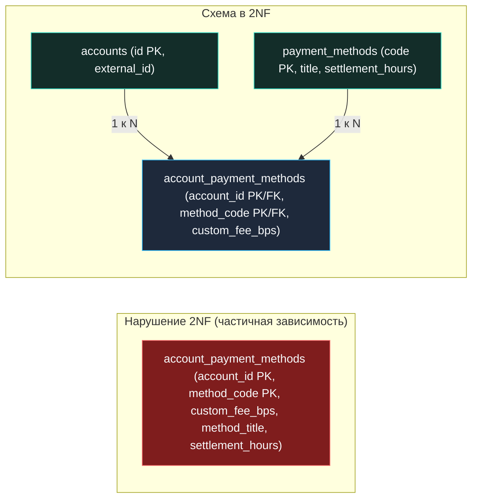

*Частичные функциональные зависимости в составных ключах, правило левого префикса в B-Tree и ловушка иллюзорного суррогатного ключа.*

В главе [[10. Первая нормальная форма (1NF)]] мы вычистили списки из ячеек и гарантировали атомарность каждого столбца. Но строгая 1NF проверяет порядок только *внутри* отдельных ячеек. Она никак не спасает от масштабного дублирования данных по всей высоте таблицы, как только в схеме появляется составной первичный ключ.

Представим платёжный шлюз `LedgerPulse`, в котором сотни тысяч счетов (мерчантов) подключаются к разным платёжным рельсам: банковским картам, Системе быстрых платежей (`sbp`) и межбанковским переводам (`swift`). Между счетами и методами оплаты возникает связь «многие ко многим» (**Many-to-Many**): у одного счёта бывает несколько методов, а один метод используется множеством счетов. Проектировщик создаёт таблицу `account_payment_methods`, честно соблюдая 1NF:

| account_id (PK) | method_code (PK) | custom_fee_bps | method_title | settlement_hours |
| :--- | :--- | :--- | :--- | :--- |
| 101 | `card` | 210 | Карты Visa / Mastercard | 24 |
| 101 | `sbp` | 40 | Система быстрых платежей | 1 |
| 205 | `card` | 180 | Карты Visa / Mastercard | 24 |

В этой таблице нет массивов или списков через запятую. Каждая ячейка скалярна, все домены однородны, а составной первичный ключ `(account_id, method_code)` уникально задаёт каждую строку. Но стоит платёжному партнёру изменить срок расчётов по картам (`settlement_hours`) с `24` до `48` часов или переименовать способ оплаты, как база попадает в тяжёлый операционный кризис.

---

## Что такое частичная зависимость и вторая нормальная форма

Чтобы понять сбой, разберём, от чего зависит каждый неключевой столбец таблицы `account_payment_methods`:

- столбец `custom_fee_bps` (индивидуальная комиссия счёта по конкретному методу) зависит **от всего составного ключа** `(account_id, method_code)` целиком;
- столбцы `method_title` и `settlement_hours` зависят **только от `method_code`**. Название платёжного канала и регламент его расчётов никак не зависят от того, какой `account_id` его подключил.

В реляционной теории такую ситуацию называют **частичной функциональной зависимостью (Partial Dependency)**: неключевой атрибут определяется лишь фрагментом составного первичного ключа, а не всем ключом.

**Вторая нормальная форма (2NF)** устраняет ровно этот класс избыточности. Формальное определение звучит так: отношение находится в 2NF, если оно уже удовлетворяет требованиям 1NF и каждый неключевой атрибут функционально полно (неприводимо) зависит от всего первичного ключа.

> [!note] Правило простого первичного ключа
> Если первичный ключ таблицы состоит из одной-единственной колонки (например, `id BIGINT`), у такого ключа не бывает «половины». Поэтому любая таблица в 1NF с простым первичным ключом формально удовлетворяет 2NF. Вся инженерная глубина 2NF раскрывается именно в связях «многие ко многим» — либо там, где разработчик пытается замаскировать составную сущность искусственным ключом.

---

## Цена нарушения 2NF для дисков, памяти и блокировок

На учебном примере из трёх строк повторение строки `"Карты Visa / Mastercard"` кажется мелочью. На реальном биллинге с 500 000 подключений дублирование бьёт сразу по трём уровням СУБД:

1. **Тяжёлый штраф на запись (Write Penalty) и блокировки.** Чтобы поменять `settlement_hours` по каналу `card` с 24 до 48 часов, сервис выполняет массовый запрос `UPDATE account_payment_methods SET settlement_hours = 48 WHERE method_code = 'card'`. Если к картам подключены 300 000 счетов, движок перезапишет 300 000 кортежей, сгенерирует десятки мегабайт в журнале предзаписи (WAL — подробно разберём в Модуле 5), перегрузит канал репликации и выставит строковые блокировки (**Row-level Lock**), затормозив параллельные изменения комиссий клиентам.
2. **Раздувание страниц и деградация кеша (Buffer Pool).** Повторяющиеся текстовые описания и метаданные увеличивают размер каждой строки в разы. На 8-килобайтную страницу ОЗУ помещается в 3–4 раза меньше связок. При массовом биллинговом прогоне движок вынужден вычитывать больше страниц с NVMe SSD (**~100 мкс** против **~100 нс** в RAM), вытесняя горячие данные из кеша.
3. **Аномалии вставки и удаления.** Пока ни один клиент не подключил новый платёжный метод `mir_pay`, его описание негде сохранить — мешает `NOT NULL` на `account_id`. А если последний клиент отключит метод `sbp`, система потеряет сам справочник этого канала.

---

## Приведение к 2NF: чистая таблица связей

Чтобы привести схему к строгой 2NF, мы отсекаем столбцы с частичной зависимостью и выносим их в отдельный справочник `payment_methods`. Исходная таблица очищается от лишних полей и превращается в компактную **таблицу связей (Junction Table / Join Table)** `account_payment_methods`:



После декомпозиции в таблице `account_payment_methods` остаётся только сама связь `(account_id, method_code)` и атрибут, относящийся строго к этой паре — `custom_fee_bps`. Изменение `settlement_hours` для всех 300 000 клиентов теперь сводится к обновлению ровно одной строки в `payment_methods`.

---

## Под капотом: составной первичный ключ и правило левого префикса

Когда вы объявляете `PRIMARY KEY (account_id, method_code)`, СУБД строит под капотом **один составной B-Tree индекс**, в котором оба значения склеены в единый ключ сортировки. Физический порядок колонок в этом объявлении критически влияет на планы запросов.

> [!info] Правило левого префикса (Leftmost Prefix Rule)
> В составном B-Tree ключе `(account_id, method_code)` дерево сначала упорядочено по `account_id`, а внутри одного и того же счёта — по `method_code`. Отсюда следуют два жёстких физических ограничения (подробнее составные индексы разберём в Модуле 4):
> 1. Запрос с фильтром `WHERE account_id = 101` или `WHERE account_id = 101 AND method_code = 'card'` быстро спускается по дереву от корня к нужному диапазону.
> 2. Запрос с фильтром только по второй колонке `WHERE method_code = 'card'` **не может** эффективно использовать этот B-Tree индекс: значения `'card'` разбросаны по ветвям всех счетов.
>
> Если системе `LedgerPulse` нужно быстро находить как все методы конкретного счёта, так и все счета, подключённые к конкретному методу, к первичному ключу добавляют инвертированный индекс:
> ```sql
> CREATE INDEX idx_apm_method_account
>     ON account_payment_methods (method_code, account_id);
> ```

Заодно обратите внимание, почему компактность кортежей в таблице связей так важна: без текстовых описаний размер строки `account_payment_methods` сжимается до пары десятков байт, и на одну 8-килобайтную страницу помещается более сотни связок.

---

## Архитектура «многие ко многим» в Go 1.24

В приложении на Go нормализованная связь «многие ко многим» читается одним `JOIN`-запросом к таблице связей и справочнику методов. Чтобы пример отражал реальную практику `LedgerPulse`, представим, что индивидуальная комиссия `custom_fee_bps` в `account_payment_methods` опциональна (`NULL` означает «действует базовая комиссия канала» — `base_fee_bps` из `payment_methods`), а в Go мы аккуратно обрабатываем оба значения с помощью `sql.NullInt64`:

```go
package ledger

import (
	"context"
	"database/sql"
	"fmt"
)

type AccountMethod struct {
	MethodCode      string
	Title           string
	SettlementHours int
	EffectiveFeeBPS int64
}

func ListAccountMethods(ctx context.Context, db *sql.DB, accountID int64) ([]AccountMethod, error) {
	// Индекс PRIMARY KEY (account_id, method_code) закрывает фильтр WHERE apm.account_id = $1.
	const query = `
		SELECT
			pm.code,
			pm.title,
			pm.settlement_hours,
			pm.base_fee_bps,
			apm.custom_fee_bps
		FROM account_payment_methods apm
		JOIN payment_methods pm ON pm.code = apm.method_code
		WHERE apm.account_id = $1
		ORDER BY pm.code
	`

	rows, err := db.QueryContext(ctx, query, accountID)
	if err != nil {
		return nil, fmt.Errorf("list methods for account %d: %w", accountID, err)
	}
	defer rows.Close()

	var methods []AccountMethod
	for rows.Next() {
		var item AccountMethod
		var baseFee int64
		var customFee sql.NullInt64

		if err := rows.Scan(
			&item.MethodCode,
			&item.Title,
			&item.SettlementHours,
			&baseFee,
			&customFee,
		); err != nil {
			return nil, fmt.Errorf("scan payment method: %w", err)
		}

		item.EffectiveFeeBPS = baseFee
		if customFee.Valid {
			item.EffectiveFeeBPS = customFee.Int64
		}
		methods = append(methods, item)
	}

	if err := rows.Err(); err != nil {
		return nil, fmt.Errorf("iterate payment methods: %w", err)
	}
	return methods, nil
}
```

Один сетевой вызов к PostgreSQL использует левый префикс первичного ключа `(account_id, method_code)` для точечного чтения связок, соединяет их со справочником `payment_methods` и собирает готовый срез доменных структур `AccountMethod` без лишних запросов в цикле.

---

## Ловушка «Иллюзия суррогатного ключа»

> [!warning] Подмена смысла искусственным `id`
> Начинающие разработчики нередко пытаются «обхитрить» правило второй нормальной формы так: *«2NF запрещает частичные зависимости только при составном ключе. Добавим искусственный столбец `id BIGINT PRIMARY KEY`, и таблица станет одноколоночной — значит, попадёт во 2NF автоматически»*.
>
> ```sql
> -- ОПАСНЫЙ САМООБМАН:
> CREATE TABLE account_payment_methods (
>     id               BIGINT GENERATED ALWAYS AS IDENTITY PRIMARY KEY,
>     account_id       BIGINT NOT NULL,
>     method_code      TEXT   NOT NULL,
>     custom_fee_bps   INT,
>     method_title     TEXT   NOT NULL, -- дублирование никуда не исчезло
>     settlement_hours INT    NOT NULL  -- аномалии обновления остались на месте
> );
> ```
> С формально-буквоедской точки зрения `method_title` действительно зависит от суррогатного ключа `id`. Но на физическом уровне диска вы не решили ни одной проблемы: миллионы дублей, раздувание WAL, блокировки при массовом `UPDATE` и аномалии вставки остались нетронутыми. Более того, без `UNIQUE (account_id, method_code)` в таблицу теперь можно случайно вставить один и тот же платёжный метод для счёта дважды.
>
> Инженерный принцип прост: если в таблице связей вы добавляете суррогатный `id` (например, чтобы на саму строку связки могли ссылаться другие таблицы), вы всё равно обязаны вынести справочник `payment_methods` наружу и закрепить бизнес-ключ ограничением `UNIQUE (account_id, method_code)`.

> [!tip] Собеседование [Middle]
> **Вопрос:** Если добавить в таблицу связей `id BIGINT PRIMARY KEY`, будет ли она соответствовать 2NF, и почему так делать нельзя?  
> **Ответ:** Формально по определению 2NF на первичном ключе `{id}` частичных зависимостей больше нет, однако появляется **транзитивная зависимость** `id → method_code → method_title`, нарушающая 3NF, и сохраняются все физические проблемы дублирования данных, Write Penalty и аномалий обновления. Кроме того, теряется уникальность натуральной пары без отдельного ограничения `UNIQUE`. В реальном проектировании суррогатный `id` не заменяет декомпозицию.

---

## Практика

**Упражнение 1 (Базовое). Выявление частичных зависимостей.**
В `LedgerPulse` спроектировали таблицу дневных лимитов по валютам:
`account_currency_limits (account_id PK, currency PK, daily_limit, currency_name, minor_units)`
где `minor_units` — количество знаков после запятой для валюты (например, `2` для `USD`, `0` для `JPY`). Определите, какие столбцы зависят от всего ключа, а какие нарушают 2NF, и напишите исправленный DDL в 2NF.

> [!solution] Показать решение
> Столбец `daily_limit` зависит от всего составного ключа `(account_id, currency)` целиком, а `currency_name` и `minor_units` — только от части ключа (`currency`). Выносим атрибуты валют в справочник `currencies`:
> ```sql
> CREATE TABLE currencies (
>     code        CHAR(3)  PRIMARY KEY CHECK (code ~ '^[A-Z]{3}$'),
>     name        TEXT     NOT NULL,
>     minor_units SMALLINT NOT NULL CHECK (minor_units BETWEEN 0 AND 8)
> );
>
> CREATE TABLE account_currency_limits (
>     account_id  BIGINT  NOT NULL REFERENCES accounts(id) ON DELETE RESTRICT,
>     currency    CHAR(3) NOT NULL REFERENCES currencies(code) ON DELETE RESTRICT,
>     daily_limit BIGINT  NOT NULL CHECK (daily_limit >= 0),
>     PRIMARY KEY (account_id, currency)
> );
> ```

**Упражнение 2 (Практическое). Таблица связей с суррогатным ключом и двусторонним поиском.**
По условиям нового сервиса на конкретную связку счёта и платёжного метода должны ссылаться записи аудита, поэтому в `account_payment_methods` нужен суррогатный `id BIGINT GENERATED ALWAYS AS IDENTITY PRIMARY KEY`. Напишите корректный DDL в 2NF для `account_payment_methods`, который: (а) исключает дубликаты пары `(account_id, method_code)`; (б) обеспечивает быстрый поиск по `method_code`.

> [!solution] Показать решение
> ```sql
> CREATE TABLE account_payment_methods (
>     id             BIGINT GENERATED ALWAYS AS IDENTITY PRIMARY KEY,
>     account_id     BIGINT NOT NULL REFERENCES accounts(id) ON DELETE RESTRICT,
>     method_code    TEXT   NOT NULL REFERENCES payment_methods(code) ON DELETE RESTRICT,
>     custom_fee_bps INT    CHECK (custom_fee_bps >= 0),
>     UNIQUE (account_id, method_code)
> );
>
> CREATE INDEX idx_apm_method_account
>     ON account_payment_methods (method_code, account_id);
> ```
> Ограничение `UNIQUE (account_id, method_code)` создаёт уникальный составной B-Tree индекс (для проверки дублей и поиска по `account_id`), а второй индекс `(method_code, account_id)` закрывает обратный поиск по каналу оплаты.

**Упражнение 3 (Со звёздочкой \*). Анализ левого префикса.**
В таблице связей объявлен `PRIMARY KEY (account_id, method_code)` без дополнительных индексов. Определите, какие из четырёх предикатов смогут эффективно сузить диапазон поиска по этому B-Tree индексу, а какие столкнутся с полным сканированием дерева или таблицы:
1. `WHERE account_id = 42`
2. `WHERE method_code = 'sbp'`
3. `WHERE account_id = 42 AND method_code = 'sbp'`
4. `WHERE account_id > 42 AND method_code = 'sbp'`

> [!solution] Показать решение
> 1. `WHERE account_id = 42` — **использует индекс полностью** по левому префиксу: все записи для `42` лежат непрерывным отрезком.
> 2. `WHERE method_code = 'sbp'` — **не использует префикс**, так как `account_id` не зафиксирован; планировщик уйдёт в `Seq Scan` (или медленный обход всего индекса).
> 3. `WHERE account_id = 42 AND method_code = 'sbp'` — **использует оба столбца индекса**, точечный спуск к одной записи.
> 4. `WHERE account_id > 42 AND method_code = 'sbp'` — **частичное использование**: после неравенства `>` индекс сужает диапазон только по `account_id > 42`, но проверять `method_code = 'sbp'` движку придётся фильтрацией по всем найденным веткам, потому что равенство по первой колонке отсутствует.

---

Вторая нормальная форма защитила нас от частичных зависимостей при составных ключах. Но вспомните ловушку суррогатного ключа: даже если первичный ключ состоит из одного столбца `id` и 2NF формально выполнена, внутри строки может прятаться цепочка, где одно неключевое поле определяет другое неключевое поле. Разрубить такие скрытые связи поможет тема следующей главы — [[12. Третья нормальная форма (3NF)]].
