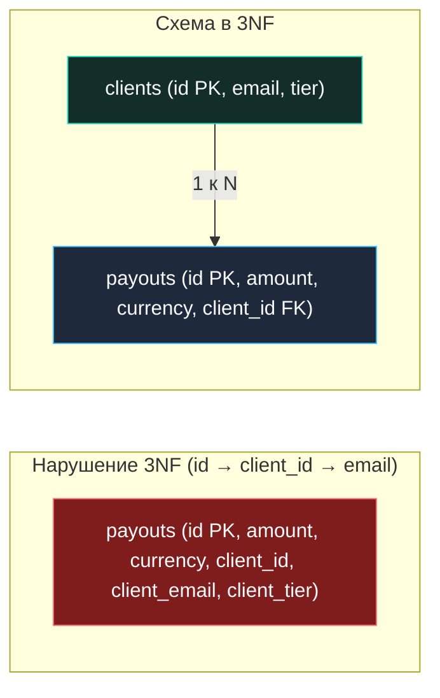

*Борьба с транзитивными зависимостями, клятва Биллу Кенту и Кодду и композиция данных между микросервисами на Go.*

В главах [[10. Первая нормальная форма (1NF)]] и [[11. Вторая нормальная форма (2NF)]] мы избавились от списков в ячейках и отсекли частичные зависимости от фрагментов составного ключа. Кажется, что таблица с простым первичным ключом из одной колонки уже защищена от дублирования. На практике именно в таких таблицах прячется самое распространённое нарушение структуры.

**Третья нормальная форма (3NF)** — это рабочий стандарт промышленного проектирования реляционных баз данных. Примерно в 95% транзакционных OLTP-систем процесс нормализации останавливают именно на 3NF.

В 1983 году исследователь баз данных Уильям (Билл) Кент в классической статье *«A Simple Guide to Five Normal Forms in Relational Database Theory»* сформулировал мнемонический парафраз судебной клятвы, который до сих пор точно передаёт смысл первых трёх форм: *«Каждый неключевой атрибут должен предоставлять факт о ключе, обо всём ключе и **ни о чём, кроме ключа** — да поможет мне Кодд»* (отсылая к Эдгару Кодду, создателю реляционной модели).

«Ни о чём, кроме ключа» — это и есть запрет на транзитивные зависимости.

---

## Транзитивная зависимость: посредник внутри строки

**Транзитивная зависимость (Transitive Dependency)** возникает, когда неключевой атрибут `C` функционально зависит от другого неключевого атрибута `B`, а уже `B` зависит от первичного ключа `A` (`A → B → C`). То есть `C` привязан к первичному ключу не напрямую, а через посредника.

Посмотрим на таблицу выплат `payouts` в `LedgerPulse`, где первичным ключом служит простой `id`:

| id (PK) | amount | currency | client_id | client_email | client_tier |
| :--- | :--- | :--- | :--- | :--- | :--- |
| 501 | 250000 | `USD` | 42 | `bob@ledger.io` | `enterprise` |
| 502 | 80000 | `USD` | 42 | `bob@ledger.io` | `enterprise` |
| 503 | 120000 | `EUR` | 88 | `alice@ledger.io` | `standard` |

Проверим эту таблицу на соответствие уже знакомым формам:
- каждая ячейка скалярна, домены однородны, ключ уникален — **1NF выполнена**;
- первичный ключ `id` состоит из одного столбца, поэтому частичных зависимостей от фрагмента ключа нет — **2NF формально выполнена**.

Но посмотрим на зависимости между столбцами внимательнее. Сумма `amount`, валюта `currency` и идентификатор клиента `client_id` описывают саму конкретную выплату `id`. А вот `client_email` и `client_tier` к отдельной выплате отношения не имеют: они функционально определяются **только полем `client_id`**. Сложилась транзитивная цепочка: `id → client_id → (client_email, client_tier)`.

---

## Физика отказа: почему транзитивность опасна

На первый взгляд хранить `client_email` прямо в строке выплаты удобно — отчёту не нужен `JOIN`. Но в работающем сервисе эта «удобная» цепочка порождает три тяжёлых сбоя:

1. **Усиление записи (Write Amplification).** Когда клиент `42` меняет контактный email или переходит с тарифа `standard` на `enterprise`, база вынуждена обновить тысячи его исторических строк в `payouts`. В нагруженных биллингах старые выплаты лежат на медленных дисках или в архивных партициях — массовое обновление поднимает шквал дискового ввода-вывода, забивает WAL и блокирует текущие вставки.
2. **Рассинхронизация источника правды (Single Source of Truth).** Если массовое обновление прервётся из-за таймаута, дедлока или забытого условия в скрипте миграции (либо новый сервис забудет обновить `client_email` в архивной таблице), в базе появятся две строки одного и того же `client_id = 42` с разными адресами. Определить, какой адрес актуален, по самой базе больше нельзя.
3. **Раздувание страниц (Data Bloat).** Повторяющиеся строки email и названий тарифов в каждом кортеже съедают 30–60 лишних байт, снижая число строк на 8-килобайтную страницу ОЗУ и вымывая горячие данные из Buffer Pool.

Кроме того, таблица `payouts` с транзитивной зависимостью страдает от аномалий вставки и удаления из [[9. Нормализация — зачем избавляться от аномалий|главы 9]]: нового клиента невозможно завести без выплаты, а удаление единственной отменённой выплаты стирает профиль клиента.

---

## Приведение к 3NF: разрубаем цепочку

Чтобы довести схему до строгой 3NF, мы разрываем транзитивную цепочку: выносим атрибуты-посредники в самостоятельную таблицу `clients`, а в `payouts` оставляем только внешний ключ `client_id`:



Теперь почта и уровень клиента хранятся строго в одном месте — в таблице `clients`. Изменение адреса превращается в атомарный `UPDATE` одной-единственной строки, а база сохраняет статус единого источника правды.

---

## 3NF в микросервисной архитектуре на Go: API Composition

В монолитной базе `LedgerPulse` переход к 3NF решается простым SQL `JOIN` между `payouts` и `clients`. Но как только компания делит систему на изолированные сервисы по паттерну **Database-per-Service**, ситуация меняется. Таблица `payouts` живёт в базе сервиса выплат (`PayoutService`), а таблица `clients` — в отдельной базе сервиса клиентов (`ClientService`).

Выполнить реляционный `JOIN` между двумя физически разными базами данных по сети нельзя. Внешний ключ `client_id` превращается из ссылки между таблицами в границу сетевого взаимодействия.

Чтобы собрать обогащённый список выплат для панели администратора, в распределённых системах применяют паттерн **API Composition (композиция на уровне API)**. На стороне шлюза или BFF (Backend for Frontend) на Go мы:
1. Забираем список выплат из `PayoutService`.
2. Собираем **уникальные** `client_id` через мапу `map[int64]struct{}`, чтобы не дёргать один и тот же профиль десять раз.
3. Одним пакетным запросом запрашиваем профили в `ClientService` (используя `golang.org/x/sync/errgroup`, если параллельно нужно подтянуть данные ещё из других сервисов).
4. Выполняем **in-memory JOIN** — склеиваем срез выплат с мапой клиентов в памяти Go.

```go
package bff

import (
	"context"
	"fmt"
	"maps"
	"slices"

	"golang.org/x/sync/errgroup"
)

type Payout struct {
	ID       int64
	Amount   int64
	Currency string
	ClientID int64
}

type Client struct {
	ID    int64
	Email string
	Tier  string
}

type PayoutView struct {
	PayoutID    int64
	Amount      int64
	Currency    string
	ClientID    int64
	ClientEmail string
	ClientTier  string
}

type PayoutClient interface {
	ListRecentPayouts(ctx context.Context, limit int) ([]Payout, error)
}

type DirectoryClient interface {
	GetClientsByIDs(ctx context.Context, ids []int64) (map[int64]Client, error)
}

func GetEnrichedPayouts(ctx context.Context, payoutsSvc PayoutClient, dirSvc DirectoryClient, limit int) ([]PayoutView, error) {
	payouts, err := payoutsSvc.ListRecentPayouts(ctx, limit)
	if err != nil {
		return nil, fmt.Errorf("fetch recent payouts: %w", err)
	}
	if len(payouts) == 0 {
		return nil, nil
	}

	// Собираем уникальные client_id, чтобы выполнить один batch-запрос вместо N+1.
	idSet := make(map[int64]struct{}, len(payouts))
	for _, p := range payouts {
		idSet[p.ClientID] = struct{}{}
	}
	clientIDs := slices.Collect(maps.Keys(idSet))

	var clients map[int64]Client
	g, gCtx := errgroup.WithContext(ctx)
	g.Go(func() error {
		var fetchErr error
		clients, fetchErr = dirSvc.GetClientsByIDs(gCtx, clientIDs)
		return fetchErr
	})
	if err := g.Wait(); err != nil {
		return nil, fmt.Errorf("enrich clients: %w", err)
	}

	// Склейка в памяти Go (аналог Hash Join).
	views := make([]PayoutView, 0, len(payouts))
	for _, p := range payouts {
		email, tier := "unknown", "unknown" // безопасный fallback при удалении клиента
		if c, ok := clients[p.ClientID]; ok {
			email, tier = c.Email, c.Tier
		}
		views = append(views, PayoutView{
			PayoutID:    p.ID,
			Amount:      p.Amount,
			Currency:    p.Currency,
			ClientID:    p.ClientID,
			ClientEmail: email,
			ClientTier:  tier,
		})
	}
	return views, nil
}
```

Обратите внимание на две детали Go 1.24 и распределённых систем. Стандартные функции `maps.Keys` и `slices.Collect` превращают множество ключей в срез без лишнего шаблонного цикла. При этом работа по соединению данных переносится с единственного узла базы данных в горизонтально масштабируемые stateless-экземпляры Go-сервисов — разумеется, в пределах разумного размера выборки (`limit`), чтобы не тащить по сети миллионы строк (подробнее межсервисную интеграцию и паттерны чтения рассматривает Том 3).

---

## Подводные камни: исторический снимок против транзитивности

> [!warning] Ловушка «не всякий дубликат нарушает 3NF»
> Представьте, что в строке выплаты `payouts` вместе с `client_id` хранится колонка `applied_fee_bps` (ставка комиссии, по которой реально рассчитали выплату в момент её создания). Начинающий архитектор нередко удаляет её со словами: *«Ставка тарифа лежит в `clients`/`tariffs`, значит, в `payouts` это транзитивная зависимость — убираем»*.
>
> Такое «исправление» разрушит финансовый учёт. Через месяц клиент сменит тариф со `150` базисных пунктов на `80` — и пересчёт прошлой отчётности по текущему тарифу исказит все исторические выплаты. Значение `applied_fee_bps` описывает **факт конкретной операции в прошлом** (`payouts.id → applied_fee_bps`), а не текущее состояние клиента. Это допустимый исторический снимок (snapshot), а не транзитивная зависимость от `client_id`.

> [!tip] Собеседование [Middle]
> **Вопрос:** В чём принципиальная разница между Второй (2NF) и Третьей (3NF) нормальными формами?  
> **Ответ:**  
> - **2NF** устраняет **частичные функциональные зависимости**: ни один неключевой столбец не должен зависеть только от части составного первичного ключа. Если первичный ключ простой (одна колонка), 1NF автоматически закрывает 2NF.  
> - **3NF** устраняет **транзитивные функциональные зависимости**: ни один неключевой столбец не должен зависеть от первичного ключа опосредованно, через другой неключевой столбец (`PK → B → C`).  
> Обе формы избавляют схему от дублирования данных и защищают базу от аномалий вставки, обновления и удаления.

---

## Практика

**Упражнение 1 (Базовое). Разрыв транзитивной цепочки.**
В банковском сервисе таблица `wire_transfers` имеет вид:
`wire_transfers (id PK, amount, currency, branch_id, branch_city, branch_manager)`
Опишите цепочку функциональных зависимостей и приведите таблицу к 3NF в синтаксисе PostgreSQL, назначив корректный `ON DELETE` на внешний ключ.

> [!solution] Показать решение
> Атрибуты `branch_city` и `branch_manager` функционально зависят не от перевода `id`, а от отделения `branch_id` (`id → branch_id → (branch_city, branch_manager)`). Разрубаем цепочку на две таблицы:
> ```sql
> CREATE TABLE branches (
>     id      BIGINT GENERATED ALWAYS AS IDENTITY PRIMARY KEY,
>     city    TEXT NOT NULL,
>     manager TEXT NOT NULL
> );
>
> CREATE TABLE wire_transfers (
>     id        BIGINT GENERATED ALWAYS AS IDENTITY PRIMARY KEY,
>     amount    BIGINT  NOT NULL CHECK (amount > 0),
>     currency  CHAR(3) NOT NULL CHECK (currency ~ '^[A-Z]{3}$'),
>     branch_id BIGINT  NOT NULL REFERENCES branches(id) ON DELETE RESTRICT
> );
> ```
> Ограничение `ON DELETE RESTRICT` не позволит случайно удалить отделение банка, пока к нему привязаны исторические переводы.

**Упражнение 2 (Практическое). Параллельная API-композиция в Go.**
Доработайте функцию `GetEnrichedPayouts`: добавьте второй интерфейс `CurrencyClient` с методом `GetRatesToUSD(ctx context.Context, codes []string) (map[string]int64, error)` (курс в микроцентах), соберите уникальный список валют `codes` из `payouts` и запустите запросы к `DirectoryClient` и `CurrencyClient` параллельно внутри `errgroup`. Добавьте в `PayoutView` поле `RateToUSD int64` (со значением `0`, если курс не найден).

> [!solution] Показать решение
> ```go
> type CurrencyClient interface {
> 	GetRatesToUSD(ctx context.Context, codes []string) (map[string]int64, error)
> }
>
> func GetEnrichedPayoutsV2(
> 	ctx context.Context,
> 	payoutsSvc PayoutClient,
> 	dirSvc DirectoryClient,
> 	currSvc CurrencyClient,
> 	limit int,
> ) ([]PayoutView, error) {
> 	payouts, err := payoutsSvc.ListRecentPayouts(ctx, limit)
> 	if err != nil {
> 		return nil, fmt.Errorf("fetch recent payouts: %w", err)
> 	}
> 	if len(payouts) == 0 {
> 		return nil, nil
> 	}
>
> 	clientSet := make(map[int64]struct{}, len(payouts))
> 	currSet := make(map[string]struct{}, 4)
> 	for _, p := range payouts {
> 		clientSet[p.ClientID] = struct{}{}
> 		currSet[p.Currency] = struct{}{}
> 	}
>
> 	var (
> 		clients map[int64]Client
> 		rates   map[string]int64
> 	)
> 	g, gCtx := errgroup.WithContext(ctx)
> 	g.Go(func() error {
> 		var e error
> 		clients, e = dirSvc.GetClientsByIDs(gCtx, slices.Collect(maps.Keys(clientSet)))
> 		return e
> 	})
> 	g.Go(func() error {
> 		var e error
> 		rates, e = currSvc.GetRatesToUSD(gCtx, slices.Collect(maps.Keys(currSet)))
> 		return e
> 	})
> 	if err := g.Wait(); err != nil {
> 		return nil, fmt.Errorf("enrich payouts: %w", err)
> 	}
>
> 	views := make([]PayoutView, 0, len(payouts))
> 	for _, p := range payouts {
> 		email, tier := "unknown", "unknown"
> 		if c, ok := clients[p.ClientID]; ok {
> 			email, tier = c.Email, c.Tier
> 		}
> 		views = append(views, PayoutView{
> 			PayoutID:    p.ID,
> 			Amount:      p.Amount,
> 			Currency:    p.Currency,
> 			ClientID:    p.ClientID,
> 			ClientEmail: email,
> 			ClientTier:  tier,
> 			RateToUSD:   rates[p.Currency], // для отсутствующего ключа мапа вернёт 0
> 		})
> 	}
> 	return views, nil
> }
> ```
> Два независимых сетевых вызова теперь выполняются конкурентно за время самого медленного из них, а если один упадёт, `gCtx` немедленно отменит второй.

**Упражнение 3 (Со звёздочкой \*). Валюта в `ledger_entries` проекта `LedgerPulse`.**
Посмотрите на схему `LedgerPulse`: в таблице `accounts` есть столбец `currency CHAR(3)`, и в дочерней таблице `ledger_entries (id, transaction_id, account_id, amount, currency)` тоже есть столбец `currency CHAR(3)`. Ответьте: нарушает ли такое повторение 3NF, и как защитить базу от ситуации, когда в `ledger_entries` по ошибке записали `'EUR'` для рублёвого счёта (`accounts.currency = 'RUB'`)?

> [!solution] Показать решение
> Если валюта счёта неизменна, а `ledger_entries.currency` просто копирует `accounts.currency`, это **формально транзитивная зависимость** (`ledger_entries.id → account_id → currency`), то есть осознанная контролируемая денормализация ради быстрой проверки двойной записи без `JOIN` к `accounts` (и для защиты от мультивалютных багов при агрегации проводок). Чтобы две колонки не разошлись, одной проверки в Go-коде недостаточно — надёжнее добавить в схему **составной внешний ключ**: объявить `UNIQUE (id, currency)` на `accounts` и сослаться на него из `ledger_entries` через `FOREIGN KEY (account_id, currency) REFERENCES accounts(id, currency)`. Тогда сама СУБД физически запретит вставить проводку в чужой валюте.

---

Третья нормальная форма закрывает подавляющее большинство реальных задач OLTP-проектирования: каждый неключевой столбец теперь зависит от ключа, от всего ключа и ни от чего, кроме ключа. Но у 3NF остаётся одно тонкое теоретическое исключение, когда в таблице есть несколько пересекающихся потенциальных ключей и неключевых полей вовсе нет — или же атрибуты внутри строки образуют независимые пары значений. Разберём усиленную форму Бойса–Кодда (BCNF), а также 4NF и 5NF в следующей главе.
