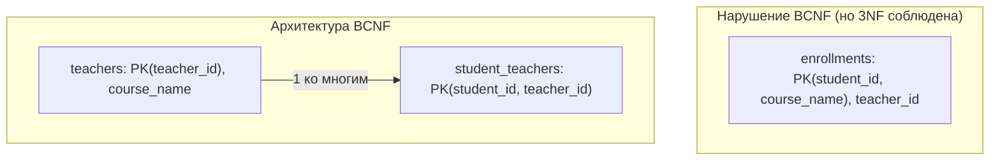

*Когда схема формально проходит проверку 3NF, но всё равно плодит аномалии вставки, дублирование фактов и декартово раздувание страниц диска.*

> «Простота требует больше труда в начале проекта — чтобы очистить идею до самой сути — и больше дисциплины на всём сроке его жизни, чтобы отличать хорошие изменения от плохих и вредоносных.»  
> — Алан Донован и Брайан Керниган *(со ссылкой на Фреда Брукса)*, *The Go Programming Language*

В предыдущем уроке — [[12. Третья нормальная форма (3NF)]] — мы устранили транзитивные зависимости неключевых столбцов. Для 95% транзакционных OLTP-систем такой строгости хватает: очевидное дублирование исчезает, а база защищена от базовых аномалий модификации.

Но реляционная алгебра на 3NF не останавливается. В системах бронирования, расписаниях и в банковском клиринге `LedgerPulse` встречаются краевые случаи, где формально корректная 3NF всё ещё пропускает скрытую избыточность и логические противоречия: либо нельзя занести в базу нового исполнителя до первого клиента, либо таблица разрастается десятками лишних строк и вымывает горячие страницы по 8 КБ из кэша.

---

## Нормальная форма Бойса–Кодда (BCNF)

Нормальную форму Бойса–Кодда (**BCNF**, *Boyce-Codd Normal Form*) предложили Рэймонд Бойс и Эдгар Кодд в 1974 году как более строгое усиление третьей нормальной формы. Бойс в те же годы участвовал в создании языка SEQUEL — предшественника SQL, — поэтому на практике столкнулся с тем, что классическое определение 3NF оставляет лазейку. В инженерной среде BCNF нередко называют «3.5NF».

> **Формальное правило BCNF:**  
> Отношение находится в нормальной форме Бойса–Кодда тогда и только тогда, когда для любой нетривиальной функциональной зависимости $X \rightarrow Y$ множество атрибутов $X$ является **суперключом** этого отношения.

На языке практики это звучит предельно ясно: если один столбец (или набор столбцов) однозначно определяет значение другого столбца, то этот определяющий набор обязан быть первичным ключом или уникальным ключом (`UNIQUE`) таблицы.

Где именно даёт трещину 3NF? Определение третьей нормальной формы запрещает неключевым столбцам зависеть от других неключевых столбцов. Однако оно молчит в ситуации, когда **часть составного потенциального ключа функционально зависит от неключевого атрибута**. Такая коллизия возникает только тогда, когда у таблицы есть несколько перекрывающихся составных потенциальных ключей.

### Классический пример: расписание лекций и клиринговые коридоры

Рассмотрим классическую систему университетского планирования с тремя сущностями: Студент, Курс и Преподаватель. Зафиксируем жёсткие бизнес-правила:

1. Студент может изучать конкретный курс только у одного преподавателя.
2. Каждый преподаватель закреплён строго за одним курсом.
3. Один и тот же курс могут параллельно вести разные преподаватели.

Спроектируем таблицу зачислений `enrollments` с составным первичным ключом `(student_id, course_name)` и неключевым столбцом `teacher_id`:

| `student_id` (PK) | `course_name` (PK) | `teacher_id` |
|---:|---|---:|
| 1 | `Go Backend` | 42 (Боб) |
| 2 | `Go Backend` | 42 (Боб) |
| 1 | `System Design` | 88 (Алиса) |

Находится ли эта таблица в 3NF? Да. В ней нет транзитивных зависимостей между неключевыми столбцами: единственный неключевой атрибут `teacher_id` зависит от полного составного ключа `(student_id, course_name)`.

Но внутри заложена скрытая бомба. По правилу № 2 преподаватель ведёт ровно один курс, а значит, зная `teacher_id`, мы однозначно определяем `course_name` — действует функциональная зависимость `teacher_id -> course_name`. При этом `teacher_id` не является суперключом таблицы (у одного преподавателя учатся десятки студентов).

Точно такая же структура возникает и в финансовом домене `LedgerPulse`, если проектировать таблицу распределения клиринговых операторов `clearing_assignments (merchant_id, currency, operator_id)`, где каждый оператор обслуживает строго одну валюту, а мерчант в рамках одной валюты закреплён за одним оператором.

На практике нарушение BCNF бьёт по данным сразу с двух сторон:

* **Аномалия вставки.** На кафедру приняли нового преподавателя (или в `LedgerPulse` подключили нового оператора на валюту `JPY`), но пока нет ни одного студента или мерчанта, мы физически не можем сохранить этот факт в таблице: `student_id` входит в первичный ключ и не может принимать `NULL` (см. [[8. NULL и трёхзначная логика]]).
* **Аномалия дублирования и рассинхронизации.** Факт «Боб ведёт Go Backend» повторяется в каждой строке студента. При переводе курса или обновлении одного кортежа без остальных в базе возникает противоречие.

### Приведение к BCNF

Чтобы закрыть лазейку, мы декомпозируем отношение: выносим зависимость `teacher_id -> course_name` в отдельную таблицу `teachers`, где детерминант `teacher_id` становится полноценным первичным ключом.



Теперь `teachers` хранит факт закрепления преподавателя за курсом независимо от набора студентов, а `student_teachers` связывает студента и преподавателя без дублирования названия курса.

> [!warning] Инженерная оговорка о BCNF
> В редких схемах с циклически перекрывающимися ключами декомпозиция до строгой BCNF без потерь данных способна разрушить сохранение одной из функциональных зависимостей — проверку правила приходится выносить в межтабличный триггер или отдельный контрольный индекс. В таких пограничных случаях архитектор осознанно взвешивает, оставить ли 3NF с жёстким триггером или перейти к BCNF.

---

## Четвёртая нормальная форма (4NF) и многозначные зависимости

Нормальные формы от 1NF до BCNF боролись с **функциональными зависимостями** ($X \rightarrow Y$), когда одно значение однозначно задаёт другое. В 1977 году Рональд Фейджин ввёл Четвёртую нормальную форму (**4NF**), которая устраняет **многозначные зависимости** (*Multivalued Dependencies*, $X \twoheadrightarrow Y$).

Многозначная зависимость появляется там, где одна сущность обладает двумя или более совершенно независимыми друг от друга списками значений (связями `1:N`), но разработчик упаковывает оба списка в одну плоскую таблицу связей.

### Антипаттерн декартова произведения

Представим профиль инженера в системе найма. У него есть независимый список навыков (`Go`, `PostgreSQL`) и независимый список хобби (`Гитара`, `Шахматы`). Навык программирования на Go никак не связан с игрой на гитаре. Если объединить их в таблицу `developer_info` с составным ключом `(dev_id, skill, hobby)`, таблица примет такой вид:

| `dev_id` | `skill` | `hobby` |
|---:|---|---|
| 1 | `Go` | `Гитара` |
| 1 | `Go` | `Шахматы` |
| 1 | `PostgreSQL` | `Гитара` |
| 1 | `PostgreSQL` | `Шахматы` |

Чтобы не потерять допустимые сочетания и сохранить симметрию, таблица вынуждена хранить полное **декартово произведение** (*Cartesian Product*) всех навыков на все увлечения. В `LedgerPulse` аналогичная ошибка возникает, если в одной связующей таблице `account_bindings (account_id, currency, webhook_url)` хранить сразу независимые разрешённые валюты счёта и адреса его вебхуков.

> [!info] Физика дискового I/O и Write Amplification в 4NF
> Упаковка независимых коллекций в общую таблицу бьёт по физике хранения и кэшам СУБД. Если у счёта или разработчика 20 значений первого списка и 20 второго, вместо $20 + 20 = 40$ компактных строк таблица раздувается до $20 \times 20 = 400$ кортежей.
>
> Добавление всего одного нового навыка заставляет базу вставить сразу $N$ строк (по числу хобби). Это порождает резкое усиление записи (**Write Amplification**): растут листья B-Tree индекса, 8-килобайтные страницы переполняются и делятся пополам (**Page Split**), пухнет журнал предзаписи (WAL), а полезные горячие таблицы вымываются из Buffer Pool. Вместо чтения из RAM (~100 нс) соседним запросам приходится заново поднимать страницы с NVMe (~100 мкс) или HDD (~10 мс).

**Приведение к 4NF** тривиально и бескомпромиссно: каждый независимый многозначный факт живёт в своей таблице — `developer_skills (dev_id, skill)` и `developer_hobbies (dev_id, hobby)`. Декартов взрыв исчезает полностью.

---

## Пятая и шестая нормальные формы (5NF, 6NF)

Выше 4NF начинается территория высокой реляционной абстракции, где математическая строгость часто вступает в прямой конфликт с задержками OLTP-продакшена.

* **5NF (Project-Join Normal Form, PJNF).** Устраняет зависимости соединения в ситуациях, когда три и более сущности связаны единым циклическим правилом. Если разбить такую тройную таблицу на две или три парные таблицы, при обратном соединении (`JOIN`) в результате появляются ложные, не существовавшие в реальности строки (фантомные кортежи). Встречается в сложной логистике, многосторонних соглашениях или комбинаторных ограничениях (например, «банк-корреспондент `B` работает с валютой `C` только в регионе `R`»).
* **6NF.** Отношение находится в шестой нормальной форме, если оно не содержит нетривиальных зависимостей соединения — на практике это значит, что таблица состоит из первичного ключа и **максимум одного информационного столбца**. Под каждое отдельное свойство сущности (имя, статус, тариф, баланс) заводится собственная таблица.

Где живёт 6NF в реальной индустрии? В аналитических хранилищах **Data Vault** и глубоких темпоральных базах данных, где нужно хранить независимую посекундную историю изменения каждого отдельного атрибута с интервалами `(valid_from, valid_to)`. Для обычного OLTP-сервиса на Go шестая форма оборачивается **Join Hell** — для чтения одного профиля процессору СУБД приходится склеивать полтора десятка разрозненных таблиц.

> [!warning] Границы нормализации в продакшене
> Классическое ориентировочное правило для транзакционных баз (OLTP): проектируйте схему до строгой **3NF**, проверяйте перекрывающиеся составные ключи на **BCNF** и точечно применяйте **4NF**, как только замечаете независимые списки в одной таблице связей. Доводить операционную базу до 5NF/6NF без явной предметной необходимости контрпродуктивно из-за стоимости множественных `JOIN`.

---

## Go 1.24 и PostgreSQL: декларативная BCNF против процедурных «костылей»

Когда разработчик оставляет таблицу в не-BCNF виде и пытается «допроверить» инвариант в коде приложения на Go, он неизбежно сталкивается с гонками данных. Посмотрим на популярный антипаттерн: попытку удержать правило `teacher_id -> course_name` процедурной проверкой внутри транзакции.

```go
package main

import (
	"context"
	"database/sql"
	"errors"
	"fmt"
)

// AssignCourseBad пытается эмулировать BCNF в коде Go.
// Под конкурентной нагрузкой такой код упирается в блокировки и ошибки сериализации.
func AssignCourseBad(ctx context.Context, db *sql.DB, studentID, teacherID int64, course string) error {
	tx, err := db.BeginTx(ctx, &sql.TxOptions{Isolation: sql.LevelSerializable})
	if err != nil {
		return err
	}
	defer tx.Rollback()

	var existingCourse string
	err = tx.QueryRowContext(
		ctx,
		"SELECT course_name FROM enrollments WHERE teacher_id = $1 LIMIT 1",
		teacherID,
	).Scan(&existingCourse)
	if err != nil && !errors.Is(err, sql.ErrNoRows) {
		return err
	}

	if existingCourse != "" && existingCourse != course {
		return fmt.Errorf("инвариант нарушен: преподаватель %d уже ведёт курс %s", teacherID, existingCourse)
	}

	_, err = tx.ExecContext(
		ctx,
		"INSERT INTO enrollments (student_id, course_name, teacher_id) VALUES ($1, $2, $3)",
		studentID, course, teacherID,
	)
	if err != nil {
		return err
	}

	return tx.Commit()
}
```

Почему этот код опасен в продакшене? Даже при `Isolation: sql.LevelSerializable` два параллельных запроса с разными студентами для одного нового преподавателя могут прочитать «пусто» (`sql.ErrNoRows`), вставить два разных курса, и PostgreSQL вынужден будет аварийно откатить одну из транзакций с ошибкой сериализации (`SQLSTATE 40001`). Если же снизить уровень изоляции до `Read Committed`, гонка тихо запишет в таблицу взаимоисключающие факты. Под высокой нагрузкой постоянные ретраи сериализуемых транзакций обрушивают пропускную способность (RPS).

Реляционное ядро решает задачу без уровня `Serializable` и лишних чтений перед записью. Приведём схему к BCNF с помощью декларативных ограничений (см. [[6. Первичные и внешние ключи]] и [[7. Ограничения целостности данных — NOT NULL, UNIQUE, CHECK]]):

```sql
CREATE TABLE teachers (
    teacher_id  BIGINT PRIMARY KEY,
    course_name TEXT NOT NULL
);

CREATE TABLE student_teachers (
    student_id BIGINT NOT NULL,
    teacher_id BIGINT NOT NULL REFERENCES teachers(teacher_id) ON DELETE RESTRICT,
    PRIMARY KEY (student_id, teacher_id)
);
```

Теперь преподаватель физически не может вести два разных курса — у `teachers.teacher_id` одно единственное значение `course_name`. Запись зачисления в Go превращается в один быстрый и безопасный запрос, а нарушение инварианта (например, несуществующий `teacher_id`) детерминированно останавливает сама СУБД:

```text
ERROR:  insert or update on table "student_teachers" violates foreign key constraint "student_teachers_teacher_id_fkey"
DETAIL:  Key (teacher_id)=(999) is not present in table "teachers".
```

> [!tip] Собеседование [Senior/Staff]
> **Вопрос:** Что опаснее для проекта: недостаточная нормализация (*Under-normalization*) или избыточная (*Over-normalization*)?  
> **Ответ:** Почти всегда опаснее **недостаточная нормализация**. Она приводит к тихому повреждению данных (*Data Corruption*) и логическим противоречиям, распутать которые через месяцы эксплуатации крайне дорого. Избыточная нормализация бьёт по скорости чтения из-за лишних `JOIN`. Проблемы скорости легко локализуются через `EXPLAIN ANALYZE` и решаются индексами или точечной денормализацией, а восстановление испорченной финансовой отчётности требует ручной сверки первичных документов.

---

## Упражнения

### Базовое
В расчётном модуле `LedgerPulse` дана таблица `clearing_rules (merchant_id, currency, operator_id)` с `PK (merchant_id, currency)`. Каждый оператор `operator_id` обслуживает строго одну валюту `currency`, а одну валюту могут вести несколько операторов.
1. Находится ли таблица в 3NF?
2. Нарушает ли она BCNF и какие аномалии возникают?
3. Разбейте таблицу до BCNF в SQL DDL.

> [!solution] Показать решение
> 1. **Да, таблица в 3NF:** единственный неключевой столбец `operator_id` зависит от полного ключа `(merchant_id, currency)`.
> 2. **Нет, BCNF нарушена:** действует зависимость `operator_id -> currency`, но `operator_id` не суперключ. Возникают аномалия вставки (нельзя завести оператора без мерчанта) и дублирование пары `(operator_id, currency)`.
> 3. **Декомпозиция до BCNF:**
> ```sql
> CREATE TABLE clearing_operators (
>     operator_id BIGINT PRIMARY KEY,
>     currency    CHAR(3) NOT NULL CHECK (currency ~ '^[A-Z]{3}$')
> );
>
> CREATE TABLE merchant_operators (
>     merchant_id BIGINT NOT NULL,
>     operator_id BIGINT NOT NULL REFERENCES clearing_operators(operator_id) ON DELETE RESTRICT,
>     PRIMARY KEY (merchant_id, operator_id)
> );
> ```
> Особенность BCNF здесь видна наглядно: правило «у мерчанта не более одного оператора на валюту» теперь требует контроля через триггер или материализованную валюту.

### Практическое
Дана таблица уведомлений и лимитов `account_bindings (account_id BIGINT, currency CHAR(3), webhook_url TEXT, PRIMARY KEY (account_id, currency, webhook_url))`. У одного счёта 5 разрешённых валют и 4 независимых вебхука. Напишите DDL для PostgreSQL 17, приводящий схему к 4NF, и покажите вставку данных для счёта `10`.

> [!solution] Показать решение
> Исходная таблица хранит многозначные зависимости `account_id ->> currency` и `account_id ->> webhook_url` ($5 \times 4 = 20$ строк вместо $5 + 4 = 9$). Разделяем списки:
> ```sql
> CREATE TABLE account_currencies (
>     account_id BIGINT  NOT NULL REFERENCES accounts(id) ON DELETE CASCADE,
>     currency   CHAR(3) NOT NULL CHECK (currency ~ '^[A-Z]{3}$'),
>     PRIMARY KEY (account_id, currency)
> );
>
> CREATE TABLE account_webhooks (
>     account_id  BIGINT NOT NULL REFERENCES accounts(id) ON DELETE CASCADE,
>     webhook_url TEXT   NOT NULL CHECK (webhook_url <> ''),
>     PRIMARY KEY (account_id, webhook_url)
> );
>
> INSERT INTO account_currencies (account_id, currency)
> VALUES (10, 'RUB'), (10, 'USD');
>
> INSERT INTO account_webhooks (account_id, webhook_url)
> VALUES (10, 'https://api.example.com/hook-1'),
>        (10, 'https://api.example.com/hook-2');
> ```

### Со звёздочкой (*)
Дана таблица `correspondent_matrix (bank_id, currency, region)` с тремя строками: `(BankA, USD, EU)`, `(BankA, EUR, US)`, `(BankB, USD, US)`. Покажите, почему при разбиении на парные проекции `(bank_id, currency)`, `(currency, region)` и `(bank_id, region)` обратный `JOIN` порождает ложную строку, отсутствующую в исходной таблице.

> [!solution] Показать решение
> Проекции исходных строк:
> - `BC = {(BankA, USD), (BankA, EUR), (BankB, USD)}`
> - `CR = {(USD, EU), (EUR, US), (USD, US)}`
> - `BR = {(BankA, EU), (BankA, US), (BankB, US)}`
>
> Соединение `BC JOIN CR JOIN BR` для пары `BankA` и `USD` находит `USD` в `US` и `BankA` в `US`, порождая **фантомную строку `(BankA, USD, US)`**. Если по бизнес-правилу `BankA` не клирит `USD` в `US`, парное разбиение нарушает эквивалентность схемы — исходная таблица уже находится в **5NF**.

---

## Мостик к следующему уроку

Мы довели нормализацию до BCNF, 4NF и границ 5NF. Схема избавлена от аномалий и дублирования. Но в продакшене академическая чистота упирается в задержки и сотни случайных чтений со страниц диска.

Зачем в таблице `accounts` схемы `LedgerPulse` присутствует колонка `balance`, если сумму можно вычислить по `ledger_entries`? В следующем уроке разберёмся, когда правила нормализации нарушают осознанно: переходим к [[14. Денормализация — когда и как она оправдана]].
