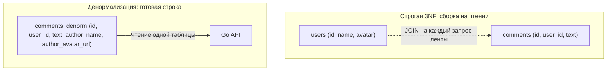

*Как осознанно нарушать нормальные формы ради миллисекундных SLA на чтение — и не потерять согласованность данных при записи.*

> «Блеск Unix заключался в выборе абстракции, достаточно общей, чтобы быть поразительно полезной, и при этом не слишком дорогой по производительности.»  
> — Брайан Керниган, *UNIX: A History and a Memoir*

Начиная с [[9. Нормализация — зачем избавляться от аномалий]] и вплоть до строгой [[13. BCNF и более высокие нормальные формы (4NF, 5NF)]], мы последовательно очищали схему от избыточности, дробили таблицы и защищались от аномалий вставки, обновления и удаления.

В реальной высоконагруженной системе математическая безупречность 3NF неизбежно сталкивается с физикой железа: задержками шины памяти, случайным чтением 8-килобайтных страниц с диска и сетевыми пересылками между узлами кластера. Попробуйте на активном мерчант-счёте `LedgerPulse` с пятью миллионами проводок вычислять текущий остаток при каждом списании через `SELECT COALESCE(SUM(amount), 0) FROM ledger_entries WHERE account_id = $1`: даже при наличии индекса задержка чтения сотен или тысяч страниц убьёт целевые миллисекунды SLA.

**Денормализация** — это осознанное, строго контролируемое нарушение нормальных форм ради многократного ускорения операций чтения (**Read Performance**) за счёт усложнения записи (**Write Penalty**) и управляемой избыточности хранения.

> [!important] Принцип зрелого инженера
> Денормализация — это скальпель хирурга, а не топор дровосека. Её нельзя применять «на глаз» на старте проекта. Начинайте со строгой 3NF или BCNF, и лишь после замеров под профилировщиком (`EXPLAIN (ANALYZE, BUFFERS)` и метрик APM) точечно денормализуйте доказанно раскалённые пути чтения.

---

## Физика железа: почему JOIN становится дорогим

Реляционные СУБД отлично умеют соединять таблицы: оптимизатор подбирает `Nested Loop`, `Hash Join` или `Merge Join`. Но когда объём таблиц переваливает за десятки и сотни миллионов строк, а нагрузка достигает десятков тысяч RPS, строгая 3NF начинает проседать по трём аппаратным причинам.

1. **Накладные расходы на CPU и RAM.** Чтобы собрать экран профиля пользователя (имя, аватар, десять последних постов, число комментариев, теги, статус подписки), движок СУБД поднимает и сопоставляет строки из 5–6 независимых таблиц. Для `Hash Join` приходится выделять память под хэш-таблицы, загружать разнородные страницы в Buffer Pool и ловить промахи 64-байтных кэш-линий процессора при чтении из оперативной памяти (~100 нс на обращение).
2. **Случайное чтение против последовательного (Random I/O vs Sequential I/O).** В нормализованной схеме каждая таблица лежит в собственном Heap-файле. Сбор одной составной бизнес-сущности превращается в десятки прыжков по уровням B-Tree и случайных чтений 8-килобайтных страниц из разных участков файла. На NVMe SSD случайное чтение обходится примерно в ~100 мкс, а на классических HDD — до ~10 мс, что на порядки медленнее чтения одной уже собранной строки из горячей страницы в RAM.
3. **Горизонтальное шардирование.** Если таблица `users` лежит на одном узле кластера, а шардированная таблица `posts` или `ledger_entries` разнесена по десяткам других серверов (подробнее о шардировании см. Модуль 8), СУБД физически не может выполнить дешёвый локальный `JOIN` без сетевых пересылок по миллисекундному RTT. Денормализация становится единственным способом удержать быстрые ответы API.

---

## Четыре паттерна денормализации

Разберём ключевые приёмы, которые инженеры применяют в высоконагруженных системах на Go и PostgreSQL, — от ленты комментариев до финансового ядра `LedgerPulse`.

### 1. Кэширование агрегаций (счётчики и предрасчитанные балансы)

**Проблема (3NF).** Чтобы показать число комментариев под постом, сервис выполняет агрегацию:

```sql
SELECT COUNT(*) FROM comments WHERE post_id = 42;
```

На популярном посте с 50 000 комментариев этот запрос, даже опираясь на индекс, вынужден обходить тысячи записей при каждом открытии страницы. В точности та же проблема возникает в `LedgerPulse`: по канону двойной записи баланс счёта — это производная величина, сумма всех его строк в `ledger_entries`.

**Решение.** Мы осознанно вводим избыточное материализованное поле: `comments_count BIGINT` в таблице `posts` или колонку `balance BIGINT NOT NULL DEFAULT 0 CHECK (balance >= 0)` прямо в таблице `accounts` (вспомните `001_init_ledger.sql`). Вычисляемый агрегат превращается в чтение одной строки за $O(1)$, а база вдобавок получает возможность моментально проверять инвариант `balance >= 0` при списании.

> [!warning] Плата за скорость: Write Penalty
> За денормализованный счётчик или баланс приходится платить при каждой записи. Любая вставка или удаление комментария обязаны обновлять `comments_count`, а каждая проводка в `ledger_entries` — синхронно менять `accounts.balance`. Одна пропущенная точка изменения в коде мгновенно создаёт тихое расхождение между фактами и агрегатом.

### 2. Дублирование атрибутов для отказа от JOIN

**Проблема (3NF).** При отрисовке ленты комментариев клиенту нужны текст комментария, имя автора и ссылка на его аватар. В нормализованной схеме каждый запрос тащит соединение `JOIN users ON comments.user_id = users.id`.

**Решение.** Продублировать редко меняющиеся атрибуты `author_name` и `author_avatar_url` в строку `comments`. Выборка ленты сводится к плоскому запросу по одной таблице:

```sql
SELECT id, user_id, text, author_name, author_avatar_url, created_at
FROM comments
WHERE post_id = 42
ORDER BY created_at DESC;
```



В `LedgerPulse` похожую роль играет хранение `currency` одновременно в `accounts` и в `ledger_entries`: аналитические и проверочные выборки по проводкам видят валюту без обязательного `JOIN accounts`, хотя приложению и ограничениям приходится следить, чтобы валюта проводки всегда совпадала с валютой счёта.

### 3. Материализованные поля (снапшоты истории)

Иногда денормализация продиктована не столько скоростью, сколько бизнес-логикой неизменности истории. Если в таблице `order_items` хранить только `product_id` и всегда подтягивать цену через `JOIN products`, сезонное изменение цены в каталоге задним числом пересчитает стоимость всех прошлогодних заказов.

Поэтому `price` на момент покупки обязан копироваться в `order_items`. В финансовых проводках по тому же закону фиксируют курс обмена `fx_rate` или комиссионную ставку на момент проведения транзакции, даже если они хранятся в справочнике тарифов.

### 4. Упаковка связей `1:N` и динамических свойств в JSONB

Если у товара десятки слабоструктурированных характеристик (диагональ, цвет, вязкость, размер), которые всегда читаются целиком вместе с карточкой товара, дробить их по отдельным дочерним таблицам невыгодно. Упаковка в столбец `attributes JSONB` намеренно нарушает [[10. Первая нормальная форма (1NF)]], но укладывает всю сущность на одну 8-килобайтную страницу данных рядом с основной строкой. В `LedgerPulse` по этому же принципу устроена колонка `metadata JSONB NOT NULL DEFAULT '{}'::jsonb` в `accounts` для второстепенных реквизитов внешнего провайдера.

---

## Go 1.24: как удерживать консистентность при записи

Главный риск денормализации — рассинхронизация копий (**Data Inconsistency**). Когда пользователь меняет аватар или в `LedgerPulse` проходит перевод средств, приложение должно гарантировать обновление всех денормализованных мест. На практике применяют два паттерна.

### Подход 1. Синхронное обновление в ACID-транзакции

Подходит для локальных критичных инвариантов внутри одной базы данных: счётчиков комментариев и денежных балансов. Здесь выручает атомарный инкремент средствами самой СУБД внутри транзакции `database/sql`:

```go
package main

import (
	"context"
	"database/sql"
	"fmt"
)

// AddComment вставляет комментарий и атомарно увеличивает денормализованный счётчик.
func AddComment(ctx context.Context, db *sql.DB, postID int64, text string) error {
	tx, err := db.BeginTx(ctx, nil)
	if err != nil {
		return fmt.Errorf("begin tx: %w", err)
	}
	// После успешного Commit вызов Rollback вернёт sql.ErrTxDone, что безопасно.
	defer tx.Rollback()

	_, err = tx.ExecContext(
		ctx,
		"INSERT INTO comments (post_id, text) VALUES ($1, $2)",
		postID, text,
	)
	if err != nil {
		return fmt.Errorf("insert comment: %w", err)
	}

	// Атомарное обновление на стороне СУБД исключает гонку Read-Modify-Write в памяти Go.
	res, err := tx.ExecContext(
		ctx,
		"UPDATE posts SET comments_count = comments_count + 1 WHERE id = $1",
		postID,
	)
	if err != nil {
		return fmt.Errorf("increment comments_count: %w", err)
	}

	affected, err := res.RowsAffected()
	if err != nil {
		return fmt.Errorf("rows affected: %w", err)
	}
	if affected == 0 {
		return fmt.Errorf("post %d not found", postID)
	}

	return tx.Commit()
}
```

Ключевая деталь: мы не читаем `comments_count` в Go, не прибавляем единицу в памяти и не перезаписываем старое значение. Выражение `comments_count = comments_count + 1` заставляет PostgreSQL удерживать строчную блокировку только на время этого шага и атомарно применять дельту к последней закоммиченной версии строки.

Точно так же при проведении платежа в `LedgerPulse` (вспомните логику `PostEntries` из `project/step01/schema.go`) в одной транзакции вставляются строки в `ledger_entries` и обновляются балансы в `accounts` через `balance = balance + $1`, а ограничение `CHECK (balance >= 0)` не позволяет счёту уйти в минус.

### Подход 2. Асинхронное обновление (Eventual Consistency)

Что делать, если пользователь обновил свой аватар, а за пять лет у него накопилось пять миллионов комментариев в `comments`? Попытка обновить пять миллионов строк в одной синхронной транзакции заблокирует гигантский кусок таблицы, раздует WAL и почти наверняка упрётся в таймаут.

В таких сценариях переходят к согласованности в конечном счёте (**Eventual Consistency**):

1. Основная транзакция обновляет таблицу `users` и в той же транзакции сохраняет событие `UserAvatarUpdated` в локальную таблицу исходящих сообщений по паттерну **Transactional Outbox** (подробнее см. Том 3, раздел надёжности микросервисов).
2. Ретранслятор отправляет событие в брокер сообщений (например, Kafka).
3. Фоновые воркеры на Go вычитывают события и мелкими батчами (по 500–1 000 строк на транзакцию) обновляют `author_avatar_url` в `comments`. Короткое время старые комментарии показывают прежний аватар, зато база работает без долгих блокировок и скачков задержек.

> [!tip] Собеседование [Middle]
> **Вопрос:** Если соединения таблиц так дорого обходятся под высокой нагрузкой, почему бы сразу не отказаться от реляционной СУБД в пользу документного или колоночного NoSQL (MongoDB, Cassandra), где данные изначально денормализованы?  
> **Ответ:** За отказ от реляционной модели приходится платить утратой строгих межтабличных ACID-транзакций, декларативных ограничений целостности (см. [[7. Ограничения целостности данных — NOT NULL, UNIQUE, CHECK]]) и гибкости произвольных аналитических запросов. В зрелых высоконагруженных системах стандартом стал гибридный подход: источник истины (master data) живёт в строгой 3NF внутри PostgreSQL, а денормализованные витрины чтения (**Read Models**) асинхронно реплицируются в Redis, Elasticsearch или ClickHouse по паттерну **CQRS** (подробнее см. Том 3 и Модуль 9 этого тома).

---

## Упражнения

### Базовое
Откройте файл `project/sql/migrations/001_init_ledger.sql`. В схеме `LedgerPulse` баланс счёта хранится в колонке `accounts.balance`, хотя все изменения суммы фиксируются в `ledger_entries.amount`.
1. Объясните, какую нормальную форму нарушает наличие `accounts.balance` и зачем это сделано.
2. Напишите SQL-запрос сверки (reconciliation), который находит все счета, где сохранённый `accounts.balance` разошёлся с фактической суммой проводок в `ledger_entries`. Учтите счета, у которых ещё нет ни одной проводки (см. [[8. NULL и трёхзначная логика]]).

> [!solution] Показать решение
> 1. Поле `accounts.balance` представляет собой вычисляемый агрегат над таблицей `ledger_entries` (избыточное материализованное поле). С точки зрения строгой нормализации это контролируемая денормализация: она позволяет проверять достаточность средств при списании за $O(1)$ по одной строке таблицы `accounts` вместо полного суммирования тысяч исторических проводок.
> 2. Запрос сверки с использованием `LEFT JOIN` и `COALESCE` (чтобы счёт без проводок сравнивался с нулём, а не с `NULL`):
> ```sql
> SELECT
>     a.id,
>     a.external_id,
>     a.balance AS cached_balance,
>     COALESCE(SUM(e.amount), 0) AS ledger_sum
> FROM accounts a
> LEFT JOIN ledger_entries e ON e.account_id = a.id
> GROUP BY a.id, a.external_id, a.balance
> HAVING a.balance <> COALESCE(SUM(e.amount), 0);
> ```
> Если результат пуст — материализованные балансы полностью согласованы с журналом проводок.

### Практическое
Напишите на Go 1.24 функцию `TransferAtomic(ctx context.Context, db *sql.DB, txID, fromID, toID, amount int64, currency string) error`, которая в одной ACID-транзакции:
1. Вставляет две проводки двойной записи (`-amount` для `fromID` и `+amount` для `toID`) в `ledger_entries`.
2. Атомарно обновляет `accounts.balance` для обоих счетов без предварительного `SELECT`.
3. Обновляет счета в детерминированном порядке возрастания `id` (`min(fromID, toID)` → `max(fromID, toID)`), чтобы встречные переводы `A → B` и `B → A` не вызвали взаимную блокировку (deadlock).

> [!solution] Показать решение
> ```go
> func TransferAtomic(
> 	ctx context.Context,
> 	db *sql.DB,
> 	txID, fromID, toID, amount int64,
> 	currency string,
> ) error {
> 	if amount <= 0 || fromID == toID {
> 		return fmt.Errorf("invalid transfer parameters")
> 	}
>
> 	tx, err := db.BeginTx(ctx, nil)
> 	if err != nil {
> 		return fmt.Errorf("begin tx: %w", err)
> 	}
> 	defer tx.Rollback()
>
> 	// Фиксируем порядок блокировки строк по возрастанию account_id.
> 	firstID, firstDelta := fromID, -amount
> 	secondID, secondDelta := toID, amount
> 	if toID < fromID {
> 		firstID, firstDelta = toID, amount
> 		secondID, secondDelta = fromID, -amount
> 	}
>
> 	const updateBal = `UPDATE accounts SET balance = balance + $1, updated_at = now() WHERE id = $2 AND currency = $3`
> 	for _, step := range []struct {
> 		id    int64
> 		delta int64
> 	}{
> 		{firstID, firstDelta},
> 		{secondID, secondDelta},
> 	} {
> 		res, err := tx.ExecContext(ctx, updateBal, step.delta, step.id, currency)
> 		if err != nil {
> 			return fmt.Errorf("update account %d: %w", step.id, err)
> 		}
> 		n, err := res.RowsAffected()
> 		if err != nil {
> 			return fmt.Errorf("rows affected %d: %w", step.id, err)
> 		}
> 		if n != 1 {
> 			return fmt.Errorf("account %d not found or currency mismatch", step.id)
> 		}
> 	}
>
> 	const insertEntry = `
> 		INSERT INTO ledger_entries (transaction_id, account_id, amount, currency)
> 		VALUES ($1, $2, $3, $4), ($1, $5, $6, $4)`
> 	if _, err := tx.ExecContext(ctx, insertEntry, txID, fromID, -amount, currency, toID, amount); err != nil {
> 		return fmt.Errorf("insert ledger entries: %w", err)
> 	}
>
> 	return tx.Commit()
> }
> ```
> Условие `CHECK (balance >= 0)` на уровне PostgreSQL прервёт транзакцию при уходе `fromID` в минус, а единый порядок `UPDATE` исключит deadlock между встречными переводами.

### Со звёздочкой (*)
Пользователь сменил имя в таблице `users`, и фоновому воркеру Go нужно обновить денормализованное поле `author_name` в пяти миллионах его прошлых комментариев в `comments`. Напишите SQL-запрос одного батча на 500 строк с использованием `ctid` (или первичного ключа `id`), который безопасно обновляет очередную порцию записей и возвращает количество изменённых строк, чтобы воркер мог крутить цикл до нуля и не держать долгие блокировки.

> [!solution] Показать решение
> Обычный `UPDATE comments SET author_name = $1 WHERE user_id = $2 LIMIT 500` в PostgreSQL синтаксически запрещён (`UPDATE` не поддерживает `LIMIT` напрямую). Вместо него используют подзапрос или CTE с `LIMIT 500` и проверкой, что значение ещё не обновлено (иначе цикл станет бесконечным):
> ```sql
> WITH batch AS (
>     SELECT id
>     FROM comments
>     WHERE user_id = $1
>       AND author_name IS DISTINCT FROM $2
>     ORDER BY id
>     LIMIT 500
>     FOR UPDATE SKIP LOCKED
> )
> UPDATE comments c
> SET author_name = $2
> FROM batch b
> WHERE c.id = b.id;
> ```
> Оператор `IS DISTINCT FROM` корректно работает даже при наличии `NULL` (см. [[8. NULL и трёхзначная логика]]), `FOR UPDATE SKIP LOCKED` не мешает другим параллельным воркерам, а цикл в Go завершается, как только `res.RowsAffected()` возвращает `0`.

---

## Мостик к следующему уроку

Теперь у нас в руках оба полюса проектирования реляционных схем: строгая математика нормализации и хирургическая денормализация под профиль нагрузки.

Но реальная система состоит не из двух учебных таблиц — это десятки сущностей, ограничений и связей, которые нужно согласовать с командой и перевести в рабочий DDL и Go-код без потерь смысла. Как превратить бизнес-правила двойной записи в чертёж и как устроена боевая схема `LedgerPulse` в `project/step01/`? Разберёмся в следующей главе: [[15. ER-диаграммы и моделирование схемы LedgerPulse]].
