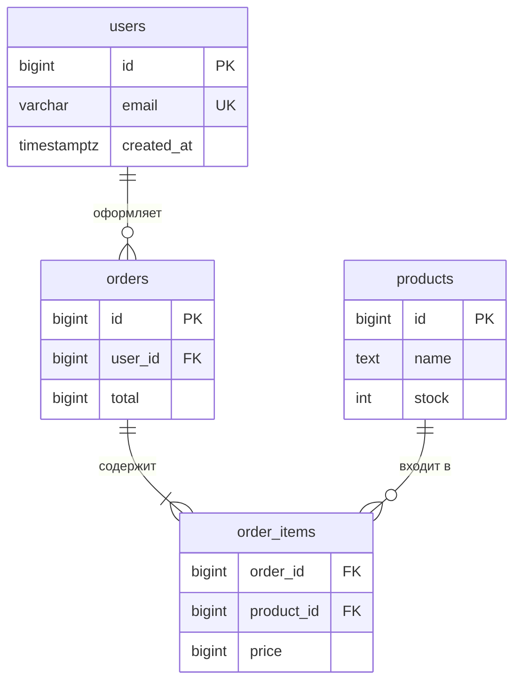
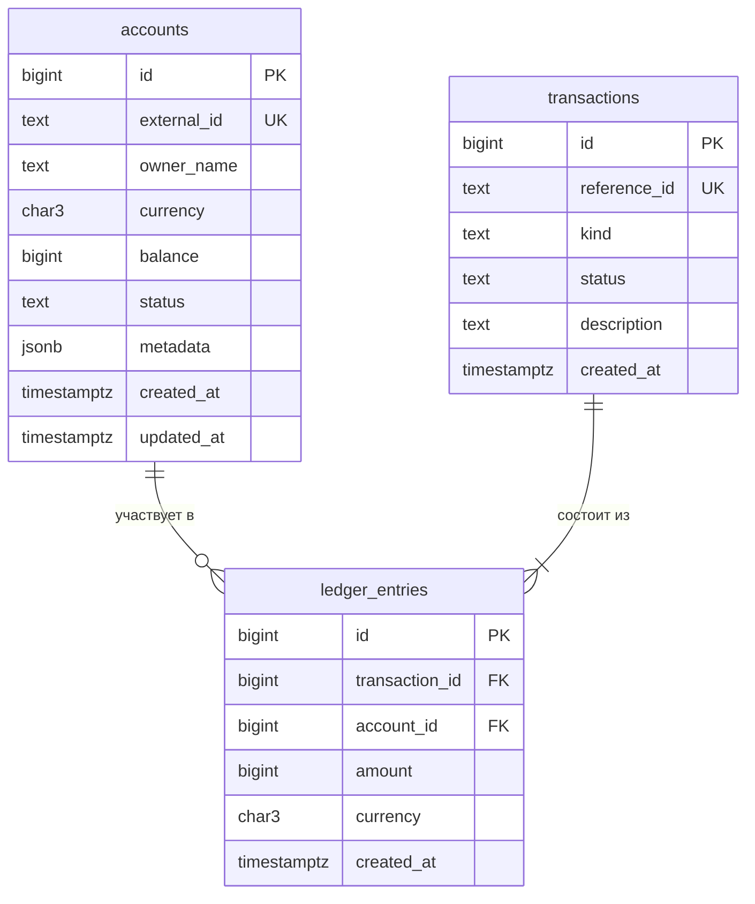

*От бизнес-требований к трём уровням моделирования, нотации Crow's Foot, подходу Database-First и разбору боевой схемы LedgerPulse в `project/step01/`.*

> «На этом неспешном подъёме на вершину знания я хотел обходиться минимумом метафор, аналогий и нелепых картинок — и вместо них пользоваться языком и обозначениями настоящих инженеров, которые проектируют и строят компьютеры.»  
> — Чарльз Петцольд, *Code: The Hidden Language of Computer Hardware and Software*

К пятнадцатому уроку у нас уже есть весь теоретический инструментарий: мы разобрали устройство страниц и ключей, ограничения целостности, трёхзначную логику `NULL`, все ступени нормализации от 1NF до BCNF и 5NF, а также прагматичную денормализацию в [[14. Денормализация — когда и как она оправдана]].

Но реальная промышленная база данных — это не три учебные таблицы. Это десятки, а то и сотни связанных сущностей с жёсткими финансовыми инвариантами. Пытаться удержать такую топологию в голове или восстанавливать её по Go-структурам — верный путь к потере целостности. Структуры Go часто смешивают транспортные DTO, параметры HTTP-запросов и агрегаты, скрывая реальную картину хранения на диске.

Чтобы превратить разрозненные требования бизнеса в надёжную схему `LedgerPulse`, инженеры опираются на **моделирование данных** и чертят **ER-диаграммы** (*Entity-Relationship Diagrams*).

---

## Три уровня моделирования данных

Проектирование схемы никогда не начинается с поспешного ввода `CREATE TABLE` в `psql`. Это последовательный перевод бизнес-логики в конкретные байты на 8-килобайтных страницах диска через три уровня абстракции.

### 1. Концептуальная модель (Conceptual Model)

Взгляд с высоты предметной области, на котором инженеры разговаривают с владельцами продукта и аналитиками. Здесь нет ни типов данных, ни первичных ключей, ни диалекта СУБД. Модель фиксирует только ключевые сущности и семантику их связей.

* *В торговом домене:* «Пользователь оформляет Заказ», «Заказ включает Товары», «Товар относится к Категории».
* *В домене `LedgerPulse`:* «У Счёта есть баланс и валюта», «Транзакция состоит из Проводок по Счетам с нулевой суммой».

### 2. Логическая модель (Logical Model)

Концептуальные идеи переводятся на язык реляционной алгебры. Сущности получают атрибуты, определяются потенциальные ключи и кардинальность связей. Именно здесь мы проводим нормализацию до [[12. Третья нормальная форма (3NF)]] и BCNF, а также расщепляем прямые связи «Многие-ко-многим» через промежуточные таблицы вроде `order_items` или `ledger_entries`.

### 3. Физическая модель (Physical Model)

Здесь абстракция встречается с конкретной СУБД (в нашем курсе — PostgreSQL 17) и аппаратной реальностью. Инженер выбирает физические типы столбцов (`BIGINT`, `CHAR(3)`, `TIMESTAMPTZ`, `JSONB`), расставляет ограничения из [[7. Ограничения целостности данных — NOT NULL, UNIQUE, CHECK]], задаёт порядок столбцов и стратегию индексирования.

> [!info] Физика модели: от математики к кремнию
> Переход от логической модели к физической — это граница между теорией множеств и устройством памяти. В логической модели написано просто: «уникальный идентификатор счёта». В физической инженер обязан решить: монотонный 8-байтный `BIGINT` или 16-байтный случайный `UUID`?
> От этого выбора зависит, сколько кортежей поместится на 8-килобайтную страницу в Buffer Pool, будет ли каждая вставка вызывать расщепление листовых страниц B-Tree (**Page Split**) и сколько байт уйдёт в журнал WAL. На этом же этапе вы упорядочиваете столбцы с учётом выравнивания памяти (**Data Alignment**), чтобы не платить лишними байтами пустого заполнения (padding), как мы разбирали в [[5. Таблицы, строки, столбцы и ключи]].

---

## Анатомия ER-диаграммы и кардинальность связей

**ER-диаграмма** — универсальный чертёж реляционной архитектуры, построенный из трёх элементов:

1. **Сущность (Entity):** объект предметной области, превращающийся в таблицу.
2. **Атрибут (Attribute):** свойство сущности, превращающееся в столбец.
3. **Связь (Relationship):** взаимодействие между сущностями через первичные и внешние ключи (`PK`/`FK`).

Ключевое свойство любой связи — **кардинальность** (*Cardinality*), задающая количественные пропорции между экземплярами сущностей:

* **Один-к-одному (`1:1`).** Например, `Пользователь` и `Паспортные данные`. На уровне DDL дочерняя таблица делает свой `PRIMARY KEY` одновременно внешним ключом на родителя.
* **Один-ко-многим (`1:N`).** Базовый строительный блок реляционных схем. Один `Пользователь` оформляет много `Заказов`, один `Счёт` участвует во множестве `Проводок`. Поддерживается внешним ключом на стороне «многих» (см. [[6. Первичные и внешние ключи]]).
* **Многие-ко-многим (`M:N`).** Один `Заказ` содержит много `Товаров`, а один `Товар` попадает во многие `Заказы`; одна `Транзакция` затрагивает несколько `Счетов`, а один `Счёт` участвует в тысячах `Транзакций`.

> [!warning] Ловушка прямых связей M:N
> На концептуальном рисунке удобно провести одну линию «Многие-ко-многим» между Заказами и Товарами. Но на логическом и физическом уровне **реляционные СУБД не поддерживают прямые связи `M:N`**. Вы обязаны ввести связующую таблицу (**Junction / Join Table**), расщепив одну `M:N` на две строгие связи `1:N`. Игнорирование этого правила немедленно нарушает [[11. Вторая нормальная форма (2NF)]] и плодит повторяющиеся группы.

Для чтения и рисования таких чертежей стандартом стала нотация «вороньих лапок» (**Crow's Foot**), где на концах линий ставят символы обязательности и множественности (`||` — ровно один, `o|` — ноль или один, `|{` — один или больше, `o{` — ноль или больше).

Посмотрим, как нотация работает в классическом примере интернет-магазина:



Связующая таблица `order_items` физически реализует отношение `M:N` между `orders` и `products` и заодно фиксирует цену `price` на момент покупки — ту самую снапшот-денормализацию из [[14. Денормализация — когда и как она оправдана]].

---

## Разбор боевой схемы LedgerPulse: от ER-модели к `project/step01/`

Теперь применим весь этот аппарат к сквозному проекту нашего тома — системе финансового учёта **LedgerPulse**.

### Концепция двойной записи в ER-диаграмме

В бухгалтерии и финтехе баланс нельзя просто «переписать» числом: каждое изменение денег обязано иметь след в виде парных проводок (дебет и кредит), сумма которых по одной транзакции строго равна нулю. Так связь `M:N` между `transactions` (финансовая операция как целое) и `accounts` (счёт) естественным образом материализуется через таблицу проводок `ledger_entries`:



### Физический DDL (`project/sql/migrations/001_init_ledger.sql`)

Откроем реальную начальную миграцию `LedgerPulse` и прочитаем каждое решение проектировщика:

```sql
CREATE TABLE IF NOT EXISTS accounts (
    id          BIGINT GENERATED ALWAYS AS IDENTITY PRIMARY KEY,
    external_id TEXT        NOT NULL UNIQUE,
    owner_name  TEXT        NOT NULL,
    currency    CHAR(3)     NOT NULL CHECK (currency ~ '^[A-Z]{3}$'),
    balance     BIGINT      NOT NULL DEFAULT 0 CHECK (balance >= 0),
    status      TEXT        NOT NULL DEFAULT 'active' CHECK (status IN ('active', 'frozen', 'closed')),
    metadata    JSONB       NOT NULL DEFAULT '{}'::jsonb,
    created_at  TIMESTAMPTZ NOT NULL DEFAULT now(),
    updated_at  TIMESTAMPTZ NOT NULL DEFAULT now()
);

CREATE TABLE IF NOT EXISTS transactions (
    id              BIGINT GENERATED ALWAYS AS IDENTITY PRIMARY KEY,
    reference_id    TEXT        NOT NULL UNIQUE,
    kind            TEXT        NOT NULL CHECK (kind IN ('transfer', 'deposit', 'withdrawal', 'fee')),
    status          TEXT        NOT NULL DEFAULT 'pending' CHECK (status IN ('pending', 'posted', 'failed', 'reversed')),
    description     TEXT        NOT NULL DEFAULT '',
    created_at      TIMESTAMPTZ NOT NULL DEFAULT now()
);

CREATE TABLE IF NOT EXISTS ledger_entries (
    id             BIGINT GENERATED ALWAYS AS IDENTITY PRIMARY KEY,
    transaction_id BIGINT      NOT NULL REFERENCES transactions(id) ON DELETE RESTRICT,
    account_id     BIGINT      NOT NULL REFERENCES accounts(id)     ON DELETE RESTRICT,
    amount         BIGINT      NOT NULL CHECK (amount <> 0),
    currency       CHAR(3)     NOT NULL CHECK (currency ~ '^[A-Z]{3}$'),
    created_at     TIMESTAMPTZ NOT NULL DEFAULT now()
);
```

Разберём шесть ключевых решений этой физической модели:

1. **Монотонные суррогатные ключи `BIGINT GENERATED ALWAYS AS IDENTITY`.** Новые строки всегда дописываются в правый край B-Tree без случайных разрывов страниц.
2. **Разделение внутреннего `id` и внешнего ключа идемпотентности.** `accounts.external_id` и `transactions.reference_id` помечены как `NOT NULL UNIQUE`. Клиенты и внешние провайдеры оперируют строковыми идентификаторами, а внутренние связи и индексы `ledger_entries` сжимаются до компактного 8-байтного `BIGINT`.
3. **Деньги только в целых минимальных единицах (`BIGINT`).** Никаких типов с плавающей точкой: 100 рублей 50 копеек хранятся как `10050`.
4. **Декларативные `CHECK`-ограничения на входе.** Код валюты валидируется регулярным выражением `^[A-Z]{3}$`, нулевые проводки отсекаются `amount <> 0`, уход баланса в минус ловится `balance >= 0`, а перечни `kind` и `status` закрыты списком допустимых значений.
5. **Защита истории через `ON DELETE RESTRICT`.** Нельзя удалить счёт или транзакцию, если по ним уже существуют проводки в `ledger_entries`.
6. **Осознанные компромиссы из главы 14.** Поле `accounts.balance` кэширует баланс для быстрой проверки достаточности средств, а `accounts.metadata JSONB` заменяет десятки необязательных колонок и таблиц расширений.

### Отражение инвариантов в Go (`project/step01/schema.go`)

Пока мы ещё не подключили реальный драйвер PostgreSQL (он появится в следующих модулях), файл `project/step01/schema.go` моделирует эти же реляционные ограничения прямо в памяти на чистом Go 1.24. Посмотрите, как ограничения БД отображаются в сентинельные ошибки и логику метода `PostEntries`:

```go
var (
	ErrNotNullViolation    = errors.New("not null violation")
	ErrUniqueViolation     = errors.New("unique constraint violation")
	ErrCheckViolation      = errors.New("check constraint violation")
	ErrForeignKeyViolation = errors.New("foreign key violation")
	ErrUnbalancedLedger    = errors.New("double-entry sum must equal zero")
)

type Money struct {
	Minor    int64
	Currency string
}
```

Перед изменением состояния `LedgerSchema.PostEntries` проверяет весь пакет проводок целиком — если хотя бы одно условие нарушено, мапа `accounts` и слайс `entries` остаются нетронутыми (атомарность):

```go
	if sum != 0 {
		return fmt.Errorf("%w: got %d", ErrUnbalancedLedger, sum)
	}

	for id, delta := range deltas {
		if s.accounts[id].Balance+delta < 0 {
			return fmt.Errorf("%w: account %d balance would become negative", ErrCheckViolation, id)
		}
	}
```

Запустим модульный тест `project/step01/schema_test.go`, проверяющий все пять классов нарушений целостности (`UNIQUE`, `NOT NULL`, `CHECK`, `FK` и баланс двойной записи):

```text
$ cd project && go test -v ./step01/...
=== RUN   TestLedgerSchemaConstraints
--- PASS: TestLedgerSchemaConstraints (0.00s)
PASS
ok  	github.com/UnrealTemplier/go-textbook-v2-vol2/project/step01	0.001s
```

Обратите внимание на деталь: в `001_init_ledger.sql` есть ограничения уровня строки (`CHECK (amount <> 0)`), ограничения уровня таблицы (`UNIQUE`, `FOREIGN KEY`), но межстрочное правило двойной записи (`SUM(amount) = 0` в рамках одной `transaction_id`) декларативный `CHECK` одной строки выразить не может — в Go за него отвечает `ErrUnbalancedLedger`, а в PostgreSQL позже мы защитим его транзакционной логикой и триггером (см. Модуль 3 и Модуль 5).

---

## Методология: Code-First против Database-First

В бэкенд-разработке существуют два подхода к эволюции схемы данных.

### 1. Code-First (от структур языка к таблицам)

Разработчик описывает структуры Go с тегами ORM (например, GORM), а библиотека сама генерирует и применяет `CREATE TABLE` и `ALTER TABLE`. Для быстрых прототипов это удобно, но под нагрузкой вскрываются проблемы: генератор нередко выбирает неоптимальные типы, создаёт избыточные индексы, игнорирует порядок столбцов, `fillfactor` и тонкости выразительных `CHECK`-ограничений PostgreSQL.

### 2. Database-First (от ER-модели и SQL DDL к коду Go)

Это **канонический идиоматичный подход в Go**. База данных проектируется как самостоятельный фундамент: сначала согласовывается ER-диаграмма, затем пишутся явные версионируемые SQL-миграции (`001_init_ledger.sql`), а структуры и типобезопасные методы доступа на Go генерируются поверх проверенных SQL-запросов статическим компилятором вроде `sqlc` (подробнее о `sqlc` и миграциях см. Модуль 10). Нет ни рантайм-рефлексии, ни расхождения между моделью в коде и реальными типами на диске.

> [!tip] Собеседование [Middle]
> **Вопрос:** Почему в микросервисной архитектуре на ER-диаграммах отдельных сервисов часто отсутствуют классические `FOREIGN KEY` на таблицы других доменов?  
> **Ответ:** В микросервисах применяют паттерн *Database per Service*: база данных жёстко инкапсулирована внутри своего сервиса. Сервис биллинга и сервис пользователей физически живут в разных базах данных, а порой и в разных СУБД. На ER-диаграмме платежей поле `user_id` — это обычный скалярный атрибут (`BIGINT` или `UUID`), а не реляционный `FOREIGN KEY`. Проверка существования сущностей и согласованность между сервисами переносятся на уровень событий, паттерна *Transactional Outbox* и распределённых процессов вроде *Saga* (подробнее см. Модуль 8 и Том 3).

---

## Упражнения

### Базовое
Изучите `project/sql/migrations/001_init_ledger.sql` и ER-диаграмму `LedgerPulse` выше.
1. Назовите кардинальность связи между `transactions` и `ledger_entries` и между `accounts` и `ledger_entries`.
2. Почему в обоих внешних ключах таблицы `ledger_entries` указано `ON DELETE RESTRICT`, а не `ON DELETE CASCADE`? Что случилось бы с финансовым аудитом при использовании `CASCADE`?

> [!solution] Показать решение
> 1. `transactions` → `ledger_entries`: **один-ко-многим (`1:N`)**, причём каждая проведённая транзакция требует минимум две проводки (`||--|{`). `accounts` → `ledger_entries`: **один-ко-многим (`1:N`)**, у нового счёта может быть ноль проводок (`||--o{`).
> 2. При `ON DELETE CASCADE` удаление счёта или транзакции безмолвно уничтожило бы связанные строки в `ledger_entries`. Для парных проводок удаления счёта разрушило бы инвариант двойной записи у всех затронутых транзакций (`SUM(amount)` перестал бы равняться нулю), а история движения денег исчезла бы без следа. В финансовых системах записи не удаляются — вместо этого счёт переводят в статус `'closed'`, а ошибочную транзакцию компенсируют обратной проводкой (`'reversed'`).

### Практическое
Бизнес запросил новую функцию для `LedgerPulse`: временное резервирование (холд) средств на счёте перед списанием (например, при оплате картой до окончательного клиринга).
Добавьте в схему новую таблицу `holds` в стиле `001_init_ledger.sql` со связью `1:N` от `accounts` (`ON DELETE RESTRICT`), уникальным внешним ключом идемпотентности `reference_id`, положительной суммой `amount` (`BIGINT`), валютой `currency` и статусом (`'active'`, `'captured'`, `'released'`). Изобразите обновлённую связь в нотации Mermaid `erDiagram`.

> [!solution] Показать решение
> ```sql
> CREATE TABLE IF NOT EXISTS holds (
>     id           BIGINT GENERATED ALWAYS AS IDENTITY PRIMARY KEY,
>     account_id   BIGINT      NOT NULL REFERENCES accounts(id) ON DELETE RESTRICT,
>     reference_id TEXT        NOT NULL UNIQUE,
>     amount       BIGINT      NOT NULL CHECK (amount > 0),
>     currency     CHAR(3)     NOT NULL CHECK (currency ~ '^[A-Z]{3}$'),
>     status       TEXT        NOT NULL DEFAULT 'active' CHECK (status IN ('active', 'captured', 'released')),
>     created_at   TIMESTAMPTZ NOT NULL DEFAULT now(),
>     updated_at   TIMESTAMPTZ NOT NULL DEFAULT now()
> );
> ```
> ```mermaid
> erDiagram
>     accounts ||--o{ ledger_entries : "имеет проводки"
>     accounts ||--o{ holds : "резервирует средства"
>     transactions ||--|{ ledger_entries : "включает"
> ```
> Обратите внимание: здесь дополнительно нужно следить, чтобы доступный остаток счёта при новом холде проверялся как `balance - SUM(active holds) >= amount`.

### Со звёздочкой (*)
В `project/step01/schema.go` у структуры `Account` есть поле `Status` (`"active"`, `"frozen"`, `"closed"`), а в `001_init_ledger.sql` на него стоит `CHECK (status IN ('active', 'frozen', 'closed'))`. Однако метод `PostEntries` в `step01/schema.go` сейчас проверяет только существование счёта, валюту, нулевой баланс двойной записи и неотрицательность `balance`.
1. Дополните проверку внутри `PostEntries` в `step01` так, чтобы попытка провести операцию по счёту со статусом `"closed"` или списанием со счёта `"frozen"` возвращала ошибку с `ErrCheckViolation`.
2. Объясните, почему простой `CHECK` в определении таблицы `ledger_entries` в PostgreSQL не сможет выполнить эту же проверку и как её реализуют на уровне БД.

> [!solution] Показать решение
> 1. В цикле проверки проводок в `PostEntries` добавляем контроль статуса счёта:
> ```go
> if acc.Status == "closed" {
> 	return fmt.Errorf("%w: account %d is closed", ErrCheckViolation, acc.ID)
> }
> if acc.Status == "frozen" && e.Amount < 0 {
> 	return fmt.Errorf("%w: account %d is frozen for debits", ErrCheckViolation, acc.ID)
> }
> ```
> (Заметьте: по банковским правилам на замороженный счёт обычно запрещают списание, но могут разрешать зачисление возвратов или штрафов; если запрещены любые движения, условие упрощается до `acc.Status != "active"`.)
> 2. В стандарте SQL и PostgreSQL ограничение `CHECK` на таблице `ledger_entries` имеет доступ **только к столбцам текущей вставляемой строки** и не может делать `SELECT` в соседнюю таблицу `accounts`. Поэтому на уровне СУБД такой межтабличный бизнес-инвариант обеспечивают либо хранимой процедурой/сервисной транзакцией (с блокировкой `SELECT status FROM accounts WHERE id = $1 FOR UPDATE`), либо `BEFORE INSERT` триггером на таблице `ledger_entries` (подробнее о триггерах см. Модуль 3).

---

## Мостик к следующему уроку

Мы соединили теорию моделирования с реальной схемой `LedgerPulse` и разобрались, как бизнес-правила превращаются в физические таблицы `accounts`, `transactions`, `ledger_entries` и Go-код в `project/step01/`.

Но знать, как строить правильные схемы, — только половина инженерного ремесла. Вторая половина — вовремя замечать привлекательные на первый взгляд «универсальные» решения, которые тихо ломают кэш, целостность и точность расчётов под нагрузкой. В финальной главе первого модуля мы препарируем самые опасные ловушки проектирования: переходим к [[16. Антипаттерны проектирования реляционных схем]].
