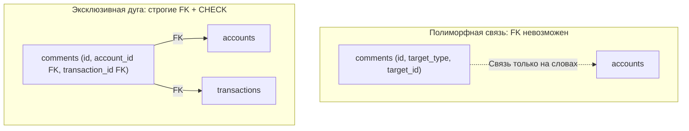

*Почему погоня за «универсальной гибкостью» без миграций оборачивается потерей денег, разрушением кэша страниц и деградацией базы под нагрузкой.*

> «Пишите ясно — не умничайте.»  
> — Брайан Керниган, *UNIX: A History and a Memoir*

Мы подходим к финалу первого модуля. Позади — устройство страниц диска и ключей, трёхзначная логика `NULL`, строгая математика нормализации до BCNF и осознанная денормализация, а в [[15. ER-диаграммы и моделирование схемы LedgerPulse]] мы собрали боевой чертёж финансового ядра `LedgerPulse`.

Но на реальных проектах между теорией и продакшеном регулярно встаёт соблазн «сделать универсальную схему на все случаи жизни». Парадокс в том, что самые разрушительные антипаттерны рождаются не от лени, а из благих намерений: избавиться от будущих миграций, сэкономить число таблиц или защититься от случайного `DELETE`. На тестовой базе из сотни строк такие трюки кажутся гениальными. Под боевой нагрузкой они взрывают задержки, забивают Buffer Pool случайным I/O и тихо портят данные.

Разберём классические антипаттерны реляционных схем, их физическую цену на уровне страниц и памяти, а также проверенные альтернативы для PostgreSQL и Go.

---

## 1. Entity-Attribute-Value (EAV): универсальная свалка

Классический тупик из систем каталогов и CMS. В магазине тысячи разнородных товаров: у ноутбука есть объём RAM и частота процессора, у футболки — размер и цвет, у масла — вязкость. Вместо явных колонок или структурных расширений разработчик заводит одну «универсальную» таблицу `(entity_id, attribute_name, attribute_value)`:

| `entity_id` | `attribute_name` | `attribute_value` |
|---:|---|---|
| 42 | `color` | `Red` |
| 42 | `size` | `XL` |
| 42 | `cpu_cores` | `8` |

### Почему это ломает базу

1. **Уничтожение доменной целостности.** Столбец `attribute_value` вынужден быть текстовым (`TEXT`). СУБД больше не проверяет, что `cpu_cores` — целое положительное число, а `expires_at` — валидная дата. Типизация вываливается в код приложения.
2. **Множественные самосоединения (Self-Joins).** Чтобы собрать один товар с десятью характеристиками в структуру Go, запросу приходится склеивать гигантскую таблицу саму с собой десять раз подряд.
3. **Разрушение локальности данных в Buffer Pool.** Характеристики одного товара физически разбросаны по десяткам несвязанных 8-килобайтных страниц. Выборка одной карточки порождает лавину случайных чтений (~100 мкс на NVMe вместо ~100 нс из горячей страницы в RAM), а планировщик ошибается в оценках кардинальности на многократных `JOIN`.

> [!tip] Собеседование [Middle]
> **Вопрос:** Если EAV так разрушителен, как в реляционной БД хранить товары или аккаунты с динамическим набором характеристик?  
> **Ответ:** Базовые инварианты сущности (`id`, артикул, базовая цена, остаток, валюта) выносятся в строго типизированные реляционные столбцы, а переменный набор дополнительных свойств укладывается в один столбец `attributes JSONB` (как `accounts.metadata` в `LedgerPulse`). PostgreSQL хранит `JSONB` в разобранном бинарном формате внутри строки и позволяет индексировать вложенные ключи через **GIN-индексы** без самосоединений и распыления кортежа по таблице.

---

## 2. Полиморфные связи (Polymorphic Associations)

Предположим, пользователи или служба безопасности оставляют комментарии и записи аудита к счетам (`accounts`), транзакциям (`transactions`) и документам (`documents`). Соблазнительно сделать одну таблицу `comments` со строковым дискриминатором `target_type` и числовым `target_id`:

| `id` | `body` | `target_type` | `target_id` |
|---:|---|---|---:|
| 1 | `Проверен комплаенсом` | `accounts` | 42 |
| 2 | `Повторная попытка` | `transactions` | 105 |

### Почему это опасно

В SQL **невозможно объявить `FOREIGN KEY`**, целевая таблица которого меняется в зависимости от значения другой колонки. Ссылочная целостность из [[6. Первичные и внешние ключи]] полностью отключается. При удалении родительской записи комментарий навсегда остаётся сиротой (*Orphaned Row*), а случайная опечатка в `target_type` превращает связь в призрак.

### Решение: эксклюзивная дуга (Exclusive Arc)

Мы создаём явные типизированные внешние ключи под каждую возможную цель и гарантируем взаимоисключение строгим ограничением из [[7. Ограничения целостности данных — NOT NULL, UNIQUE, CHECK]]:



```sql
CREATE TABLE comments (
    id             BIGINT GENERATED ALWAYS AS IDENTITY PRIMARY KEY,
    body           TEXT NOT NULL,
    account_id     BIGINT REFERENCES accounts(id) ON DELETE RESTRICT,
    transaction_id BIGINT REFERENCES transactions(id) ON DELETE RESTRICT,
    CONSTRAINT chk_exclusive_target CHECK (
        (account_id IS NOT NULL)::int +
        (transaction_id IS NOT NULL)::int = 1
    )
);
```

Теперь ровно один внешний ключ обязан быть заполнен, а остальные равны `NULL` — ядро PostgreSQL защищает каждую ссылку.

---

## 3. Единая таблица справочников (OTLT / The Blob)

Идея «зачем плодить двадцать мелких таблиц под статусы, типы операций, роли и категории — сложим всё в одну супертаблицу `dictionaries (domain, code, title)`» известна как антипаттерн **OTLT** (*One True Lookup Table*).

Последствия два:
1. **Смерть ссылочной целостности.** Внешний ключ ссылается на общую таблицу `dictionaries`, поэтому ничто не мешает ошибке в коде записать в статус платежа идентификатор категории доставки.
2. **Конкуренция за блокировки (Lock Contention).** Одна общая таблица становится горячей точкой для несвязанных подсистем. Мелкие сервисные обновления начинают конфликтовать с чтением и изменением справочников по всему проекту.

Идиоматичный путь прост: отдельные таблицы справочников или строгие `CHECK (status IN (...))` стоят копейки. Маленькие справочники целиком оседают в Buffer Pool с почти стопроцентным попаданием в кэш.

---

## 4. Сплошной Soft Delete (`is_deleted = true`)

Требование «никогда ничего не удаляйте физически, добавьте везде флаг `is_deleted BOOLEAN`» кажется безобидным, пока база не вырастет.

> [!warning] Ловушка MVCC, уникальности и B-Tree
> В PostgreSQL обновление строки (`UPDATE ... SET is_deleted = true`) под капотом механизма многоверсионности (MVCC) физически работает как пометка старой версии кортежа мёртвой и запись **новой версии** на свободное место страницы. Повсеместное мягкое удаление бьёт сразу по двум местам:
> 1. **Ломаются `UNIQUE`-ограничения.** Если клиент удалил счёт с `external_id = 'ext-42'`, создать новый с тем же ключом не получится — `UNIQUE` видит старую строку. Приходится выкручиваться частичными индексами вроде `CREATE UNIQUE INDEX ... ON accounts (external_id) WHERE NOT is_deleted`.
> 2. **Раздуваются таблицы и B-Tree индексы.** Когда 80–90% строк «удалены», каждый поиск живых записей гоняет по памяти страницы с мусором, снижая полезную плотность кэша.

**Надёжная альтернатива.** Для горячих оперативных таблиц используют **архивные таблицы** (*Archive Tables*, например `accounts_archive`) либо явные статусы жизненного цикла (как `'closed'` в `LedgerPulse`). При удалении строка переносится в архив и физически удаляется из боевой таблицы в одной транзакции: основная таблица остаётся компактной, а исторические данные доступны аналитикам.

---

## 5. Случайные UUIDv4 в роли Primary Key

Выбор случайного `UUID v4` в качестве `PRIMARY KEY` — прямой удар по физике B-Tree индекса. Дерево поиска оптимизировано под монотонно возрастающие вставки в правый край.

Когда первичный ключ случаен, каждый `INSERT` целится в произвольный листовой узел в середине дерева. СУБД поднимает с диска случайные 8-килобайтные страницы, переполняет их и вынужденно делит пополам (**Page Split**). Итог — внутренняя фрагментация страниц на 30–50%, раздувание WAL (**Write Amplification**) и вымывание горячего кэша.

**Решение.** Используйте монотонный `BIGINT GENERATED ALWAYS AS IDENTITY` или время-упорядоченный **UUID v7** (первые 48 бит которого хранят временную метку). Если наружу во внешний API нельзя отдавать последовательные ID, держите внутренний `id BIGINT PRIMARY KEY` для связей и джойнов, а клиентам отдавайте отдельный `external_id` или `public_id UUID`, как это сделано в `001_init_ledger.sql`.

---

## 6. Финансовые и структурные ловушки: `FLOAT`, списки через запятую и `God Table`

Есть ещё три антипаттерна, которые особенно болезненно бьют по финансовым и высоконагруженным системам вроде `LedgerPulse`.

### `FLOAT` / `DOUBLE PRECISION` для денег

Типы с плавающей точкой стандарта IEEE 754 представляют числа в двоичной системе приближённо: точная десятичная дробь вроде `0.1` или `0.01` становится бесконечной двоичной дробью. Посмотрите на классический сбой в Go при использовании `float64` вместо целых копеек (`int64`), принятых в `step01.Money`:

```go
package main

import "fmt"

func main() {
	var balanceFloat float64 = 0.1 + 0.2
	fmt.Printf("float64: 0.1 + 0.2 = %.17f (== 0.3? %v)\n", balanceFloat, balanceFloat == 0.3)

	// В LedgerPulse деньги хранятся в целых неделимых единицах (копейках/центах):
	const minorA, minorB int64 = 10, 20
	fmt.Printf("int64:   10 + 20   = %d копеек (== 30? %v)\n", minorA+minorB, minorA+minorB == 30)
}
```

Вывод программы наглядно объясняет, почему в `001_init_ledger.sql` стоит `BIGINT`, а не `DOUBLE PRECISION`:

```text
float64: 0.1 + 0.2 = 0.30000000000000004 (== 0.3? false)
int64:   10 + 20   = 30 копеек (== 30? true)
```

После тысяч начислений комиссий и округлений во `FLOAT` баланс перестаёт сходиться до копейки. Храните суммы в целых минимальных единицах (`BIGINT`), а для произвольной десятичной точности (курсов валют, процентных ставок) используйте тип фиксированной точности `NUMERIC(19, 6)`.

### Массивы ID через запятую (Jaywalking)

Хранение списка идентификаторов в одной строковой ячейке — например, `allowed_account_ids = '12,45,98'` — напрямую нарушает [[10. Первая нормальная форма (1NF)]]. Вы теряете возможность повесить `FOREIGN KEY`, не можете нормально индексировать принадлежность элемента через B-Tree, упираетесь в лимит длины строки и пишете хрупкие регулярные выражения вместо `JOIN`. Всегда выносите связь `M:N` в отдельную связующую таблицу с внешними ключами.

### `God Table` (таблица-монстр)

Когда в одну таблицу `accounts` сваливают 80 столбцов — от горячего `balance` и `status` до тяжёлых текстов договора, истории KYC-проверок и редко читаемых настроек отчётности, — ширина каждой строки раздувается с сотен байт до килобайт. На 8-килобайтную страницу в Buffer Pool вместо 60–80 компактных записей помещается всего 4–5 строк. Каждый запрос баланса вынужден тащить с диска и прогонять через кэш CPU балласт, который ему не нужен. Разделяйте «горячее» ядро и «холодные» тяжёлые реквизиты вертикальной декомпозицией `1:1`.

---

## Чек-лист архитектора перед запуском миграции

Перед тем как утвердить DDL новой таблицы в проекте на Go:

1. Нет ли в схеме универсальной таблицы-свалки (`EAV`)? Переменный набор атрибутов выносите в `JSONB` с GIN-индексом.
2. Защищена ли каждая связь реальным `FOREIGN KEY`? Полиморфные `target_type/target_id` заменяйте эксклюзивной дугой с `CHECK` или отдельными таблицами.
3. Разнесены ли независимые справочники? Никаких общих `dictionaries` (OTLT).
4. Не перегружены ли горячие таблицы мёртвыми строками `is_deleted` и тяжёлыми колонками (`God Table`)? Используйте архивные таблицы и вертикальное разделение `1:1`.
5. Растёт ли первичный ключ монотонно (`BIGINT` или `UUIDv7`), хранятся ли деньги в `BIGINT` / `NUMERIC`, а списки связей — в нормальных таблицах вместо строк через запятую?

---

## Упражнения

### Базовое
Проведите ревью следующей DDL-схемы платёжного модуля и найдите в ней **четыре** антипаттерна, разобранных в этом уроке. Кратко опишите последствия каждого и предложите исправленный вариант.

```sql
CREATE TABLE payment_orders (
    id          UUID PRIMARY KEY DEFAULT gen_random_uuid(),
    amount      DOUBLE PRECISION NOT NULL,
    tag_ids     TEXT NOT NULL, -- хранит '1,4,19'
    is_deleted  BOOLEAN NOT NULL DEFAULT false
);
```

> [!solution] Показать решение
> 1. **`UUID PRIMARY KEY DEFAULT gen_random_uuid()` (случайный UUIDv4):** случайные вставки дробят листья B-Tree (Page Split) и усиливают запись. Заменить на `BIGINT GENERATED ALWAYS AS IDENTITY` (или `UUIDv7`), при необходимости добавив отдельный `public_id UUID UNIQUE`.
> 2. **`DOUBLE PRECISION` для `amount`:** ошибка двоичного представления дробей IEEE 754 искажает копейки. Заменить на `BIGINT` в минимальных единицах (плюс `currency CHAR(3)`).
> 3. **`tag_ids TEXT` со списком через запятую (Jaywalking):** нарушение 1NF, нет `FOREIGN KEY`, невозможен быстрый B-Tree поиск. Вынести в связующую таблицу `payment_order_tags (order_id, tag_id)`.
> 4. **`is_deleted BOOLEAN` по умолчанию:** со временем раздувает таблицу и индексы мёртвыми кортежами MVCC и усложняет `UNIQUE`. Заменить на явный жизненный цикл статуса платежа или перенос закрытых записей в `payment_orders_archive`.

### Практическое
В проекте `LedgerPulse` потребовалось прикреплять внутренние заметки комплаенс-офицеров либо к конкретному счёту (`accounts`), либо к конкретной транзакции (`transactions`), но не к обоим сразу.
Спроектируйте таблицу `compliance_notes` с паттерном **Exclusive Arc** (эксклюзивная дуга) так, чтобы PostgreSQL гарантировал существование родителя через `FOREIGN KEY` и запрещал пустую или двойную привязку.

> [!solution] Показать решение
> ```sql
> CREATE TABLE compliance_notes (
>     id             BIGINT GENERATED ALWAYS AS IDENTITY PRIMARY KEY,
>     author         TEXT        NOT NULL CHECK (author <> ''),
>     note           TEXT        NOT NULL CHECK (note <> ''),
>     account_id     BIGINT      REFERENCES accounts(id)     ON DELETE RESTRICT,
>     transaction_id BIGINT      REFERENCES transactions(id) ON DELETE RESTRICT,
>     created_at     TIMESTAMPTZ NOT NULL DEFAULT now(),
>     CONSTRAINT chk_compliance_notes_exclusive_target CHECK (
>         (account_id IS NOT NULL)::int +
>         (transaction_id IS NOT NULL)::int = 1
>     )
> );
> ```
> При попытке вставить заметку с обоими `NULL` или обоими заполненными ID сработает ограничение `chk_compliance_notes_exclusive_target`, а при несуществующем ID счёта или транзакции вставку остановит `FOREIGN KEY`.

### Со звёздочкой (*)
Предположим, унаследованная таблица `merchants` использует мягкое удаление `is_deleted BOOLEAN` и хранит десятки тысяч неактивных строк, мешающих `UNIQUE (external_id)` и раздувающих индексы.
Напишите единый атомарный SQL-запрос PostgreSQL (через модифицирующий CTE `WITH moved AS (DELETE ... RETURNING *)`), который безопасно переносит запись мерчанта с `id = 42` в архивную таблицу `merchants_archive` с тем же набором колонок и датой архивации `archived_at`. Объясните, что произойдёт, если на этого мерчанта всё ещё ссылается `FOREIGN KEY` с `ON DELETE RESTRICT` из активных счетов.

> [!solution] Показать решение
> ```sql
> WITH moved AS (
>     DELETE FROM merchants
>     WHERE id = 42
>     RETURNING id, external_id, owner_name, created_at
> )
> INSERT INTO merchants_archive (id, external_id, owner_name, created_at, archived_at)
> SELECT id, external_id, owner_name, created_at, now()
> FROM moved;
> ```
> Запрос выполняется атомарно как единый оператор: `DELETE ... RETURNING` удаляет строку из оперативной таблицы и передаёт её кортеж в `INSERT INTO merchants_archive`. Если на строку `id = 42` всё ещё ссылается дочерняя запись через `FOREIGN KEY ... ON DELETE RESTRICT`, PostgreSQL прервёт весь оператор ошибкой `foreign key violation`, и строка не окажется ни удалённой, ни задублированной в архиве.

---

## Мостик к следующему модулю

Мы завершили первый модуль Тома 2 — фундамент реляционных баз данных и моделирования схем. Вы прошли путь от физики 8-килобайтных страниц и сдвига мышления к множествам до нормализации, осознанной денормализации, ER-чертежей `LedgerPulse` и диагностики антипаттернов.

Надёжная схема и таблица ограничений уже лежат в `project/sql/migrations/001_init_ledger.sql`. Теперь пора научиться свободно разговаривать с базой данных на её родном декларативном языке — писать точные выборки, фильтрацию, соединения и агрегации без потери производительности. Впереди Модуль 2: «Базовый SQL с нуля», начиная с введения в SQL, DDL и DML.
