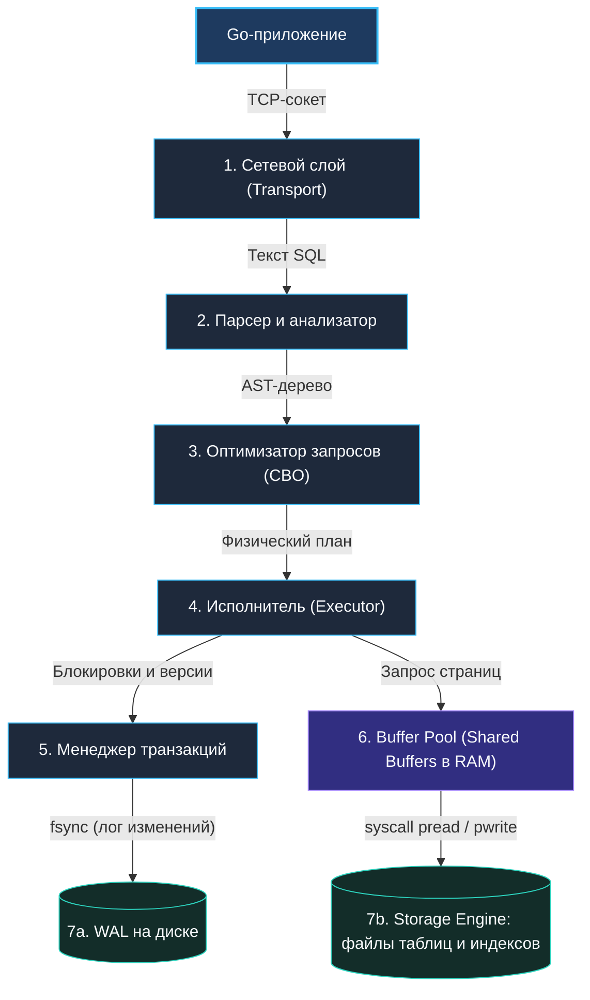
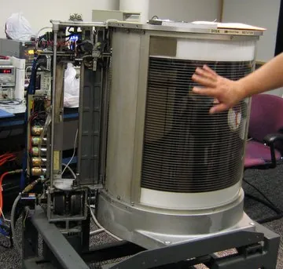

*Граница между файлами на диске и программным ядром управления: почему Go-сервис не может просто писать в CSV или JSON и из каких слоёв состоит СУБД.*

> «Файл в Unix — это просто последовательность байтов. Любую структуру и организацию его содержимого определяют лишь программы, которые с ним работают; самой файловой системе безразлично, что лежит внутри.»  
> — Брайан Керниган, *UNIX: A History and a Memoir*

## База данных против СУБД: зачем разделять понятия

В рабочих чатах постоянно звучат фразы вроде «мы храним счета в базе PostgreSQL» или «база упала по таймауту». В быстром разговоре такой сленг никому не мешает. Но при проектировании отказоустойчивого бэкенда смешение терминов скрывает важнейшую границу: где заканчиваются пассивные данные на накопителе и где начинается активная программа, которая этими данными управляет.

Инженерная терминология разводит эти понятия строго:

- **База данных (БД, Database)** — организованная совокупность структурированных данных. На физическом уровне это набор файлов на диске (под управлением файловой системы `ext4`, `XFS` или `ZFS`): последовательности байтов, упакованные в блоки заданного формата.
- **СУБД (Система Управления Базами Данных, DBMS)** — полномасштабный программный комплекс, работающий поверх этих файлов. Именно СУБД принимает сетевые соединения, разбирает SQL, изолирует параллельные транзакции, кэширует страницы в ОЗУ и гарантирует сохранность записей при аппаратных сбоях.

PostgreSQL, MySQL, SQLite, Redis и ClickHouse — это **СУБД**, а не базы данных. Ваше Go-приложение устанавливает TCP-сокет (или открывает файл в случае встраиваемой SQLite) именно к движку СУБД. Тот переводит декларативные SQL-инструкции в физические операции чтения и записи страниц, не позволяя десяткам клиентов превратить файлы на диске в кашу из байтов.

## Почему бы просто не писать в файлы на Go

В начале проекта возникает соблазнительный вопрос: зачем поднимать отдельный сервер PostgreSQL, писать миграции и настраивать драйвер, если стандартная библиотека Go умеет открывать файлы за пять строк кода? Кажется, что достаточно сериализовать проводку в строку CSV или JSONL и дописать её в конец файла.

Взглянем на прямолинейную реализацию такой записи для нашего биллинга `LedgerPulse`:

```go
package main

import (
	"fmt"
	"os"
)

type LedgerLine struct {
	AccountID int64
	Amount    int64
	Currency  string
}

func appendEntry(path string, e LedgerLine) error {
	f, err := os.OpenFile(path, os.O_APPEND|os.O_CREATE|os.O_WRONLY, 0o644)
	if err != nil {
		return err
	}
	defer f.Close()

	line := fmt.Sprintf("%d,%d,%s\n", e.AccountID, e.Amount, e.Currency)
	_, err = f.WriteString(line) // системный вызов write
	return err
}
```

В однопоточной утилите командной строки этот код отработает чисто. Под реальной нагрузкой веб-сервиса он приведёт к повреждению финансовых данных по трём причинам:

1. **Конкурентность и гонки данных между процессами.** Если 1 000 горутин одновременно вызовут `appendEntry`, системные вызовы `write` при определённом размере буфера и настройках ОС могут перемешать фрагменты строк (interleaved writes), и в файле появится обломок вроде `104,-500,R105,250,USD\nUB\n`. Даже если вы защитите функцию через `sync.Mutex`, все горутины выстроятся в однопоточную очередь внутри одного процесса. А как только сервис масштабируют хотя бы на два пода Kubernetes поверх общего сетевого диска (NFS или общего тома), мьютекс в памяти одного процесса Go окажется бессилен против параллельной записи из соседнего контейнера.
2. **Частичная запись и расщепление страниц (Partial / Torn Writes).** Файловые системы и контроллеры дисков оперируют секторами (обычно 512 байт или 4 КБ). Если во время `write` оборвётся питание или произойдёт сбой ядра ОС (Kernel Panic), на диск попадёт лишь часть буфера — например, `104,-5`. При следующем запуске парсер споткнётся о неполную строку, а понять, была ли операция подтверждена клиенту, не получится.
3. **Линейная сложность поиска $O(N)$.** Допустим, файл проводок вырос до 50 ГБ. Чтобы найти все операции одного счёта `account_id = 42`, Go-программа вынуждена прочитать с накопителя все 50 ГБ байт за байтом от начала до конца (Full Scan), разобрать миллионы строк и отфильтровать нужные в памяти. На SSD со скоростью чтения 1 ГБ/с такой запрос займёт десятки секунд, забьёт дисковую шину и вымоет страничный кэш ОС. Индексы СУБД решают эту задачу за логарифмическое время $O(\log N)$ или $O(1)$, читая считаные килобайты.

> [!tip] Собеседование [Junior]
> **Вопрос:** Зачем нужна СУБД, если современные файловые системы (`ext4`, `XFS`, `ZFS`) и так обеспечивают кэширование, права доступа и быстрое чтение файлов?  
> **Ответ:** Файловая система предоставляет низкоуровневую абстракцию «файл как неструктурированный поток байтов» и отвечает за размещение блоков на секторах накопителя, но ничего не знает о смысле записей внутри файла. СУБД решает задачи прикладного уровня: гарантирует свойства транзакций ACID (атомарность, согласованность, изоляцию, долговечность), безопасно разделяет конкурентный доступ без блокировки всей системы в один поток, защищает данные от частичных записей через журнал упреждающей записи (WAL) и поддерживает индексы (B-Tree, Hash) для поиска за $O(\log N)$ вместо полного сканирования $O(N)$.

## Внутренняя архитектура СУБД: микро-ОС внутри ОС

Чтобы одновременно выдерживать тысячи соединений, не терять байты при сбоях и выбирать быстрые планы выполнения, реляционная СУБД строится как специализированная операционная система внутри основной ОС.

Проследим путь запроса на чтение баланса счёта, который отправляет приложение `LedgerPulse`:

```sql
SELECT id, balance, currency
FROM accounts
WHERE id = 42;
```

Между отправкой этой строки из Go и возвратом кортежа по сети работают семь взаимосвязанных слоёв:



Разберём ответственность каждого узла:

1. **Сетевой уровень (Transport).** Принимает входящий TCP-поток, разбирает бинарный протокол конкретной СУБД (например, PostgreSQL Wire Protocol), проверяет аутентификацию и привязывает соединение к рабочему процессу (как в PostgreSQL) или потоку ОС (как в MySQL).
2. **Парсер и анализатор (Parser & Analyzer).** Превращает сырую строку SQL в абстрактное синтаксическое дерево (AST), проверяет существование таблицы `accounts`, типы столбцов и права пользователя по системному каталогу.
3. **Оптимизатор запросов (Query Optimizer / Cost-Based Optimizer).** Мозг СУБД. Опираясь на статистику распределения значений, он перебирает возможные способы выполнить запрос (идти по индексу, читать таблицу целиком, какой алгоритм соединения выбрать) и оценивает суммарную стоимость в единицах CPU и дискового I/O.
4. **Исполнитель (Executor).** Получает выбранное дерево физического плана (узлы вроде `Index Scan`, `Filter`, `Hash Join`, `Aggregate`) и шаг за шагом запрашивает кортежи у нижележащего движка.
5. **Менеджер транзакций (Transaction Manager).** Отслеживает активные транзакции, управляет блокировками и версиями строк (многоверсионностью MVCC), чтобы параллельное чтение и запись не видели полуфабрикатов чужих изменений (детально в Модуле 5).
6. **Buffer Pool (`Shared Buffers`).** Крупный участок оперативной памяти, выделенный под кэш дисковых страниц. В промышленных серверах БД под Buffer Pool обычно отдают от 25% до 75% всей RAM. Если нужные страницы уже лежат здесь, исполнителю не приходится ждать диск.
7. **Движок хранения (Storage Engine) и журнал WAL.** Движок управляет физическим форматом файлов на диске (кучами страниц, B-Tree индексами) и читает/сбрасывает блоки через `pread` и `pwrite` (или `mmap`). Рядом работает **журнал упреждающей записи (Write-Ahead Log, WAL)**. Прежде чем модифицировать страницу с данными в памяти при изменении баланса, СУБД сначала дописывает компактную запись о факте изменения в последовательный файл WAL и принудительно сбрасывает его на энергонезависимый накопитель системным вызовом `fsync`.

Именно связка Buffer Pool + WAL решает противоречие между скоростью и надёжностью. Менять разрозненные 8-килобайтные страницы по всему диску при каждом платеже слишком медленно, поэтому СУБД меняет страницу в быстрой RAM (помечая её как «грязную», dirty page), а на диск при фиксации транзакции сбрасывает только быструю последовательную запись в WAL. Если питание пропадёт до того, как грязные страницы таблиц уйдут на диск, после перезапуска СУБД проиграет журнал WAL и восстановит данные без потерь.

## Страничная организация данных и цена локальности



На физическом уровне реляционная СУБД почти никогда не читает и не пишет с накопителя одиночные строки длиной 50–120 байт. Постоянные мелкие запросы к контроллеру SSD/NVMe превратили бы пропускную способность шины в миллионы микроскопических команд.

Вместо этого файлы таблиц и индексов разрезаны на однородные блоки фиксированного размера — **страницы (Pages)** (8 КБ в PostgreSQL, 16 КБ в InnoDB). Заглянем внутрь операции чтения одной записи `id = 42` размером около 100 байт:

> [!info] Под капотом: анатомия чтения одной строки
> 1. По индексу (или карте расположения) СУБД вычисляет номер файла и индекс конкретной 8-килобайтной страницы, где хранится кортеж `id = 42`.
> 2. Она ищет дескриптор этой страницы в внутренней хеш-таблице **Buffer Pool**.
> 3. При промахе (**Cache Miss**) движок делает системный вызов `pread` и поднимает с диска **весь блок 8 КБ целиком** (или 16 КБ в MySQL InnoDB), даже если запрошено одно 8-байтовое поле `balance`.
> 4. Страница размещается в свободном слоте Buffer Pool, из неё извлекаются нужные поля кортежа `id = 42`, и они отправляются по TCP обратно в Go-приложение.

Такая физика напрямую диктует правила проектирования схем и запросов:

- **Локальность данных (Data Locality).** Если строки, которые сервис читает вместе (например, 20 последних проводок одного счёта), физически лежат на одной или соседних страницах, один системный вызов `pread` сразу прогревает кэш для всей пачки данных.
- **Фрагментация и Random I/O.** Когда связанные записи разбросаны по разным концам стогигабайтного файла таблицы, каждое обращение к очередному кортежу рискует вызвать отдельный Cache Miss и чтение целых 8 КБ ради сотни полезных байт.

> [!warning] Ловушка: эффект Cache Thrashing (вымывания кэша)
> Распространённый миф эксплуатации: «база тормозит — докинем RAM, и всё поместится в Buffer Pool». Но оперативная память не спасёт, если в системе регулярно крутится тяжёлый запрос со сплошным сканированием гигантской таблицы (Full Table Scan). Проходя миллионы страниц подряд, такой запрос быстро вытеснит из Buffer Pool «горячие» страницы активных счетов и справочников. Как только горячий кэш вымыт, все быстрые клиентские операции с задержкой 1 мс резко замедляются в десятки раз, проваливаясь в дисковое чтение.

## Упражнения

### Упражнение 1 (Базовое). Разделение БД и СУБД в инциденте
Во время разбора сбоя в сервисе `LedgerPulse` дежурный инженер написал в отчёт две фразы:
- *А:* «Файловая система XFS вернула ошибку `ENOSPC` (нет места на диске) при попытке расширить файл `base/16384/24576`.»
- *Б:* «Сервер остановился, потому что оптимизатор выбрал `Seq Scan` вместо `Index Scan` и вымыл Buffer Pool на 64 ГБ.»

Определите для каждого пункта, относится ли проблема к уровню **файлов базы данных и ОС** или к уровню **программного ядра СУБД**, и кратко объясните почему.

> [!solution] Показать решение
> - **Ситуация А** затрагивает физический уровень **базы данных (файлов на диске) и файловой системы ОС**: закончилось свободное место на блочном томе, куда движок хранения пытается записать новые 8-килобайтные страницы.
> - **Ситуация Б** целиком относится к уровню **СУБД**: планировщик запросов (CBO) выбрал неудачный план выполнения, а исполнитель прогнал миллионы страниц через оперативную память, вызвав вымывание кэша (Cache Thrashing) в `Buffer Pool`.

### Упражнение 2 (Практическое). Поиск и устранение гонки и partial write в файловом хранилище
Вспомните функцию `appendEntry` из этой главы. Допустим, нужно оставить простой локальный журнал аудита на одном сервере, но защититься хотя бы от перемешивания строк между горутинами и от чтения неполной строки при обрыве записи.
1. Почему одного `sync.Mutex` вокруг `f.WriteString` недостаточно, если питание сервера пропадёт посередине системного вызова `write`, и почему `sync.Mutex` вообще не спасёт при запуске двух инстансов Go-приложения?
2. Какой системный вызов ядра ОС (аналогичный тому, что использует WAL в СУБД) нужно вызвать после записи в файл (`*os.File` в Go), чтобы убедиться, что данные реально дошли до энергонезависимого накопителя, а не остались в страничном кэше (Page Cache) ядра?

> [!solution] Показать решение
> 1. `sync.Mutex` синхронизирует только горутины внутри **одного процесса** Go. Внутри процесса он исключит наложение строк из двух горутин, но:
>    - Два отдельных процесса (или два пода в кластере) имеют разные адресные пространства и разные мьютексы — их записи всё равно пересекутся на общем диске.
>    - При внезапном отключении питания в момент записи буфера в сектор на диске может оказаться оборванная строка (Partial Write), а на момент возврата из `WriteString` байты вообще могут лежать только в кэше ядра ОС (Page Cache) и потеряться полностью. Для защиты от обрывов записи снабжают контрольной суммой (например, CRC32) и длиной записи, чтобы при восстановлении отбросить битый хвост.
> 2. В Go для принудительного сброса буферов на диск используется метод `f.Sync()`, который под Linux вызывает системный вызов `fsync` (или `fdatasync`). Именно на `fsync` опирается WAL в СУБД, а также именно из-за цены `fsync` единичная запись на диск не может делаться со скоростью операций в памяти.

### Упражнение 3 (\*). Трассировка пути запроса по слоям СУБД
Представьте, что Go-сервис отправляет два разных запроса в PostgreSQL:
1. `SELECT balance FROM accounts WHERE id = 10;` (страница со счётом уже в Buffer Pool).
2. `UPDATE accounts SET balance = balance - 500 WHERE id = 10;` (страница со счётом в Buffer Pool, транзакция коммитится).

Проследите для обоих запросов, какие из семи слоёв архитектуры СУБД будут задействованы, понадобится ли обращение к диску (и к каким файлам — таблиц или WAL) и изменится ли состояние страниц в Buffer Pool.

> [!solution] Показать решение
> 1. **Для `SELECT` (Cache Hit):** задействуются Сетевой слой → Парсер и анализатор → Оптимизатор → Исполнитель → Менеджер транзакций (проверка видимости версии строки по правилам MVCC) → Buffer Pool (находит страницу по хеш-таблице в RAM). Обращений к файлам Storage Engine на диске и к WAL не происходит. Страница в памяти не модифицируется.
> 2. **Для `UPDATE` с коммитом:** задействуются те же слои до Buffer Pool, но дальше путь принципиально другой:
>    - Менеджер транзакций накладывает блокировку на обновляемый кортеж `id = 10` и создаёт новую версию строки (или помечает старую).
>    - Изменение сначала записывается в буфер **WAL**, а при `COMMIT` принудительно сбрасывается на диск в файлы WAL через `fsync` (обращение к диску происходит, но это быстрая последовательная запись в конец журнала).
>    - Страница таблицы в **Buffer Pool** обновляется в RAM и помечается как «грязная» (**dirty page**). Сами файлы данных таблицы (Heap) на диске при этом могут быть сброшены фоновым процессом позже (во время контрольной точки, Checkpointing).

---

Мы разделили файлы базы данных и программное ядро СУБД, заглянули в Buffer Pool и увидели роль WAL. Но почему одной универсальной СУБД недостаточно и для мгновенных денежных переводов, и для отчётов за три года? В следующей главе разберём великий архитектурный раскол между транзакционными и аналитическими системами: [[3. Типы баз данных — OLTP против OLAP]].
