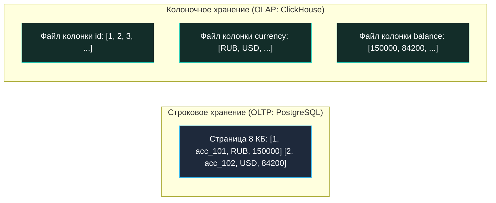

*Великий архитектурный раскол баз данных: почему строковое хранение создано для платежей в LedgerPulse, а колоночное — для многомиллиардной аналитики, кэш-линий CPU и SIMD.*

> «Можно уверенно сказать, что единого языка не будет никогда: в разработке слишком много компромиссов, чтобы один-единственный язык одинаково хорошо подходил для всех задач.»  
> — Брайан Керниган, *UNIX: A History and a Memoir*

## Почему один движок не справляется со всеми нагрузками

Фредерик Брукс ещё в 1986 году сформулировал принцип, справедливый и для подсистем хранения: *серебряной пули не существует*. Физика памяти и накопителей накладывает жёсткий компромисс: **невозможно спроектировать такую организацию байтов на диске, которая одинаково быстро обслуживает точечные транзакции и масштабные аналитические отчёты**.

В жизни растущего Go-бэкенда рано или поздно случается один и тот же инцидент. Пока база `LedgerPulse` невелика, бухгалтерские отчёты строятся прямо поверх рабочей PostgreSQL. В один прекрасный день аналитик запускает тяжёлую сводку оборотов за три года. Дисковая очередь взлетает, Buffer Pool мгновенно вымывается миллионом чужих страниц, а время ответа платёжного API подскакивает с 5 миллисекунд до десятков секунд. Пользователи не могут оплатить заказ, потому что отчёт для дашборда заблокировал ресурсы ввода-вывода.

Чтобы не допускать таких аварий, нужно понимать природу полярных классов нагрузок — **OLTP** (Online Transaction Processing) и **OLAP** (Online Analytical Processing).

## OLTP: оперативная транзакционная обработка

**OLTP** — это транзакционная обработка в реальном времени, кровеносная система платежных шлюзов, маркетплейсов, банковских счетов и систем бронирования. Когда микросервис на Go открывает счёт клиента или списывает деньги за покупку, он почти всегда работает по профилю OLTP.

Характерные черты OLTP-нагрузки:

- **Форма операций.** Короткие, атомарные точечные запросы (CRUD): создать запись, прочитать профиль по ключу, обновить баланс счёта, вставить пару проводок. Один запрос затрагивает одну строку или несколько связанных кортежей.
- **Конкурентность (Concurrency).** Очень высокая: тысячи и десятки тысяч запросов в секунду (RPS / TPS) от множества независимых пользователей одновременно.
- **Требования к надёжности.** Бескомпромиссная согласованность (гарантии ACID, которые мы детально изучим в Модуле 5). Потерять или задвоить перевод в `LedgerPulse` недопустимо.
- **Объём возвращаемых данных.** Небольшой: от сотни байт до нескольких килобайт (например, конкретный счёт или последние 20 проводок по нему).

### Строковое хранение (Row-Oriented Storage)

Чтобы атомарно обновить запись счёта, все её поля должны лежать на диске рядом. Поэтому классические OLTP-системы (PostgreSQL, MySQL InnoDB, Oracle) используют **строковое хранение (Row-Oriented Storage)**: файл разбит на страницы по 8 КБ (PostgreSQL) или 16 КБ (InnoDB), а внутри страницы кортежи строк лежат целиком подряд:

`[1, acc_101, Иванов, RUB, 150000] [2, acc_102, Петрова, USD, 84200] ...`

Когда `LedgerPulse` меняет баланс `id = 1`, исполнитель находит страницу в Buffer Pool, берёт блокировку на кортеж, обновляет байты баланса (или пишет новую версию строки рядом) и помечает страницу как «грязную» (`dirty page`). Локальность полей в одном месте даёт минимум случайного I/O на транзакцию.

## OLAP: оперативная аналитическая обработка

**OLAP** — это мир бизнес-аналитики (BI), хранилищ данных (Data Warehousing) и подготовки данных для моделей машинного обучения. Сюда стекаются миллиарды исторических событий и проводок, чтобы ответить на стратегические вопросы: «Каков суммарный оборот по регионам и валютам за последние три года?» или «Как менялась средняя комиссия в часы пиковой нагрузки?».

Характерные черты OLAP-нагрузки диаметрально противоположны OLTP:

- **Форма операций.** Тяжёлые агрегации (`SUM`, `AVG`, `COUNT`, `GROUP BY`, фильтрация по временным окнам), проходящие через миллионы и миллиарды записей.
- **Конкурентность.** Относительно низкая: десятки аналитиков или фоновых заданий, но каждый запрос стремится занять все доступные ядра процессора и всю пропускную способность дискового массива.
- **Характер записи.** Точечных обновлений с блокировками почти нет. Новые факты добавляются крупными пакетами в конец (**Append-Only**).
- **Объём обрабатываемых данных.** От сотен гигабайт до десятков терабайт на один аналитический проход.

### Колоночное хранение (Column-Oriented Storage)

Представьте, что аналитик запускает простой на вид отчёт по таблице из 100 миллионов счетов:

```sql
SELECT SUM(balance) FROM accounts;
```

В строковой OLTP-базе процессор вынужден поднять с диска в Buffer Pool **все страницы таблицы целиком**. Вместе с нужным 8-байтовым полем `balance` движок прочитает `external_id`, `owner_name`, `metadata` в `JSONB`, временные метки и заголовки кортежей. Чтобы сложить ~800 МБ чисел `balance`, СУБД перекачает с накопителя 50–100 ГБ лишних для этого отчёта байтов.

Специализированные OLAP-движки (ClickHouse, Greenplum, Apache Doris, Amazon Redshift, Snowflake) устроены иначе — они применяют **колоночное хранение (Column-Oriented Storage)**. Значения каждого столбца сохраняются в собственных физических файлах и блоках, отдельно от остальных колонок.



> [!info] Под капотом: кэш-линии CPU, сжатие и SIMD-векторизация
> Колоночная раскладка байтов даёт тройной выигрыш на уровне физического железа:
>
> 1. **Выборочное чтение с диска.** Запрос `SELECT SUM(balance)` открывает только файл колонки `balance`. Остальные столбцы вообще не считываются с накопителя.
> 2. **Плотная компрессия.** Однородный поток однотипных чисел `int64` или повторяющихся кодов валют (`'RUB'`, `'USD'`) сжимается алгоритмами вроде **LZ4** или **ZSTD** в 5–10 раз эффективнее, чем пёстрая смесь полей внутри одной строки. Накопитель передаёт компактный последовательный поток байтов.
> 3. **Кэш-линии CPU и SIMD.** Современный процессор подтягивает данные из RAM в кэш L1/L2 блоками по 64 байта (**Cache Line**). В строковой базе 64 байта забиваются обрывками разных полей одной записи. В колоночном хранилище в одну 64-байтную кэш-линию плотно ложатся восемь 64-битных чисел `balance` подряд (или шестнадцать 32-битных значений). Это позволяет процессору применять векторные инструкции **SIMD** (Single Instruction, Multiple Data — AVX2, AVX-512), складывая или фильтруя пачку чисел за один цикл команд. Такой подход называют **векторизованным выполнением (Vectorized Execution)**.

## Как профиль СУБД меняет код на Go

Понимание различий OLTP и OLAP напрямую определяет, как мы пишем код взаимодействия с базой в сервисах на Go.

### Паттерн работы с OLTP (PostgreSQL)

В транзакционной системе запросы короткие, точечные и параметризованные. Мы забираем соединение из пула на миллисекунду, выполняем вставку или обновление и возвращаем сокет обратно:

```go
package ledger

import (
	"context"
	"database/sql"
)

type Transaction struct {
	ID          int64
	ReferenceID string
	Kind        string
}

// CreateTransaction фиксирует заголовок транзакции в OLTP-базе PostgreSQL.
func CreateTransaction(ctx context.Context, db *sql.DB, refID, kind string) (int64, error) {
	const query = `
		INSERT INTO transactions (reference_id, kind, status)
		VALUES ($1, $2, 'pending')
		RETURNING id`

	var id int64
	err := db.QueryRowContext(ctx, query, refID, kind).Scan(&id)
	return id, err
}
```

Здесь за один вызов вставляется один кортеж, а конструкция `RETURNING id` сразу возвращает сгенерированный базой идентификатор без второго сетевого похода. (Параметры `` `$1` ``, `` `$2` `` в PostgreSQL защищают от SQL-инъекций и позволяют переиспользовать план; детально работу с `database/sql` разберём в Модуле 10.)

### Паттерн работы с OLAP (ClickHouse): никаких одиночных вставок

В колоночной СУБД действует жёсткий запрет: **никогда не отправляйте точечные `INSERT` по одной строке на каждый HTTP-запрос**.

Под капотом ClickHouse работает семейство движков **MergeTree** (идеологически близкое к LSM-деревьям, подробности разберём в Модуле 9). Каждый оператор `INSERT` создаёт на диске отдельную неизменяемую директорию-кусок (**part**) с собственными файлами для каждого столбца. Если сервис на Go начнёт слать по 5 000 одиночных вставок в секунду, диск заполнится десятками тысяч мелких кусков, фоновый процесс слияния (**Merge**) не успеет их объединять, и база остановит приём записей с фатальной ошибкой `Too many parts in all data in table`.

> [!warning] Ловушка: OLAP под видом обычного SQL
> Поскольку ClickHouse поддерживает привычный синтаксис `INSERT INTO ... VALUES ...`, разработчики нередко подключают его тем же способом, что и PostgreSQL, и вставляют события аудита по одному. Для OLAP-движка это разрушительная нагрузка, убивающая и диск, и метаданные.

Канонический паттерн записи в OLAP из Go — **батчинг (Batching)**. События накапливаются в памяти (или вычитываются пачками из топика брокера вроде Kafka) и сбрасываются крупными блоками по 5 000–50 000 строк за один запрос:

```go
package analytics

import "context"

type EntryEvent struct {
	TransactionID int64
	AccountID     int64
	Amount        int64
	Currency      string
}

// BatchSender абстрагирует интерфейс пачковой отправки (например, PrepareBatch в clickhouse-go).
type BatchSender interface {
	Append(args ...any) error
	Send() error
}

func FlushLedgerEvents(ctx context.Context, batch BatchSender, events []EntryEvent) error {
	for _, ev := range events {
		// Добавляем строку только в локальный буфер в памяти Go без сетевого вызова.
		if err := batch.Append(ev.TransactionID, ev.AccountID, ev.Amount, ev.Currency); err != nil {
			return err
		}
	}
	// Отправляем всю пачку одним сжатым сетевым блоком -> создаётся 1 крупный part на диске.
	return batch.Send()
}
```

Детально техники пакетной загрузки (включая `UNNEST` и `COPY` в PostgreSQL) мы изучим в Модуле 4, а архитектуру ClickHouse — в Модуле 9.

> [!tip] Собеседование [Senior/Staff]
> **Вопрос:** Что такое HTAP (Hybrid Transactional/Analytical Processing) и можно ли честно совместить OLTP и OLAP в одной системе?  
> **Ответ:** HTAP — это класс архитектур, призванных убрать задержку ETL-выгрузки между оперативной базой и аналитической витриной (примеры: TiDB, Google AlloyDB, Google Spanner). Под капотом компромисс никуда не исчезает — он просто изолируется по разным узлам или форматам хранения: транзакционный мастер пишет и читает данные в строковом формате (обеспечивая быстрый CRUD и ACID), а выделенные аналитические узлы или фоновые колоночные движки (например, TiFlash в TiDB) асинхронно или полусинхронно переупаковывают поток изменений из WAL в колоночный формат. Так аналитические запросы видят почти свежие данные, не конкурируя с платежами за диск и Buffer Pool.

## Сводное сравнение OLTP и OLAP

| Критерий | OLTP (PostgreSQL, MySQL) | OLAP (ClickHouse, Greenplum) |
|---|---|---|
| Главная цель | Обработка текущих бизнес-операций | Аналитические отчёты и агрегации |
| Физическая раскладка | Строковая (Row-Oriented) | Колоночная (Column-Oriented) |
| Типичный запрос | Точечный по ключу (`WHERE id = ...`) | Скан диапазонов (`SUM`, `GROUP BY`) |
| Параллелизм (RPS) | Тысячи–десятки тысяч в секунду | Десятки тяжёлых запросов одновременно |
| Запись данных | Частые короткие `INSERT` / `UPDATE` | Массовый пакетный `Append-Only` (Batch) |
| Сжатие данных | Умеренное (разнородные поля рядом) | Очень высокое (однородные столбцы) |
| Утилизация CPU / RAM | Индексный поиск, высокая нагрузка на кэш | Cache-friendly линейный проход, SIMD |

## Упражнения

### Упражнение 1 (Базовое). Классификация запросов в `LedgerPulse`
Отнесите каждый из четырёх сценариев к профилю **OLTP** или **OLAP** и поясните, какой формат хранения (строковый или колоночный) даст лучший результат:
1. Проверка баланса конкретного счёта и списание комиссии при переводе.
2. Построение ежемесячного отчёта «Сумма всех комиссий в разбивке по валютам и дням за последний год» по 800 млн проводок.
3. Поиск статуса одной транзакции по её уникальному `reference_id`.
4. Вычисление среднего и 95-го перцентиля размера перевода по типам операций за квартал.

> [!solution] Показать решение
> 1. **OLTP (строковый формат):** точечная транзакция по первичному ключу, критичны строгая согласованность (ACID) и задержка в миллисекунды.
> 2. **OLAP (колоночный формат):** сканирование сотен миллионов записей с чтением лишь 3 колонок (`kind`, `currency`, `amount`, `created_at`). Колоночное хранение избавит от чтения лишних полей и позволит применить сжатие и SIMD.
> 3. **OLTP (строковый формат):** одиночный точечный поиск по уникальному индексу.
> 4. **OLAP (колоночный формат):** тяжёлая аналитическая агрегация по огромному массиву исторических данных без точечных обновлений.

### Упражнение 2 (Практическое). Расчёт объёма чтения с диска
В таблице `ledger_entries` хранится 200 млн строк. Длина одной строки в строковом движке (с учётом заголовка кортежа и всех полей: `id`, `transaction_id`, `account_id`, `amount`, `currency`, `description`, `created_at`) составляет 160 байт. Поле `amount` занимает 8 байт (`BIGINT`), а сжатие в колоночной базе для этого столбца даёт коэффициент 4x.
1. Сколько гигабайт данных вынуждена прочитать строковая СУБД без подходящего покрывающего индекса для запроса `SELECT SUM(amount) FROM ledger_entries;`?
2. Сколько гигабайт считает с диска колоночная СУБД для того же запроса?

> [!solution] Показать решение
> 1. **Строковая СУБД (Sequential Scan):** прочитает все 200 млн строк целиком:
>    $$200\,000\,000 \times 160\,\text{байт} = 32\,000\,000\,000\,\text{байт} \approx 29.8\,\text{ГБ}$$
>    (На практике с учётом заполненности 8-килобайтных страниц и выравнивания — ещё на 10–20% больше.)
> 2. **Колоночная СУБД:** откроет только файл колонки `amount`:
>    - Несжатый объём: $200\,000\,000 \times 8\,\text{байт} = 1.6\,\text{ГБ}$.
>    - С учётом сжатия 4x с диска будет прочитано: $1.6\,\text{ГБ} / 4 = 400\,\text{МБ}$ (~0.37 ГБ).
>    Разница в объёме дискового ввода-вывода — **почти в 80 раз**, и всё это пройдёт последовательным чтением без вымывания кэша транзакционной базы.

### Упражнение 3 (\*). Исправляем ошибку батчинга в аналитическом сервисе
Ниже приведён код Go-воркера, который читает события проводок из канала и пишет их в аналитическую БД по одному. Почему этот код положит ClickHouse под трафиком 3 000 событий/сек, и как переписать цикл, чтобы сброс шёл пачками либо по достижении 5 000 событий, либо раз в 1 секунду (что наступит раньше)?

```go
func RunAnalyticsWorker(ctx context.Context, events <-chan EntryEvent, sink func(context.Context, []EntryEvent) error) error {
	for {
		select {
		case <-ctx.Done():
			return ctx.Err()
		case ev := <-events:
			if err := sink(ctx, []EntryEvent{ev}); err != nil {
				return err
			}
		}
	}
}
```

> [!solution] Показать решение
> **Причина падения:** 3 000 одиночных вызовов `sink` в секунду создадут в ClickHouse 3 000 новых кусков (`part`) в секунду, перегрузив фоновое слияние и вызвав ошибку `Too many parts`.
>
> **Исправление с буфером и таймером:**
> ```go
> func RunAnalyticsWorker(ctx context.Context, events <-chan EntryEvent, sink func(context.Context, []EntryEvent) error) error {
> 	const maxBatch = 5000
> 	buf := make([]EntryEvent, 0, maxBatch)
> 	ticker := time.NewTicker(time.Second)
> 	defer ticker.Stop()
>
> 	flush := func() error {
> 		if len(buf) == 0 {
> 			return nil
> 		}
> 		if err := sink(ctx, buf); err != nil {
> 			return err
> 		}
> 		buf = buf[:0]
> 		return nil
> 	}
>
> 	for {
> 		select {
> 		case <-ctx.Done():
> 			return flush()
> 		case ev, ok := <-events:
> 			if !ok {
> 				return flush()
> 			}
> 			buf = append(buf, ev)
> 			if len(buf) >= maxBatch {
> 				if err := flush(); err != nil {
> 					return err
> 				}
> 			}
> 		case <-ticker.C:
> 			if err := flush(); err != nil {
> 				return err
> 			}
> 		}
> 	}
> }
> ```
> Цикл сбрасывает пачки по 5 000 строк на пике, а при низком трафике держит задержку доставки не более секунды и сбрасывает остаток буфера при остановке.

---

Мы разобрали физический водораздел между строковыми OLTP-базами для транзакций и колоночными OLAP-хранилищами для отчётов. Поскольку основа ядра `LedgerPulse` — транзакционный биллинг, в ближайших модулях мы сфокусируемся на реляционных системах. Пора заглянуть в математику, которая в 1970 году отделила SQL от физических указателей на магнитных лентах: переходим к [[4. Реляционная модель данных — отношения, кортежи и множества]].
