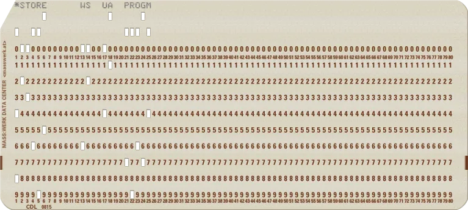
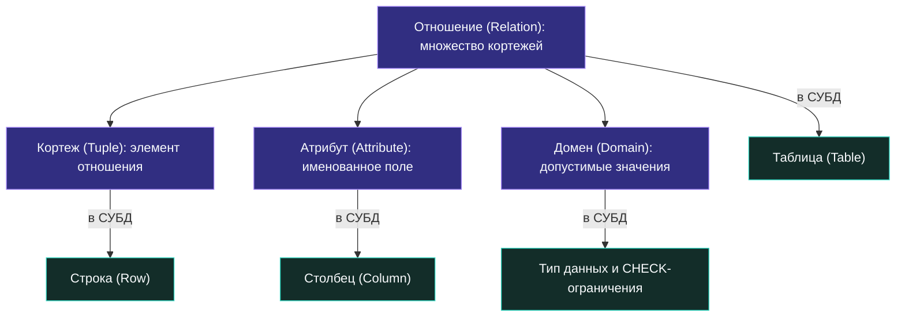

*Математика Эдгара Кодда без сухой схоластики: почему слово «реляционная» не означает «связи», как кортеж превращается в байты на 8 КБ странице и чем реляционная алгебра побеждает NoSQL.*

> «Блеск Unix заключался в выборе абстракции, достаточно общей, чтобы быть поразительно полезной, и при этом не слишком дорогой по производительности.»  
> — Брайан Керниган, *UNIX: A History and a Memoir*

## Революция 1970 года: конец навигационного лабиринта



До июня 1970 года работа с базами данных напоминала блуждание по тёмному лабиринту с ручным фонарём. В индустрии доминировали иерархические и сетевые СУБД (например, IBM IMS и стандарт CODASYL). Чтобы получить историю операций клиента, программист писал низкоуровневый императивный код с **навигационным доступом**: «перейди на корневой узел клиента, спустись по физическому указателю к списку счетов, отсчитай третий блок, шагай по связанному списку проводок, проверяя указатель на следующую запись».

У навигационного подхода был фатальный изъян — полное отсутствие **независимости данных от физического размещения**. Стоило администратору переразбить блоки на магнитном носителе или поменять цепочку указателей ради ускорения одного отчёта, как сотни тысяч строк прикладного кода переставали работать.

Ситуацию изменила статья математика и сотрудника IBM **Эдгара Франка Кодда** *«A Relational Model of Data for Large Shared Data Banks»* (июнь 1970). Кодд предложил оторвать разработчика от физических адресов и дисковых указателей, построив работу с данными на фундаменте **теории множеств** и **логики предикатов первого порядка**.

Главный переворот формулируется в одной фразе: **программист декларативно описывает, ЧТО ему нужно получить, а СУБД сама решает, КАК физически достать эти байты**. Для Go-разработчика, привыкшего к циклам `for`, срезам и указателям в памяти, это требует осознанного переключения: в базе данных мы больше не обходим цепочки структур — мы оперируем математическими множествами.

## Анатомия реляционной модели: четыре базовых термина

Привычные слова «таблица», «строка» и «колонка» — прикладные метафоры. Под ними лежит строгий математический аппарат теории Кодда:

1. **Отношение (Relation)** — подмножество декартова произведения доменов. В терминологии SQL это **таблица**. Ключевое свойство математического множества: его элементы неупорядочены и уникальны.
2. **Кортеж (Tuple)** — отдельный элемент отношения, в СУБД ему соответствует **строка (Row)**. Поскольку множество не имеет внутреннего порядка, ни одна реляционная СУБД не гарантирует последовательность выдачи строк без явного `ORDER BY` (даже если вчера строки возвращались по возрастанию `id`, после обновления или изменения плана порядок способен поменяться).
3. **Атрибут (Attribute)** — именованный элемент кортежа, то есть **столбец или колонка (Column)**. В чистой реляционной модели атрибуты тоже идентифицируются по имени, а не по порядковому номеру.
4. **Домен (Domain)** — множество всех допустимых значений конкретного атрибута, аналог **типа данных с ограничениями** (`BIGINT`, `CHAR(3)`, `TIMESTAMPTZ`, `CHECK`). Домен охраняет целостность данных: в столбец валюты `CHAR(3)` с проверкой кода ISO 4217 физически нельзя записать число с плавающей точкой или текст длиннее трёх символов.



> [!warning] Ловушка терминологии: почему база «реляционная»
> Одно из самых живучих заблуждений звучит так: «реляционная база — это та, где таблицы связаны внешними ключами (relationships)». Это историческая и лингвистическая ошибка. Слово «реляционная» происходит от математического термина **Relation** (отношение), то есть обозначает саму таблицу как множество кортежей. База данных с единственной таблицей и без единого внешнего ключа `FOREIGN KEY` остаётся полностью реляционной.

## Объектно-реляционное несоответствие в Go

Вернёмся к разрыву между структурами в памяти Go и плоскими отношениями в БД (**Object-Relational Impedance Mismatch**). В Go-коде мы свободно держим графы указателей, вложенные слайсы и мапы. Классическая реляционная модель строго плоская: каждый атрибут кортежа атомарен и не может содержать произвольный вложенный список других сущностей (в следующих главах мы оформим это правило строго как первую нормальную форму).

Посмотрим, как Go-код соединяет мир императивных структур с плоским потоком кортежей `LedgerPulse` через стандартный пакет `database/sql`:

```go
package ledger

import (
	"context"
	"database/sql"
)

// Account принимает поля одного кортежа из отношения accounts.
type Account struct {
	ID         int64
	ExternalID string
	OwnerName  string
	Currency   string
	Balance    int64
	ClosedNote sql.NullString // Защита от допустимого NULL в домене атрибута
}

func ListActiveAccounts(ctx context.Context, db *sql.DB, currency string) ([]Account, error) {
	const query = `
		SELECT id, external_id, owner_name, currency, balance, closed_note
		FROM accounts
		WHERE currency = $1 AND status = 'active'
		ORDER BY id`

	rows, err := db.QueryContext(ctx, query, currency)
	if err != nil {
		return nil, err
	}
	defer rows.Close() // Гарантирует возврат соединения в пул при выходе из функции

	var result []Account
	for rows.Next() {
		var acc Account
		// Передаём указатели, чтобы Scan записал байты из сетевого буфера в поля структуры.
		if err := rows.Scan(
			&acc.ID,
			&acc.ExternalID,
			&acc.OwnerName,
			&acc.Currency,
			&acc.Balance,
			&acc.ClosedNote,
		); err != nil {
			return nil, err
		}
		result = append(result, acc)
	}

	if err := rows.Err(); err != nil {
		return nil, err
	}
	return result, nil
}
```

Обратите внимание на две детали этого контракта. Во-первых, тип `sql.NullString` решает несоответствие доменов: в Go обычная `string` не способна выразить отсутствие значения (`NULL` из трёхзначной логики SQL), а обёртка хранит флаг `Valid bool`. Во-вторых, цикл `for rows.Next()` — это курсорный итератор по потоку кортежей из TCP-буфера, а финальная проверка `rows.Err()` перехватывает сетевые или протокольные сбои, случившиеся уже после старта чтения.

## Как кортеж лежит на 8-килобайтной странице: выравнивание и накладные расходы

Математические отношения не весят ни байта. Но PostgreSQL написан на C, и каждый абстрактный кортеж превращается в последовательность байтов на 8-килобайтной странице диска. Как именно устроена эта раскладка?

> [!info] Под капотом: заголовок кортежа и байты выравнивания (Padding)
> В PostgreSQL каждая строка таблицы (кортеж) на странице 8 КБ состоит из двух частей:
> 1. **Заголовок кортежа (Tuple Header):** занимает минимум **23 байта** на каждую строку (с выравниванием обычно 24 байта). Там хранятся системные поля многоверсионности `t_xmin` и `t_xmax` (идентификаторы транзакций создания и удаления версии), маска `NULL`-значений (null bitmap) и служебные битовые флаги.
> 2. **Полезная нагрузка (User Data):** непосредственно значения столбцов.
>
> Как и компилятор Go при размещении полей в структуре (`struct alignment`), PostgreSQL выравнивает столбцы по адресам памяти, кратным их размеру (например, 8-байтовые `BIGINT` и `TIMESTAMPTZ` требуют кратности 8 байтам, 4-байтовые `INT` — кратности 4 байтам). Если объявить колонки в неудачном порядке — скажем, `(CHAR(1), BIGINT, CHAR(1), BIGINT)` — движок вставит до 7 пустых байтов выравнивания (**Padding**) перед каждым `BIGINT`. На таблице из миллиарда проводок такая небрежность раздувает файл на десятки гигабайт, сокращает число строк на одной 8-килобайтной странице и снижает эффективность Buffer Pool.

В реальной схеме `LedgerPulse` (`project/sql/migrations/001_init_ledger.sql`) стоит помнить об этом правиле при добавлении новых столбцов: 8-байтовые типы (`BIGINT`, `TIMESTAMPTZ`) и фиксированные поля разумно группировать до коротких и переменных полей вроде `TEXT` и `JSONB`. Подробно физическую структуру страниц кучи (`Heap`), TOAST и битовую карту видимости мы изучим в Модуле 6.

## Сила реляционной алгебры: почему для биллинга не берут NoSQL

Когда документо-ориентированные NoSQL-системы вроде MongoDB набирали популярность, популярным стал тезис: зачем раскладывать данные по плоским таблицам и мириться с несоответствием моделей, если можно сохранить вложенный JSON-документ счёта со всеми его проводками внутри?

На практике финансовый учёт быстро наталкивается на ограничения документо-ориентированного подхода: один перевод затрагивает минимум два разных счёта, документ начинает бесконечно расти, а связи между клиентами, транзакциями и отчётами перекрещиваются. Именно здесь реляционная модель выигрывает за счёт **реляционной алгебры**.

Три базовые операции реляционной алгебры работают над отношениями как над множествами:

- **Селекция (Selection, $\sigma$):** фильтрация кортежей по предикату — в SQL секция `WHERE`.
- **Проекция (Projection, $\pi$):** отбор нужного подмножества атрибутов — список столбцов в `SELECT`.
- **Соединение (JOIN, $\bowtie$) и Декартово произведение ($\times$):** комбинирование кортежей из разных отношений по общему ключу или условию.

Фундаментальное свойство этой алгебры — **замкнутость**: результат любой операции над отношениями сам образует новое отношение. Благодаря замкнутости оптимизатор запросов может математически перестраивать дерево операций без изменения смысла ответа.

Например, соединение ассоциативно: `(accounts JOIN ledger_entries) JOIN transactions` математически эквивалентно `accounts JOIN (ledger_entries JOIN transactions)`. Опираясь на статистику кардинальности, стоимостной оптимизатор сам решает, в каком порядке соединять таблицы, проталкивает фильтры `WHERE` ближе к чтению с диска (**Predicate Pushdown**), чтобы отсечь лишние строки до соединения, и выбирает лучший физический алгоритм (`Nested Loop`, `Hash Join` или `Merge Join` — все три мы разберём в Модуле 4).

В документо-ориентированной базе без развитого оптимизатора соединений эту работу приходится писать руками в коде Go: делать серию сетевых запросов, выгружать лишний JSON по TCP, соединять слайсы через мапы в памяти, тратить такты CPU и нагружать сборщик мусора.

> [!tip] Собеседование [Middle]
> **Вопрос:** В чём принципиальная разница между навигационным доступом (как в старых иерархических БД или при ручном переходе по ссылкам между документами в NoSQL) и реляционным доступом?  
> **Ответ:** Реляционный доступ декларативен: разработчик задаёт математические предикаты отбора и правила соединения множеств в SQL, не привязываясь к физическому расположению записей, а оптимизатор СУБД сам строит оптимальный план обхода страниц и индексов. Навигационный доступ императивен: код жёстко завязан на цепочки физических указателей или ручные последовательности запросов по ID, поэтому малейшее изменение связей или рост объёма данных вынуждают переписывать прикладную логику.

## Упражнения

### Упражнение 1 (Базовое). Словарь Кодда на схеме `LedgerPulse`
Ниже приведён фрагмент DDL таблицы проводок `ledger_entries`:

```sql
CREATE TABLE ledger_entries (
    id             BIGINT GENERATED ALWAYS AS IDENTITY PRIMARY KEY,
    transaction_id BIGINT  NOT NULL,
    account_id     BIGINT  NOT NULL,
    amount         BIGINT  NOT NULL CHECK (amount <> 0),
    currency       CHAR(3) NOT NULL CHECK (currency ~ '^[A-Z]{3}$')
);
```

Сопоставьте с этой таблицей четыре термина реляционной модели Эдгара Кодда: **отношение**, **кортеж**, **атрибут**, **домен**. Объясните, почему запрос `SELECT id, amount FROM ledger_entries LIMIT 5;` без `ORDER BY` имеет право вернуть разные строки после обновления части таблицы.

> [!solution] Показать решение
> - **Отношение (Relation):** сама таблица `ledger_entries` целиком (множество всех зарегистрированных проводок).
> - **Кортеж (Tuple):** отдельная строка в `ledger_entries`, например `(101, 42, 7, -5000, 'RUB')`.
> - **Атрибут (Attribute):** именованный столбец, например `amount` или `currency`.
> - **Домен (Domain):** допустимое множество значений столбца. Для `amount` — все ненулевые 64-битные целые числа (`BIGINT` с `CHECK (amount <> 0)`); для `currency` — все 3-буквенные строки из заглавных латинских букв (`CHAR(3)` + регулярное выражение).
>
> **Почему порядок без `ORDER BY` не гарантирован:** математическое отношение — это *неупорядоченное* множество. Физически в PostgreSQL кортежи могут читаться по мере заполнения свободных слотов на страницах (в том числе после `UPDATE` или параллельного чтения несколькими воркерами, когда разные запросы цепляются за общий скан). Без `ORDER BY` СУБД возвращает кортежи в том порядке, в каком ей дешевле всего поднять страницы.

### Упражнение 2 (Практическое). Выравнивание полей и диагностика Go-сканера
1. Посмотрите на две схемы таблицы с одинаковым набором столбцов:
   - Схема А: `(flag CHAR(1), amount BIGINT, currency CHAR(3), created_at TIMESTAMPTZ, retry_count SMALLINT)`
   - Схема Б: `(amount BIGINT, created_at TIMESTAMPTZ, retry_count SMALLINT, currency CHAR(3), flag CHAR(1))`
   В какой из схем на каждую строку будет тратиться меньше байтов выравнивания (**Padding**) и почему? (Размеры типов в PostgreSQL: `BIGINT` — 8 байт, `TIMESTAMPTZ` — 8 байт, `SMALLINT` — 2 байта, `CHAR(N)` — N+1 байт короткого заголовка varlena.)
2. В Go-функции ниже разработчик забыл три важные детали при чтении кортежей через `database/sql`. Найдите все три ошибки:

```go
func LoadBalances(ctx context.Context, db *sql.DB) ([]int64, error) {
	rows, err := db.QueryContext(ctx, "SELECT balance FROM accounts WHERE status = 'active'")
	if err != nil {
		return nil, err
	}
	var out []int64
	for rows.Next() {
		var b int64
		if err := rows.Scan(b); err != nil {
			return nil, err
		}
		out = append(out, b)
	}
	return out, nil
}
```

> [!solution] Показать решение
> 1. **Схема Б компактнее.** В схеме А короткие поля `CHAR(1)` (~2 байта) и `CHAR(3)` (~4 байта) стоят прямо перед 8-байтовыми полями `BIGINT` и `TIMESTAMPTZ`, вынуждая PostgreSQL вставлять по 4–6 пустых байтов выравнивания перед каждым 8-байтовым полем (и в хвосте перед следующим кортежем). В схеме Б два 8-байтовых поля идут подряд без единого байта padding, а мелкие типы плотно упакованы следом.
> 2. **Три ошибки в Go-функции:**
>    - Нет `defer rows.Close()` после проверки `err != nil` — при ошибке сканирования или обрыве цикла сетевое соединение утечёт и не вернётся в пул.
>    - В `rows.Scan(b)` передано значение `b`, а не указатель `&b` — `Scan` вернёт ошибку времени выполнения, так как не сможет записать значение в переменную.
>    - Отсутствует финальная проверка `if err := rows.Err(); err != nil` — если TCP-соединение оборвётся на середине потока строк, функция тихо вернёт неполный слайс без ошибки.

### Упражнение 3 (\*). От навигационного обхода к реляционной алгебре
Разработчик переносит отчёт из старого документо-ориентированного хранилища на PostgreSQL и пишет такой императивный алгоритм в Go:

```go
// Псевдокод навигационного обхода:
// 1. Забрать по сети все транзакции с kind == "transfer"
// 2. В цикле для каждой транзакции сходить в БД за её проводками в ledger_entries
// 3. Внутри второго цикла сходить в БД за аккаунтом и проверить currency == "USD"
// 4. В памяти Go отобрать только (transaction.reference_id, entry.amount)
```

1. Выразите ту же задачу в терминах операций **реляционной алгебры** (селекция, проекция, соединение).
2. Напишите единый декларативный SQL-запрос, который решает её за один проход со стороны СУБД.

> [!solution] Показать решение
> 1. **В терминах реляционной алгебры:**
>    - Селекция ($\sigma$) по отношению `transactions`: `kind = 'transfer'`.
>    - Селекция ($\sigma$) по отношению `accounts`: `currency = 'USD'`.
>    - Соединение ($\bowtie$) отфильтрованных множеств с `ledger_entries` по ключам `transactions.id = ledger_entries.transaction_id` и `accounts.id = ledger_entries.account_id` (причём оптимизатор применит Predicate Pushdown и выполнит селекции *до* соединения).
>    - Проекция ($\pi$) итогового отношения на два атрибута: `(reference_id, amount)`.
> 2. **Декларативный SQL-запрос:**
>    ```sql
>    SELECT t.reference_id, e.amount
>    FROM transactions AS t
>    JOIN ledger_entries AS e ON e.transaction_id = t.id
>    JOIN accounts AS a ON a.id = e.account_id
>    WHERE t.kind = 'transfer'
>      AND a.currency = 'USD';
>    ```
>    Вместо сотен последовательных сетевых походов из циклов Go мы передаём намерение целиком, а планировщик СУБД сам выбирает индексы и алгоритм `JOIN`.

---

Мы разобрали математический фундамент Эдгара Кодда: отношения, кортежи, домены, выравнивание байтов на странице и силу реляционной алгебры. Но как именно идентифицировать каждый отдельный кортеж среди миллиардов записей и какой тип идентификатора выбрать для таблицы `accounts` — возрастающий `BIGINT` или `UUIDv7`? Этому посвящена следующая глава Модуля 1 о таблицах, строках, столбцах и ключах.
