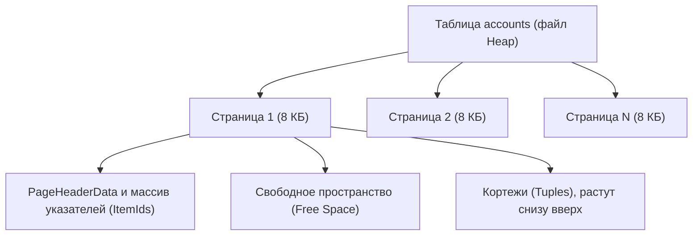

*Как математические отношения и кортежи ложатся на 8-килобайтные страницы Heap, почему порядок столбцов в DDL экономит гигабайты памяти и как выбрать между `BIGINT`, `UUID v4`, `UUID v7` и составным ключом.*

> «Память часто была самым дорогим компонентом компьютера. Когда на счету был каждый байт, этот дефицит навязывал программистам особую дисциплину: приходилось постоянно отдавать себе отчёт, сколько памяти занимает программа...»  
> — Брайан Керниган (*UNIX: A History and a Memoir*)

## От математики к железу: когда кортеж встречает диск

В предыдущей главе [[4. Реляционная модель данных — отношения, кортежи и множества]] мы рассматривали базу данных как строгую математическую модель из отношений, кортежей и предикатов. Но промышленная СУБД — это программа на C, C++ или Rust, работающая поверх реальной операционной системы, кэшей процессора и накопителей.

Пока данных немного, различие между теорией и железом незаметно. Стоит системе `LedgerPulse` вырасти до сотен миллионов проводок в таблице `ledger_entries`, и цена каждого байта становится ощутимой: обращение к L1-кэшу процессора занимает ~1 нс, к оперативной памяти RAM — ~100 нс, к NVMe SSD — ~100 мкс (в 1 000 раз дольше RAM), а к магнитному HDD — ~10 мс (ещё в 100 раз медленнее). Если таблица раздута из-за неверного порядка колонок, а первичный ключ дробит страницы индекса, лишний дисковый ввод-вывод быстро съест пропускную способность сервиса.

Спустимся из теории множеств в подсистему хранения и переведём термины «отношение», «кортеж» и «атрибут» на инженерный язык: **таблицы**, **строки**, **столбцы** и **ключи**.

---

## Таблица как структура хранения: Heap и Slotted Page

На уровне SQL таблица выглядит как упорядоченная двумерная сетка. На диске в PostgreSQL данные обычной таблицы лежат в структуре **Heap (куча)**.

> [!note] Терминологический контекст
> Слово «Heap» в архитектуре СУБД не относится ни к динамической куче памяти Go, ни к двоичной куче (Binary Heap) из алгоритмов. **Heap-файл** — неупорядоченный набор страниц фиксированного размера, куда движок дописывает новые строки туда, где нашлось свободное место.

В Heap-файле нет встроенного порядка строк. Запрос `SELECT id, balance_minor FROM accounts` без `ORDER BY` возвращает строки в произвольном порядке страниц на диске. Поиск без индекса превращается в полное последовательное сканирование (**Seq Scan**), прогоняющее через Buffer Pool весь файл целиком.

Файл таблицы нарезан на страницы по **8 КБ** с разметкой **Slotted Page**:



В начале страницы лежит заголовок (`PageHeaderData`) и массив указателей (`ItemIds`), растущий сверху вниз; сами кортежи (`Tuples`) укладываются снизу вверх. Внешние индексы ссылаются на пару `(страница, индекс в ItemIds)`: если сборка мёртвых версий сдвинет кортеж внутри блока, обновится лишь локальный указатель страницы.

---

## Строка под капотом: анатомия кортежа и выравнивание

Разработчик привык думать о строке таблицы `accounts` как о наборе полезных полей: `(id=101, currency='RUB', balance_minor=50000)`. На деле перед первым пользовательским полем СУБД записывает плотный служебный заголовок для поддержки транзакций и конкурентного доступа.

В PostgreSQL эта структура называется `HeapTupleHeaderData`. Она занимает минимум 23 байта, а с учётом аппаратного выравнивания по границе 8 байт — ровно **24 байта** на каждую строку.

> [!info] Под капотом: 24 байта заголовка `HeapTupleHeaderData`
> * `t_xmin` (4 байта) — идентификатор транзакции (XID), создавшей эту версию строки (`INSERT`).
> * `t_xmax` (4 байта) — идентификатор транзакции, удалившей или обновившей строку (`DELETE` / `UPDATE`). На этих двух полях держится многоверсионность (MVCC), к которой мы вернёмся в Модуле 5.
> * `t_cid` / `t_field3` (4 байта) — порядковый номер команды внутри транзакции.
> * `t_ctid` (6 байт) — физический адрес актуальной версии строки (`номер страницы + индекс указателя`). При обновлении старая версия начинает указывать на новую.
> * `t_infomask` и `t_infomask2` (по 2 байта) — битовые флаги состояния транзакции, блокировок и числа атрибутов.
> * `t_hoff` (1 байт) — смещение от начала заголовка до первого столбца.
> * **NULL Bitmap** (опционально) — битовая карта столбцов со значением `NULL`, занимающая 1 бит на колонку, если в строке есть хотя бы один `NULL`.

### Локальность данных и выравнивание в Go и SQL

Процессору неудобно считывать 64-битное целое число (`int64` или `BIGINT`) с адреса, который не кратен 8 байтам: в лучшем случае это стоит лишнего цикла шины памяти, в худшем — аппаратного сбоя. Поэтому и компилятор Go, и подсистема хранения СУБД вставляют невидимые холостые байты — **выравнивание (padding)**.

Сравним две структуры домена `LedgerPulse` в Go 1.24. Обе хранят одинаковый набор данных, но занимают разный объём памяти:

```go
package main

import (
	"fmt"
	"unsafe"
)

type BadEntry struct {
	IsSettled   bool  // 1 байт (+ 7 байт padding до 8-байтной границы)
	AmountMinor int64 // 8 байт
	CurrencyID  int16 // 2 байта (+ 6 байт padding в хвосте структуры)
}

type GoodEntry struct {
	AmountMinor int64 // 8 байт
	CurrencyID  int16 // 2 байта
	IsSettled   bool  // 1 байт (+ 5 байт padding в хвосте)
}

func main() {
	fmt.Printf("BadEntry:  %d байт\n", unsafe.Sizeof(BadEntry{}))  // Вывод: 24 байт
	fmt.Printf("GoodEntry: %d байт\n", unsafe.Sizeof(GoodEntry{})) // Вывод: 16 байт
}
```

Разница составляет 8 байт на один экземпляр — треть всей структуры уходит впустую. В реляционной таблице происходит ровно то же самое, только в масштабе гигабайт на диске и в оперативной памяти сервера БД.

Если объявить столбцы таблицы `ledger_entries` в хаотичном порядке:

```sql
CREATE TABLE ledger_entries_bad (
    is_settled   BOOLEAN,   -- 1 байт + 7 байт padding перед BIGINT
    id           BIGINT,    -- 8 байт
    entry_type   SMALLINT,  -- 2 байта + 6 байт padding перед BIGINT
    amount_minor BIGINT     -- 8 байт
);
```

На каждой строке СУБД потеряет 13 байт холостого заполнения. Добавим сюда 24 байта заголовка `HeapTupleHeaderData` — и вместо 19 байт полезных данных строка займёт 56 байт на странице. На 100 миллионах проводок `LedgerPulse` пустое выравнивание съест около **1.3 ГБ** лишнего места (а в широких таблицах с десятком чередующихся флагов и `BIGINT` потери достигают 20–30 ГБ).

Чем крупнее Heap-файл, тем меньше строк помещается на одну 8-килобайтную страницу, тем выше доля промахов буферного кэша (Buffer Pool) в RAM и тем медленнее работает весь бэкенд.

> [!tip] Собеседование [Middle]
> **Вопрос:** Как уменьшить физический размер таблицы в PostgreSQL без удаления строк и без включения сжатия?  
> **Ответ:** Переупорядочить столбцы в DDL таблицы по убыванию их выравнивания: сначала 8-байтные типы (`BIGINT`, `TIMESTAMPTZ`, `DOUBLE PRECISION`), затем 4-байтные (`INTEGER`, `DATE`), затем 2-байтные (`SMALLINT`) и 1-байтные (`BOOLEAN`, `"char"`), а типы переменной длины (`TEXT`, `VARCHAR`, `NUMERIC`, `JSONB`) разместить в самом конце. Типы фиксированной ширины прижатся друг к другу без дыр padding.

---

## Столбцы и механизм TOAST

Каждый столбец привязан к строгому домену из теории Кодда (`BIGINT`, `TEXT`, `TIMESTAMPTZ`, `JSONB`). Пока значения небольшие, они лежат прямо внутри кортежа на странице. Но как быть, если в таблице `transactions` есть поле `metadata JSONB` с подробной банковской выпиской объёмом 300 КБ?

Страница PostgreSQL жёстко ограничена 8 КБ, а кортеж целиком не может быть больше одной страницы. Чтобы обойти это ограничение, работает механизм **TOAST (The Oversized-Attribute Storage Technique)**.

Когда размер строки превышает порог `TOAST_TUPLE_THRESHOLD` (около **2 КБ**), движок запускает три шага:
1. Пытается сжать длинные атрибуты на лету алгоритмом `pglz` или быстрым `lz4`.
2. Если сжатый кортеж всё ещё не влезает в лимит, СУБД выносит большое значение за пределы основной таблицы, разрезая его на фрагменты по ~2 КБ.
3. Фрагменты сохраняются в отдельную скрытую TOAST-таблицу, а в основной строке остаётся компактный 18-байтный указатель.

> [!warning] Ловушка `SELECT *` и скрытый Random I/O
> Механизм TOAST превращает безобидный на вид запрос `SELECT * FROM transactions WHERE account_id = 42` в источник тяжёлого случайного ввода-вывода. Если приложению нужны только `id` и `amount_minor`, но в запросе стоит звёздочка, СУБД вычитает лишние 2-килобайтные чанки из TOAST-таблицы, распакует JSON в оперативной памяти и перешлёт сотни килобайт по сети в Go-сервис — лишь затем, чтобы программа отбросила эти поля. Запрашивайте только те столбцы, которые реально сканируете в структуру.

---

## Ключи: математическая иерархия и практика выбора

Поскольку физический Heap не хранит никакого порядка, базе необходим строгий механизм адресации каждой строки. Эту задачу решают **ключи**.

В реляционной теории выстроена чёткая иерархия ключей:
1. **Суперключ (Superkey)** — любой набор столбцов, однозначно идентифицирующий строку. Например, для таблицы `accounts` суперключом будет `(id, owner_id, currency)` — хотя `currency` избыточна, комбинация всё равно уникальна.
2. **Потенциальный ключ (Candidate Key)** — минимальный суперключ, из которого нельзя убрать ни один столбец без потери уникальности. Для `accounts` потенциальными ключами могут быть отдельно `id` и отдельно `account_number`.
3. **Первичный ключ (Primary Key, PK)** — один из потенциальных ключей, выбранный проектировщиком в качестве основного идентификатора строки. По стандарту SQL он автоматически накладывает ограничения `UNIQUE` и `NOT NULL`, а СУБД строит по нему уникальный индекс.

### Составные ключи (Composite Keys)

Иногда уникальность строки рождается только из пары или тройки атрибутов — такой ключ называют **составным**. Например, в `LedgerPulse` одна проводка может иметь несколько строк внутри транзакции, пронумерованных по порядку: `(transaction_id, line_no)`. Другой частый сценарий — связующая таблица многие-ко-многим, вроде `account_tags (account_id, tag_id)`.

Составной ключ экономит место на лишнем суррогатном столбце и физически защищает от дубликатов пары. Кроме того, построенный по нему индекс `B-Tree` автоматически ускоряет поиск по левому префиксу (`WHERE transaction_id = $1`, подробнее об этом — в Модуле 4).

Плата за составной ключ проявляется при связывании таблиц: каждая дочерняя таблица вынуждена тащить в себя все столбцы родительского составного ключа, а условия `JOIN` становятся многословнее. Если на строку со сложным бизнес-ключом ссылаются другие таблицы, проще ввести одиночный суррогатный `id` в роли первичного ключа, а составную пару объявить отдельным ограничением `UNIQUE` (о чём пойдёт речь в [[7. Ограничения целостности данных — NOT NULL, UNIQUE, CHECK]]).

### Естественные против суррогатных ключей

При выборе первичного ключа инженер всегда сталкивается с дилеммой между двумя подходами:

| Критерий | Естественный ключ (Natural Key) | Суррогатный ключ (Surrogate Key) |
|---|---|---|
| Примеры | ИНН, номер счёта IBAN, email | `BIGINT` (`IDENTITY`), `UUID v7` |
| Бизнес-смысл | Есть, понятен человеку | Отсутствует, чисто технический адрес |
| Изменяемость | Может поменяться (смена стандарта, опечатка) | Неизменен всю жизнь записи |
| Влияние на схему | Обновление ключа требует каскадных правок в связях | Связи между таблицами стабильны |

Естественные атрибуты подчиняются законам внешнего мира, а не вашей программы: банковский счёт переоформляют по новому формату, клиент меняет email, а государственный реестр меняет длину ИНН. Изменение первичного ключа влечёт тяжёлую перезапись ссылок во всех связанных таблицах с риском блокировок. Поэтому в OLTP-системах стандартом стал **суррогатный ключ**, а естественные уникальные коды закрепляются ограничением `UNIQUE`.

> [!tip] Собеседование [Senior/Staff]
> **Вопрос:** Что выбрать для первичного ключа в распределённом Go-бэкенде: автоинкрементный `BIGINT` (`GENERATED ALWAYS AS IDENTITY`), `UUID v4` или `UUID v7`?  
> **Ответ:** Выбор опирается на физику B-Tree индекса (детали устройства страниц дерева разберём в Модуле 4):  
> 1. **`BIGINT` (`IDENTITY`)** — весит 8 байт, монотонно растёт. Новые ключи всегда ложатся в самый правый край B-Tree, давая последовательную запись без перестроений страниц. Минус — генерация ID привязана к одному узлу БД, а последовательные числа раскрывают объём бизнеса по внешним API.  
> 2. **`UUID v4`** — 16 байт чистой случайности. Генерируется в памяти Go-сервиса без похода в БД, но для B-Tree это катастрофа при активной записи: случайные значения попадают в случайные страницы, вызывают постоянное расщепление узлов (**Page Splits**), раздувают индекс и превращают запись в шквал случайного дискового I/O.  
> 3. **`UUID v7` (RFC 9562)** — современный компромисс для распределённых систем. Первые 48 бит кодируют миллисекундный Unix Timestamp, остальные заполнены энтропией. Приложение на Go генерирует ID локально без координации с базой, а ключи в B-Tree растут монотонно во времени, сохраняя локальность страниц кэша.

---

## Практика: проектируем физическую раскладку таблицы

Посмотрим, как принципы выравнивания и выбора ключей объединяются в реальной таблице проводок `ledger_entries` для `LedgerPulse`:

```sql
-- Все 8-байтные поля сгруппированы в начале, затем 2-байтные и 1-байтные,
-- в самом конце — поля переменной длины.
CREATE TABLE ledger_entries (
    id             BIGINT GENERATED ALWAYS AS IDENTITY PRIMARY KEY,
    transaction_id BIGINT NOT NULL,
    account_id     BIGINT NOT NULL,
    amount_minor   BIGINT NOT NULL,
    created_at     TIMESTAMPTZ NOT NULL,
    entry_side     SMALLINT NOT NULL,   -- 1 = debit, -1 = credit
    is_reconciled  BOOLEAN NOT NULL DEFAULT FALSE,
    note           TEXT                 -- переменная длина в самом конце
);
```

На каждой строке этой таблицы:
* Пять 8-байтных колонок (`id`, `transaction_id`, `account_id`, `amount_minor`, `created_at`) ложатся плотно, без единого байта внутреннего padding — 40 байт подряд.
* Следом идут 2 байта `entry_side` и 1 байт `is_reconciled` (3 байта + 5 байт выравнивания перед переменной частью, если `note` заполнено).
* Поле переменной длины `note` расположено в хвосте кортежа, поэтому движку не приходится пересчитывать смещения фиксированных колонок при чтении числовых полей.

---

## Упражнения

### Упражнение 1 (Базовое)
Переупорядочьте столбцы таблицы `audit_events` для устранения внутреннего padding и объясните размещение `payload`:
```sql
CREATE TABLE audit_events (
    is_error     BOOLEAN NOT NULL,
    event_id     BIGINT NOT NULL,
    http_status  SMALLINT NOT NULL,
    occurred_at  TIMESTAMPTZ NOT NULL,
    retry_count  SMALLINT NOT NULL,
    payload      JSONB
);
```

> [!solution] Показать решение
> ```sql
> CREATE TABLE audit_events (
>     event_id     BIGINT NOT NULL,       -- 8 байт
>     occurred_at  TIMESTAMPTZ NOT NULL,  -- 8 байт
>     http_status  SMALLINT NOT NULL,     -- 2 байта
>     retry_count  SMALLINT NOT NULL,     -- 2 байта
>     is_error     BOOLEAN NOT NULL,      -- 1 байт (+ 3 байта padding)
>     payload      JSONB                  -- переменная длина / TOAST
> );
> ```
> **Разбор:** В исходном DDL `is_error` (1 байт) и `http_status` (2 байта) создавали 13 байт холостого padding перед 8-байтными полями. Группировка `8 → 2 → 1` убирает дыры, а вынос `payload` в хвост сохраняет фиксированные смещения начальных столбцов.

### Упражнение 2 (Практическое)
Опишите в Go 1.24 две структуры представления строки счёта `LedgerPulse` с полями `IsFrozen bool`, `ID int64`, `CurrencyCode uint16`, `BalanceMinor int64`, `RiskTier uint8` (плохую и оптимизированную) и выведите `unsafe.Sizeof` и `unsafe.Offsetof` ключевых полей.

> [!solution] Показать решение
> ```go
> package main
>
> import (
> 	"fmt"
> 	"unsafe"
> )
>
> type AccountRowBad struct {
> 	IsFrozen     bool   // 1 + 7 padding
> 	ID           int64  // 8
> 	CurrencyCode uint16 // 2 + 6 padding
> 	BalanceMinor int64  // 8
> 	RiskTier     uint8  // 1 + 7 padding
> }
>
> type AccountRowGood struct {
> 	ID           int64  // 8
> 	BalanceMinor int64  // 8
> 	CurrencyCode uint16 // 2
> 	IsFrozen     bool   // 1
> 	RiskTier     uint8  // 1 + 4 padding
> }
>
> func main() {
> 	fmt.Printf("Bad: %d (ID@%d), Good: %d (ID@%d)\n",
> 		unsafe.Sizeof(AccountRowBad{}), unsafe.Offsetof(AccountRowBad{}.ID),
> 		unsafe.Sizeof(AccountRowGood{}), unsafe.Offsetof(AccountRowGood{}.ID),
> 	)
> }
> // Вывод: Bad: 40 (ID@8), Good: 24 (ID@0)
> ```
> **Разбор:** Перегруппировка по убыванию выравнивания сжала структуру с 40 до 24 байт (минус 40% памяти в кэше CPU и куче).

### Упражнение 3 (Со звёздочкой *)
Для `LedgerPulse` нужна таблица позиций счёта-фактуры `invoice_lines`, где внутри счёта (`invoice_id`) строки нумеруются с `1` (`line_no`). Внешние шлюзы присылают `external_line_ref` (до 64 символов). Сравните составной PK `(invoice_id, line_no)` и суррогатный PK `id BIGINT` + `UNIQUE (invoice_id, line_no)`. Почему `external_line_ref` не годится на роль PK?

> [!solution] Показать решение
> 1. Если на `invoice_lines` не ссылаются другие таблицы, **составной PK `(invoice_id, line_no)`** экономит 8–16 байт на суррогатном ключе и обходится одним B-Tree индексом (он же ускоряет выборку `WHERE invoice_id = $1`).
> 2. Если на строки появятся внешние ссылки (например, из `refund_lines`), удобнее суррогатный PK `BIGINT`/`UUID v7`, чтобы не тащить пару столбцов во все дочерние таблицы.
> 3. `external_line_ref` — внешний естественный ключ: его формат может поменяться, а случайные строки фрагментируют B-Tree; его выносят в отдельное `UNIQUE`.

---

Таблица перестала быть абстрактной сеткой: мы увидели 8-килобайтную страницу Slotted Page, 24-байтовый заголовок, холостой padding и TOAST. В следующей главе [[6. Первичные и внешние ключи]] свяжем `accounts`, `transactions` и `ledger_entries` в единую систему и разберём цену этих связей.
