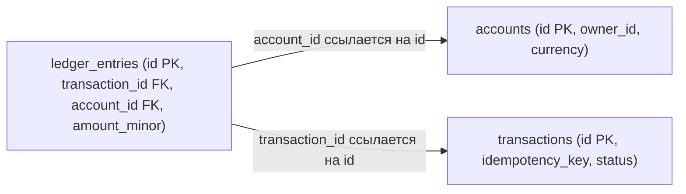

*Как первичный ключ организует хранение данных в PostgreSQL и MySQL, почему внешний ключ работает как скрытый триггер с блокировками, когда выбирать `RESTRICT`, `CASCADE` или `SET NULL` и как обрабатывать ошибки ссылочной целостности в Go.*

> «Любая функция ввода-вывода обязана считаться с вероятностью сбоя, и лишь наивный программист верит, что простое чтение или запись не могут завершиться ошибкой. Именно тогда, когда внезапно отказывают самые надёжные операции, нам нужнее всего знать почему.»  
> — Алан Донован, Брайан Керниган (*The Go Programming Language*)

## Связывая изолированные острова данных

В предыдущей главе [[5. Таблицы, строки, столбцы и ключи]] мы увидели, что таблица в PostgreSQL — неупорядоченная куча (Heap) страниц по 8 КБ. Но финансовая система `LedgerPulse` не может жить в одной таблице: у нас есть счета (`accounts`), финансовые транзакции (`transactions`) и строки двойной записи (`ledger_entries`).

Если таблицы никак не связаны на уровне ядра СУБД, малейший сбой в коде превратит базу в мусор. Бэкенд может записать проводку на несуществующий `account_id = 999999` или удалить счёт, по которому вчера прошло десять миллионов рублей. В результате баланс не сойдётся, а отчётность потеряет доверие.

За связность реляционной модели отвечают две опоры: **первичный ключ (Primary Key, PK)** и **внешний ключ (Foreign Key, FK)**. Понимание их физического устройства отделяет учебное CRUD-приложение от продакшен-системы, готовой к высокой конкурентной нагрузке и шардированию.

---

## Первичный ключ под капотом: PostgreSQL против InnoDB

**Первичный ключ** — это столбец или набор столбцов, однозначно задающий каждую строку таблицы. Математически он обеспечивает базовое правило теории множеств из [[4. Реляционная модель данных — отношения, кортежи и множества]]: в одном отношении не бывает двух одинаковых кортежей.

Когда вы добавляете `PRIMARY KEY` в DDL, СУБД выполняет два действия:
1. Навешивает на столбец строгие проверки `NOT NULL` и `UNIQUE`.
2. **Автоматически создаёт B-Tree индекс** по этому ключу.

Однако физическое размещение таблицы и этого индекса в популярных движках устроено по-разному:
* **В PostgreSQL** файл таблицы (Heap) и файл первичного индекса лежат отдельно. B-Tree индекс хранит отсортированные значения ключа и 6-байтные физические указатели `ctid` (номер страницы и слота), ведущие к кортежу в Heap-файле.
* **В MySQL (InnoDB)** применяется **кластерный индекс (Clustered Index)**, или Index-Organized Table (IOT). Сама таблица физически устроена как B-Tree дерево, отсортированное по Primary Key, а полезные данные всей строки хранятся прямо в листовых узлах этого дерева. Подробнее архитектуру индексов и различия движков мы разберём в Модулях 4 и 7.

Выбор типа данных первичного ключа напрямую определяет профиль дискового ввода-вывода при каждой операции `INSERT`:
* **`BIGINT` (`GENERATED ALWAYS AS IDENTITY`)** монотонно возрастает (`1, 2, 3...`). Новые записи всегда попадают в самый правый листовой узел B-Tree. Страницы заполняются плотно и последовательно (**Sequential Write**), без лишней перезаписи старых блоков.
* **Случайный `UUID v4`** равномерно разбрасывает ключи по всему 128-битному пространству. Для каждой вставки движок ищет случайную страницу B-Tree в памяти или дочитывает её с диска (~100 мкс на NVMe против ~100 нс в RAM). Когда страница переполняется, случается аварийное расщепление узла пополам (**Page Split**), что ведёт к фрагментации и потоку случайного ввода-вывода (**Random I/O**).
* **`UUID v7` (RFC 9562)** — прагматичный компромисс для распределённых систем. Первые 48 бит занимает миллисекундный Unix Timestamp, поэтому ключи растут монотонно во времени. Сервисы на Go генерируют идентификаторы локально без обращения к базе, а B-Tree индекс сохраняет локальность данных в буферном пуле.

---

## Внешний ключ: страж ссылочной целостности и его скрытая цена

**Внешний ключ (Foreign Key)** — это столбец или группа столбцов дочерней таблицы, ссылающаяся на первичный (или уникальный) ключ родительской таблицы. Его задача — гарантировать **ссылочную целостность (Referential Integrity)**: в базе не может появиться дочерняя запись без существующего родителя.

В схеме `LedgerPulse` таблица проводок `ledger_entries` связана сразу с двумя родительскими таблицами — счетами и транзакциями:



Если разработчик воспринимает внешний ключ как пассивную документацию для ER-диаграмм, он упускает главное.

> [!warning] Ловушка: внешний ключ — скрытый синхронный триггер
> На уровне ядра СУБД внешний ключ работает как системный триггер, срабатывающий на каждую запись. Когда Go-бэкенд выполняет:
> ```sql
> INSERT INTO ledger_entries (transaction_id, account_id, amount_minor)
> VALUES (1001, 42, -5000);
> ```
> PostgreSQL приостанавливает вставку, запускает под капотом внутреннюю проверку существования родительских строк (`accounts.id = 42` и `transactions.id = 1001`) и накладывает на них разделяемые строковые блокировки (`FOR KEY SHARE`), чтобы параллельная транзакция не успела удалить счёт № 42 до фиксации вашей проводки.
>
> Если страница со счётом № 42 вытеснена из Buffer Pool, одиночный `INSERT` внезапно вызывает чтение с диска. А если родительский счёт — горячий системный счёт комиссий, на который пишут тысячи горутин одновременно, конкуренция за блокировки начинает тормозить весь поток записей.

К этому добавляется ещё одна деталь, о которой часто забывают: СУБД автоматически строит индекс для `PRIMARY KEY` родителя, но **не создаёт индекс на столбец `FOREIGN KEY` в дочерней таблице**. Если в `ledger_entries` нет индекса по `account_id`, то попытка удалить или обновить ID счёта в `accounts` заставит базу просканировать весь многогигабайтный Heap дочерней таблицы (`Seq Scan`), проверяя, не осталась ли на него ссылка.

---

## Политики удаления и обновления: RESTRICT, CASCADE, SET NULL

Что обязана сделать база данных, если кто-то пытается удалить строку из родительской таблицы `accounts`, на которую уже ссылаются записи в `ledger_entries`? Стандарт SQL предлагает пять режимов поведения (задаются через `ON DELETE` и аналогично для `ON UPDATE`):

1. **`RESTRICT`** — жёстко запрещает удаление родителя, пока существует хотя бы одна дочерняя строка. Проверка выполняется немедленно в момент команды `DELETE`. В финансовых таблицах `LedgerPulse` это основной режим защиты истории проводок.
2. **`NO ACTION`** — режим по умолчанию в PostgreSQL, если политика не указана. Он тоже запрещает удаление родителя с живыми потомками, но отличие тонкое: при использовании отложенных ограничений (`DEFERRABLE`) проверка сдвигается на конец команды или транзакции (`COMMIT`), тогда как `RESTRICT` срабатывает сразу.
3. **`CASCADE`** — при удалении родительской строки СУБД автоматически удаляет все связанные дочерние строки во всех зависимых таблицах.
4. **`SET NULL`** — при удалении родителя внешний ключ в дочерней таблице заменяется на `NULL`. Это работает только тогда, когда столбец FK не помечен как `NOT NULL`. Удобно для необязательных связей: например, если в таблице `transactions` хранится `approved_by_operator_id` (кто подтвердил ручную операцию), то при увольнении и удалении оператора сама транзакция в журнале сохранится, а ссылка на оператора обнулится.
5. **`SET DEFAULT`** — заменяет внешний ключ на значение по умолчанию (`DEFAULT`), которое тоже обязано существовать в родительской таблице. На практике применяется редко из-за хрупкости при изменении справочников.

> [!tip] Собеседование [Middle]
> **Вопрос:** Почему ведущие DBA и архитекторы избегают `ON DELETE CASCADE` в нагруженных продакшен-базах?  
> **Ответ:** Каскадное удаление превращает безобидный `DELETE FROM accounts WHERE id = 42` в неконтролируемую лавину внутри одной транзакции:  
> 1. **Шторм блокировок и дедлоки:** СУБД берёт эксклюзивные блокировки на сотни тысяч или миллионы строк в десятках связанных таблиц, останавливая параллельные запросы бэкенда.  
> 2. **Взрывной рост WAL:** Удаление миллионов строк за секунду генерирует гигабайты записей в журнале предзаписи (WAL, подробнее в Модуле 5), перегружает диск и вызывает критическое отставание реплик (Replication Lag).  
> 3. **Необратимость:** Случайная команда `DELETE` с каскадом мгновенно стирает связанную финансовую историю.  
> **Инженерное решение:** Для критичных данных ставят `ON DELETE RESTRICT` и используют мягкое удаление (`deleted_at TIMESTAMPTZ` — с учётом границ этого подхода, о которых поговорим в главе 16), либо удаляют дочерние записи асинхронно небольшими батчами (по 1 000–5 000 строк) через фоновый воркер на Go.

---

## Highload-архитектура: жизнь без Foreign Keys

Заглянув в схемы баз данных крупных нагруженных проектов — Uber, GitHub, Pinterest, Slack — вы обнаружите, что во многих продакшен-таблицах внешние ключи полностью отсутствуют. Это не небрежность, а осознанный архитектурный компромисс, вызванный двумя ограничениями:

1. **Горизонтальное шардирование (Sharding):** Когда таблица `accounts` растёт до десятков терабайт, её разносят по разным физическим серверам (подробнее об этом — в Модуле 8). Классическая реляционная СУБД не способна проверять `FOREIGN KEY` между двумя изолированными узлами по сети без тяжёлых распределённых транзакций (2PC).
2. **Борьба за задержки (Latency) и блокировки:** При десятках тысяч записей в секунду скрытые проверки родителя и разделяемые блокировки на популярных строках становятся источником взаимоблокировок (Deadlocks).

При отказе от FK в базе ответственность за целостность не исчезает — она переезжает в прикладной код сервисов на Go, транзакционные очереди (Transactional Outbox) и фоновые задачи сверки, которые находят и подчищают «осиротевшие» записи (Orphaned records). Но пока проект работает на одном кластере PostgreSQL и не упёрся в шардирование, внешние ключи остаются самым дешёвым и надёжным стражем консистентности.

---

## Работа с ключами в Go 1.24: опциональные связи и ошибки

При работе с PostgreSQL через `database/sql` и драйвер `pgx/v5` важно аккуратно перенести две концепции: необязательные внешние ключи и обработку нарушений целостности.

### Опциональный внешний ключ и `NULL`

Допустим, в таблице `transactions` есть необязательное поле `parent_tx_id`, которое ссылается на исходную транзакцию при возврате средств (`refund`). Если это обычный платёж, в базе лежит `NULL`.

Отображать такой столбец в Go как примитивный `int64` опасно: нулевое значение `0` в Go база при вставке воспримет как попытку сослаться на транзакцию с `id = 0` и выбросит ошибку внешнего ключа. Для опциональных ключей используйте `sql.NullInt64`, дженерик `sql.Null[int64]` (появился в стандартной библиотеке начиная с Go 1.22) или указатель `*int64`.

### Обработка Foreign Key Violation (`23503`)

Никогда не проверяйте ошибку базы через поиск подстроки `strings.Contains(err.Error(), "foreign key")`: текст сообщения зависит от локали сервера и версии СУБД. Идиоматичный подход в Go — проверка стандартного кода `SQLSTATE` (`23503` для нарушения внешнего ключа в PostgreSQL) через `errors.As`:

```go
package ledger

import (
	"context"
	"database/sql"
	"errors"
	"fmt"

	"github.com/jackc/pgx/v5/pgconn"
)

const pgErrForeignKeyViolation = "23503"

var ErrReferenceNotFound = errors.New("связанный счёт или транзакция не найдены")

type EntryInput struct {
	TransactionID int64
	AccountID     int64
	ParentTxID    sql.Null[int64] // Опциональный FK (NULL для обычной операции)
	AmountMinor   int64
}

func InsertLedgerEntry(ctx context.Context, db *sql.DB, in EntryInput) (int64, error) {
	const query = `
		INSERT INTO ledger_entries (transaction_id, account_id, parent_tx_id, amount_minor)
		VALUES ($1, $2, $3, $4)
		RETURNING id`

	var entryID int64
	err := db.QueryRowContext(ctx, query,
		in.TransactionID, in.AccountID, in.ParentTxID, in.AmountMinor,
	).Scan(&entryID)
	if err != nil {
		var pgErr *pgconn.PgError
		if errors.As(err, &pgErr) && pgErr.Code == pgErrForeignKeyViolation {
			return 0, fmt.Errorf("%w (constraint %s)", ErrReferenceNotFound, pgErr.ConstraintName)
		}
		return 0, fmt.Errorf("запись проводки в БД: %w", err)
	}
	return entryID, nil
}
```

Обратите внимание на две детали. Во-первых, поле `pgErr.ConstraintName` точно подсказывает, какое именно ограничение сработало (`fk_entries_account` или `fk_entries_transaction`), если в таблице несколько внешних ключей. Во-вторых, для всех остальных ошибок (обрыв сети, таймаут контекста) мы оборачиваем исходную ошибку через `%w`, сохраняя диагностическую цепочку для вызывающего кода.

Если передать в эту функцию несуществующий `AccountID = 999999`, сервер вернёт структурированную ошибку с `SQLSTATE = 23503`, а программа преобразует её в доменную ошибку `ErrReferenceNotFound`:

```text
ошибка клиента: связанный счёт или транзакция не найдены (constraint ledger_entries_account_id_fkey)
```

---

## Упражнения

### Упражнение 1 (Базовое)
Спроектируйте DDL для таблиц `accounts`, `operators` и `ledger_entries` в `LedgerPulse` со следующими требованиями:
* Счёт нельзя удалить, если по нему есть хотя бы одна проводка.
* Если оператора поддержки удаляют из системы, поле `approved_by_operator_id` в `ledger_entries` должно обнуляться, но сама проводка обязана сохраниться.
* Задайте осмысленные имена ограничениям внешнего ключа (`CONSTRAINT fk_...`) и добавьте индекс на внешний ключ дочерней таблицы.

> [!solution] Показать решение
> ```sql
> CREATE TABLE accounts (
>     id            BIGINT GENERATED ALWAYS AS IDENTITY PRIMARY KEY,
>     currency      CHAR(3) NOT NULL,
>     balance_minor BIGINT NOT NULL DEFAULT 0
> );
>
> CREATE TABLE operators (
>     id    BIGINT GENERATED ALWAYS AS IDENTITY PRIMARY KEY,
>     email TEXT NOT NULL UNIQUE
> );
>
> CREATE TABLE ledger_entries (
>     id                      BIGINT GENERATED ALWAYS AS IDENTITY PRIMARY KEY,
>     account_id              BIGINT NOT NULL,
>     approved_by_operator_id BIGINT,
>     amount_minor            BIGINT NOT NULL,
>     CONSTRAINT fk_ledger_entries_account
>         FOREIGN KEY (account_id) REFERENCES accounts (id) ON DELETE RESTRICT,
>     CONSTRAINT fk_ledger_entries_operator
>         FOREIGN KEY (approved_by_operator_id) REFERENCES operators (id) ON DELETE SET NULL
> );
>
> CREATE INDEX idx_ledger_entries_account_id ON ledger_entries (account_id);
> ```
> **Разбор:** Политика `ON DELETE RESTRICT` запрещает удалять счёт с историей проводок, а `ON DELETE SET NULL` позволяет обнулить опциональную ссылку на оператора без потери финансовой записи. Индекс `idx_ledger_entries_account_id` избавит СУБД от полного сканирования `ledger_entries` при попытке удаления счёта.

### Упражнение 2 (Практическое)
Доработайте функцию `InsertLedgerEntry` из раздела выше: пусть при нарушении внешнего ключа функция проверяет `pgErr.ConstraintName` и возвращает разные доменные ошибки — `ErrAccountNotFound` для счёта (`fk_ledger_entries_account`) и `ErrTransactionNotFound` для транзакции (`fk_ledger_entries_transaction`), а для прочих нарушений FK возвращает общую `ErrReferenceNotFound`.

> [!solution] Показать решение
> ```go
> var (
> 	ErrAccountNotFound     = errors.New("счёт не найден")
> 	ErrTransactionNotFound = errors.New("транзакция не найдена")
> 	ErrReferenceNotFound   = errors.New("нарушена ссылочная целостность")
> )
>
> func mapForeignKeyErr(pgErr *pgconn.PgError) error {
> 	switch pgErr.ConstraintName {
> 	case "fk_ledger_entries_account":
> 		return ErrAccountNotFound
> 	case "fk_ledger_entries_transaction":
> 		return ErrTransactionNotFound
> 	default:
> 		return fmt.Errorf("%w: %s", ErrReferenceNotFound, pgErr.ConstraintName)
> 	}
> }
> ```
> **Разбор:** Явное именование ограничений в DDL (`CONSTRAINT fk_...`) в паре с проверкой `pgErr.ConstraintName` избавляет код от лишних предварительных `SELECT` и позволяет точно ответить клиенту API, какой именно ресурс отсутствует.

### Упражнение 3 (Со звёздочкой *)
В продакшене `LedgerPulse` каждые 10 мс создаётся по 200 проводок, и каждая вторая содержит строку зачисления комиссии на один и тот же системный счёт `account_id = 1`. Мониторинг показывает рост ожиданий на блокировках и периодические таймауты при пакетном закрытии счетов. Объясните, как здесь связан `FOREIGN KEY (account_id) REFERENCES accounts(id)`, и предложите два инженерных выхода.

> [!solution] Показать решение
> **Причина:** При каждом `INSERT` в `ledger_entries` с `account_id = 1` СУБД берёт разделяемую блокировку `FOR KEY SHARE` на одну и ту же строку системного счёта в `accounts`. Если параллельно административный процесс пытается обновить или заблокировать строку `accounts.id = 1` эксклюзивной блокировкой (например, `UPDATE accounts SET ...`), возникают длинные очереди ожидания и взаимоблокировки.  
> **Два выхода:**  
> 1. **Не блокировать родительскую строку несвязанными обновлениями:** вынести изменяемые поля (например, агрегированный баланс или метаданные) из таблицы `accounts`, чтобы строка с `id = 1` оставалась неизменяемой после создания, или обновлять баланс батчами.  
> 2. **Снять жёсткий FK в Highload-пути (или шардировать системный счёт на N субсчетов):** разделить один горячий счёт комиссий на 16 или 64 бакета (`fee_bucket_0..15`), распределяя нагрузку, либо убрать `FOREIGN KEY` с этой горячей связи, проверяя валидность `account_id` по кешу/фоновой сверке.

---

Первичные и внешние ключи связывают таблицы в единую структуру, но не мешают записать в строку отрицательную сумму перевода, пустую валюту или два одинаковых ключа идемпотентности. Как перенести эти бизнес-правила в само ядро СУБД и навсегда закрыть гонки проверки перед вставкой, разберём в следующей главе [[7. Ограничения целостности данных — NOT NULL, UNIQUE, CHECK]].
