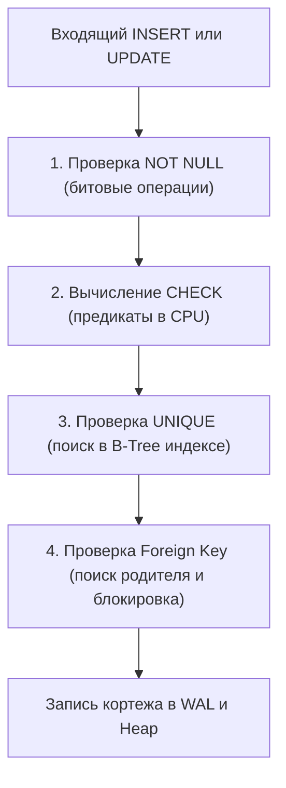

*Как перенести бизнес-инварианты из памяти Go-сервиса в ядро СУБД, сколько тактов CPU и дискового ввода-вывода стоят `NOT NULL`, `UNIQUE` и `CHECK`, и почему предварительный `SELECT` перед `INSERT` открывает гонку TOCTOU.*

> «Хотя поддержка конкурентности — одна из главных сильных сторон Go, рассуждать о конкурентных программах по природе труднее, чем о последовательных, и интуиция, выработанная на последовательном коде, порой подводит.»  
> — Алан Донован, Брайан Керниган (*The Go Programming Language*)

## Иллюзия всемогущества прикладного кода

Начинающий бэкенд-разработчик нередко уверен, что полностью контролирует корректность данных из кода приложения. Он аккуратно проектирует доменные структуры в Go, пишет валидаторы с проверкой `AmountMinor > 0`, покрывает обработчики модульными тестами и считает, что некорректные байты в базу не попадут.

В распределённом продакшене эта иллюзия рассыпается при первой же реальной нагрузке. Десяток экземпляров сервиса `LedgerPulse` в Kubernetes параллельно обрабатывает входящие вебхуки и платежи. Проверки в оперативной памяти одного процесса Go ничего не знают о соседних процессах и не спасают от состояния гонки (Race Condition), когда два запроса одновременно проверяют условие и одновременно решают, что путь свободен. К этому добавляются ручные скрипты миграции, административные запросы из консоли `psql` и соседние сервисы со своей логикой.

**Ограничения целостности (Constraints)** — это декларативные инварианты на уровне движка СУБД. База данных проверяет их атомарно *до* того, как транзакция запишет изменённые страницы в буферный пул и журнал предзаписи (WAL). В предыдущей главе [[6. Первичные и внешние ключи]] мы разобрали ключи и связи между таблицами; теперь рассмотрим три остальных столпа защиты данных — `NOT NULL`, `UNIQUE` и `CHECK`.

---

## Порядок срабатывания ограничений внутри СУБД

Когда в PostgreSQL приходит команда `INSERT` или `UPDATE`, движок проверяет ограничения в порядке возрастания их вычислительной стоимости — от мгновенных битовых операций в памяти до обращений к индексам и другим таблицам:



Такой конвейер экономит ресурсы: если строка нарушает дешёвую проверку `NOT NULL` или `CHECK`, СУБД отклоняет транзакцию сразу, даже не прикасаясь к страницам индексов.

---

## NOT NULL: отсутствие пустоты за пару инструкций

Ограничение `NOT NULL` запрещает сохранять в столбец маркер неизвестности `NULL`. В терминологии реляционной модели Эдгара Кодда это базовая защита целостности домена (Domain Integrity): например, у каждой проводки в `ledger_entries` обязаны быть сумма `amount_minor` и валюта `currency`.

Какова физическая цена такой проверки? Она практически нулевая. Вспомним устройство заголовка кортежа `HeapTupleHeaderData` из главы [[5. Таблицы, строки, столбцы и ключи]]: информация о наличии `NULL` хранится в битовой карте **NULL Bitmap** в самом начале строки, а обязательность колонки зафиксирована в системном каталоге.

Когда исполнитель формирует кортеж в оперативной памяти, ему не нужно ни считывать страницы с диска, ни искать данные в других структурах. Процессор проверяет флаг за пару машинных инструкций (~1 нс) и отсекает некорректную запись без единого дискового системного вызова.

---

## UNIQUE: индекс под маской правила

Ограничение `UNIQUE` гарантирует, что в таблице нет двух строк с одинаковым значением указанного столбца или комбинации столбцов. В домене `LedgerPulse` без него не обойтись: `idempotency_key` в таблице `transactions` защищает от двойного списания при повторной доставке платежного запроса, а `email` пользователя или пара `(account_id, external_tx_ref)` исключает дубликаты аккаунтов и проводок.

Однако за простой строкой DDL скрывается тяжёлый физический объект.

> [!warning] Ловушка: скрытая цена `UNIQUE`
> Чтобы проверять уникальность нового значения за логарифмическое время `$O(\log N)$`, а не сканировать терабайтный Heap-файл за `$O(N)$`, **база данных обязана создать полноценный B-Tree индекс**. Ограничение `UNIQUE` физически невозможно без такого индекса.
>
> Как только вы добавляете `ALTER TABLE transactions ADD CONSTRAINT uq_tx_idem UNIQUE (idempotency_key)`, движок выделяет отдельный файл B-Tree. С этого момента каждая операция `INSERT` или `UPDATE` платит двойную цену: обновляется и Heap-таблица, и дерево индекса (Index Maintenance). Если повесить `UNIQUE` на широкие строки по 500 байт (например, длинные URL, токены сессий или сериализованный JSON), индекс раздуется, вытеснит горячие страницы таблиц из Buffer Pool и замедлит все записи.

С `UNIQUE` связан и тонкий нюанс поведения `NULL`. По стандарту SQL два значения `NULL` не считаются равными друг другу, поэтому обычный столбец `UNIQUE` позволяет вставить сколько угодно строк со значением `NULL`. Если бизнес-логика требует разрешить не более одного `NULL` (например, единственный активный черновик без внешнего номера), в PostgreSQL 15+ добавляют модификатор `UNIQUE NULLS NOT DISTINCT`.

---

## CHECK: бизнес-инварианты в тактах CPU

Ограничение `CHECK` задаёт произвольное логическое выражение (предикат), которому должна удовлетворять каждая строка таблицы. Для финансового ядра `LedgerPulse` это прямой способ исключить невозможные состояния данных:

```sql
CREATE TABLE accounts (
    id            BIGINT GENERATED ALWAYS AS IDENTITY PRIMARY KEY,
    owner_id      BIGINT NOT NULL,
    balance_minor BIGINT NOT NULL,
    currency      CHAR(3) NOT NULL,
    status        TEXT NOT NULL,
    CONSTRAINT chk_accounts_balance_nonneg CHECK (balance_minor >= 0),
    CONSTRAINT chk_accounts_currency_iso   CHECK (currency ~ '^[A-Z]{3}$'),
    CONSTRAINT chk_accounts_status         CHECK (status IN ('active', 'frozen', 'closed'))
);
```

Критическая деталь, на которой легко обжечься: предикат `CHECK` считает строку допустимой, если выражение вычисляется в `TRUE` **или в `UNKNOWN`** (то есть отклоняется *только* явное `FALSE`). Если забыть `NOT NULL` у столбца `amount_minor`, строка со значением `NULL` спокойно пройдёт `CHECK (amount_minor > 0)`. Детали трёхзначной логики мы подробно разберём в следующей главе [[8. NULL и трёхзначная логика]], а правило на практике простое: ставьте `NOT NULL` рядом с каждым `CHECK`, где `NULL` недопустим.

Предикаты `CHECK` вычисляются в пространстве процесса СУБД, в оперативной памяти, до записи в буферный пул. Они расходуют лишь десятки тактов CPU и **не порождают дискового ввода-вывода** — в отличие от внешних ключей или `UNIQUE`. Поэтому финансовые инварианты вроде неотрицательного баланса на обычном клиентском счёте или запрета нулевой суммы перевода (`amount_minor != 0`) всегда должны дублироваться через `CHECK` в схеме БД.

---

## Гонка TOCTOU и делегирование базе в Go 1.24

Один из самых живучих антипаттернов в бэкенде — проверка уникальности через предварительный `SELECT` перед вставкой. Разработчик рассуждает последовательно: «Сначала спрошу у базы, занят ли `idempotency_key`; если нет — создам транзакцию».

```go
// АНТИПАТТЕРН: уязвим к гонке TOCTOU (Time-of-Check to Time-of-Use)
func createTxBad(ctx context.Context, db *sql.DB, idempotencyKey string, amountMinor int64) error {
	var exists bool
	// 1. Time of Check: проверяем наличие ключа
	err := db.QueryRowContext(ctx,
		`SELECT EXISTS(SELECT 1 FROM transactions WHERE idempotency_key = $1)`,
		idempotencyKey,
	).Scan(&exists)
	if err != nil {
		return err
	}
	if exists {
		return errors.New("дубликат операции")
	}

	// В этот зазор вклинивается параллельный запрос от того же клиента или другого пода.
	// Оба запроса получили exists == false и оба идут выполнять INSERT.

	// 2. Time of Use: вставляем запись
	_, err = db.ExecContext(ctx,
		`INSERT INTO transactions (idempotency_key, amount_minor) VALUES ($1, $2)`,
		idempotencyKey, amountMinor,
	)
	return err
}
```

Если в схеме нет `UNIQUE (idempotency_key)`, два одновременных HTTP-запроса (двойной клик пользователя или повторная доставка вебхука) пройдут проверку `exists == false` и спишут деньги дважды. А если `UNIQUE` в схеме уже есть, предварительный `SELECT` превращается в бессмысленный лишний сетевой поход к базе данных: на каждом успешном запросе приложение тратит двойную сетевую задержку, а гонка всё равно приводит к ошибке `23505` на шаге `INSERT`.

### Идиоматичный Go: сразу пишем и перехватываем SQLSTATE

Надёжное решение с учётом работы сети и СУБД — полностью убрать холостой `SELECT` и делегировать проверку ядру базы данных. Мы сразу выполняем `INSERT ... RETURNING id` и различаем коды ошибок PostgreSQL через `errors.As` с `*pgconn.PgError`:

```go
package ledger

import (
	"context"
	"database/sql"
	"errors"
	"fmt"

	"github.com/jackc/pgx/v5/pgconn"
)

const (
	pgErrNotNullViolation = "23502"
	pgErrUniqueViolation  = "23505"
	pgErrCheckViolation   = "23514"
)

var (
	ErrDuplicateIdempotencyKey = errors.New("транзакция с таким idempotency_key уже существует")
	ErrInvalidAmount           = errors.New("сумма транзакции нарушает ограничение схемы")
)

func CreateTransaction(ctx context.Context, db *sql.DB, idempotencyKey string, amountMinor int64) (int64, error) {
	const query = `
		INSERT INTO transactions (idempotency_key, amount_minor, status)
		VALUES ($1, $2, 'pending')
		RETURNING id`

	var txID int64
	err := db.QueryRowContext(ctx, query, idempotencyKey, amountMinor).Scan(&txID)
	if err != nil {
		var pgErr *pgconn.PgError
		if errors.As(err, &pgErr) {
			switch pgErr.Code {
			case pgErrUniqueViolation:
				return 0, fmt.Errorf("%w (constraint %s)", ErrDuplicateIdempotencyKey, pgErr.ConstraintName)
			case pgErrCheckViolation, pgErrNotNullViolation:
				return 0, fmt.Errorf("%w: %s", ErrInvalidAmount, pgErr.ConstraintName)
			}
		}
		return 0, fmt.Errorf("вставка транзакции: %w", err)
	}
	return txID, nil
}
```

Если два конкурентных вызова `CreateTransaction` приходят с одинаковым `idempotencyKey = "pay-8841"`, одна транзакция захватит лист B-Tree и вернёт `txID`, а вторая получит от PostgreSQL ошибку `23505` (и её перехватит ветка `ErrDuplicateIdempotencyKey`). Если же передать `amountMinor = -100` при наличии `CHECK (amount_minor > 0)`, сервер отклонит вставку в CPU за микросекунды с кодом `23514`:

```text
вызов 1 (pay-8841, 5000):  id = 1042
вызов 2 (pay-8841, 5000):  ошибка: транзакция с таким idempotency_key уже существует (constraint uq_transactions_idempotency_key)
вызов 3 (pay-8842, -100):  ошибка: сумма транзакции нарушает ограничение схемы: chk_transactions_amount_pos
```

Поле `pgErr.ConstraintName` позволяет точно отличать, какое именно уникальное поле сработало (например, `uq_transactions_idempotency_key` от `uq_accounts_external_ref`), не прибегая к хрупкому разбору текста сообщений.

> [!tip] Собеседование [Middle]
> **Вопрос:** Зачем писать валидацию входных структур на Go (проверять пустые строки, диапазоны чисел, формат валюты), если ограничения `NOT NULL`, `UNIQUE` и `CHECK` в базе данных всё равно не пропустят некорректную запись?  
> **Ответ:** Это принцип эшелонированной защиты (**Defense in Depth**):  
> 1. **Валидация в Go (первый рубеж):** Отсекает мусор на границе HTTP/gRPC до захвата соединения из пула `*sql.DB`, до сетевого round-trip к базе и до траты тактов CPU парсера SQL. Кроме того, Go-валидатор возвращает пользователю понятный список ошибок сразу по всем полям формы, а не останавливается на первом упавшем ограничении.  
> 2. **Ограничения в БД (последний рубеж):** Служат единым источником истины (Single Source of Truth), когда приложение масштабировано на десятки подов с гонками TOCTOU, а к базе подключаются другие сервисы, миграции или инженеры через `psql`.

---

## Упражнения

### Упражнение 1 (Базовое)
Дополните таблицу `transactions` для `LedgerPulse` ограничениями целостности:
* `idempotency_key` обязателен и уникален (`uq_transactions_idempotency_key`).
* `amount_minor` обязателен и строго положителен (`chk_transactions_amount_pos`).
* `currency` обязателен и состоит ровно из трёх заглавных латинских букв.
* `status` обязателен и принимает только `'pending'`, `'posted'`, `'failed'`, `'reversed'`.
* `posted_at` может быть `NULL`, но если оно заполнено, то должно быть не раньше `created_at` (`posted_at >= created_at`).

> [!solution] Показать решение
> ```sql
> CREATE TABLE transactions (
>     id              BIGINT GENERATED ALWAYS AS IDENTITY PRIMARY KEY,
>     amount_minor    BIGINT NOT NULL,
>     created_at      TIMESTAMPTZ NOT NULL DEFAULT NOW(),
>     posted_at       TIMESTAMPTZ,
>     currency        CHAR(3) NOT NULL,
>     status          TEXT NOT NULL,
>     idempotency_key TEXT NOT NULL,
>     CONSTRAINT uq_transactions_idempotency_key UNIQUE (idempotency_key),
>     CONSTRAINT chk_transactions_amount_pos     CHECK (amount_minor > 0),
>     CONSTRAINT chk_transactions_currency       CHECK (currency ~ '^[A-Z]{3}$'),
>     CONSTRAINT chk_transactions_status         CHECK (status IN ('pending', 'posted', 'failed', 'reversed')),
>     CONSTRAINT chk_transactions_posted_order   CHECK (posted_at IS NULL OR posted_at >= created_at)
> );
> ```
> **Разбор:** В последнем `CHECK` выражение `posted_at >= created_at` само по себе для `NULL` даёт `UNKNOWN` и прошло бы проверку, но явное условие `posted_at IS NULL OR ...` делает намерение проектировщика прозрачным для коллег при чтении DDL.

### Упражнение 2 (Практическое)
Перепишите функцию регистрации счёта в `LedgerPulse` так, чтобы избавиться от гонки TOCTOU. Исходный плохой код:
```go
func OpenAccountBad(ctx context.Context, db *sql.DB, ownerID int64, externalCode string) (int64, error) {
	var exists bool
	err := db.QueryRowContext(ctx,
		`SELECT EXISTS(SELECT 1 FROM accounts WHERE external_code = $1)`, externalCode,
	).Scan(&exists)
	if err != nil {
		return 0, err
	}
	if exists {
		return 0, errors.New("код счёта уже занят")
	}
	var id int64
	err = db.QueryRowContext(ctx,
		`INSERT INTO accounts (owner_id, external_code, balance_minor) VALUES ($1, $2, 0) RETURNING id`,
		ownerID, externalCode,
	).Scan(&id)
	return id, err
}
```
Реализуйте `OpenAccount(ctx context.Context, db *sql.DB, ownerID int64, externalCode string) (int64, error)` в один SQL-запрос с обработкой кода `23505` (конфликт `external_code`) и `23503` (несуществующий `ownerID`).

> [!solution] Показать решение
> ```go
> var (
> 	ErrExternalCodeTaken = errors.New("код счёта уже занят")
> 	ErrOwnerNotFound     = errors.New("владелец счёта не найден")
> )
>
> func OpenAccount(ctx context.Context, db *sql.DB, ownerID int64, externalCode string) (int64, error) {
> 	const query = `
> 		INSERT INTO accounts (owner_id, external_code, balance_minor)
> 		VALUES ($1, $2, 0)
> 		RETURNING id`
>
> 	var id int64
> 	err := db.QueryRowContext(ctx, query, ownerID, externalCode).Scan(&id)
> 	if err != nil {
> 		var pgErr *pgconn.PgError
> 		if errors.As(err, &pgErr) {
> 			switch pgErr.Code {
> 			case "23505":
> 				return 0, ErrExternalCodeTaken
> 			case "23503":
> 				return 0, ErrOwnerNotFound
> 			}
> 		}
> 		return 0, fmt.Errorf("создание счёта: %w", err)
> 	}
> 	return id, nil
> }
> ```
> **Разбор:** Удаление `SELECT EXISTS` сократило число сетевых запросов в два раза и устранило окно гонки. При опоре на `UNIQUE (external_code)` и `FOREIGN KEY (owner_id)` база атомарно гарантирует корректность и возвращает точный код `SQLSTATE`.

### Упражнение 3 (Со звёздочкой *)
Разработчик решил застраховаться от дублирования сложных уведомлений и добавил ограничение `UNIQUE (payload_json)` на столбец типа `TEXT`, где лежат JSON-документы средним размером 800 байт. Таблица выросла до 20 млн строк. Объясните:
1. Что произойдёт с объёмом B-Tree индекса и буферным пулом (Buffer Pool)?
2. Как решить задачу защиты от дубликатов без хранения 800-байтных строк внутри каждой страницы индекса?

> [!solution] Показать решение
> 1. **Последствия для памяти и диска:** 20 млн ключей по ~800 байт дадут индекс размером порядка 16–20 ГБ только на сами полезные значения (плюс метаданные страниц B-Tree). На каждой 8-килобайтной странице дерева поместится меньше десятка записей — резко вырастет глубина дерева, замедлится поиск и усилится вымывание рабочих страниц таблиц из Buffer Pool (Cache Miss).  
> 2. **Инженерное решение:** Считать криптографический хеш (например, SHA-256 — фиксированные 32 байта) в приложении Go или генерируемом столбце и вешать `UNIQUE` на компактный хеш (`payload_sha256 BYTEA` или `UUID`-токен идемпотентности). Это уменьшит размер ключей в B-Tree в 25 раз.

---

Ограничения `NOT NULL`, `UNIQUE` и `CHECK` надёжно защищают инварианты, но даже в этой главе мы уже столкнулись со странностью: почему `CHECK (amount_minor > 0)` спокойно пропускает `NULL`, а два `NULL` не нарушают `UNIQUE`? Чтобы эти правила перестали казаться загадкой, в следующей главе разберём самую коварную концепцию SQL — [[8. NULL и трёхзначная логика]].
