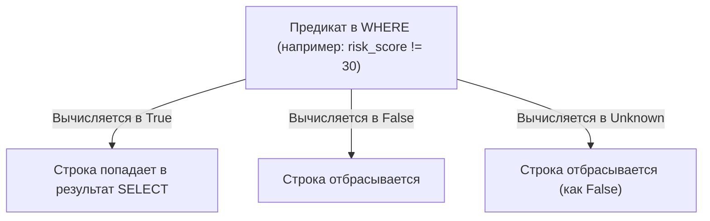

*Почему `NULL` ломает привычную двузначную логику Go, как предикат `NOT IN` превращает миллионную таблицу в пустое множество, сколько байт занимает `NULL` в заголовке кортежа и когда в Go выбирать `sql.Null[T]` вместо указателей.*

## Призрак реляционной модели

В языке Go царит двоичная ясность. Переменная `bool` принимает строго `true` или `false`. Указатель либо хранит адрес объекта, либо равен `nil`. Число `int64` при объявлении получает нулевое значение `0`, а строка — `""`. В таком детерминированном мире программа всегда отвечает на условие чётким «да» или «нет».

Переступая порог SQL, разработчик попадает в другую логическую систему. Проектируя реляционную модель, Эдгар Кодд моделировал не идеальный абстрактный мир, а реальные данные, которые почти всегда неполны: у открытого счёта `LedgerPulse` ещё нет даты закрытия `closed_at`, у обычного клиента отсутствует `parent_account_id`, а сумма лимита по кредитной линии ещё не назначена.

Для представления неполноты Кодд ввёл специальный маркер: **`NULL` — это не ноль, не пустая строка `""` и не `false`. Это маркер того, что значение «неизвестно» или «неприменимо».**

Это решение разрушило классическую булеву алгебру и породило **трёхзначную логику (Three-Valued Logic, 3VL)**. Непонимание 3VL регулярно приводит к пропавшим строкам в финансовых отчётах и неожиданным просадкам производительности.

---

## Трёхзначная логика (3VL)

В стандарте SQL результат любого логического выражения принимает одно из трёх состояний:
1. **`True`** (Истина).
2. **`False`** (Ложь).
3. **`Unknown`** (Неизвестно — результат соприкосновения с `NULL`).

> [!warning] Ловушка: сравнение с `NULL` через `=` и `!=`
> В SQL бессмысленно писать `WHERE closed_at = NULL`. Если два значения неизвестны, мы не можем утверждать, равны они или нет. Поэтому и `NULL = NULL`, и `NULL != 10` вычисляются в **`Unknown`**. Для проверки на отсутствие значения предназначены специальные операторы `IS NULL` и `IS NOT NULL` (а для безопасного сравнения двух колонок с учётом пустоты — `IS DISTINCT FROM` и `IS NOT DISTINCT FROM`).

Как ведут себя логические связки `AND`, `OR` и `NOT` при встрече с `Unknown`?

| `A` | `B` | `A AND B` | `A OR B` | `NOT A` |
|---|---|---|---|---|
| `True` | `Unknown` | **`Unknown`** | **`True`** | `False` |
| `False` | `Unknown` | **`False`** | **`Unknown`** | `True` |
| `Unknown` | `Unknown` | **`Unknown`** | **`Unknown`** | **`Unknown`** |

Логика таблицы прозрачна:
* `True OR Unknown` даёт **`True`**, потому что для дизъюнкции достаточно одной гарантированной истины.
* `False AND Unknown` даёт **`False`**, поскольку конъюнкция с заведомой ложью никогда не станет истинной.
* `True AND Unknown` даёт **`Unknown`** — итоговый результат зависит от неизвестного операнда.

Ключевое правило секции `WHERE` в SQL — в итоговую выборку попадают **исключительно** строки, для которых условие строго равно `True`:



> [!tip] Собеседование [Middle]
> **Вопрос:** В таблице `accounts` ровно 100 строк. У 30 счетов `risk_score = 20`, у 50 счетов `risk_score = 30`, а у оставшихся 20 счетов `risk_score IS NULL`. Сколько строк вернёт запрос `SELECT id FROM accounts WHERE risk_score != 30;`?  
> **Ответ:** Ровно **30 строк**. Для 20 счетов с `NULL` предикат `NULL != 30` даёт `Unknown`. Секция `WHERE` отбрасывает `Unknown` точно так же, как и `False`. Так разработчики незаметно теряют до четверти записей в отчётах, пока не добавят явное `OR risk_score IS NULL` (или `WHERE risk_score IS DISTINCT FROM 30`).

---

## Смертельная ловушка: `NOT IN` и `NULL`

Этот сценарий регулярно ломает фильтрацию исключений в продакшене. Предположим, нужно выбрать в `LedgerPulse` все счета, чей код категории не входит в список исключённых:

```sql
SELECT id, owner_id
FROM accounts
WHERE category_id NOT IN (1, 2, NULL);
```

Такой запрос **всегда вернёт 0 строк**, сколько бы миллионов счетов ни хранилось в таблице.

Причина кроется в развёртывании оператора `NOT IN` оптимизатором СУБД. По стандарту SQL этот фильтр эквивалентен цепочке строгих неравенств, связанных через `AND`:

```sql
category_id != 1 AND category_id != 2 AND category_id != NULL
```

Проверим строку со значением `category_id = 5`:
1. `5 != 1` → `True`
2. `5 != 2` → `True`
3. `5 != NULL` → `Unknown`

Итоговое выражение `True AND True AND Unknown` сворачивается в **`Unknown`**, и секция `WHERE` выбрасывает каждую строку таблицы.

На практике `NULL` редко пишут в список `NOT IN` руками — его туда приносит подзапрос: `WHERE id NOT IN (SELECT parent_tx_id FROM transactions)`. Достаточно появиться хотя бы одной обычной транзакции с `parent_tx_id IS NULL`, и весь запрос мгновенно перестанет возвращать данные. В боевом SQL заменяйте `NOT IN` на предикат `NOT EXISTS` (его устройство мы подробно разберём в Модуле 2) либо явно отсекайте пустоту внутри подзапроса условием `WHERE parent_tx_id IS NOT NULL`.

---

## `NULL` в скалярных выражениях и агрегатных функциях

В обычных арифметических и строковых операциях `NULL` ведёт себя как «инфекция», превращая весь результат в неизвестность:
* `1000 + NULL` → `NULL`
* `'TX-' || NULL` → `NULL` (в стандартном SQL и PostgreSQL при операторе конкатенации `||`, хотя функция `CONCAT('TX-', NULL)` в PostgreSQL пропускает `NULL` и возвращает `'TX-'`).

Зато стандартные **агрегатные функции** подчиняются обратному правилу — они молча **игнорируют** строки с `NULL`:
* `COUNT(*)` считает общее количество физических строк в выборке, даже если все столбцы равны `NULL`.
* `COUNT(closed_at)` считает только строки, где `closed_at IS NOT NULL`.
* `SUM(fee_minor)` суммирует известные комиссии, пропуская `NULL` (но если выборка пуста или все значения `NULL`, функция вернёт `NULL`, а не `0`).
* `AVG(fee_minor)` делит сумму только на число не-`NULL` строк, а не на общее количество строк в таблице. Это частая причина расхождений в аналитике: средний чек по 100 заказам, из которых 50 с `NULL`, считается как сумма, делённая на 50.

Чтобы явно заменить неизвестность на нейтральное значение (например, ноль), используйте функцию `COALESCE` (подробнее о ней и `NULLIF` — в Модуле 2):

```sql
SELECT COALESCE(SUM(fee_minor), 0) AS total_fee_minor
FROM transactions
WHERE account_id = 42;
```

---

## Физика хранения `NULL` на диске и в индексах

Интуитивно кажется, что «пустота» не должна расходовать диск. Но движку БД нужно знать, какой именно из двадцати столбцов строки отсутствует.

> [!info] Под капотом: NULL Bitmap
> Вернёмся к заголовку кортежа `HeapTupleHeaderData` из главы [[5. Таблицы, строки, столбцы и ключи]]. Если в строке хотя бы один столбец содержит `NULL`, PostgreSQL выставляет бит `HEAP_HASNULL` в системном поле `t_infomask` и сразу после 23-байтового фиксированного заголовка выделяет **NULL Bitmap** — битовую карту длиной по 1 биту на каждый столбец таблицы.
>
> Когда вы записываете `NULL` в столбец `BIGINT` (который в заполненном виде занимает 8 байт), в полезную нагрузку строки эти 8 байт **не выделяются вообще**. Наличие `NULL` кодируется одним битом в карте заголовка, что делает `NULL` предельно экономным способом хранения разреженных данных (Sparse Data).

С индексами ситуация обратная. В PostgreSQL B-Tree индекс **включает** значения `NULL` в структуру дерева (упорядочивая их в начале или в конце с помощью `NULLS FIRST` / `NULLS LAST`).

Если в таблице `transactions` хранится 20 миллионов записей, и у 99% успешных операций поле `failed_reason` имеет значение `NULL`, то обычный индекс `CREATE INDEX idx_tx_failed ON transactions (failed_reason)` сохранит 19.8 миллиона бесполезных записей `NULL`, раздув дерево на сотни мегабайт памяти. Для таких разреженных полей в PostgreSQL применяют **частичный индекс (Partial Index)** (подробно изучим в Модуле 4):

```sql
CREATE INDEX idx_tx_failed_only
    ON transactions (id)
    WHERE failed_reason IS NOT NULL;
```

Такой индекс не содержит ни одного `NULL`, занимает в десятки раз меньше места в Buffer Pool и мгновенно находит проблемные транзакции.

---

## Работа с `NULL` в Go 1.24: стек против кучи

На стыке SQL и Go возникает несоответствие моделей (Impedance Mismatch): база данных живёт в трёхзначной логике, а Go — в строгой двузначной. Для маппинга столбцов, допускающих `NULL`, стандартная библиотека `database/sql` предлагает два пути с разным профилем нагрузки на память.

### Путь 1: значимые типы `sql.Null*` и `sql.Null[T]`

В пакете `database/sql` есть готовые структуры `sql.NullString`, `sql.NullInt64`, `sql.NullTime`, `sql.NullBool`, а начиная с Go 1.22 — универсальный дженерик `sql.Null[T]`. Внутри лежит обычное значение `V` и булево поле `Valid`, которое прямо отражает бит из NULL Bitmap базы данных:

```go
package ledger

import (
	"context"
	"database/sql"
	"fmt"
	"time"
)

type Account struct {
	ID           int64
	BalanceMinor int64
	ParentID     sql.Null[int64] // NULL, если у счёта нет родительского счёта
	ClosedAt     sql.NullTime    // NULL, если счёт активен
}

func LoadAccount(ctx context.Context, db *sql.DB, id int64) (Account, error) {
	const query = `
		SELECT id, balance_minor, parent_account_id, closed_at
		FROM accounts
		WHERE id = $1`

	var acc Account
	err := db.QueryRowContext(ctx, query, id).Scan(
		&acc.ID, &acc.BalanceMinor, &acc.ParentID, &acc.ClosedAt,
	)
	if err != nil {
		return Account{}, fmt.Errorf("чтение счёта %d: %w", id, err)
	}
	return acc, nil
}
```

Если счёт № 42 активен и не привязан к родительскому счёту, поля получат значения `acc.ParentID.Valid == false` и `acc.ClosedAt.Valid == false`.

Главное достоинство `sql.Null[T]` и `sql.Null*` — это значимые типы (Value Types). При потоковом чтении десятков тысяч строк структура `Account` целиком размещается на стеке горутины или плотно укладывается в один непрерывный слайс без лишних указателей и нагрузки на сборщик мусора (GC).

### Путь 2: указатели (`*int64`, `*string`, `*time.Time`)

Драйверы `pgx` и `database/sql` умеют преобразовывать SQL `NULL` в `nil`-указатель Go. Однако при чтении 1 000 000 строк с тремя nullable-полями-указателями (`*string`, `*int64`, `*time.Time`) рантайм Go разместит в куче миллионы мелких отдельных объектов, что резко увеличит частоту циклов сборщика мусора и ухудшит локальность данных в кэше CPU.

> [!tip] Собеседование [Senior/Staff]
> **Вопрос:** Что выбрать для nullable-полей в Go-сервисе: `sql.Null[T]` / `sql.Null*` или указатели (`*string`, `*int64`)?  
> **Ответ:** Выбор зависит от роли структуры в приложении:  
> 1. Для **слоя работы с БД (Repository / high-throughput воркеры)** предпочтительнее `sql.Null[T]` и `sql.Null*` — они сохраняют плоскую раскладку памяти без аллокаций в куче и лишней работы для GC.  
> 2. Для **внешних HTTP DTO**, которые сериализуются в JSON с тегом `omitempty`, указатели `*string` или `*time.Time` (либо кастомные обёртки с `MarshalJSON`) удобнее, так как `sql.NullString` по умолчанию маршалится в JSON как объект `{"String": "...", "Valid": true}`. В продакшене эти слои разделяют: сканируют из БД в стековую модель с `sql.Null[T]`, а в API DTO переводят только финальный ответ.

---

## Упражнения

### Упражнение 1 (Базовое)
В таблице `accounts` 6 строк со значениями `(id, credit_limit_minor)`:
`(1, 10000)`, `(2, 50000)`, `(3, 10000)`, `(4, NULL)`, `(5, NULL)`, `(6, 0)`.
Определите точный результат каждого из четырёх запросов (и объясните почему):
1. `SELECT COUNT(*) FROM accounts WHERE credit_limit_minor != 10000;`
2. `SELECT COUNT(*), COUNT(credit_limit_minor), AVG(credit_limit_minor) FROM accounts;`
3. `SELECT id FROM accounts WHERE id NOT IN (SELECT parent_id FROM accounts_links);` — при условии, что в `accounts_links` есть значения `(1, 2, NULL)`.

> [!solution] Показать решение
> 1. **Результат: `2`** (строки `id = 2` и `id = 6`). Строки `4` и `5` с `NULL` дают `Unknown` на условии `NULL != 10000` и отбрасываются секцией `WHERE`.  
> 2. **Результат: `COUNT(*) = 6`, `COUNT(credit_limit_minor) = 4`, `AVG(credit_limit_minor) = 17500`**. Агрегаты игнорируют `NULL`, поэтому среднее считается как `(10000 + 50000 + 10000 + 0) / 4 = 17500`, а не деление на 6.  
> 3. **Результат: пустой набор (0 строк)**. Подзапрос вернул `NULL`, и развёрнутое условие `id != 1 AND id != 2 AND id != NULL` для любой строки вычисляется в `Unknown`.

### Упражнение 2 (Практическое)
Напишите функцию `GetAccountBalanceAndCloseInfo(ctx context.Context, db *sql.DB, accountID int64) (totalMinor int64, closedAt sql.NullTime, err error)` для `LedgerPulse`. Она должна:
* Посчитать сумму всех проводок из `ledger_entries` для `account_id` так, чтобы при отсутствии проводок `Scan` не падал на `NULL` и возвращал `0`.
* Получить `closed_at` из `accounts` без аллокаций в куче под указатели.

> [!solution] Показать решение
> ```go
> func GetAccountBalanceAndCloseInfo(
> 	ctx context.Context,
> 	db *sql.DB,
> 	accountID int64,
> ) (int64, sql.NullTime, error) {
> 	const query = `
> 		SELECT
> 			COALESCE((SELECT SUM(amount_minor) FROM ledger_entries WHERE account_id = $1), 0),
> 			closed_at
> 		FROM accounts
> 		WHERE id = $1`
>
> 	var totalMinor int64
> 	var closedAt sql.NullTime
> 	err := db.QueryRowContext(ctx, query, accountID).Scan(&totalMinor, &closedAt)
> 	if err != nil {
> 		return 0, sql.NullTime{}, fmt.Errorf("баланс счёта %d: %w", accountID, err)
> 	}
> 	return totalMinor, closedAt, nil
> }
> ```
> **Разбор:** Функция `SUM` на пустом множестве строк возвращает `NULL`, и попытка отсканировать её напрямую в `int64` завершилась бы ошибкой драйвера `converting NULL to int64 is unsupported`. Оборачивание в `COALESCE(..., 0)` гарантирует возврат целого `0`, а `sql.NullTime` безопасно принимает `NULL` для активного счёта на стеке.

### Упражнение 3 (Со звёздочкой *)
В таблице `transactions` системы `LedgerPulse` 40 миллионов строк. У 99.7% транзакций статус `'posted'` и поле `failed_reason` равно `NULL`, а у 0.3% (120 тысяч строк) — статус `'failed'` и заполнен текст `failed_reason`. Мониторинг показал, что административный отчёт по неуспешным операциям делает полное сканирование таблицы.
1. Почему обычный индекс `CREATE INDEX idx_tx_failed_reason ON transactions (failed_reason)` не оптимален?
2. Напишите правильный DDL индекса и `SELECT`-запрос, который гарантированно попадёт в этот индекс.

> [!solution] Показать решение
> 1. Обычный B-Tree индекс включит все 39.88 млн записей с `NULL` и к тому же проиндексирует длинные текстовые строки `failed_reason`, заняв гигабайты памяти впустую.  
> 2. Оптимально использовать компактный частичный индекс только по проблемным строкам (включив `created_at` или `id` для быстрого чтения последних сбоев):
> ```sql
> CREATE INDEX idx_tx_failed_created
>     ON transactions (created_at DESC)
>     WHERE failed_reason IS NOT NULL;
>
> -- Запрос обязан повторять предикат WHERE частичного индекса:
> SELECT id, created_at, failed_reason
> FROM transactions
> WHERE failed_reason IS NOT NULL
> ORDER BY created_at DESC
> LIMIT 50;
> ```
> **Разбор:** Такой индекс охватит всего 0.3% таблицы (120 тыс. записей вместо 40 млн), займёт считанные мегабайты в оперативной памяти, а предикат `WHERE failed_reason IS NOT NULL` в запросе позволит планировщику гарантированно использовать его.

---

Мы собрали весь инструментарий физического и логического уровня: знаем устройство страниц, ключей, ограничений целостности и ловушки трёхзначной логики. Но даже с идеальными ключами и проверками `CHECK` плохая структура таблиц порождает дублирование фактов и противоречия при изменении данных. Как математически строго разложить сущности предметной области по таблицам без аномалий вставки, обновления и удаления, разберём в следующей главе о нормализации баз данных.
