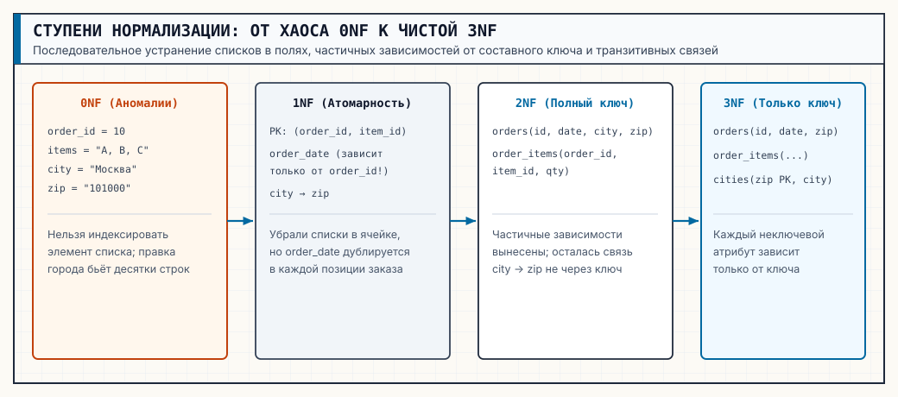
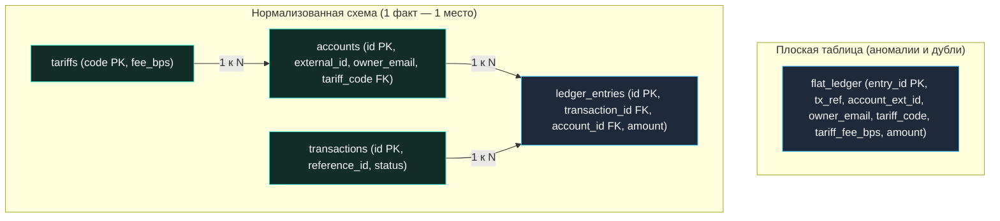

*Почему единая плоская таблица разрушает целостность данных под нагрузкой, как возникают аномалии вставки, обновления и удаления и какую цену СУБД платит за порядок в схеме.*

> «Простота требует больше труда в начале проекта — чтобы очистить идею до самой сути — и больше дисциплины на всём сроке его жизни, чтобы отличать хорошие изменения от плохих и вредоносных.»  
> — Алан Донован и Брайан Керниган

В предыдущих главах мы разобрались, как СУБД раскладывает кортежи по страницам, зачем нужны [[6. Первичные и внешние ключи]], как переносить инварианты в схему через [[7. Ограничения целостности данных — NOT NULL, UNIQUE, CHECK]] и почему коварен `NULL` из-за [[8. NULL и трёхзначная логика|трёхзначной логики]]. Но даже самые строгие `CHECK`-ограничения бессильны, если сама структура таблиц провоцирует дублирование фактов.

Каждый разработчик в начале пути испытывает соблазн сложить всю предметную область в одну широкую таблицу. Данные в такой схеме выглядят привычно — точно так же они лежат в отчёте Excel или прилетают в JSON-ответе API. Одним простым `SELECT` без объединений можно забрать всю историю операций клиента.

Удобство на старте оборачивается аварией в продакшене.

---

## Плоский мир и три классические аномалии

Представим, что первую версию финансового ядра `LedgerPulse` решили хранить в одной плоской таблице `flat_ledger`:

| entry_id | tx_ref | account_ext_id | owner_email | tariff_code | tariff_fee_bps | amount |
| :--- | :--- | :--- | :--- | :--- | :--- | :--- |
| 1 | `tx-1001` | `acc_bob` | `bob@ledger.io` | `pro` | 150 | 50000 |
| 2 | `tx-1002` | `acc_bob` | `bob@ledger.io` | `pro` | 150 | -12000 |
| 3 | `tx-1003` | `acc_alice` | `alice@ledger.io` | `pro` | 150 | 80000 |

На трёх строках такая схема кажется безобидной. Проблемы начинаются в тот момент, когда данные меняются — именно модификация превращает плоскую таблицу в источник тихого повреждения базы. В теории реляционных баз данных такие сбои делят на три класса аномалий.

### 1. Аномалия обновления (Update Anomaly)

Клиент Боб меняет почтовый ящик, либо финансовый отдел пересматривает комиссию тарифа `pro` со `150` базисных пунктов (`1.5%`) до `120`. Если Боб пользуется `LedgerPulse` три года и накопил 10 000 проводок, запрос `UPDATE` обязан найти и перезаписать все 10 000 физических строк.

Если посреди такой массовой перезаписи транзакция прервётся из-за сбоя сети, таймаута или конфликта блокировок (если выполнена без атомарной транзакции по частям), часть строк сохранит старый email, а часть получит новый. База данных теряет единый источник правды. При следующей выгрузке бухгалтерия и служба поддержки увидят у одного и того же `acc_bob` два противоречащих адреса.

### 2. Аномалия удаления (Deletion Anomaly)

Боб создал аккаунт и провёл одну тестовую проводку (`entry_id = 1`), после чего операцию отменили и удалили строку:

```sql
DELETE FROM flat_ledger WHERE entry_id = 1;
```

Вместе с проводкой база стирает сам факт существования счёта `acc_bob`, его `owner_email` и привязку к тарифу `pro`. Клиент исчезает из системы только потому, что у него пока нет ни одной завершённой операции.

### 3. Аномалия вставки (Insertion Anomaly)

Продуктовая команда заводит новый тариф `vip_usd` с комиссией `50` базисных пунктов, но ни один клиент ещё не успел провести по нему платёж. Добавить такой тариф в `flat_ledger` невозможно: колонки `entry_id`, `tx_ref` и `amount` описывают конкретную проводку и защищены ограничением `NOT NULL`.

Единственный обходной путь — забивать поля транзакции искусственными `NULL` или фиктивными нулями. Схема превращается в склад заглушек, а любой аналитический запрос начинает спотыкаться о трёхзначную логику `NULL` и отфильтровывать «пустые» строки-призраки.

---

## Что такое нормализация и зачем её придумали



Чтобы навсегда закрыть эти три дыры, схему пропускают через **нормализацию** — дисциплину декомпозиции (разделения) одного широкого отношения на несколько компактных таблиц, связанных через [[6. Первичные и внешние ключи]]. Главная цель нормализации звучит просто: каждый факт о предметной области должен храниться в базе строго в одном месте.

Эдгар Кодд сформулировал первые три нормальные формы в работах 1970–1972 годов в IBM Research, когда оперативная память мейнфреймов измерялась сотнями килобайт, а каждый лишний байт на магнитном барабане стоил ощутимых денег. С тех пор ёмкость дисков и ОЗУ выросла в миллионы раз, но сама проблема согласованности никуда не исчезла. Дублированный факт всё так же расходится при обновлении, а лишние мегабайты текста по-прежнему бьют по пропускной способности памяти и дисков.

---

## Цена дублирования для железа

Плоская таблица наказывает не только логику приложения, но и физическое оборудование сервера. Посчитаем затраты на байтах.

В таблице `flat_ledger` строка `bob@ledger.io` занимает 13 байт в UTF-8, а вместе с именем владельца и названием тарифа повторяющиеся метаданные легко съедают 50–60 байт в каждом кортеже. На 10 000 операций Боба мы впустую записываем около 500–600 КБ одних и тех же символов. Масштабируем таблицу до 10 миллионов проводок — и получаем полгигабайта повторяющегося текста, который СУБД обязана читать, кешировать и сбрасывать на диск.

У этого «налога на избыточность» два прямых аппаратных последствия:

1. **Вымывание кеша страниц (Buffer Pool).** СУБД читает данные не по одной строке, а страницами по 8 КБ (в PostgreSQL) или 16 КБ (в InnoDB). Если кортеж раздут повторяющимися строками, на одну страницу помещается в 2–3 раза меньше проводок. Полезные горячие данные вытесняются из оперативной памяти (**~100 нс** на обращение), и движок чаще промахивается мимо кеша, уходя на NVMe SSD (**~100 мкс**, в 1 000 раз медленнее) или HDD (**~10 мс**, в 100 000 раз медленнее).
2. **Раздувание журнала предзаписи (WAL) и трафика репликации.** При обновлении тарифа для 50 000 проводок СУБД пишет в журнал упреждающей записи изменения всех 50 000 версий строк (подробнее устройство WAL разберём в Модуле 5). Журнал пухнет на мегабайты, нагружает диск и забивает сетевой канал к репликам, пока параллельные транзакции ждут снятия строковых блокировок.

Нормализация снимает этот налог: мы выносим тарифы в `tariffs`, владельцев счетов — в `accounts`, а в `ledger_entries` оставляем только компактный 8-байтный внешний ключ `BIGINT` и саму сумму. Сравним обе архитектуры:



Теперь смена комиссии тарифа `pro` или почты клиента обновляет ровно одну строку в `tariffs` или `accounts`. Новый тариф добавляется в `tariffs` без единой проводки, а удаление тестовой записи из `ledger_entries` оставляет профиль клиента нетронутым.

---

## Цена порядка: штраф на чтение (Read Penalty)

В архитектуре данных не бывает бесплатных побед. Устранив аномалии и ускорив запись, мы платим за чистоту **штрафом на чтение (Read Penalty)**.

Раньше выписку по счёту можно было забрать линейным чтением одной таблицы. После декомпозиции факты лежат в разных отношениях на разных страницах диска. Чтобы собрать экран транзакции для пользователя, СУБД обязана выполнить операцию `JOIN` — сопоставить кортежи из `ledger_entries`, `transactions` и `accounts` по их ключам.

> [!warning] Ловушка чрезмерного дробления
> Каждое соединение `JOIN` тратит ресурсы процессора и памяти. Планировщик выбирает один из физических алгоритмов соединения: **Nested Loop** (вложенные циклы), **Hash Join** (хэш-таблица в памяти) или **Merge Join** (слияние отсортированных потоков) — их механику мы детально изучим в Модуле 4. Если увлечься академическим перфекционизмом и распилить простую сущность на 15–20 мелких таблиц, каждый `SELECT` превратится в серию случайных прыжков по страницам диска (**Random I/O**), убивая латентность чтения.

Искусство моделирования в том и состоит, чтобы найти границу между надёжной целостностью и разумным числом соединений на чтение.

---

## Сборка данных на стороне Go: паттерн DTO

Когда схема нормализована, таблицы в PostgreSQL редко совпадают «один к одному» со структурами ответа HTTP-обработчика или доменного представления. В Go-сервисе `LedgerPulse` мы не делаем три последовательных запроса из кода приложения — вместо этого отдаём соединение базе через `JOIN` за один сетевой вызов и раскладываем плоский результат в специализированную структуру передачи данных (**DTO**, *Data Transfer Object*):

```go
package ledger

import (
	"context"
	"database/sql"
	"fmt"
	"time"
)

// EntryDetailsDTO объединяет нормализованные данные проводки, счёта и тарифа для API-ответа.
type EntryDetailsDTO struct {
	EntryID    int64
	TxRef      string
	OwnerEmail string
	TariffCode string
	FeeBPS     int
	Amount     int64
	CreatedAt  time.Time
}

func FetchEntryDetails(ctx context.Context, db *sql.DB, entryID int64) (EntryDetailsDTO, error) {
	const query = `
		SELECT
			e.id,
			t.reference_id,
			a.owner_email,
			tf.code,
			tf.fee_bps,
			e.amount,
			e.created_at
		FROM ledger_entries e
		JOIN transactions t ON t.id = e.transaction_id
		JOIN accounts a     ON a.id = e.account_id
		JOIN tariffs tf     ON tf.code = a.tariff_code
		WHERE e.id = $1
	`

	var dto EntryDetailsDTO
	err := db.QueryRowContext(ctx, query, entryID).Scan(
		&dto.EntryID,
		&dto.TxRef,
		&dto.OwnerEmail,
		&dto.TariffCode,
		&dto.FeeBPS,
		&dto.Amount,
		&dto.CreatedAt,
	)
	if err != nil {
		return EntryDetailsDTO{}, fmt.Errorf("fetch entry %d details: %w", entryID, err)
	}
	return dto, nil
}
```

Обратите внимание на два важных момента: параметр `$1` защищает запрос от SQL-инъекций и включает повторное использование плана выполнения, а сама Go-функция за один сетевой вызов получает ровно нужные семь столбцов.

Если сравнить план выполнения обновления тарифа до и после нормализации на таблице в 100 000 проводок, разница очевидна даже в простом выводе `psql`:

```text
-- До нормализации (flat_ledger):
UPDATE 50000    -- переписано 50 000 версий строк, удержано 50 000 блокировок

-- После нормализации (tariffs):
UPDATE 1        -- изменена 1 строка размером < 100 байт
```

> [!tip] Собеседование [Middle]
> **Вопрос:** Если операция `JOIN` нагружает CPU и память при чтении, почему бы сразу не проектировать таблицы денормализованными, без разделения?  
> **Ответ:** Для подавляющего большинства OLTP-систем нормализация до третьей нормальной формы (`3NF`) — обязательный стандарт по умолчанию. Она защищает транзакционные данные от рассинхронизации при сбоях, конкурентных обновлениях и ошибках прикладного кода. Отказываться от нормализации имеет смысл только точечно — когда профилирование и метрики реальной нагрузки доказывают, что конкретный `JOIN` стал узким местом. В таких точках применяют осознанную денормализацию (её правила разберём в главе 14), кеширование в Redis или разделение моделей чтения и записи по паттерну CQRS (подробнее см. в Томе 3, раздел о CQRS, и в Модуле 10 этого тома).

---

## Практика

**Упражнение 1 (Базовое). Классификация аномалий.**
В платёжном сервисе хранят единую таблицу `transfers_flat (id PK, sender_acc, sender_name, receiver_acc, amount, currency, currency_rate_to_usd)`. Назовите, какая именно аномалия проявится в каждом из трёх сценариев, и объясните, почему `CHECK` и `NOT NULL` не способны её предотвратить:
1. В систему добавили новую валюту `JPY`, по которой ещё не было переводов.
2. Отменили и удалили единственный ошибочный перевод клиента `acc_77`.
3. Изменился курс `EUR` к `USD`, а на сбое сети обновилась только половина из 40 000 прошлых записей.

> [!solution] Показать решение
> 1. **Аномалия вставки:** нельзя сохранить курс валюты `JPY` без фиктивного перевода, потому что `id`, `sender_acc` и `amount` обязательны (`NOT NULL`). Ограничения `NOT NULL` здесь не спасают, а наоборот блокируют вставку справочной записи.
> 2. **Аномалия удаления:** удаление единственной транзакции уничтожает сведения о существовании счёта `acc_77` и имени владельца, если те жили только внутри строки перевода.
> 3. **Аномалия обновления:** дублирование курса в тысячах строк превращает изменение одного числа в массовую перезапись. При неатомарной или прерванной обработке возникают противоречивые курсы для одной и той же валюты в одной таблице.

**Упражнение 2 (Практическое). Декомпозиция и DTO на Go.**
Разбейте таблицу `payouts_flat (payout_id, amount, currency, merchant_id, merchant_name, bank_bic)` на две нормализованные таблицы (`merchants` и `payouts`) в синтаксисе PostgreSQL. Затем напишите функцию `GetPayoutView(ctx context.Context, db *sql.DB, payoutID int64) (PayoutView, error)`, возвращающую объединённый DTO.

> [!solution] Показать решение
> Выносим атрибуты мерчанта в родительскую таблицу `merchants`, а в `payouts` оставляем внешний ключ `merchant_id`:
> ```sql
> CREATE TABLE merchants (
>     id       BIGINT GENERATED ALWAYS AS IDENTITY PRIMARY KEY,
>     name     TEXT NOT NULL,
>     bank_bic TEXT NOT NULL
> );
>
> CREATE TABLE payouts (
>     id          BIGINT GENERATED ALWAYS AS IDENTITY PRIMARY KEY,
>     merchant_id BIGINT  NOT NULL REFERENCES merchants(id) ON DELETE RESTRICT,
>     amount      BIGINT  NOT NULL CHECK (amount > 0),
>     currency    CHAR(3) NOT NULL CHECK (currency ~ '^[A-Z]{3}$')
> );
> ```
> Код на Go собирает данные одним `JOIN`-запросом:
> ```go
> type PayoutView struct {
> 	PayoutID     int64
> 	Amount       int64
> 	Currency     string
> 	MerchantName string
> 	BankBIC      string
> }
>
> func GetPayoutView(ctx context.Context, db *sql.DB, payoutID int64) (PayoutView, error) {
> 	const q = `
> 		SELECT p.id, p.amount, p.currency, m.name, m.bank_bic
> 		FROM payouts p
> 		JOIN merchants m ON m.id = p.merchant_id
> 		WHERE p.id = $1
> 	`
> 	var v PayoutView
> 	err := db.QueryRowContext(ctx, q, payoutID).Scan(
> 		&v.PayoutID, &v.Amount, &v.Currency, &v.MerchantName, &v.BankBIC,
> 	)
> 	if err != nil {
> 		return PayoutView{}, fmt.Errorf("get payout %d: %w", payoutID, err)
> 	}
> 	return v, nil
> }
> ```
> Теперь смена `bank_bic` мерчанта обновляет ровно одну строку в `merchants`, а добавление нового мерчанта не требует фальшивых выплат.

**Упражнение 3 (Со звёздочкой \*). Расчёт ёмкости страницы.**
Страница PostgreSQL хранит 8 192 байта; за вычетом заголовка страницы и указателей слотов полезная вместимость — около 8 060 байт. Каждый кортеж несёт 24 байта заголовка и 4 байта указателя в массиве слотов. В плоской таблице строка содержит 40 байт числовых полей плюс 120 байт повторяющегося текста (`owner_email`, `tariff_name`, `merchant_title`). В нормализованной таблице текст заменили на два 8-байтных ключа `BIGINT` (`16` байт). Оцените, во сколько раз больше проводок поместится на одну страницу в RAM, и объясните влияние на промахи кеша при сканировании 1 миллиона строк.

> [!solution] Показать решение
> 1. **Плоский кортеж:** `24 + 4 + 40 + 120 = 188` байт (с выравниванием по 8 байт — ~192 байта). На страницу помещается `8060 / 192 ≈ 41` строка. Для 1 000 000 строк потребуется `~24 390` страниц (~195 МБ).
> 2. **Нормализованный кортеж:** `24 + 4 + 40 + 16 = 84` байта (с выравниванием — ~88 байт). На страницу помещается `8060 / 88 ≈ 91` строка. Для 1 000 000 строк потребуется `~10 989` страниц (~88 МБ).
> 3. **Вывод:** на одну 8-килобайтную страницу помещается примерно в **2.2 раза** больше проводок, а общий объём таблицы сжимается более чем вдвое. При том же размере Buffer Pool доля горячих данных в оперативной памяти вырастает в два раза, резко снижая число дорогих обращений к диску.

---

Главный вывод прост: нормализация устраняет аномалии записи и экономит страницы памяти, а ценой становится сборка данных через `JOIN` при чтении. Но с чего начинается приведение хаотичной таблицы в порядок, если прямо внутри одной ячейки лежит список значений через запятую? Этому посвящена следующая глава — [[10. Первая нормальная форма (1NF)]].
