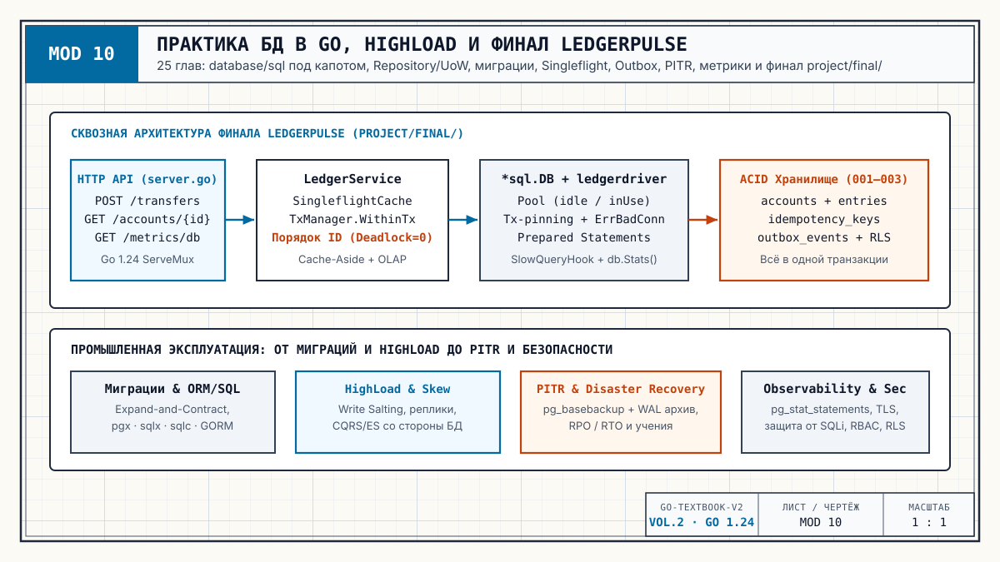

*Двадцать пять глав о промышленной работе с базами данных из Go: от `database/sql` под капотом, `Repository`/`Unit of Work`, миграций и кэша с `Singleflight` до `Outbox`, HighLoad, бэкапов PITR, наблюдаемости, безопасности и финала `LedgerPulse`.*

> «В Go нет канонического веб-фреймворка наподобие Rails в Ruby или Django в Python. Не то чтобы таких фреймворков не существовало, но строительные блоки стандартной библиотеки Go достаточно гибки, чтобы часто обходиться без них.»  
> — Алан Донован и Брайан Керниган, *The Go Programming Language*

## Что нужно знать до старта

* **Модули 1–9:** SQL, индексы, `EXPLAIN`, транзакции, MVCC/WAL, PostgreSQL, MySQL/InnoDB, репликация, шардирование, Redis/Valkey и ClickHouse.
* **Том 1, Модуль 7:** HTTP-сервис на `net/http`, `context.Context`, `log/slog`, слои `Server` и `Store`, тестирование через `httptest`.

## Что вы соберёте в этом разделе

* **Безупречный слой данных на Go 1.24** — разберёте архитектуру `database/sql` и `driver.Connector`, управление пулом соединений (`ErrBadConn`, `Tx`-pinning, Prepared Statements), паттерны `Repository` и `Unit of Work` через `context`, а также честный выбор между `pgx`, `sqlx`, `sqlc` и ORM.
* **Эксплуатационную зрелость HighLoad-систем** — освоите zero-downtime миграции (`expand-and-contract`), `Cache-Aside` и `Singleflight`, БД-сторону паттернов `CQRS`/`Event Sourcing`/`Transactional Outbox`/идемпотентности, борьбу с `Hot Partition`, физические бэкапы/PITR и аварийное восстановление (RPO/RTO).
* **Финальный сквозной сервис `LedgerPulse` (`project/final/`)** — соедините все шаги тома поверх собственного чистого Go-драйвера `ledgerdriver`, транзакционного менеджера `TxManager`, идемпотентности, `Outbox`, `Singleflight`-кэша, OLAP-витрины и HTTP API с метриками пула `/metrics/db`.

## Карта раздела

1. [[1. Пакет database_sql — архитектура драйверов, запросы и ошибки]] — `sql.Open`, `database/sql/driver`, жизненный цикл `*sql.Rows`, отмена по `context` и маппинг ошибок.
2. [[2. database_sql под капотом — пул соединений, badconn, Tx-pinning и Prepared Statements]] — `connOpener`, `idle`/`inUse`, `driver.ErrBadConn`, привязка транзакции к соединению и ловушка `db.Prepare`.
3. [[3. Паттерн Repository и транзакции в Go — Unit of Work через context]] — интерфейсы со стороны потребителя, `DBTX` и менеджер транзакций `WithinTx` из `project/final/repo.go`.
4. [[4. ORM против SQL — database_sql, pgx, sqlx, sqlc и GORM]] — матрица абстракций Go: накладные расходы рефлексии, типобезопасная кодогенерация `sqlc` и когда ORM вреден.
5. [[5. Миграции базы данных — expand-and-contract без простоя]] — блокировки DDL (`AccessExclusiveLock`), безопасные выкатки в 4 шага и `lock_timeout`.
6. [[6. Версионирование схемы и совместимость с выкатками сервиса]] — обратная совместимость `N` и `N+1` версий кода при rolling deploy и canary-релизах.
7. [[7. Seed-данные, фикстуры и воспроизводимые тестовые стенды]] — детерминированные сиды, изоляция тестов и почему продакшен-дамп не подходит для CI.
8. [[8. Кэширование поверх БД — Cache-Aside, Write-Through, Write-Back и Cache Stampede]] — стратегии инвалидации, TTL+jitter, защита `Singleflight` из `project/step07/` и давление на GC.
9. [[9. CQRS со стороны базы данных — разделение моделей чтения и записи]] — нормализованный OLTP-источник против денормализованных проекций и отсылка к Тому 3.
10. [[10. Event Sourcing и хранение журнала событий в СУБД]] — append-only таблица событий, оптимистичная версия агрегата, снапшоты и отсылка к Тому 3.
11. [[11. Согласованность данных в микросервисах — границы владения таблицами]] — Database-per-Service, запрет общих таблиц и отказ от межсервисных FK.
12. [[12. Паттерн Transactional Outbox на уровне БД]] — атомарная запись события в `outbox_events` из `003_idempotency_outbox.sql`, поллинг с `SKIP LOCKED` и CDC/Debezium.
13. [[13. Идемпотентность операций на уровне базы данных]] — таблица `idempotency_keys`, дедупликация повторных HTTP-запросов, TTL очистки и защита от двойного списания.
14. [[14. HighLoad-архитектура баз данных — масштабирование чтения и записи]] — read replicas, connection pooling, батчинг, буферизация записи и предел одного узла.
15. [[15. Горячие партиции (Hot Partition) и перекос данных (Skew)]] — эффект знаменитости, write salting, горячие ключи в `LedgerPulse` и распределение нагрузки.
16. [[16. Резервное копирование и восстановление — физические бэкапы и PITR]] — логические дампы против `pg_basebackup`, архивирование WAL и восстановление на точный момент времени (PITR).
17. [[17. Аварийное восстановление (Disaster Recovery) — RPO, RTO и учения]] — георезервирование, регулярные проверки восстановления из бэкапа и сценарии отказа ЦОД.
18. [[18. Мониторинг баз данных — ключевые метрики PostgreSQL, соединений и I_O]] — Golden Signals для СУБД, `db.Stats()`, cache hit ratio, bloat и лаг репликации.
19. [[19. Журнал медленных запросов (Slow Query Log) и pg_stat_statements]] — нормализация запросов, `mean_exec_time` vs `total_exec_time` и поиск деградаций.
20. [[20. Наблюдаемость БД — корреляция запросов, трейсов и планов]] — прокидывание `traceparent` в комментарии SQL (`sqlcommenter`), `auto_explain` и отсылка к Тому 4.
21. [[21. Безопасность баз данных — TLS, шифрование, секреты и сетевая изоляция]] — `sslmode=verify-full`, ротация паролей, KMS и минимизация поверхности атаки.
22. [[22. SQL-инъекции — механика атак и параметризация запросов]] — почему `$1, $2` на уровне wire-протокола делают инъекцию невозможной, и белые списки для идентификаторов.
23. [[23. Разграничение прав (RBAC) и Row-Level Security (RLS) в БД]] — принцип наименьших привилегий, роли миграций против приложения и политика `RLS` из `003_idempotency_outbox.sql`.
24. [[24. Практика LedgerPulse (финал) — биллинг, кэш, витрина и замеры]] — сквозная прогулка по `project/final/`: `ledgerdriver`, `TxManager`, `Transfer`, `RelayOutbox` и тесты под `-race`.
25. [[25. Итоги Тома 2 — полная карта баз данных и мостик к Тому 3]] — матрица выбора хранилищ и переход к промышленному бэкенду, API и брокерам в Томе 3.
