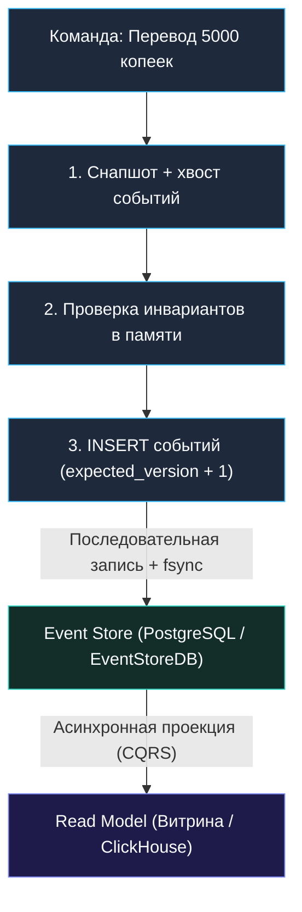

*Состояние как неизменяемая последовательность фактов в БД: схема Append-Only журнала в PostgreSQL, оптимистичная проверка версии, снапшоты, upcasters и физика последовательного ввода-вывода.*

> «Мы пишем, а позже читаем. Сохраняем, а позже извлекаем. Храним, а позже обращаемся к сохранённому. Назначение памяти — уберечь информацию без искажений между двумя этими событиями.»  
> — Чарльз Петцольд, *Code: The Hidden Language of Computer Hardware and Software* (2-е изд.)

---

## Гроссбух вместо ластика: состояние как последовательность фактов

В гроссбухе венецианского купца не держали ластика. Если при расчёте шелка ошиблись на десять дукатов, писец не соскабливал чернила, а добавлял на новой строке корректирующую проводку: «Списано 10 дукатов ввиду ошибки пересчёта». Остаток кассы — не перезаписанное число, а сумма всех строк от первой страницы до последней, позволяющая заглянуть в состояние счёта на любую прошлую дату.

Команда `UPDATE accounts SET balance = balance - 5000` затирает историю изменений. **Event Sourcing (ES)** хранит состояние агрегата как неизменяемую (append-only) последовательность событий: `AccountOpened`, `FundsDeposited`, `TransferDebited`. Прикладные границы агрегатов и шины сообщений рассматриваются в Томе 3 (подробнее см. Том 3), а здесь мы разберём **устройство Event Store в СУБД**: схему таблиц, физику последовательной записи, оптимистичную блокировку версий, эволюцию схем и память в Go 1.24.

---

## Архитектура Event Store в PostgreSQL

Классическая OLTP-таблица оптимизирована под обновление текущего снимка. Хранилище событий оптимизировано под хронологическое добавление фактов.



Три базовых элемента Event Store:
1. **Event Stream (`stream_id` + `version`).** Логический поток одного агрегата (`account-42`) со строго монотонной версией `1, 2, 3, ...`.
2. **Global Sequence (`global_seq`).** Единый монотонный счётчик событий всей базы — опора для проекций CQRS (см. [[9. CQRS со стороны базы данных — разделение моделей чтения и записи]]) и шардирования.
3. **Snapshots (снапшоты).** Снимки вычисленного состояния на конкретной версии, чтобы не перечитывать всю историю с нуля.

```sql
CREATE TABLE IF NOT EXISTS event_streams (
    stream_id TEXT   PRIMARY KEY,
    version   BIGINT NOT NULL DEFAULT 0 CHECK (version >= 0)
);

CREATE TABLE IF NOT EXISTS domain_events (
    global_seq BIGINT GENERATED ALWAYS AS IDENTITY PRIMARY KEY,
    event_id   UUID        NOT NULL UNIQUE,
    stream_id  TEXT        NOT NULL REFERENCES event_streams(stream_id),
    version    BIGINT      NOT NULL CHECK (version > 0),
    event_type TEXT        NOT NULL,
    payload    BYTEA       NOT NULL,
    created_at TIMESTAMPTZ NOT NULL DEFAULT now(),
    UNIQUE (stream_id, version)
);

CREATE TABLE IF NOT EXISTS aggregate_snapshots (
    stream_id  TEXT        PRIMARY KEY REFERENCES event_streams(stream_id),
    version    BIGINT      NOT NULL CHECK (version >= 0),
    state      BYTEA       NOT NULL,
    updated_at TIMESTAMPTZ NOT NULL DEFAULT now()
);
```

> [!warning] Ловушка / Gotcha
> **Правка событий задним числом запрещена.** Попытка `UPDATE` или `DELETE` в `domain_events` ломает аудит, сбивает монотонные версии и разрушает согласованность всех проекций. Ошибки исправляют только добавлением компенсационного события (`FeeRefunded`, `TransferReversed`).

---

## Под капотом: физика последовательной записи и `O_APPEND`

При случайном `UPDATE` в B-Tree СУБД ищет 8 КБ страницу в Buffer Pool (подгружая её с диска за $O(\log N)$ при промахе), помечает страницу как `dirty`, обновляет индексы и пишет запись в WAL.

Append-Only модель приближает работу приложения к самому WAL:
* Новые записи добавляются в конец кучи (`heap`), а индекс по `global_seq` растёт справа.
* В файловых журналах (Kafka, EventStoreDB) ядро Linux буферизует записи в Page Cache и сбрасывает их через `fsync` непрерывными блоками со сложностью $O(1)$ независимо от размера базы.
* На SSD и NVMe последовательный поток снижает нагрузку на внутреннюю сборку мусора и выравнивание износа (*wear leveling*) контроллера, упираясь лишь в шину PCIe, а не в случайные 4 КБ перезаписи.

В Linux флаг `O_APPEND` при `os.OpenFile` гарантирует атомарное позиционирование в конец файла перед каждым `write()`. Но для бизнес-систем на Go вместо сырых файлов выбирают PostgreSQL или EventStoreDB/Kafka, поскольку файловые журналы заставляют вручную реализовывать репликацию, ротацию сегментов и точечные выборки по `stream_id`.

---

## Реализация на Go 1.24: снапшоты и оптимистичная блокировка

```go
package eventstore

import (
	"context"
	"database/sql"
	"encoding/json"
	"errors"
	"fmt"
	"time"
)

type AccountState struct {
	StreamID string `json:"stream_id"`
	Currency string `json:"currency"`
	Balance  int64  `json:"balance"`
	Version  int64  `json:"version"`
}

type StoredEvent struct {
	GlobalSeq int64
	EventID   string
	StreamID  string
	Version   int64
	Type      string
	Payload   []byte
	CreatedAt time.Time
}

var ErrConcurrencyConflict = errors.New("concurrency conflict: stream version mismatch")

func LoadAggregate(ctx context.Context, db *sql.DB, streamID string, apply func(*AccountState, StoredEvent) error) (*AccountState, error) {
	state := &AccountState{StreamID: streamID}

	var snapData []byte
	var snapVersion int64
	err := db.QueryRowContext(ctx,
		`SELECT version, state FROM aggregate_snapshots WHERE stream_id = $1`, streamID,
	).Scan(&snapVersion, &snapData)
	if err != nil && !errors.Is(err, sql.ErrNoRows) {
		return nil, fmt.Errorf("load snapshot: %w", err)
	}
	if err == nil {
		if err := json.Unmarshal(snapData, state); err != nil {
			return nil, fmt.Errorf("unmarshal snapshot: %w", err)
		}
		state.Version = snapVersion
	}

	rows, err := db.QueryContext(ctx, `
		SELECT global_seq, event_id, stream_id, version, event_type, payload, created_at
		FROM domain_events WHERE stream_id = $1 AND version > $2 ORDER BY version ASC
	`, streamID, state.Version)
	if err != nil {
		return nil, fmt.Errorf("query events: %w", err)
	}
	defer rows.Close()

	for rows.Next() {
		var ev StoredEvent
		if err := rows.Scan(&ev.GlobalSeq, &ev.EventID, &ev.StreamID, &ev.Version, &ev.Type, &ev.Payload, &ev.CreatedAt); err != nil {
			return nil, err
		}
		if err := apply(state, ev); err != nil {
			return nil, fmt.Errorf("apply v%d: %w", ev.Version, err)
		}
		state.Version = ev.Version
	}
	return state, rows.Err()
}

func SaveEvents(ctx context.Context, db *sql.DB, streamID string, expectedVersion int64, events []StoredEvent) error {
	if len(events) == 0 {
		return nil
	}
	tx, err := db.BeginTx(ctx, nil)
	if err != nil {
		return err
	}
	defer func() { _ = tx.Rollback() }()

	if _, err := tx.ExecContext(ctx,
		`INSERT INTO event_streams (stream_id, version) VALUES ($1, 0) ON CONFLICT (stream_id) DO NOTHING`, streamID,
	); err != nil {
		return err
	}

	var currentVersion int64
	if err := tx.QueryRowContext(ctx,
		`SELECT version FROM event_streams WHERE stream_id = $1 FOR UPDATE`, streamID,
	).Scan(&currentVersion); err != nil {
		return err
	}
	if currentVersion != expectedVersion {
		return fmt.Errorf("%w: expected %d, got %d", ErrConcurrencyConflict, expectedVersion, currentVersion)
	}

	stmt, err := tx.PrepareContext(ctx, `
		INSERT INTO domain_events (event_id, stream_id, version, event_type, payload, created_at)
		VALUES ($1, $2, $3, $4, $5, $6)
	`)
	if err != nil {
		return err
	}
	defer stmt.Close()

	newVersion := expectedVersion
	for _, ev := range events {
		newVersion++
		if _, err := stmt.ExecContext(ctx, ev.EventID, streamID, newVersion, ev.Type, ev.Payload, time.Now().UTC()); err != nil {
			return err
		}
	}
	if _, err := tx.ExecContext(ctx, `UPDATE event_streams SET version = $1 WHERE stream_id = $2`, newVersion, streamID); err != nil {
		return err
	}
	return tx.Commit()
}
```

При одновременной записи двух горутин с `expectedVersion = 1` вторая честно остановится на проверке версии:

```text
writer-1: committed version=2 (FundsDebited amount=-5000)
writer-2: concurrency conflict: stream version mismatch: expected 1, got 2
```

> [!tip] Собеседование [Senior/Staff]
> **Вопрос:** Зачем в `SaveEvents` вызов `SELECT ... FOR UPDATE`, если блокировка называется оптимистичной?  
> **Ответ:** Оптимистичность означает, что долгая фаза чтения истории и проверки правил прошла без удержания блокировок в БД. В короткой транзакции записи `FOR UPDATE` на **одной строке** `event_streams` служит точкой сериализации для конкретного `stream_id`: параллельная транзакция дождётся коммита первой, прочитает уже обновлённую версию и вернёт `ErrConcurrencyConflict`. Это дешевле уровня изоляции `SERIALIZABLE`, а индекс `UNIQUE (stream_id, version)` даёт страховку на уровне схемы.

---

## Эволюция схемы событий и Upcasters

Если год назад событие `TransferPosted` писалось без поля `currency` (подразумевался `RUB`), менять старые строки в `domain_events` нельзя. При чтении используют **Upcaster** — слой адаптации устаревших версий формата к актуальной Go-структуре:

```go
type TransferPostedV2 struct {
	TransactionID string `json:"transaction_id"`
	Amount        int64  `json:"amount"`
	Currency      string `json:"currency"`
}

func UpcastTransferPosted(ev StoredEvent) (TransferPostedV2, error) {
	var out TransferPostedV2
	if err := json.Unmarshal(ev.Payload, &out); err != nil {
		return TransferPostedV2{}, fmt.Errorf("unmarshal %s: %w", ev.Type, err)
	}
	if out.Currency == "" {
		out.Currency = "RUB" // Значение по умолчанию для событий версии v1
	}
	return out, nil
}
```

> [!warning] Ловушка / Gotcha
> **Хранение `[]byte` вместо `any` и рефлексии.** Храните `payload` как `BYTEA` (или `JSONB`) и преобразуйте его через явный `switch` по `event_type` в строгие Go-структуры. Полагаться на `map[string]any` и `reflect` для исторических событий медленно и опасно при рефакторинге.

---

## Память и GC при реплее, ловушки и выбор движка

Восстановление состояния (**replay**) — самая дорогая операция в ES: при 10 000 событий без снапшота сервис 10 000 раз вызывает `json.Unmarshal`/`proto.Unmarshal`, разгоняя нагрузку на GC до 20–30% CPU. Снижают давление на память пять приёмов:
1. **Снапшоты каждые `N` событий** ограничивают длину реплея.
2. **Protobuf или Avro** вместо JSON дают меньше аллокаций и компактнее в диске.
3. **`sync.Pool`** переиспользует буферы десериализации.
4. **Пакетное чтение по курсору** (`WHERE global_seq > $1 ORDER BY global_seq LIMIT 5000`), а в `pgx` при экстремальных требованиях — zero-copy чтение буфера строки до следующего вызова `Next()`.
5. **Отказ от аналитики в Event Store:** агрегации `SUM`/`COUNT`/`GROUP BY` всегда выносят в Read-витрины (ClickHouse / PostgreSQL), не сканируя весь журнал.

### Ловушки и сравнение подходов

* **Отсутствие снапшотов:** время загрузки активного счёта деградирует с 5 мс до секунд.
* **Поздние события (`Late Events`):** различайте бизнес-время `occurred_at` и время записи `created_at`; при опоздании события пересчитывайте период или выпускайте компенсацию.
* **Сравнение с C# и PHP:** в C# (`EventStore.Client`, `Akka.NET`) подписки и снапшоты обёрнуты фреймворками; в классическом stateless PHP реплей на каждый запрос слишком дорог, поэтому там читают только из готовых витрин. В Go код явный, что даёт контроль над памятью и пулами соединений.

> [!tip] Собеседование [Senior/Staff]
> **Вопрос:** Как добиться поведения, эквивалентного *exactly-once*, в проекциях Event Sourcing?  
> **Ответ:** Глобальный *exactly-once* в распределённой системе требует дорогих координаций. На практике комбинируют *at-least-once* доставку и идемпотентность: проектор хранит `last_processed_global_seq` (или `processed_event_ids`) и обновляет его в **одной транзакции** с целевыми таблицами Read DB, отбрасывая уже применённые события.

| Критерий | PostgreSQL / MySQL | EventStoreDB / Kafka | Файловые журналы |
|---|---|---|---|
| **Скорость записи** | Высокая (с батчингом) | Очень высокая (append-лог) | Максимальная (прямой I/O) |
| **Выборки** | SQL-индексы, `global_seq` | По `stream_id` и подписки | Последовательный скан |
| **Транзакции** | Полный ACID + Outbox | Оптимистичная версия потока | Только вручную |
| **Где применять** | Большинство систем на Go | Сверхвысокие потоки событий | Встраиваемые движки, брокеры |

---

## Упражнения

### 1. Базовое: исправление ошибочной комиссии без `UPDATE`
В `LedgerPulse` три часа назад записалось событие `FeeCharged` на 500 копеек вместо 150. Объясните, почему нельзя выполнить `UPDATE domain_events`, и опишите правильное решение.

> [!solution] Показать решение
> `UPDATE` разрушает аудиторский след и не уведомляет уже отработавшие CQRS-проекции (витрины останутся рассинхронизированными). Правильное решение — добавить новое компенсационное событие `FeeRefunded` на `+350` копеек со ссылкой на `original_event_id`. Агрегат при реплее получит верный баланс, а проекторы штатно обработают событие по новому `global_seq`.

### 2. Практическое: идемпотентный `SaveSnapshotIfNeeded`
Напишите на Go 1.24 функцию сохранения снапшота в `aggregate_snapshots`, которая пишет снимок только при `state.Version - lastSnapVersion >= threshold` и гарантирует в SQL, что более старый снимок никогда не перезатрёт более новый.

> [!solution] Показать решение
> ```go
> func SaveSnapshotIfNeeded(ctx context.Context, db *sql.DB, state *AccountState, lastSnapVersion, threshold int64) error {
> 	if state.Version-lastSnapVersion < threshold {
> 		return nil
> 	}
> 	raw, err := json.Marshal(state)
> 	if err != nil {
> 		return fmt.Errorf("marshal snapshot: %w", err)
> 	}
> 	_, err = db.ExecContext(ctx, `
> 		INSERT INTO aggregate_snapshots (stream_id, version, state, updated_at)
> 		VALUES ($1, $2, $3, now())
> 		ON CONFLICT (stream_id) DO UPDATE
> 		SET version = EXCLUDED.version, state = EXCLUDED.state, updated_at = now()
> 		WHERE aggregate_snapshots.version < EXCLUDED.version
> 	`, state.StreamID, state.Version, raw)
> 	return err
> }
> ```
> Условие `WHERE aggregate_snapshots.version < EXCLUDED.version` отсекает гонку при параллельном сохранении снимков.

### 3. Со звёздочкой (\*): цикл повторов при `ErrConcurrencyConflict`
Реализуйте функцию `DebitWithRetry`, которая при получении `ErrConcurrencyConflict` от `SaveEvents` перечитывает свежее состояние агрегата `LoadAggregate`, повторно проверяет `state.Balance >= amount` и повторяет попытку (до 3 раз с короткой паузой).

> [!solution] Показать решение
> ```go
> func DebitWithRetry(ctx context.Context, db *sql.DB, streamID, eventID string, amount int64, apply func(*AccountState, StoredEvent) error) error {
> 	for attempt := range 3 {
> 		state, err := LoadAggregate(ctx, db, streamID, apply)
> 		if err != nil {
> 			return err
> 		}
> 		if state.Balance < amount {
> 			return errors.New("insufficient funds")
> 		}
> 		payload, _ := json.Marshal(struct{ Amount int64 }{Amount: -amount})
> 		err = SaveEvents(ctx, db, streamID, state.Version, []StoredEvent{{EventID: eventID, Type: "FundsDebited", Payload: payload}})
> 		if err == nil {
> 			return nil
> 		}
> 		if !errors.Is(err, ErrConcurrencyConflict) {
> 			return err
> 		}
> 		select {
> 		case <-ctx.Done():
> 			return ctx.Err()
> 		case <-time.After(time.Duration(attempt+1) * 5 * time.Millisecond):
> 		}
> 	}
> 	return ErrConcurrencyConflict
> }
> ```
> Если конкурентная транзакция уже списала остаток, на следующей итерации `LoadAggregate` увидит новый баланс и честно вернёт `insufficient funds`.

---

Event Sourcing и CQRS хорошо работают в пределах одного сервиса и его БД. Но когда система делится на несколько микросервисов, встаёт вопрос границ владения таблицами: можно ли делать `JOIN` или внешние ключи между чужими схемами и как сохранять согласованность между сервисами? Этой теме посвящена следующая глава о согласованности данных в микросервисах и границах владения таблицами.
