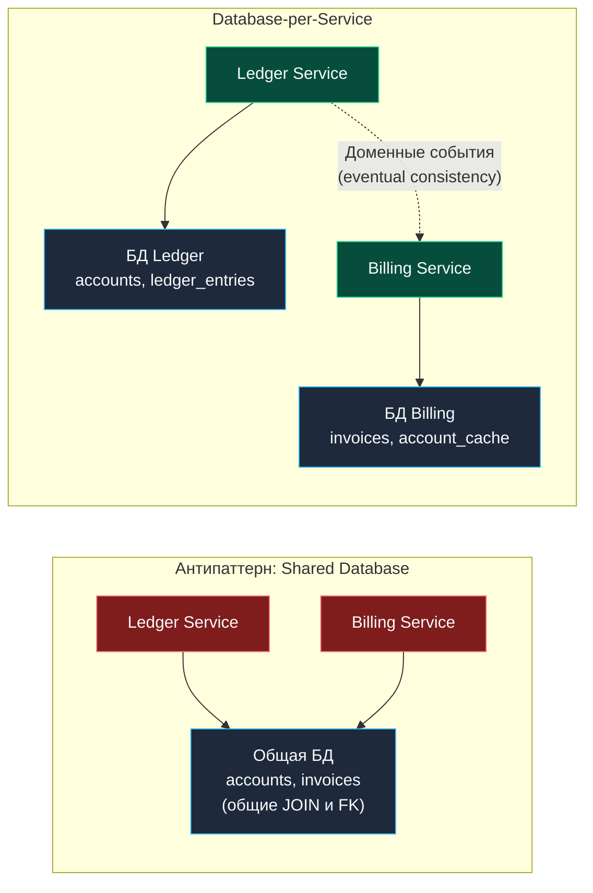

*Почему общий доступ двух сервисов к одной таблице разрушает изоляцию, как устроен паттерн Database-per-Service без межсервисных `FOREIGN KEY`, чем CAP и PACELC ограничивают синхронные вызовы в Go `netpoll` и как проектировать устойчивые границы владения данными.*

> «Как сформулировал Роб Пайк, «сложность мультипликативна»: решая задачу за счёт усложнения одной части системы, вы медленно, но верно добавляете сложность во все остальные. Под постоянным давлением сроков и требований добавить ещё фич, опций и настроек легко поступиться простотой — хотя в долгосрочной перспективе именно простота служит ключом к хорошему ПО.»  
> — Алан Донован и Брайан Керниган (цитируя Роба Пайка), *The Go Programming Language*

Представьте работу железнодорожного узла до изобретения радио и телеграфа. Дежурный по станции отправляет поезд на однопутный перегон, вручив машинисту материальный жезл — физическое право проезда. Пока жезл в кабине, ни один другой состав не сможет занять эти же рельсы: так работает локальная транзакция и строгая блокировка в монолите. Но стоит разнести станции на сотни километров тайги и оставить связь лишь через конных вестовых — ситуация меняется. Вестовой может застрять в метели, депеша — прийти через трое суток или продублироваться. Если дежурные продолжат полагаться на мгновенную и единственную доставку, столкновение поездов станет вопросом времени.

В монолитной базе данных согласованность держится на локальных ACID-транзакциях (`BEGIN ... COMMIT`), о которых вы уже читали в [[1. ACID — четыре гарантии транзакции без иллюзий]]. Когда бизнес-логику разрезают на микросервисы, каждый сервис получает собственную зону ответственности и собственное хранилище. Сетевой вызов между ними может оборваться по таймауту, зависнуть на полпути или вернуть частичный сбой. В этот момент распределённое состояние расходится.

Главное искушение при распиле монолита — оставить общую базу данных «на первое время» и ходить из соседних сервисов в таблицы `accounts` или `ledger_entries` напрямую через `JOIN` и `FOREIGN KEY`. Такой компромисс кажется быстрым, но через полгода превращает систему в распределённый монолит, где нельзя безопасно выполнить даже рядовую миграцию.

---

## Границы владения таблицами: Database-per-Service против Shared Database

Чтобы сервисы действительно развивались независимо, на уровне архитектуры баз данных вводят четыре жёстких правила владения данными.

1. **Единственный владелец таблицы (Single Writer / Single Owner).** Только один сервис имеет право выполнять `INSERT`, `UPDATE`, `DELETE` и прямые `SELECT` по конкретной таблице. В домене `LedgerPulse` таблицами `accounts`, `transactions` и `ledger_entries` владеет исключительно ядро учёта `Ledger`.
2. **Запрет общих таблиц (Shared Database Anti-pattern).** Если два микросервиса пишут и читают одну таблицу напрямую, их модели данных, индексы и блокировки сцеплены намертво. Вы не сможете изменить тип столбца или перенести таблицу в другое хранилище без одновременного релиза обоих сервисов. На раннем этапе, когда держать десяток отдельных кластеров PostgreSQL слишком дорого, допустим промежуточный шаг **Schema-per-Service**: сервисы живут на одном сервере, но в разных схемах (`ledger.*`, `billing.*`) под отдельными ролями БД без прав на чтение чужой схемы.
3. **Отказ от межсервисных `FOREIGN KEY`.** Ограничение `REFERENCES` работает только в пределах одной базы данных. Когда сервис `Billing` или `Notifications` переезжает в собственный инстанс, внешний ключ на `accounts(id)` физически невозможен. Вместо него хранят непрозрачный внешний идентификатор (`account_external_id TEXT` или `account_id BIGINT` без `REFERENCES`), а ссылочную целостность поддерживают протоколом на уровне приложения и событий.
4. **Локальные проекции вместо межсервисных `JOIN`.** Если сервису уведомлений для отправки чека нужны `owner_name` и валюта счёта, он не ходит в чужую таблицу `accounts` и не делает синхронный запрос на каждый перевод. Сервис слушает доменные события и поддерживает собственную денормализованную таблицу-проекцию (подробнее этот механизм разобран в [[9. CQRS со стороны базы данных — разделение моделей чтения и записи]]).



---

## Теоретический фундамент: CAP, PACELC и цена сетевого вызова

Как только таблицы разъезжаются по разным базам и сервисам, в силу вступают законы распределённых систем. В [[7. CAP и PACELC в выборе баз данных]] мы разбирали теорему CAP на уровне репликации СУБД. Для межсервисного взаимодействия она звучит так же сурово: при сетевом разделении (`Partition`, `P`) система выбирает между строгой согласованностью (`Consistency`, `C`) и доступностью (`Availability`, `A`). В облачной инфраструктуре сетевые разрывы неизбежны, поэтому высоконагруженные микросервисы чаще опираются на ослабленную модель **BASE** (*Basically Available, Soft state, Eventual consistency*).

Но сеть деградирует не постоянно, а большую часть времени работает штатно. В нормальном режиме действует модель **PACELC** (*If Partition, trade Consistency vs Availability; Else, trade Latency vs Consistency*). Для Go-сервисов это практический выбор архитектуры:

* **Синхронный путь (выше задержка, строже согласованность):** сервис `Billing` перед созданием счёта делает синхронный HTTP/gRPC-запрос в `Ledger`, проверяя актуальный статус счёта. Локальный запрос в кэш-память PostgreSQL занимает ~50–150 мкс, `COMMIT` с `fsync` на NVMe — ~100–500 мкс, а межсервисный вызов по сети в пределах одного дата-центра — уже 1–5 мс (на два порядка медленнее), не считая каскадных сбоев.
* **Асинхронный путь (ниже задержка, итоговая согласованность):** сервис `Ledger` фиксирует перевод локально и публикует событие, а `Billing` обновляет свою проекцию чуть позже ([[6. Модели согласованности в БД — Strong, Eventual, Read-Your-Writes и Causal]]).

> [!tip] Собеседование [Middle]
> **Вопрос:** Почему модель CAP неполна для проектирования микросервисов и что добавляет PACELC?  
> **Ответ:** CAP описывает поведение системы только в момент сетевого разделения (`P`), когда приходится жертвовать либо доступностью (`A`), либо согласованностью (`C`). Модель PACELC дополняет картину для штатного режима без сбоев (`Else`): инженер выбирает между **задержкой (`Latency`)** и **согласованностью (`Consistency`)**. В микросервисах на Go это дилемма между синхронным межсервисным RPC (свежие данные ценой высокого `p99` и жёсткой связности) и локальной проекцией по асинхронным событиям (мгновенное чтение из своей БД ценой отставания данных).

---

## Под капотом Go: `netpoll`, парковка горутин и давление на GC

На уровне кода синхронный запрос к чужой базе или чужому сервису кажется безобидным вызовом функции. Но внутри рантайма Go у такого ожидания есть вполне измеримая цена.

1. **Системный вызов:** горутина вызывает `read()` или `write()` на сетевом сокете.
2. **Переход в `netpoll`:** если ответ ещё не пришёл, пакет `net` регистрирует файловый дескриптор сокета в мультиплексоре ОС (`epoll` в Linux или `kqueue` в macOS).
3. **Парковка горутины:** планировщик Go переводит горутину в статус `waiting`, снимает её с системного потока `M` и помещает в структуру ожидания `pollDesc`. Поток `M` освобождается и уходит обслуживать другие горутины.
4. **Пробуждение:** когда ядро через `epoll` сообщает о приходе байтов, сетевой поллер переводит горутину обратно в локальную или глобальную очередь выполнения (`runq`).

Сама парковка дешёвая, но при сбое зависимого сервиса в игру вступают повторные попытки (retry). Каждый ретрай порождает новый `http.Request` или gRPC-метаданные, буферы сериализации JSON/Protobuf и таймеры `context.WithTimeout` с экспоненциальной задержкой. При лавинообразных ретраях миллионы короткоживущих объектов заполняют кучу и провоцируют **волновой эффект аллокаций**: сборщик мусора (GC) запускается чаще, съедает CPU и замедляет даже те обработчики, которые вообще не ходят в проблемный сервис. На практике систему защищают предохранителями (circuit breakers), лимитом параллельных повторов, переиспользованием буферов через `sync.Pool` и переходом от синхронных ретраев к фоновой обработке (подробно сетевые клиенты, HTTP/gRPC и circuit breakers разбираются в Томе 3).

---

## 2PC против Saga и инварианты распределённой координации

Если бизнес-процесс всё же затрагивает таблицы двух разных сервисов (например, списание средств в `Ledger` и выдача товара в `Fulfillment`), локальной транзакции уже недостаточно.

* **Two-Phase Commit (2PC)** требует координатора, фазы `Prepare` и удержания эксклюзивных блокировок строк в БД на всё время сетевых раунд-трипов. В [[9. Двухфазный коммит (2PC) — протокол, блокировки и отказ координатора]] мы подробно показали, почему 2PC в веб-микросервисах приводит к блокировке таблиц и зависанию транзакций в статусе `In-Doubt` при падении координатора. Этот протокол остаётся в узкой нише вроде процессинговых ядер с аппаратными HSM или внутри одного кластера распределённой СУБД, но не между независимыми сервисами.
* **Паттерн Saga** заменяет глобальную блокировку цепочкой коротких локальных ACID-транзакций. Каждый сервис фиксирует изменения в своих таблицах сразу, а при отказе запускаются **компенсирующие транзакции** в обратном порядке (LIFO). Детальный разбор типов шагов (`Compensatable`, `Pivot`, `Retriable`) и семантических блокировок в `LedgerPulse` приведён в [[10. Паттерн Saga со стороны базы данных — локальные транзакции и компенсации]].

> [!warning] Ловушка: компенсация не равна `ROLLBACK`
> В отличие от отката транзакции в PostgreSQL, компенсирующая операция — это новая бизнес-команда, которая логически обращает эффект прошлого шага. Если внешний клиринг уже подтвердил перевод или склад уже отгрузил физический заказ, автоматическая компенсация невозможна. В таких точках процесс переходит в состояние `manual_intervention` для разбора оператором или запускает асинхронный арбитраж.

### Персистентное состояние оркестратора в БД и код на Go 1.24

Главная ошибка новичков при реализации координатора процессов в Go — хранить список пройденных шагов в локальной переменной (слайсе) в памяти процесса. Если под перезапустится при деплое или упадет по OOM посреди цепочки, память исчезнет, а запущенные изменения останутся без компенсации.

Состояние процесса нужно хранить в собственной таблице сервиса (например, `saga_executions`) и обновлять его атомарно с проверкой версии строки (`optimistic locking`) или через `SELECT ... FOR UPDATE`.

```go
package coordinator

import (
	"context"
	"database/sql"
	"errors"
	"fmt"
)

var ErrConcurrentTransition = errors.New("concurrent saga state transition")

// AdvanceStep атомарно продвигает шаг процесса в БД, защищаясь от гонки через version.
func AdvanceStep(ctx context.Context, db *sql.DB, sagaID string, expectedVer, nextStep int, nextState string) error {
	res, err := db.ExecContext(ctx, `
		UPDATE saga_executions
		SET current_step = $1,
		    state        = $2,
		    version      = version + 1,
		    updated_at   = now()
		WHERE saga_id = $3 AND version = $4`,
		nextStep, nextState, sagaID, expectedVer,
	)
	if err != nil {
		return fmt.Errorf("advance saga %s: %w", sagaID, err)
	}
	affected, err := res.RowsAffected()
	if err != nil {
		return fmt.Errorf("rows affected: %w", err)
	}
	if affected == 0 {
		return ErrConcurrentTransition
	}
	return nil
}
```

При конкурентном запуске двух воркеров на одну и ту же `saga_id` только один получит `RowsAffected() == 1`, а второй немедленно завершится с `ErrConcurrentTransition` и не продублирует шаг:

```text
worker-1: saga=sg-901 version=2 -> updated to step=2 state=running version=3 (rows=1)
worker-2: saga=sg-901 version=2 -> ErrConcurrentTransition (rows=0, duplicate skipped)
```

В других экосистемах задачу координации часто отдают тяжёлым фреймворкам: в Java/Spring используют Camunda или Axon Framework, в .NET — MassTransit и NServiceBus. Они берут на себя сериализацию состояния, но привносят скрытые накладные расходы и сложную отладку. Философия Go тяготеет к явной инженерии: простая машина состояний в таблице БД, явный `context.Context` для таймаутов и отмены, минимум «магии» — за счёт чего легко контролировать аллокации и диагностировать задержки через `pprof` и SQL-трейсы (а специализированные внешние оркестраторы вроде Temporal разбираются в Томе 3).

---

## Доставка `at-least-once`, порядок событий и типичные ловушки

> [!tip] Собеседование [Senior/Staff]
> **Вопрос:** Существует ли в распределённых системах физическая гарантия доставки `exactly-once` между двумя базами данных?  
> **Ответ:** Нет. Согласно фундаментальному результату о задаче двух генералов, поверх ненадёжной сети с потерями и дубликатами пакетов нельзя гарантировать, что сообщение доставлено ровно один раз без единого повтора. На практике систему строят из двух половин: **доставка `at-least-once`** (гарантия, что сообщение не потеряется, даже если придётся повторить) плюс **идемпотентный потребитель** (повторная обработка не меняет итоговое состояние БД). Вместе они дают эффект `effectively-once` для бизнес-данных.

При разделении таблиц между сервисами на практике чаще всего стреляют четыре грабли:

1. **Потеря состояния координатора в памяти.** При рестарте сервиса без записи шага в `saga_executions` процесс забывает о начатых операциях. Лечение — персистентная запись каждого перехода до или внутри локальной транзакции.
2. **Неидемпотентные компенсации и обработчики.** Повторная доставка команды отмены списывает или начисляет деньги дважды. Лечение — проверка текущего статуса (`WHERE status = 'reserved'`) и таблица ключей идемпотентности (подробно разберём в [[13. Идемпотентность операций на уровне базы данных]]).
3. **Нарушение порядка доставки (`out-of-order`).** Событие `AccountClosed` или `PaymentRefunded` может прийти в проекцию соседнего сервиса раньше, чем `AccountCreated`, из-за ретраев или разных партиций брокера. Лечение — хранить монотонный номер версии агрегата (`sequence_number` или `version`) и обновлять локальную проекцию только условием `WHERE excluded.version > local_projection.version`.
4. **Шторм ретраев (`Retry Storm`).** Когда зависимая БД замедляется, синхронные ретраи в HTTP-обработчиках удерживают соединения и горутины, усугубляя деградацию (`thundering herd`). Лечение — экспоненциальная задержка с джиттером, ограничение параллельных вызовов и перевод отложенных задач в фоновую очередь БД (`pending_retry`) без удержания клиентского запроса.

---

## Упражнения

### 1. Базовое: Разрыв межсервисного `FOREIGN KEY`

Из монолита `LedgerPulse` выделяют отдельный микросервис выставления счетов `Invoices`. Раньше в общей БД существовала таблица:
```sql
CREATE TABLE invoices (
    id         BIGINT GENERATED ALWAYS AS IDENTITY PRIMARY KEY,
    account_id BIGINT NOT NULL REFERENCES accounts(id),
    amount     BIGINT NOT NULL CHECK (amount > 0),
    status     TEXT   NOT NULL
);
```
Какие изменения нужно внести в DDL таблицы `invoices` при переезде `Invoices` в собственную базу данных и как теперь проверять существование счёта при создании инвойса?

> [!solution] Показать решение
> При переносе `invoices` в отдельную БД ограничение `REFERENCES accounts(id)` работать перестанет, так как таблица `accounts` принадлежит сервису `Ledger`.
> 1. Убираем `FOREIGN KEY` и оставляем логический идентификатор (а при необходимости и `external_id`):
> ```sql
> CREATE TABLE invoices (
>     id                 BIGINT GENERATED ALWAYS AS IDENTITY PRIMARY KEY,
>     ledger_account_id  BIGINT NOT NULL,
>     amount             BIGINT NOT NULL CHECK (amount > 0),
>     status             TEXT   NOT NULL CHECK (status IN ('draft', 'issued', 'paid', 'cancelled')),
>     created_at         TIMESTAMPTZ NOT NULL DEFAULT now()
> );
> CREATE INDEX idx_invoices_ledger_account_id ON invoices (ledger_account_id);
> ```
> 2. Вместо межсервисного `JOIN` и `FK` сервис `Invoices` либо поддерживает локальную read-проекцию `known_accounts (account_id PRIMARY KEY, status, currency)`, обновляемую событиями из `Ledger`, либо в момент выставления счёта выполняет синхронный запрос к API `Ledger` (принимая компромисс PACELC по задержке).

### 2. Практическое: Защита локальной проекции от `out-of-order` событий

Сервис `Analytics` слушает события изменения статуса счетов из `Ledger` и поддерживает у себя таблицу `account_projections (account_id BIGINT PRIMARY KEY, status TEXT NOT NULL, version BIGINT NOT NULL, updated_at TIMESTAMPTZ NOT NULL)`. Напишите идемпотентный SQL-запрос для PostgreSQL, который гарантирует, что устаревшее событие с меньшей или равной версией (`version`) не перезапишет более свежее состояние.

> [!solution] Показать решение
> ```sql
> INSERT INTO account_projections (account_id, status, version, updated_at)
> VALUES ($1, $2, $3, now())
> ON CONFLICT (account_id) DO UPDATE
> SET status     = EXCLUDED.status,
>     version    = EXCLUDED.version,
>     updated_at = EXCLUDED.updated_at
> WHERE EXCLUDED.version > account_projections.version;
> ```
> Ключевое условие `WHERE EXCLUDED.version > account_projections.version` на уровне PostgreSQL защищает и от дубликатов (`EXCLUDED.version = version`), и от запоздалых событий из прошлого (`EXCLUDED.version < version`).

### 3. Со звёздочкой (\*): Схема `saga_executions` и безопасная обработка `manual_intervention`

Доработайте таблицу `saga_executions` (добавив колонку `version BIGINT NOT NULL DEFAULT 1` и статус `'manual_intervention'`) и напишите функцию на Go 1.24 `MarkManualIntervention`, которая переводит застрявший процесс в ручной разбор, сохраняя текст ошибки. Почему обновление должно проверять `version`, а не просто перезаписывать статус безусловным `UPDATE ... WHERE saga_id = $1`?

> [!solution] Показать решение
> ```sql
> CREATE TABLE IF NOT EXISTS saga_executions (
>     saga_id      TEXT        PRIMARY KEY,
>     saga_type    TEXT        NOT NULL,
>     state        TEXT        NOT NULL CHECK (state IN ('running', 'compensating', 'completed', 'failed', 'manual_intervention')),
>     current_step INT         NOT NULL DEFAULT 0,
>     version      BIGINT      NOT NULL DEFAULT 1,
>     payload      JSONB       NOT NULL,
>     last_error   TEXT        NOT NULL DEFAULT '',
>     updated_at   TIMESTAMPTZ NOT NULL DEFAULT now()
> );
> ```
> ```go
> func MarkManualIntervention(ctx context.Context, db *sql.DB, sagaID string, expectedVer int64, reason string) error {
> 	res, err := db.ExecContext(ctx, `
> 		UPDATE saga_executions
> 		SET state      = 'manual_intervention',
> 		    last_error = $1,
> 		    version    = version + 1,
> 		    updated_at = now()
> 		WHERE saga_id = $2
> 		  AND version = $3
> 		  AND state IN ('running', 'compensating')`,
> 		reason, sagaID, expectedVer,
> 	)
> 	if err != nil {
> 		return fmt.Errorf("mark manual intervention: %w", err)
> 	}
> 	n, err := res.RowsAffected()
> 	if err != nil {
> 		return err
> 	}
> 	if n == 0 {
> 		return ErrConcurrentTransition
> 	}
> 	return nil
> }
> ```
> Проверка `version` и допустимых исходных статусов (`'running', 'compensating'`) не даёт запоздалому воркеру перезаписать уже успешно завершённую (`'completed'`) или ранее разобранную оператором сагу.

---

## Главный вывод и мостик дальше

Переход к микросервисам держится на строгом **Database-per-Service**: у каждой таблицы ровно один сервис-владелец, межсервисные `FOREIGN KEY` и общие `JOIN` заменяются внешними идентификаторами и локальными проекциями, а координация процессов опирается на персистентные состояния и идемпотентные шаги с учётом PACELC и стоимости ретраев в Go.

Но как только мы отказались от общей базы и перешли к обмену событиями, возникает критический разрыв: сервис `Ledger` зафиксировал перевод в своих таблицах, а через миллисекунду процесс упал до того, как отправил событие соседнему сервису. Как сделать запись бизнес-данных и постановку события в очередь неделимой операцией на уровне PostgreSQL — разберём в следующей главе: [[12. Паттерн Transactional Outbox на уровне БД]].
