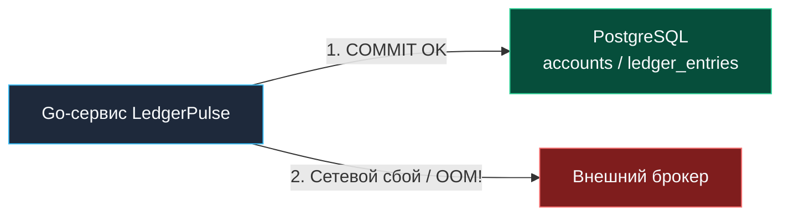
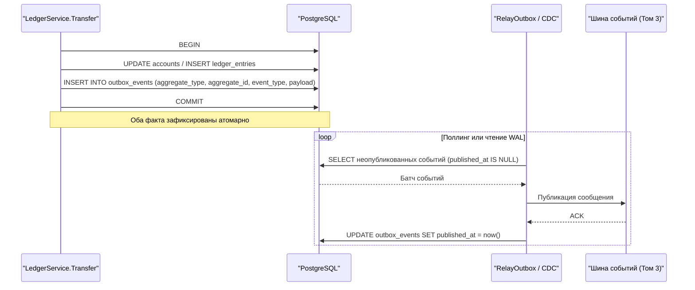

*Как закрыть проблему двойной записи (Dual Write) с помощью таблицы `outbox_events` и частичного индекса из `003_idempotency_outbox.sql`, сравнение поллинга через `FOR UPDATE SKIP LOCKED` и чтения `WAL` (CDC), а также разбор `RelayOutbox` из `LedgerPulse`.*

> «Любая функция ввода-вывода обязана считаться с вероятностью сбоя, и лишь наивный программист верит, что простое чтение или запись не могут завершиться ошибкой. Именно тогда, когда внезапно отказывают самые надёжные операции, нам нужнее всего знать почему.»  
> — Алан Донован и Брайан Керниган, *The Go Programming Language*

Представьте старинную контору управляющего банком. Подписав распоряжение о переводе средств, банкир не бросает кабинет и не бежит лично через весь город на телеграф. Если по дороге он попадёт под ливень или задержится, банк останется без присмотра, а депеша так и не уйдёт. Вместо этого управляющий фиксирует перевод в главной книге и тем же движением кладёт копию распоряжения в деревянный лоток «Исходящие» (*Outbox*) на краю стола. Каждые несколько минут заходит штатный курьер, забирает бумаги из лотка и уносит их на телеграф. Даже если курьер опоздает или вернётся с полпути, документ уже зафиксирован в стенах банка и не потеряется.

В распределённых микросервисах на месте главной книги стоит PostgreSQL, а на месте телеграфа — шина событий или внешний брокер сообщений (Kafka, RabbitMQ, NATS; инфраструктура брокеров подробно разбирается в Томе 3). Когда `LedgerPulse` проводит перевод между счетами, ему нужно не только обновить балансы, но и уведомить смежные сервисы — аналитику, нотификации, антифрод. И здесь инженеры регулярно попадают в классическую ловушку **двойной записи (Dual Write)**.

---

## Проблема двойной записи (Dual Write)

Наивный код сначала выполняет `COMMIT` в PostgreSQL, а следующей строкой на Go вызывает `broker.Publish(...)`. Между этими двумя строками пролегает сетевой разлом, в котором данные расходятся двумя способами:

1. **Потеря события:** транзакция в PostgreSQL зафиксировалась (`COMMIT`), но за миллисекунду до отправки в брокер под упал по OOM или брокер ответил сетевым таймаутом. Деньги списаны, а соседний сервис никогда не узнает о переводе.
2. **Фантомное событие:** разработчик поменял порядок и сначала опубликовал сообщение в брокер, а затем пошёл делать `COMMIT` в БД. База отклонила транзакцию из-за `CHECK (balance >= 0)` или взаимоблокировки, но получатели события уже обработали несуществующий перевод.

Попытка обернуть запись в PostgreSQL и публикацию в брокер в общую распределённую транзакцию (2PC) на практике почти не применяется: брокеры либо не поддерживают XA-транзакции, либо такой протокол радикально снижает пропускную способность ([[8. Распределённые транзакции — цена атомарности между узлами]]).



Паттерн **Transactional Outbox** устраняет саму возможность рассинхронизации: вместо прямого вызова брокера в бизнес-транзакции сервис записывает событие в специальную таблицу `outbox_events` в той же самой локальной ACID-транзакции. Оба изменения — обновление баланса и регистрация события — либо фиксируются одним `COMMIT`, либо откатываются вместе при любой ошибке.

---

## Как устроен Transactional Outbox в `LedgerPulse`

Взгляните на реальную миграцию нашего учебного проекта `project/sql/migrations/003_idempotency_outbox.sql`:

```sql
CREATE TABLE IF NOT EXISTS outbox_events (
    id             BIGINT GENERATED ALWAYS AS IDENTITY PRIMARY KEY,
    aggregate_type TEXT        NOT NULL,
    aggregate_id   TEXT        NOT NULL,
    event_type     TEXT        NOT NULL,
    payload        JSONB       NOT NULL,
    published_at   TIMESTAMPTZ,
    created_at     TIMESTAMPTZ NOT NULL DEFAULT now()
);

-- Частичный индекс для фонового ретранслятора Outbox
CREATE INDEX IF NOT EXISTS idx_outbox_unpublished
    ON outbox_events (created_at, id)
    WHERE published_at IS NULL;
```

Каждая деталь этой схемы спроектирована под высокую нагрузку:

* `aggregate_type` и `aggregate_id` (например, `'transaction'` и `'42'`) задают доменную принадлежность события — позже брокер использует их как ключ партиционирования, чтобы события по одному агрегату шли в строгом порядке.
* `event_type` и `payload JSONB` описывают имя и тело доменного события (`'TransferPosted'`).
* **Частичный индекс `idx_outbox_unpublished`** (`WHERE published_at IS NULL`) — ключевая оптимизация для PostgreSQL. Если таблица хранит миллион уже отправленных событий за неделю, обычный B-Tree индекс раздуется на десятки мегабайт, а частичный индекс содержит только *неотправленные* строки и остаётся размером в несколько страниц памяти.

Последовательность шагов при переводе в `LedgerPulse` выглядит так:



### Атомарность и `RelayOutbox` в `project/final/`

В `project/final/service.go` метод `Transfer` выполняет все операции внутри одного транзакционного замыкания `s.txMgr.WithinTx`: обновляет балансы, пишет проводки в `ledger_entries`, регистрирует ключ идемпотентности и вызывает `txRepo.InsertOutbox`. Как только одна из проверок нарушается (например, в тесте `TestLedgerPulseEndToEndAndConcurrency` при попытке овердрафта срабатывает условие `balance + $1 >= 0`), `WithinTx` откатывает транзакцию целиком — и в `outbox_events` остаётся ровно ноль событий.

Фоновая доставка в `project/final/service.go` и `project/final/repo.go` оформлена через `RelayOutbox`:

```go
// RelayOutbox доставляет накопившиеся события и помечает их опубликованными.
func (s *LedgerService) RelayOutbox(ctx context.Context, batchSize int) (int, error) {
	events, err := s.repo.ListUnpublishedOutbox(ctx, batchSize)
	if err != nil {
		return 0, err
	}
	now := time.Now().UTC()
	for _, ev := range events {
		// В боевой системе здесь сначала идёт отправка payload в брокер (см. Том 3),
		// и только после ACK от брокера — отметка published_at в БД.
		if err := s.repo.MarkOutboxPublished(ctx, ev.ID, now); err != nil {
			return 0, err
		}
	}
	return len(events), nil
}
```

В однопоточном учебном тесте `ListUnpublishedOutbox` делает простой `SELECT ... WHERE published_at IS NULL ORDER BY id ASC LIMIT $1`. Но в продакшене обычно работают несколько реплик сервиса одновременно. Если два пода вызовут обычный `SELECT`, они прочитают одни и те же строки и отправят дубликаты. Чтобы несколько воркеров безопасно разбирали очередь параллельно, выборку помещают внутрь транзакции с блокировкой `FOR UPDATE SKIP LOCKED` (подробно механику строковых блокировок мы разбирали в [[5. Блокировки (Locking) — 2PL, SELECT FOR UPDATE и SKIP LOCKED]]):

```go
// Конкурентный захват батча несколькими ретрансляторами в PostgreSQL.
func (r *PollingRelay) RelayBatch(ctx context.Context, limit int) (int, error) {
	tx, err := r.db.BeginTx(ctx, nil)
	if err != nil {
		return 0, fmt.Errorf("begin tx: %w", err)
	}
	defer func() { _ = tx.Rollback() }()

	rows, err := tx.QueryContext(ctx, `
		SELECT id, aggregate_type, aggregate_id, event_type, payload
		FROM outbox_events
		WHERE published_at IS NULL
		ORDER BY created_at, id
		LIMIT $1
		FOR UPDATE SKIP LOCKED`, limit,
	)
	if err != nil {
		return 0, fmt.Errorf("select outbox: %w", err)
	}
	defer rows.Close()

	var batch []OutboxEvent
	for rows.Next() {
		var ev OutboxEvent
		if err := rows.Scan(&ev.ID, &ev.AggregateType, &ev.AggregateID, &ev.EventType, &ev.Payload); err != nil {
			return 0, err
		}
		batch = append(batch, ev)
	}
	if err := rows.Err(); err != nil {
		return 0, err
	}

	var sentIDs []int64
	for _, ev := range batch {
		if err := r.publishToBroker(ctx, ev); err != nil {
			break // Прерываемся, чтобы не нарушить порядок, или пишем retry_count
		}
		sentIDs = append(sentIDs, ev.ID)
	}
	if len(sentIDs) > 0 {
		if _, err := tx.ExecContext(ctx,
			`UPDATE outbox_events SET published_at = now() WHERE id = ANY($1)`, sentIDs,
		); err != nil {
			return 0, fmt.Errorf("mark published: %w", err)
		}
	}
	if err := tx.Commit(); err != nil {
		return 0, fmt.Errorf("commit relay: %w", err)
	}
	return len(sentIDs), nil
}
```

Ключевое условие здесь — `ORDER BY created_at, id` совпадает с порядком частичного индекса `idx_outbox_unpublished`, а `FOR UPDATE SKIP LOCKED` заставляет второй воркер мгновенно перепрыгивать строки, уже захваченные первым воркером. Батчевая отметка через `id = ANY($1)` за один сетевой раунд-трип вместо `N` отдельных `UPDATE` экономит время и I/O. (В MySQL 8.0+ работает аналогичный синтаксис `FOR UPDATE SKIP LOCKED`.)

---

## Два механизма чтения Outbox: Polling против CDC

Выбор между фоновым опросом таблицы и чтением журнала транзакций напрямую упирается в физику работы диска и операционной системы.

### 1. Polling (периодический опрос)
Воркер раз в `100–500` мс отправляет в PostgreSQL запрос `SELECT ... WHERE published_at IS NULL ... FOR UPDATE SKIP LOCKED`.
* **Что происходит в ОС и СУБД:** Go-горутина выполняет сетевой `write`/`read` и паркуется в `netpoll`. PostgreSQL обращается к страницам частичного индекса и таблицы. Даже при пустой очереди частый опрос (10–20 раз в секунду с каждого из 10 подов) превращается в сотни бесполезных запросов в секунду, сжигая CPU и лимиты IOPS в облачных инстансах.
* **Плюсы:** нулевые внешние зависимости, простота отладки, работает в любой реляционной СУБД.
* **Минусы:** задержка доставки равна половине интервала опроса (типично 100–500 мс) плюс лишний шум на пустых опросах.

### 2. CDC (Change Data Capture / Transaction Log Tailing)
Вместо опроса таблицы внешний коннектор (например, Debezium или Kafka Connect — их эксплуатация и брокеры Kafka разбираются в Томе 3) подключается к PostgreSQL как логическая реплика и читает поток изменений прямо из журнала упреждающей записи `WAL` через плагины `pgoutput`, `wal2json` или `test_decoding` (подробнее о слотах логической репликации см. [[11. Репликация в PostgreSQL — потоковая, логическая и слоты]]).
* **Что происходит в ОС и СУБД:** чтение `WAL` ([[8. WAL — журнал упреждающей записи и долговечность на диске]]) — это последовательное потоковое чтение с диска (`pread` с предвыборкой ядра ОС), которое вообще не трогает B-Tree индексы и не создаёт блокировок строк на таблице `outbox_events`.
* **Плюсы:** задержка доставки единицы миллисекунд, естественный порядок коммитов, минимальная нагрузка на OLTP-транзакции.
* **Минусы:** сложнее эксплуатация (кластер Kafka Connect, мониторинг репликационных слотов). Главный риск: репликационный слот резервирует сегменты `WAL` (`RESERVE WAL`); если коннектор упал и не чинился сутки, старые WAL-сегменты не удалятся и способны заполнить весь диск БД.

> [!tip] Собеседование [Middle]
> **Вопрос:** Outbox Polling или CDC (Debezium): что выбрать для нового сервиса на Go?  
> **Ответ:** Если бизнесу допустима задержка 100–500 мс, поток событий измеряется сотнями или парой тысяч в секунду и команда не хочет поддерживать инфраструктуру Debezium/Kafka Connect, оптимальный выбор — Polling с частичным индексом и `FOR UPDATE SKIP LOCKED`. Когда же критична задержка в единицы миллисекунд, нагрузка превышает 10 000 событий в секунду или нужно разгрузить основную БД от частых `SELECT`/`UPDATE`, оправдан переход на CDC поверх логической репликации.

---

## Гарантии доставки, `DLQ` и уборка таблицы `outbox_events`

### Семантика `at-least-once` и окно сбоя
Transactional Outbox **не даёт** физической доставки `exactly-once`. Посмотрите на последние строки `RelayBatch`: воркер отправил сообщение в брокер и получил `ACK`, но за миллисекунду до `tx.Commit()` в PostgreSQL соединение с базой оборвалось. Транзакция откатилась, `published_at` остался `NULL`, и через секунду другой воркер отправит то же самое событие повторно. Значит, Outbox гарантирует **`at-least-once`** доставку, а защита от дубликатов лежит на плечах потребителя ([[13. Идемпотентность операций на уровне базы данных]]).

### Ошибки публикации и Dead Letter Queue (`DLQ`)
Если одно сообщение битое или брокер временно отклоняет его (например, превышен лимит размера сообщения), поллер не должен вечно пытаться отправить только первую строку, блокируя всю остальную очередь. На практике в `outbox_events` добавляют колонки `attempts INT NOT NULL DEFAULT 0`, `next_retry_at TIMESTAMPTZ NOT NULL DEFAULT now()` и `last_error TEXT`, а по достижении порога попыток (скажем, 10) переносят запись в таблицу `outbox_dlq` для разбора дежурным инженером.

### Раздувание таблицы и эксплуатация в PostgreSQL
> [!warning] Ловушка: бесконечный рост таблицы `outbox_events`
> Если просто ставить `published_at = now()` и никогда не чистить старые строки, за месяц активной работы `outbox_events` вырастет на десятки гигабайт, а `UPDATE published_at` начнёт генерировать миллионы мёртвых кортежей для `Autovacuum` ([[10. VACUUM, Autovacuum, ANALYZE и борьба с раздуванием]]).

Есть два промышленных способа не допустить раздувания:
1. **Немедленное удаление (`DELETE`) или батчевая уборка:** если история исходящих событий не нужна для аудита, воркер сразу удаляет доставленные строки (`DELETE FROM outbox_events WHERE id = ANY($1)`) либо отдельная джоба удаляет старые строки с `published_at < now() - interval '7 days'` порциями по 5 000 строк.
2. **Партиционирование по времени (Range Partitioning):** таблица `outbox_events` разбивается на суточные партиции по `created_at` ([[5. Партиционирование (Partitioning) — Range, List, Hash и управление таблицами]]). Как только все события за позавчера опубликованы, партиция целиком отрезается мгновенной командой `DROP TABLE outbox_events_2026_11_20` — без единого `DELETE` и нагрузки на `VACUUM`.

### Альтернативы и соседние паттерны
* **Outbox без брокера:** в простых системах ретранслятор может отправлять события напрямую в HTTP-вебхуки соседних сервисов, но тогда при падении получателя поллер вынужден управлять очередью ретраев сам.
* **Event Sourcing:** если сам журнал событий в БД служит первичным источником истины вместо обновляемых таблиц состояния, отдельный `outbox_events` часто не нужен — потребители читают сам поток событий ([[10. Event Sourcing и хранение журнала событий в СУБД]]).

---

## Упражнения

### 1. Базовое: Почему порядок операций в `Dual Write` не спасает

Разработчик в `LedgerPulse` переписал метод `Transfer` так: сначала отправляет событие `TransferPosted` в шину, и только если отправка прошла успешно, вызывает `tx.Commit()` в PostgreSQL. Объясните, в какой реальной ситуации это приведёт к рассинхронизации данных и чем она опаснее потери события.

> [!solution] Показать решение
> Если между успешной отправкой сообщения в брокер и `tx.Commit()` в PostgreSQL произойдёт сбой (конфликт уникальности `idempotency_key`, срабатывание ограничения `balance >= 0`, перезапуск PostgreSQL, сетевой таймаут на `COMMIT`), транзакция откатится, а событие `TransferPosted` уже ушло в брокер. Соседние сервисы начислят кэшбэк, сформируют акт или отправят клиенту чек о переводе, которого в главной бухгалтерской книге `LedgerPulse` не существует. Откат уже опубликованного события невозможен — система получает фантомные деньги и ложную отчётность.

### 2. Практическое: Частичный индекс и выборка с отложенными повторами

Дополните таблицу `outbox_events` из `003_idempotency_outbox.sql` колонками `attempts INT NOT NULL DEFAULT 0` и `next_retry_at TIMESTAMPTZ NOT NULL DEFAULT now()`. Напишите DDL нового частичного индекса и `SELECT ... FOR UPDATE SKIP LOCKED` запрос для ретранслятора, который берёт до 50 готовых к отправке событий (где `attempts < 10` и `next_retry_at <= now()`).

> [!solution] Показать решение
> ```sql
> ALTER TABLE outbox_events
>     ADD COLUMN attempts      INT         NOT NULL DEFAULT 0,
>     ADD COLUMN next_retry_at TIMESTAMPTZ NOT NULL DEFAULT now();
>
> DROP INDEX IF EXISTS idx_outbox_unpublished;
> CREATE INDEX idx_outbox_ready
>     ON outbox_events (next_retry_at, id)
>     WHERE published_at IS NULL AND attempts < 10;
> ```
> Запрос воркера внутри транзакции:
> ```sql
> SELECT id, aggregate_type, aggregate_id, event_type, payload, attempts
> FROM outbox_events
> WHERE published_at IS NULL
>   AND attempts < 10
>   AND next_retry_at <= now()
> ORDER BY next_retry_at, id
> LIMIT 50
> FOR UPDATE SKIP LOCKED;
> ```
> Условие предиката в `CREATE INDEX ... WHERE published_at IS NULL AND attempts < 10` гарантирует, что «отравленные» сообщения с `attempts >= 10` автоматически выпадают из рабочего индекса и не тормозят выборку новых событий.

### 3. Со звёздочкой (\*): Защита от долгой транзакции при медленном брокере

В примере `RelayBatch` выше вызов `r.publishToBroker(ctx, ev)` выполняется внутри транзакции PostgreSQL, пока строки заблокированы через `FOR UPDATE SKIP LOCKED`. Что произойдёт с пулом соединений `database/sql` и `Autovacuum` в PostgreSQL, если брокер начнёт отвечать с задержкой 5 секунд на батч? Как перестроить цикл доставки без удержания долгой транзакции БД?

> [!solution] Показать решение
> При медленном брокере каждая горутина ретранслятора удерживает открытую транзакцию и соединение из пула `*sql.DB` (Tx-pinning, см. [[2. database_sql под капотом — пул соединений, badconn, Tx-pinning и Prepared Statements]]) по 5 секунд. Быстро исчерпается `MaxOpenConns`, а длинная транзакция удержит старый `xmin` горизонта снимков, мешая `Autovacuum` очищать мёртвые версии строк во всей базе.
>
> **Решение — шаблон «Claim → Publish → Ack» (две короткие транзакции без удержания блокировки на время сети):**
> 1. **Транзакция 1 (микросекунды):** захватываем батч с помощью `UPDATE ... SET locked_until = now() + interval '30 seconds' WHERE id IN (SELECT id FROM outbox_events WHERE published_at IS NULL AND locked_until <= now() ORDER BY id LIMIT $1 FOR UPDATE SKIP LOCKED) RETURNING ...` и сразу делаем `COMMIT`. Соединение мгновенно возвращается в пул.
> 2. **Сеть (вне транзакции БД):** публикуем батч в брокер с таймаутом контекста.
> 3. **Транзакция 2 (микросекунды):** помечаем доставленные строки `UPDATE outbox_events SET published_at = now() WHERE id = ANY($1)`. Если воркер упал на шаге 2, через 30 секунд `locked_until` истечёт, и другой воркер безопасно заберёт событие повторно.

---

## Главный вывод и мостик дальше

Паттерн **Transactional Outbox** объединяет обновление бизнес-таблиц и регистрацию доменного события в таблице `outbox_events` внутри одной локальной ACID-транзакции PostgreSQL, а фоновый поллинг с `FOR UPDATE SKIP LOCKED` (или чтение `WAL` через CDC) гарантирует доставку **`at-least-once`** даже при падении приложения или брокера.

Но гарантия `at-least-once` означает, что любое сообщение и любой HTTP-запрос при сетевом сбое могут прийти на сервер дважды или трижды. Как сделать так, чтобы повторный запрос на перевод в `LedgerPulse` или дубль события в потребителе не списал деньги повторно — разберём в следующей главе: [[13. Идемпотентность операций на уровне базы данных]].
