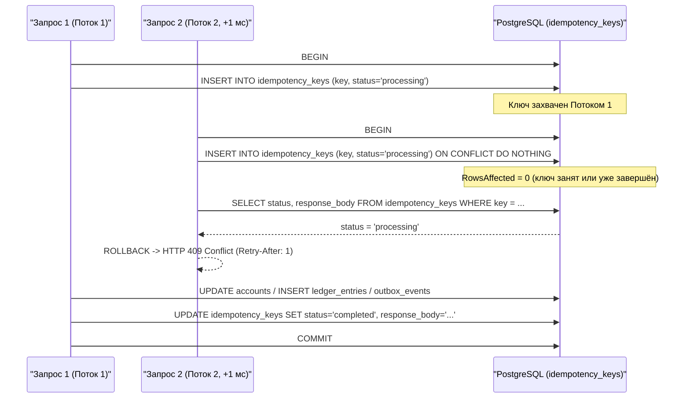

*Как устроена таблица `idempotency_keys` из `003_idempotency_outbox.sql` и метод `Transfer` в `LedgerPulse`, почему проверка `SELECT` перед `INSERT` проигрывает уникальному ограничению в гонке `TOCTOU`, как обрабатывать конкурентный двойной клик и строить `Transactional Inbox` для потребителей событий.*

> «Простота требует больше труда в начале проекта — чтобы очистить идею до самой сути — и больше дисциплины на всём сроке его жизни, чтобы отличать хорошие изменения от плохих и вредоносных.»  
> — Алан Донован и Брайан Керниган (со ссылкой на Фреда Брукса), *The Go Programming Language*

Представьте кнопку вызова лифта на этаже. Вы подходите и нажимаете её — индикатор загорается, и контроллер отправляет кабину на ваш этаж. Если от нетерпения вы нажмёте ту же кнопку ещё десять раз подряд, к вам не приедут десять кабин одновременно. Система перешла в состояние «вызов принят» с первого нажатия, а все последующие нажатия не породили новых побочных эффектов. Это и есть бытовая физика идемпотентности.

В [[12. Паттерн Transactional Outbox на уровне БД]] мы убедились, что распределённая шина способна доставить событие повторно (`at-least-once`). То же происходит и на границе HTTP-клиента: мобильное приложение отправило `POST /api/v1/transfers`, сервер в PostgreSQL успешно списал 2 500 копеек и вернул `200 OK`, но по пути ответ потерялся в сотовой сети. Клиент видит таймаут и повторяет запрос. Если сервер не защищён от повтора, деньги уйдут со счёта дважды.

**Идемпотентность** — это свойство операции, при котором повторное применение с теми же аргументами даёт тот же результат и не меняет состояние системы сверх первого выполнения. Формально: $f(f(x)) = f(x)$. В распределённых системах комбинация доставки `at-least-once` и идемпотентного обработчика даёт бизнес-логике эффект **«точно один раз» по результату (`effectively-once`)**.

---

## Где идемпотентность обязательна и что говорит HTTP

По спецификации HTTP методы `GET`, `HEAD`, `PUT`, `DELETE` и `OPTIONS` задуманы идемпотентными: повторный `DELETE /orders/42` удаляет ресурс один раз, а повторный вызов лишь сообщает, что ресурса уже нет. Методы `POST` и `PATCH` по умолчанию **не идемпотентны**. Поэтому именно операции создания платежей, переводов, резервирования товара и обработки сообщений из очередей разработчик защищает явно на уровне БД.

Типовые сценарии в продакшене:
* **Платёжный процессинг:** повторный `POST /api/v1/transfers` при обрыве связи или автоматическом ретрае прокси не должен проводить второе списание.
* **Двойной клик в интерфейсе:** два почти одновременных запроса на оформление заказа не должны создать две отгрузки на складе.
* **Обработчики брокеров событий:** при ребалансировке партиций или падении воркера до подтверждения смещения сообщение приходит повторно.
* **Автоматические ретраи HTTP-клиентов и Service Mesh:** сетевые клиенты с экспоненциальной задержкой повторяют любой запрос, завершившийся `502`/`504` или обрывом TCP-соединения (конфигурация HTTP-шлюзов, middleware и консьюмеров брокеров разбирается в Томе 3).

---

## Идемпотентность на уровне SQL-операций

Сравним два внешне похожих SQL-запроса:

* `UPDATE accounts SET balance = balance - 100 WHERE id = 1;` — **не идемпотентно**: каждый повтор снимает очередные 100 единиц.
* `UPDATE accounts SET balance = 900 WHERE id = 1;` — **идемпотентно**: десять повторов оставят на счёте 900.

Однако в конкурентном биллинге вроде `LedgerPulse` нельзя просто присваивать `balance = 900` — пока первый запрос шёл по сети, другой перевод уже мог изменить баланс счёта (аномалия потерянного обновления, [[4. Аномалии — Dirty Read, Phantom Read, Lost Update и Write Skew]]). Поэтому в SQL опираются на три базовых механизма:

1. **Уникальные ограничения (`PRIMARY KEY`, `UNIQUE`):** защита по естественному или внешнему ключу (`reference_id`, `order_number`, `idempotency_key`).
2. **Атомарный Upsert:**
   * В PostgreSQL: `INSERT INTO ... VALUES (...) ON CONFLICT (reference_id) DO NOTHING;` (или `DO UPDATE`).
   * В MySQL: `INSERT INTO ... VALUES (...) ON DUPLICATE KEY UPDATE reference_id = reference_id;`.
   * В стандарте SQL (PostgreSQL 15+, Oracle, MS SQL): оператор `MERGE`.
3. **Перехват ошибки уникальности (`SQLSTATE 23505`):** попытка вставки внутри транзакции и штатная обработка конфликта ключа.

> [!tip] Собеседование [Middle]
> **Вопрос:** В чём разница между предварительной проверкой через `SELECT` перед `INSERT` и уникальным ограничением `UNIQUE` в базе данных?  
> **Ответ:** Схема «сначала проверь через `SELECT`, а потом вставь через `INSERT`» подвержена состоянию гонки **TOCTOU (*Time-of-Check to Time-of-Use*)**. Две конкурентные транзакции на уровне `Read Committed` выполняют `SELECT` в одну микросекунду, обе видят, что строки ещё нет, и обе пытаются выполнить `INSERT`. Только индекс `UNIQUE` (или `PRIMARY KEY`) сериализует вставку одинаковых ключей на уровне страниц B-Tree и строковых блокировок PostgreSQL, гарантируя, что пройдёт ровно одна запись.

---

## Паттерн Idempotency-Key в `LedgerPulse`

Паттерн **Idempotency-Key** (стандартизируется в IETF и применяется в платёжных API уровня Stripe, Adyen и PayPal) перекладывает идентификацию операции на клиента: перед отправкой `POST`-запроса клиент генерирует случайный `UUIDv4` и передаёт его в HTTP-заголовке `Idempotency-Key` (или в теле запроса `idempotency_key`).

Посмотрим, как устроена таблица `idempotency_keys` в `project/sql/migrations/003_idempotency_outbox.sql`:

```sql
CREATE TABLE IF NOT EXISTS idempotency_keys (
    idempotency_key TEXT        PRIMARY KEY,
    request_hash    TEXT        NOT NULL,
    transaction_id  BIGINT      REFERENCES transactions(id) ON DELETE SET NULL,
    response_code   INT         NOT NULL,
    response_body   JSONB       NOT NULL,
    created_at      TIMESTAMPTZ NOT NULL DEFAULT now(),
    expires_at      TIMESTAMPTZ NOT NULL
);

CREATE INDEX IF NOT EXISTS idx_idempotency_expires_at
    ON idempotency_keys (expires_at);
```

И как с ней работает метод `Transfer` в `project/final/service.go`:

```go
// Фрагмент LedgerService.Transfer из project/final/service.go
err := s.txMgr.WithinTx(ctx, &sql.TxOptions{Isolation: sql.LevelReadCommitted}, func(txRepo TxRepository) error {
	if existing, found, err := txRepo.GetIdempotency(ctx, req.IdempotencyKey); err != nil {
		return err
	} else if found {
		if err := json.Unmarshal([]byte(existing.ResponseBody), &result); err != nil {
			return err
		}
		result.Replayed = true
		return nil
	}
	// ... проверка счетов, обновление балансов в порядке ID, InsertEntry, InsertOutbox ...

	hash := sha256.Sum256([]byte(fmt.Sprintf("%d:%d:%d:%s", req.FromAccountID, req.ToAccountID, req.Amount, req.Currency)))
	if err := txRepo.InsertIdempotency(ctx, req.IdempotencyKey, hex.EncodeToString(hash[:]), txID, 200, string(rawBody)); err != nil {
		return err
	}
	result = res
	return nil
})
```

Вся бизнес-логика — вставка в `transactions`, дебет/кредит балансов `accounts`, двойные проводки в `ledger_entries`, запись события в `outbox_events` и фиксация ключа в `idempotency_keys` — выполняется **внутри одной ACID-транзакции** (`WithinTx`). Если перевод не прошёл (скажем, сработало ограничение `balance + $1 >= 0` при овердрафте), откатывается вся транзакция, включая ключ идемпотентности. Клиент может исправить баланс, повторить запрос с тем же ключом и успешно провести платёж.

При успешном первом переводе в `TestLedgerPulseEndToEndAndConcurrency` повторный HTTP-запрос с тем же `"idem-001"` возвращает сохранённый JSON-ответ с флагом `Replayed: true`, оставляя балансы `7 500` и `7 500` неизменными и не добавляя второе событие в `outbox_events`.

### Две важные доработки для продакшена

В учебном каркасе `project/final/service.go` показана базовая механика. В реальном высоконагруженном процессинге к ней добавляют две обязательные проверки:

1. **Сверка `request_hash` (защита от бага клиента).** В `idempotency_keys` сохраняется SHA-256 от параметров запроса (`FromAccountID`, `ToAccountID`, `Amount`, `Currency`). Если клиент по ошибке переиспользовал старый `Idempotency-Key` для перевода на другую сумму или другому получателю, сервер обязан сравнить хеш нового запроса с `existing.RequestHash` и при несовпадении вернуть ошибку `422 Unprocessable Entity` или `409 Conflict`, а не молча отдать старый чек.
2. **Конкурентный двойной клик (Concurrent Double-Click).** Представим, что два идентичных запроса с ключом `"idem-999"` пришли с разницей в 1 миллисекунду на уровне `Read Committed`. Оба вызывают `GetIdempotency` до коммита и оба получают `found == false`. Дальше первый поток дойдёт до `InsertIdempotency` и захватит уникальный индекс, а второй заблокируется на индексе первичного ключа:
   * Если первый поток завершит `COMMIT`, второй получит ошибку PostgreSQL **`23505` (`unique_violation`)**, откатит свою транзакцию (деньги второй раз не спишутся) и при повторном чтении вернёт готовый `response_body` первого запроса.
   * Но чтобы второй запрос не крутил лишнюю бизнес-логику впустую, в нагруженных системах ключ резервируют **в самом начале** со статусом `'processing'` (или захватывают через `INSERT ... ON CONFLICT DO NOTHING`), как показано на диаграмме ниже.



> [!warning] Ловушка: бесконечный статус `'processing'` при падении сервиса
> Если сервер захватил ключ со статусом `'processing'` в отдельной транзакции до выполнения бизнес-логики и сразу упал по OOM, запись навсегда застрянет в `'processing'`, блокируя клиента. Поэтому либо объединяйте захват и бизнес-операцию в **единую ACID-транзакцию** (как в `LedgerService.Transfer`, полагаясь на блокировку уникального индекса и откат при `23505`), либо добавляйте для статуса `'processing'` короткий таймаут протухания (`locked_until`).

Ниже показан идиоматичный фрагмент на Go 1.24 с проверкой `request_hash` и перехватом `unique_violation` (`23505`) при гонке двух одинаковых запросов:

```go
// Пример проверки хеша и обработки конкурентного дубликата (pgconn/pq или sqlstate-интерфейс).
type sqlStater interface{ SQLState() string }

func isUniqueViolation(err error) bool {
	var st sqlStater
	return errors.As(err, &st) && st.SQLState() == "23505"
}

func checkOrReplay(existing ExistingKey, reqHash string) (TransferResult, error) {
	if existing.RequestHash != reqHash {
		return TransferResult{}, errors.New("idempotency key reused with different payload")
	}
	var out TransferResult
	if err := json.Unmarshal([]byte(existing.ResponseBody), &out); err != nil {
		return TransferResult{}, fmt.Errorf("decode cached response: %w", err)
	}
	out.Replayed = true
	return out, nil
}
```

При столкновении двух конкурентных запросов в логах и ответах API картина остаётся детерминированной:

```text
req#1 key=idem-777 -> COMMIT tx=1042, from_balance=7500, replayed=false (200 OK)
req#2 key=idem-777 -> SQLSTATE 23505 on idempotency_keys -> ROLLBACK -> replay tx=1042, replayed=true (200 OK)
req#3 key=idem-777 (amount=9999) -> request_hash mismatch -> 422 Unprocessable Entity
```

---

## Idempotent Consumer: паттерн Transactional Inbox

Для асинхронных потребителей событий из брокеров (Kafka, RabbitMQ, NATS) HTTP-заголовка `Idempotency-Key` нет, но у каждого события из `outbox_events` есть уникальный идентификатор (`event_id` или пара `aggregate_type + aggregate_id + event_id`). На стороне сервиса-получателя заводят таблицу **`inbox_messages`** (или `processed_messages`):

```sql
CREATE TABLE IF NOT EXISTS inbox_messages (
    message_id   TEXT        PRIMARY KEY,
    consumer     TEXT        NOT NULL,
    processed_at TIMESTAMPTZ NOT NULL DEFAULT now()
);
```

Обработка сообщения в воркере всегда идёт в одной локальной транзакции:

```sql
BEGIN;
    INSERT INTO inbox_messages (message_id, consumer)
    VALUES ($1, 'analytics-projection')
    ON CONFLICT (message_id) DO NOTHING;
    -- Если driver вернул RowsAffected() == 0 -> сообщение уже обработано, делаем COMMIT и выходим.
    -- Если RowsAffected() == 1 -> выполняем бизнес-обновление локальных таблиц:
    UPDATE account_stats SET total_turnover = total_turnover + $2 WHERE account_id = $3;
COMMIT;
```

Так как вставка в `inbox_messages` и обновление доменной таблицы лежат внутри одного `BEGIN ... COMMIT`, невозможно ни обработать сообщение без записи в `inbox_messages`, ни записать `message_id` без применения эффекта.

---

## TTL и эксплуатация таблицы `idempotency_keys`

Хранить ключи идемпотентности вечно нельзя: таблица будет бесконечно расти, а вставка в огромный B-Tree индекс первичного ключа постепенно замедлится из-за вымывания страниц индекса из `shared_buffers`.

В `003_idempotency_outbox.sql` предусмотрены колонка `expires_at TIMESTAMPTZ NOT NULL` (обычно `now() + interval '24 hours'` или `72 hours`) и индекс `idx_idempotency_expires_at`. На практике чистку строят одним из двух способов:

1. **Фоновый воркер батчами:** каждые несколько минут удаляет просроченные ключи небольшими порциями, чтобы не блокировать таблицу и не создавать пиковую нагрузку на `WAL`:
   ```sql
   DELETE FROM idempotency_keys
   WHERE idempotency_key IN (
       SELECT idempotency_key
       FROM idempotency_keys
       WHERE expires_at < now()
       LIMIT 5000
   );
   ```
2. **Партиционирование по времени:** при десятках миллионов запросов в сутки таблицу `idempotency_keys` секционируют по дням на `created_at` ([[5. Партиционирование (Partitioning) — Range, List, Hash и управление таблицами]]). Удаление устаревших ключей сводится к мгновенному `DROP TABLE` старой секции.

Идемпотентность не отменяет ограничений CAP и PACELC, но переводит неизбежные сетевые повторы, ребалансировки очередей и перезапуски серверов из разряда финансовых инцидентов в рутинную штатную операцию.

---

## Упражнения

### 1. Базовое: Почему `UPDATE balance = balance - 100` опасен без ключа

В обработчик начисления бонусов из очереди сообщений поставили запрос `UPDATE bonus_accounts SET points = points + 50 WHERE user_id = $1;` без таблицы `inbox_messages`. Однажды из-за сбоя при коммите смещения в брокере одно сообщение доставили трижды. Почему эту проблему нельзя исправить заменой запроса на `UPDATE bonus_accounts SET points = 150 WHERE user_id = $1;`?

> [!solution] Показать решение
> Запрос `SET points = 150` математически идемпотентен сам по себе, но он уничтожит результаты всех *других* транзакций, которые зачислили или списали бонусы этому пользователю между первой и третьей доставкой сообщения (аномалия потерянного обновления). Правильное решение для относительных начислений — сохранить неизменяемый `UPDATE points = points + 50`, но объединить его в одной ACID-транзакции с `INSERT INTO inbox_messages (message_id) VALUES ($1) ON CONFLICT DO NOTHING` и проверкой `RowsAffected() == 1`.

### 2. Практическое: `Idempotent Consumer` на Go 1.24

Напишите функцию на Go 1.24 `ApplyEventIdempotently(ctx context.Context, db *sql.DB, msgID string, accountID, delta int64) (applied bool, err error)`, которая внутри одной транзакции проверяет уникальность `msgID` в таблице `inbox_messages` через `ON CONFLICT DO NOTHING` и при первом получении обновляет счётчик в таблице `account_stats (account_id BIGINT PRIMARY KEY, turnover BIGINT NOT NULL)`.

> [!solution] Показать решение
> ```go
> func ApplyEventIdempotently(ctx context.Context, db *sql.DB, msgID string, accountID, delta int64) (bool, error) {
> 	tx, err := db.BeginTx(ctx, nil)
> 	if err != nil {
> 		return false, fmt.Errorf("begin tx: %w", err)
> 	}
> 	defer func() { _ = tx.Rollback() }()
>
> 	res, err := tx.ExecContext(ctx, `
> 		INSERT INTO inbox_messages (message_id, consumer)
> 		VALUES ($1, 'ledger-stats')
> 		ON CONFLICT (message_id) DO NOTHING`, msgID,
> 	)
> 	if err != nil {
> 		return false, fmt.Errorf("insert inbox: %w", err)
> 	}
> 	n, err := res.RowsAffected()
> 	if err != nil {
> 		return false, err
> 	}
> 	if n == 0 {
> 		// Дубликат: событие уже обработано ранее.
> 		return false, tx.Commit()
> 	}
>
> 	if _, err := tx.ExecContext(ctx, `
> 		INSERT INTO account_stats (account_id, turnover)
> 		VALUES ($1, $2)
> 		ON CONFLICT (account_id) DO UPDATE
> 		SET turnover = account_stats.turnover + EXCLUDED.turnover`,
> 		accountID, delta,
> 	); err != nil {
> 		return false, fmt.Errorf("update account_stats: %w", err)
> 	}
>
> 	if err := tx.Commit(); err != nil {
> 		return false, fmt.Errorf("commit: %w", err)
> 	}
> 	return true, nil
> }
> ```

### 3. Со звёздочкой (\*): Инженерный аудит `Transfer` при конкурентном дубликате

Посмотрите на `LedgerService.Transfer` из `project/final/service.go` (код приведён выше). Допустим, два клиента отправили одинаковый `POST /api/v1/transfers` с одним и тем же `IdempotencyKey` одновременно, и оба запроса попали в `WithinTx` с уровнем изоляции `Read Committed` до коммита первого.
1. Почему деньги всё равно не спишутся дважды?
2. Что именно произойдёт с обоими запросами в PostgreSQL и какой код вернёт `Transfer` второму клиенту, если вызов `InsertIdempotency` не обёрнут в перехват ошибки `23505`?
3. Как доработать метод, чтобы второй клиент вместо ошибки `500` получил либо сохранённый ответ (`Replayed: true`), либо `422` при подмене `Amount`?

> [!solution] Показать решение
> 1. Деньги не спишутся дважды благодаря **первичному ключу `PRIMARY KEY (idempotency_key)`** в таблице `idempotency_keys`.
> 2. Первый запрос дойдёт до `InsertIdempotency`, вставит строку и удержит на ней блокировку до `COMMIT`. Второй запрос на `InsertIdempotency` приостановится на ожидании блокировки индекса. Как только первый запрос сделает `COMMIT`, второй получит от PostgreSQL ошибку уникальности **`SQLSTATE 23505`**, выйдет из замыкания `WithinTx`, сделает `ROLLBACK` всех своих изменений баланса/проводок/outbox и вернёт необработанную ошибку драйвера (обычно `500 Internal Server Error`).
> 3. Доработка состоит из двух шагов:
>    * Внутри `if found` сравнивать `existing.RequestHash` с SHA-256 нового запроса и возвращать `ErrIdempotencyPayloadMismatch` (HTTP `422`) при несовпадении.
>    * На уровне `Transfer` (вокруг `s.txMgr.WithinTx`): если транзакция завершилась с `isUniqueViolation(err)`, выполнить одно повторное чтение `GetIdempotency` (теперь строка первого запроса уже закоммичена), сверить `RequestHash` и вернуть кэшированный `TransferResult` с `Replayed: true`.

---

## Главный вывод и мостик дальше

Идемпотентность на уровне базы данных превращает неизбежные сетевые повторы и дубликаты сообщений в безопасную операцию: уникальные ограничения защищают от гонки `TOCTOU`, таблица `idempotency_keys` с проверкой `request_hash` и кэшированием ответа закрывает повторные HTTP-запросы, а `inbox_messages` внутри локальной транзакции обеспечивает эффект `effectively-once` для асинхронных потребителей.

Мы собрали весь фундамент прикладной надёжности данных в микросервисах — от границ владения таблицами до `Transactional Outbox` и идемпотентности. Но что делать, когда база данных работает корректно, а поток транзакций и аналитических выборок превышает физические возможности одного сервера PostgreSQL по CPU, памяти и дисковым IOPS? В следующей главе мы перейдём к HighLoad-архитектуре баз данных: разберём масштабирование чтения через реплики, пулинг соединений на уровне кластера, батчинг и буферизацию записи.
