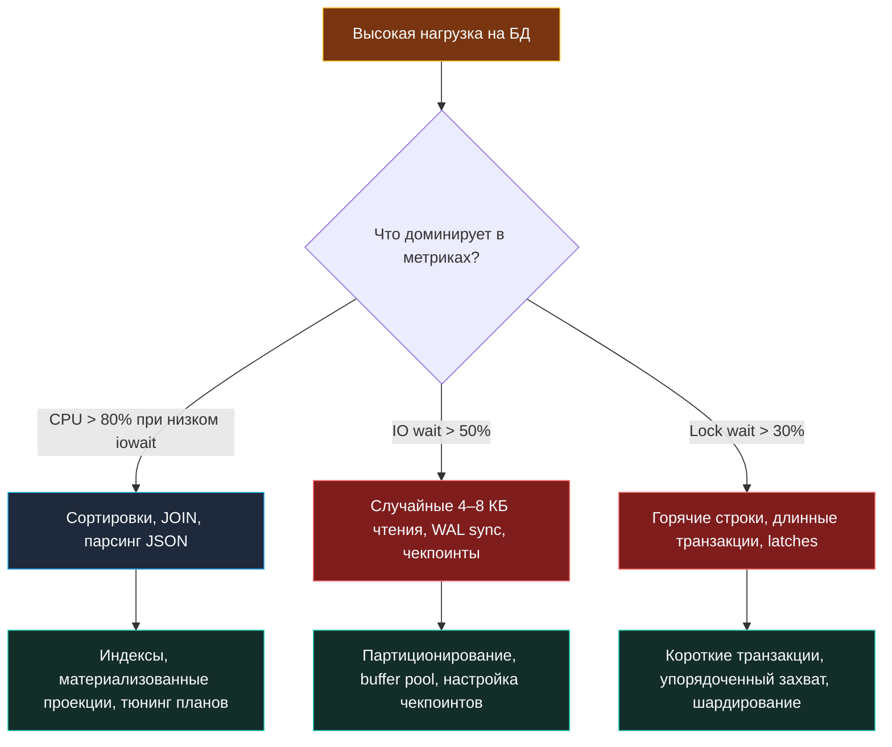

*Как диагностировать узкие места высоконагруженной СУБД по метрикам I/O, CPU и блокировок, зачем ставить PgBouncer перед PostgreSQL, как стримить выборки и батчить вставки на Go 1.24 и где проходит предел масштабирования одного узла.*

> «В идеальном мире прикладному программисту достаточно знать только API — без того, как этот API реализован и к какому железу он обращается. В реальности же чуть более глубокие знания порой оказываются весьма кстати.»  
> — Чарльз Петцольд, *Code: The Hidden Language of Computer Hardware and Software* (2-е изд.)

Представьте многополосную трассу в час пик. Можно бесконечно укладывать новый асфальт, но если на въезде в город стоит один шлагбаум пункта оплаты, пробка растянется на километры. Решение — не ещё одна полоса до горизонта, а бесконтактные транспондеры (пулеры соединений), объездные хорды (реплики чтения) и разделение потоков по разным трассам (шардирование).

В `LedgerPulse` этот предел наступает при росте трафика до десятков тысяч или миллионов операций в секунду с жёстким контрактом задержки (`p99 < 50 мс`) и доступности `99.99%`. Бросить в сервер вдвое больше CPU и RAM здесь не помогает — база упирается в физику железа и архитектуру потоков. В сравнительном масштабе задержек обращение к оперативной памяти занимает **~100 нс**, случайное чтение страницы с NVMe SSD — **~100 мкс** (в тысячу раз дольше), а позиционирование головки HDD — **~10 мс** (в сто тысяч раз дольше RAM). Один промах мимо буферного пула на горячем пути съедает бюджет `p99`.

---

## Идентификация узких мест: I/O, CPU, сеть и блокировки

Прежде чем масштабировать систему, измерьте, какой ресурс тормозит контур. Под высокой нагрузкой всегда доминирует один из четырёх факторов:



* **Диск (Disk I/O):** растёт `iowait` в `iostat`/`vmstat` и `pg_stat_database.blks_read`. Причины — случайные чтения без покрывающих индексов, частые контрольные точки, задержки записи WAL и раздувание таблиц (bloat). Даже быстрый NVMe на сотни тысяч IOPS упирается в задержки контроллера при хаотичных чтениях и частых `fsync`.
* **CPU:** загрузка ядер у потолка при нулевом `iowait`. Причины — тяжёлые `JOIN`, `ORDER BY` без индекса, сложные агрегации и десериализация `JSONB`.
* **Сеть:** задержка растёт линейно с RPS. Причины — поток мелких запросов без пайплайнинга, узкое TCP-окно или лимиты файловых дескрипторов.
* **Блокировки (Locks/Latches):** резкие скачки `p99` при стабильном среднем трафике. Виновники — «горячие строки» (частые `UPDATE` одной записи), длинные транзакции с `SHARE`-блокировками и `latch contention` (`LWLock`) в буферном пуле.

> [!warning] Ловушка: «База тормозит», а очередь стоит в Go
> Часто перегружена не СУБД, а клиентский пул. При `db.SetMaxOpenConns(200)` и резком всплеске трафика лишние горутины паркуются в очереди ожидания: в `pprof` видны всплески `runtime.gopark`, а сама БД почти свободна. Сравнивайте `db.Stats().InUse` и `db.Stats().WaitDuration` — экспоненциальный рост `WaitDuration` при низкой нагрузке на базу требует пересмотра размера пула или сокращения времени удержания соединений ([[2. database_sql под капотом — пул соединений, badconn, Tx-pinning и Prepared Statements]]).

---

## Архитектурные стратегии масштабирования

Когда запросы оптимизированы ([[10. План выполнения запроса — читаем EXPLAIN ANALYZE BUFFERS]]), переходят к разделению потоков чтения и записи.

### Масштабирование чтения: реплики и маршрутизация

Чтение обычно превосходит запись в 10–100 раз, поэтому выписки и отчёты выносят на read-реплики ([[1. Репликация — синхронная, полусинхронная и асинхронная]], [[11. Репликация в PostgreSQL — потоковая, логическая и слоты]]):

* **Асинхронная репликация:** не тормозит запись, но допускает репликационный лаг (клиент может не увидеть свежую запись — аномалия *Read-Your-Writes*, [[2. Репликация Leader-Follower — лаг репликации и аномалии чтения]]).
* **Синхронная репликация:** гарантирует актуальность данных, но прибавляет к каждому `COMMIT` 1 сетевой RTT до самой удалённой реплики.
* **Маршрутизация:** прокси (`PgBouncer`, `HAProxy`, `ProxySQL`) или два раздельных пула `*sql.DB` в Go (`writeDB` и `readDB`). Внешние прокси предпочтительнее за счёт централизованного пулинга.

### Масштабирование записи: буферизация, партиционирование и шардирование

Запись на одном узле упирается в пропускную способность WAL и CPU лидера. Отодвигают предел тремя способами:

1. **Буферизация и батчинг:** накопление изменений и отправка батчами (или через брокер и [[12. Паттерн Transactional Outbox на уровне БД]]) снижает частоту `fsync`.
2. **Партиционирование (Partitioning):** деление крупной таблицы по дате или хешу ([[5. Партиционирование (Partitioning) — Range, List, Hash и управление таблицами]]). Уменьшает размер активных B-Tree, повышает `cache hit ratio`, ускоряет `VACUUM` и позволяет удалять старые периоды мгновенным `DROP TABLE`.
3. **Шардирование (Sharding):** разнос данных по независимым физическим серверам (Citus, Vitess, роутер в приложении, [[4. Шардирование (Sharding) — ключи, консистентное хеширование и перебалансировка]]). Даёт линейный рост записи, но резко усложняет `JOIN` и распределённые транзакции.

> [!tip] Собеседование [Middle]
> **Вопрос:** Когда шардирование оправдано, а когда это антипаттерн?  
> **Ответ:** Шардирование оправдано лишь тогда, когда один физический узел записи исчерпал лимит WAL I/O или CPU после выноса чтений на реплики, оптимизации индексов и партиционирования. Внедрять шардирование «на будущее» или при базе меньше 50–100 ГБ — антипаттерн: оно усложняет миграции, бэкапы, аналитику и транзакции. Холодные исторические данные разумнее выгружать в ClickHouse ([[11. ClickHouse — аналитическая OLAP-база для миллиардов строк]]) или S3.

---

## Под капотом: модель соединений в СУБД и Go

* **PostgreSQL (процессная модель):** один клиент = один процесс ОС (5–10 МБ RSS + доступ к `shared_buffers`, [[1. Архитектура PostgreSQL — процессы, общая память и бэкенды]]). При `max_connections = 1000` тратятся гигабайты RAM и CPU на переключение контекста.
* **MySQL InnoDB (потоковая модель):** один поток ОС на соединение ([[1. Архитектура MySQL — поток на соединение и подключаемые движки]]). Памяти нужно меньше, но при высокой конкуренции возникает `mutex contention` на защёлках `Buffer Pool`.

В Go вызов `db.QueryContext` захватывает соединение под `db.mu`, отправляет запрос через `write()`, паркует горутину в сетевом поллере `netpoll` (`epoll`), а при ответе будит её и читает сокет через `read()`. Ожидание дёшево, но если число запросов превышает `max_connections`, горутины копятся в памяти вплоть до `OOM Killer`.

> [!info] Под капотом: PgBouncer в режиме `transaction`
> Внешний пулер `PgBouncer` держит 20–50 реальных соединений к PostgreSQL и мультиплексирует тысячи подключений от Go-сервисов, возвращая соединение в пул сразу после `COMMIT` или `ROLLBACK` ([[9. Настройка и оптимизация PostgreSQL — память, планировщик и PgBouncer]]). В этом режиме нельзя использовать сессионные переменные (только `SET LOCAL`), а именованные prepared statements требуют протокольной поддержки (`max_prepared_statements` в PgBouncer 1.21+).

Сравнение моделей: в **Java** потоки ОС дороги, поэтому пул (HikariCP) держат узким (50–100 соединений), либо переходят на асинхронный R2DBC; в **PHP** stateless-модель пересоздаёт сокеты на каждый запрос и не живёт без `PgBouncer`; в **Go** горутины и `netpoll` легко переваривают тысячи одновременных ожиданий, а главным риском становятся аллокации кучи при больших выборках.

---

## Идиоматичная оптимизация в Go 1.24 под нагрузкой

### Стриминг крупных выборок

Никогда не загружайте миллионы строк в память целиком. Читайте их через `rows.Next()`, переиспользуя батч-слайс `batch = batch[:0]` и проверяя `ctx.Err()`:

```go
func StreamLedgerEntries(ctx context.Context, db *sql.DB, batchSize int, handle func(context.Context, []LedgerEntry) error) error {
	rows, err := db.QueryContext(ctx,
		`SELECT id, account_id, amount FROM ledger_entries WHERE created_at >= now() - interval '1 day' ORDER BY id ASC`,
	)
	if err != nil {
		return fmt.Errorf("query ledger entries: %w", err)
	}
	defer rows.Close()

	batch := make([]LedgerEntry, 0, batchSize)
	for rows.Next() {
		if ctx.Err() != nil {
			return ctx.Err()
		}
		var e LedgerEntry
		if err := rows.Scan(&e.ID, &e.AccountID, &e.Amount); err != nil {
			return fmt.Errorf("scan ledger entry: %w", err)
		}
		batch = append(batch, e)
		if len(batch) >= batchSize {
			if err := handle(ctx, batch); err != nil {
				return err
			}
			batch = batch[:0]
		}
	}
	if len(batch) > 0 {
		if err := handle(ctx, batch); err != nil {
			return err
		}
	}
	return rows.Err()
}
```

### Пакетная вставка и амортизация `fsync`

Одиночные `INSERT` множат сетевые RTT и вызовы `fsync` на диск. Группируйте записи чанками внутри одной транзакции (а для максимальной скорости в PostgreSQL используйте `UNNEST` или протокол `COPY`, [[16. Пакетные (Batch) запросы, UNNEST и COPY]]):

```go
func BatchInsertEntries(ctx context.Context, db *sql.DB, entries []LedgerEntry) error {
	const chunkSize = 1000
	for i := 0; i < len(entries); i += chunkSize {
		chunk := entries[i:min(i+chunkSize, len(entries))]
		tx, err := db.BeginTx(ctx, nil)
		if err != nil {
			return fmt.Errorf("begin tx: %w", err)
		}
		stmt, err := tx.PrepareContext(ctx, `INSERT INTO ledger_entries (transaction_id, account_id, amount) VALUES ($1, $2, $3)`)
		if err != nil {
			_ = tx.Rollback()
			return fmt.Errorf("prepare insert: %w", err)
		}
		for _, e := range chunk {
			if _, err := stmt.ExecContext(ctx, e.TransactionID, e.AccountID, e.Amount); err != nil {
				_ = stmt.Close()
				_ = tx.Rollback()
				return fmt.Errorf("exec insert: %w", err)
			}
		}
		_ = stmt.Close()
		if err := tx.Commit(); err != nil {
			return fmt.Errorf("commit chunk: %w", err)
		}
	}
	return nil
}
```

Внутри транзакции СУБД буферизует изменения в `shared_buffers`, пишет их в WAL последовательно и вызывает `fsync` один раз на `COMMIT` вместо `N` раз.

---

## Физика диска и памяти под нагрузкой

* **WAL и Checkpointing:** частые контрольные точки (`checkpoint_timeout`) вызывают I/O-шторм при массовом сбросе `dirty pages` ([[8. WAL — журнал упреждающей записи и долговечность на диске]], [[9. Контрольные точки (Checkpointing) и сброс грязных страниц]]). В HighLoad-профиле PostgreSQL увеличивают `max_wal_size` (до 2–4 ГБ и выше) и задают `checkpoint_completion_target = 0.9`, размазывая запись по времени.
* **Вытеснение страниц (`cache churn`):** если горячий рабочий набор не влезает в `shared_buffers`, страницы постоянно гоняются с диска через Page Cache ОС в буфер пула и кучу Go, порождая промахи кэшей `L1/L2` CPU (`memory stall`). Помогают узкие покрывающие индексы, партиционирование и прогрев кэша через `pg_prewarm`.

> [!warning] Ловушка: `UUIDv4` как первичный ключ
> Случайный `UUIDv4` разбрасывает вставки по случайным страницам B-Tree, провоцирует *page splits* и уничтожает локальность данных. В нагруженных таблицах используйте монотонные ключи — `BIGINT` с `SEQUENCE` или временной `UUIDv7`, которые превращают вставку в последовательный `APPEND` в правый край индекса.

---

## Типичные ловушки и вопросы с собеседований

1. **N+1 под нагрузкой:** 1000 HTTP-запросов с 50 мелких `SELECT` создают 50 000 RPS на базу ([[13. Проблема N+1 и как её устранить]]). Лечится `JOIN`, `ANY($1)` и профилированием `pg_stat_statements`.
2. **Длинные транзакции:** удерживают снимки MVCC, блокируют очистку мёртвых строк `VACUUM` ([[11. VACUUM и сборка мёртвых версий кортежей]]) и тормозят реплики. Задавайте `statement_timeout` и `idle_in_transaction_session_timeout`.
3. **Отсутствие кэша prepared statements:** без него каждый запрос тратит 3 фазы (`Parse`, `Bind`, `Execute`) вместо прямого исполнения. В `pgxpool` кэширование работает из коробки на уровне соединения.

> [!tip] Собеседование [Senior/Staff]
> **Вопрос:** Задержка `p99` выросла с 10 мс до 500 мс, но CPU (25%) и Disk I/O в норме. Как найти и устранить причину?  
> **Ответ:** Это типичный профиль конкуренции за блокировки (`Lock`/`LWLock`) либо очереди клиентского пула.  
> 1. Проверить `pg_stat_activity` на `wait_event_type IN ('Lock', 'LWLock')`.  
> 2. Посмотреть `pg_locks` на блокирующие транзакции и `EXPLAIN ANALYZE` на наличие `Heap Fetch` из-за bloat.  
> 3. Проверить `db.Stats().WaitDuration` и профили блокировок в Go (не удерживается ли соединение пула мьютексом или внешним HTTP-вызовом).  
> 4. Сократить длительность транзакций, упорядочить блокировки и расщепить горячие ключи.

---

## Упражнения

1. **Базовое.** На стенде `LedgerPulse` CPU базы — 18%, `iowait` — 4%, активных сессий в `pg_stat_activity` — 12, но `db.Stats().WaitCount` в Go растёт, а `p99` превышает 800 мс. Объясните причину и назовите два первых шага диагностики в Go.

> [!solution] Показать решение
> Запросы не доходят до СУБД и стоят в очереди клиентского пула `database/sql`: либо `SetMaxOpenConns` равен 12 и мал для трафика, либо горутины удерживают соединения слишком долго (внешние вызовы внутри транзакции, забытый `rows.Close()`).  
> Диагностика: 1) сравнить `db.Stats().InUse` с `WaitDuration` и снять `pprof` профиль горутин/блокировок; 2) проверить все `QueryContext` на `defer rows.Close()` и наличие таймаутов `context.WithTimeout` вне и внутри `WithinTx`.

2. **Практическое.** Реализуйте функцию на Go 1.24 для пакетной вставки записей `ledger_entries` через PostgreSQL `UNNEST` чанками по 500 строк внутри транзакции `BeginTx`.

> [!solution] Показать решение
> ```go
> func BulkInsertEntriesUnnest(ctx context.Context, db *sql.DB, entries []LedgerEntry) error {
> 	const chunkSize = 500
> 	for i := 0; i < len(entries); i += chunkSize {
> 		chunk := entries[i:min(i+chunkSize, len(entries))]
> 		txIDs := make([]int64, len(chunk))
> 		accIDs := make([]int64, len(chunk))
> 		amounts := make([]int64, len(chunk))
> 		for j, e := range chunk {
> 			txIDs[j], accIDs[j], amounts[j] = e.TransactionID, e.AccountID, e.Amount
> 		}
>
> 		tx, err := db.BeginTx(ctx, nil)
> 		if err != nil {
> 			return fmt.Errorf("begin tx: %w", err)
> 		}
> 		const q = `
> 			INSERT INTO ledger_entries (transaction_id, account_id, amount)
> 			SELECT * FROM UNNEST($1::bigint[], $2::bigint[], $3::bigint[])`
> 		if _, err := tx.ExecContext(ctx, q, txIDs, accIDs, amounts); err != nil {
> 			_ = tx.Rollback()
> 			return fmt.Errorf("unnest insert: %w", err)
> 		}
> 		if err := tx.Commit(); err != nil {
> 			return fmt.Errorf("commit tx: %w", err)
> 		}
> 	}
> 	return nil
> }
> ```

3. **Со звёздочкой (\*).** Таблица `ledger_entries` (400 ГБ) с первичным ключом `UUIDv4` деградирует при вставке: упал `cache hit ratio` и вырос `iowait`. 95% чтений выбирают операции одного `account_id` за последние 7 дней. Предложите новую схему и план миграции без простоя.

> [!solution] Показать решение
> 1. **Ключ:** перейти с `UUIDv4` на `UUIDv7` или `BIGINT` sequence (плюс `created_at` в партиционированном ключе) — вставка станет последовательной.  
> 2. **Партиционирование:** `RANGE` по `created_at` (по дням/неделям) удержит рабочие страницы B-Tree в `shared_buffers`.  
> 3. **Индекс:** составной `(account_id, created_at DESC) INCLUDE (amount, transaction_id)` для `Index-Only Scan` выписок за 7 дней.  
> 4. **Миграция:** по схеме *expand-and-contract* ([[5. Миграции базы данных — expand-and-contract без простоя]]) создать новую партиционированную таблицу, включить двойную запись, перелить историю батчами и после сверки сумм переключить чтение.

---

Масштабирование снимает общий потолок с узла, но открывает новую уязвимость: что делать, если 90% запросов бьют в один-единственный ключ или шард? Разберём это в следующей главе: [[15. Горячие партиции (Hot Partition) и перекос данных (Skew)]].
