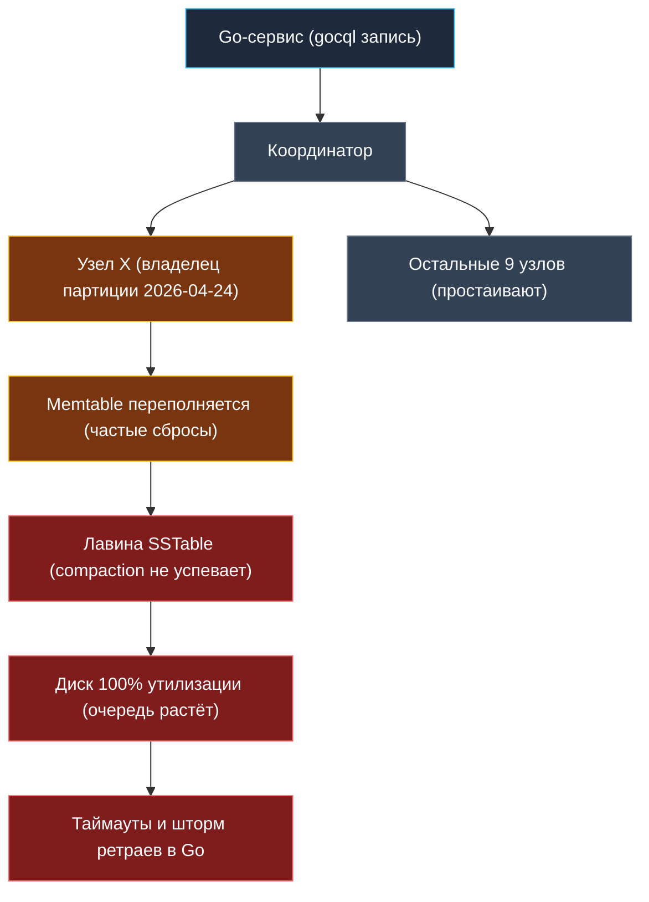

*Почему горизонтальное шардирование не спасает от перегрузки одного узла, как отличить перекос объёма данных от перекоса нагрузки, что такое write salting и как бороться с горячими счетами в `LedgerPulse` и драйверах Go.*

> «Как сформулировал Роб Пайк, «сложность мультипликативна»: решая задачу за счёт усложнения одной части системы, вы медленно, но верно добавляете сложность во все остальные.»  
> — Алан Донован и Брайан Керниган (цитируя Роба Пайка), *The Go Programming Language*

Представьте международный терминал аэропорта с десятью новенькими стойками регистрации. Девять стоек пустуют — сотрудники спокойно пьют кофе. А к четвёртой стойке тянется километровая очередь из сотен пассажиров с чемоданами, рейсы задерживаются, терминал парализован. Причина проста: на четвёртую стойку назначили два трансатлантических суперлайнера, а на остальные девять — редкие местные рейсы на пару пассажиров.

В распределённых базах данных — шардированном PostgreSQL, Apache Cassandra, MongoDB или Redis Cluster — этот сценарий называется **Hot Partition** (горячая партиция). Один шард или логическая партиция забирает львиную долю трафика, пока остальные узлы кластера простаивают. Связанное с этим понятие — **Skew** (перекос), то есть неравномерное распределение объёма данных либо потока запросов между узлами.

---

## Два лица перекоса: Data Skew и Workload Skew

Перекос проявляется в двух формах, которые нередко накладываются друг на друга:

* **Перекос данных (*Data Skew*):** физический объём данных на шардах различается на порядки. Один узел хранит 500 ГБ, соседний — 10 ГБ. Это ломает планирование дисковой ёмкости и удлиняет перебалансировку. Типичные причины — неудачный ключ шардирования с низкой кардинальностью (например, шардирование по `country`, где `"US"` в сотни раз крупнее `"LU"`) либо естественное степенное распределение (*power-law*), известное как «эффект знаменитости» (*celebrity problem*).
* **Перекос нагрузки (*Workload Skew*):** распределение по объёму может быть ровным, но один ключ собирает 80% чтений и записей. Так ведут себя трендовый хештег, товар дня на распродаже или расчётный счёт крупного мерчанта в `LedgerPulse`: каждая покупка тысяч пользователей создаёт проводку дебета или комиссии на один и тот же `account_id`. Именно *workload skew* опаснее всего, потому что его сложнее предсказать по одной лишь схеме таблиц.

---

## Как горячая партиция разрушает кластер изнутри

Возьмём кластер Cassandra из 10 узлов на NVMe SSD с 64 ГБ RAM на каждом. Если разработчик выбрал ключом партиции дату события (`event_date`), то весь поток записей за сегодня (`2026-04-24`) пойдёт на один узел-владелец (и его реплики), а девять соседей останутся без работы.



На горячем узле одновременно ломаются четыре уровня:

1. **CPU:** ядра узла X забиты сериализацией, сжатием блоков и фоновым уплотнением (*compaction*), пока 90% ядер кластера свободны.
2. **Диск:** в движке LSM-дерева ([[10. Архитектура Cassandra — LSM-Tree, SSTable, Memtable и кворумы]]) *compaction* не успевает сливать растущий поток *SSTable*. Растёт *read amplification*, SSD упирается в потолок IOPS, а среднее время ожидания в очереди диска (`await` в `iostat`) взлетает с долей миллисекунды до секунд.
3. **Сеть:** сокетные буферы и сетевой интерфейс одного узла переполняются входящим трафиком.
4. **Рантайм Go:** горутины, отправившие запросы на проблемный узел, зависают до срабатывания таймаутов. Если в клиенте настроены ретраи без экспоненциальной задержки и джиттера, сервис сам добивает перегруженный узел лавиной повторных запросов (*retry storm*).

> [!warning] Ловушка: средняя температура по кластеру скрывает пожар
> Горячая партиция часто маскируется под «медленную базу». Если на дашборде выведен средний CPU по десяти шардам (15%), команда не видит перекоса или начинает вертикально наращивать весь кластер. Единственный надёжный способ ранней диагностики — раздельный **per-node и per-shard мониторинг**.

---

## Учёт устройства железа: перекос на уровне CPU, блокировок и кэша

Если спуститься с уровня кластера на уровень одного сервера, перекос бьёт по трём аппаратным и программным механизмам:

* **Кэш-линии CPU и привязка к одному потоку.** В однопоточном ядре Redis Cluster ([[4. Redis под капотом — однопоточный event loop, RDB, AOF, Cluster и пайплайнинг]]) горячий ключ привязан к одному хеш-слоту и одному потоку обработки событий. Все запросы выстраиваются в очередь к одному ядру CPU — возникает конвейерный простой и рост задержек, хотя остальные 31 ядро машины полностью свободны. Аналогично в шардированном PostgreSQL бэкенд-процесс шарда ограничен ресурсами своего узла.
* **Блокировки и конкуренция за страницы.** В B-Tree индексе или куче PostgreSQL лавина конкурентных `UPDATE` одной и той же строки выстраивает транзакции в строгий последовательный затор. В `LedgerPulse` таким узким местом мгновенно становится единый системный счёт комиссий: даже при 10 000 пар независимых клиентских счетов все переводы упираются в строковую блокировку (`Lock: transactionid`) одной строки комиссии и защёлки буферов (`LWLock: BufferMapping`). В Go это проявляется как экспоненциальный рост длительности `tx.ExecContext`.
* **Загрязнение буферного пула.** Поток обращений к огромной горячей партиции вытесняет из `shared_buffers` и Page Cache ОС рабочие страницы остальных клиентов, вызывая массовые дисковые чтения (100 мкс на страницу NVMe против 100 нс в RAM) по всему узлу.

---

## Мониторинг и обнаружение перекоса

Чтобы поймать перекос до падения продакшена, отслеживайте три группы сигналов:

* **Метрики на уровне каждого узла и шарда:** RPS, CPU, `iostat await`, пропускная способность сети отдельно для каждого экземпляра. В Cassandra это `nodetool tablestats` и `org.apache.cassandra.metrics`, в MongoDB — `mongostat` и `serverStatus` по шардам, в PostgreSQL — `pg_stat_statements` и `pg_stat_activity` на каждом шарде.
* **Распределение размеров партиций и чанков:** в MongoDB команда `sh.status()` показывает число чанков на каждом шарде; в Cassandra контролируют максимальный и 95-й перцентиль размера партиции. Если `p95` размера партиции превышает медиану в 10 и более раз — налицо *data skew*.
* **Разрыв перцентилей задержки (`p50` против `p99.9`):** при *workload skew* медиана `p50` остаётся низкой (холодные шарды отвечают мгновенно), а хвост `p99.9` резко улетает вверх. В Go-сервисах добавляйте в гистограммы Prometheus / OpenTelemetry атрибут `shard_id`, иначе усреднение по пулу скроет больной шард.

---

## Стратегии предотвращения и устранения

Выбор техники зависит от того, проектируете ли вы схему с нуля или спасаете работающий продакшен.

### 1. Правильный ключ шардирования и партиционирования

Первый эшелон защиты (подробнее — в [[4. Шардирование (Sharding) — ключи, консистентное хеширование и перебалансировка]] и [[5. Партиционирование (Partitioning) — Range, List, Hash и управление таблицами]]):

* **Высокая кардинальность:** ключ должен принимать миллионы равномерно распределённых значений; поля вроде `currency` или `status` не годятся.
* **Отказ от монотонных ключей при range-шардинге:** `created_at` или последовательный `BIGINT` отправляют 100% новых вставок на последний шард.
* **Составные и хешированные ключи:** хеш-функции (Murmur3, MD5) размазывают ключи по кольцу или слотам (16 384 слота в Redis Cluster, `Murmur3Partitioner` в Cassandra, `hashed` шардинг в MongoDB). Это убивает последовательные горячие точки на записи, но отбирает возможность быстрых диапазонных сканов.

### 2. Добавление соли (*Write Salting*) и бакеты счетов в `LedgerPulse`

Когда бизнес требует диапазонного поиска или ключ естественным образом «горячий» (как системный счёт комиссий или аккаунт звезды), его искусственно расщепляют на `N` под-ключей с помощью случайного или детерминированного суффикса-соли от `0` до `N - 1`. Запись распределяется по `N` независимым строкам или партициям, а чтение суммирует все `N` бакетов (*scatter-gather*):

```go
// В Go 1.24 используем math/rand/v2 для быстрого выбора случайной соли без глобального мьютекса
func PickSaltedAccount(baseAccountID int64, buckets int) string {
	salt := rand.IntN(buckets)
	return fmt.Sprintf("%d:%d", baseAccountID, salt)
}
```

В `LedgerPulse` вместо одной строки счёта комиссии (`account_id = 1`) заводят 16 субсчетов-накопителей (`1000..1015`). Каждый перевод выбирает случайный субсчёт по остатку от деления или `rand.IntN(16)` — конкуренция строковых блокировок падает в 16 раз. Фоновый воркер раз в минуту сводит балансы субсчетов в главный отчётный счёт (либо итоговый баланс вычисляется суммой `SELECT SUM(balance) FROM accounts WHERE id BETWEEN 1000 AND 1015`). Цена решения — усложнение чтения и аналитики.

### 3. Перебалансировка в работающем кластере

* **Cassandra:** добавление узлов и вывод старых через `nodetool decommission`; виртуальные ноды (*vnodes*) помогают выровнять распределение диапазонов, но не спасают, если весь трафик сидит в одном ключе партиции.
* **MongoDB:** автоматический `balancer` переносит чанки, а раздувшийся чанк можно разбить вручную командой `splitChunk`. Учитывайте, что миграция чанка создаёт дополнительный дисковый и сетевой I/O и кратковременно блокирует запись.
* **Redis Cluster:** перенос горячих слотов на менее нагруженные узлы командами `CLUSTER SETSLOT` и `CLUSTER MIGRATE`.

### 4. Выделение горячих ключей и агрессивное кэширование

Если перекос создают считанные «звёздные» сущности, их изолируют: выносят на выделенный усиленный шард либо закрывают чтение агрессивным кэшем с защитой от пробоя через `Singleflight` ([[8. Кэширование поверх БД — Cache-Aside, Write-Through, Write-Back и Cache Stampede]]).

---

## Особенности конкретных хранилищ и драйверов Go

* **Apache Cassandra:** вся партиция физически лежит на одном узле (и его репликах). Раздутая «широкая строка» (*wide row*) с сотнями мегабайт данных тормозит *compaction* и провоцирует `OutOfMemory` при чтении. Практический предел размера партиции — **100–200 МБ**; используйте составной ключ `PRIMARY KEY ((high_card_key, bucket), clustering_key)`.
* **MongoDB:** `range`-шардинг по `ObjectId` неизбежно создаёт горячий хвост на последнем шарде ([[8. MongoDB под капотом — WiredTiger, Replica Set и шардирование]]). Для равномерной записи применяйте `hashed` шардинг или составной ключ.
* **Redis Cluster:** следите за hash tags вида `{user:42}:profile` и `{user:42}:feed` — фигурные скобки принудительно отправляют все такие ключи в один и тот же из 16 384 хеш-слотов ([[3. Redis — архитектура, структуры данных, RESP и работа из Go]]). Не злоупотребляйте ими ради редких мульти-ключевых операций.

На стороне Go-клиентов драйверы (`gocql`, `mongo-go-driver`, `go-redis`) знают топологию кластера и ведут отдельные пулы соединений к каждой ноде. Если одна нода становится горячей, пул к именно этому хосту исчерпывается первым:

```go
cluster := gocql.NewCluster("10.0.1.10", "10.0.1.11", "10.0.1.12")
cluster.Timeout = 2 * time.Second
cluster.WriteTimeout = 2 * time.Second
cluster.PoolConfig.HostSelectionPolicy = gocql.TokenAwareHostPolicy(
	gocql.LatencyAwareHostPolicy{
		ExclusionThreshold: 2.0,
		RetryPeriod:        10 * time.Second,
		UpdateRate:         time.Second,
		MinMeasurements:    50,
	},
)
```

Политика `LatencyAwareHostPolicy` временно отводит чтения от перегруженной реплики, но запись всё равно обязана дойти до реплик-владельцев токена. Чтобы горячий узел не утянул за собой весь сервис, держите жёсткие `Timeout` / `WriteTimeout` и используйте быстрый отказ (*fast fail*) либо ограниченные повторы с экспоненциальной задержкой и джиттером.

> [!tip] Собеседование [Senior/Staff]
> **Вопрос:** Вы видите, что один шард MongoDB постоянно загружен по CPU на 100%, а остальные семь шардов загружены на 10%. Какие шаги вы предпримете для диагностики и исправления?  
> **Ответ:**  
> 1. Проверить распределение и размер чанков через `sh.status()`, чтобы отличить *data skew* (огромный неразбитый чанк) от *workload skew*.  
> 2. Включить профилировщик (`db.setProfilingLevel(2)` или анализ медленных запросов в логах) и найти ключ, по которому идёт основной поток операций.  
> 3. Проверить тип ключа шардирования: если выбран `range` по монотонному полю (`_id`, `created_at`), запланировать миграцию на `hashed` или составной ключ с высокой кардинальностью.  
> 4. Если перекос вызван несколькими горячими документами («эффект знаменитости»), вынести чтение в кэш уровня приложения (Redis/Valkey) с TTL и `Singleflight`, а запись расщепить через *write salting*.  
> 5. Как временную меру (если бизнес допускает ослабление консистентности), перевести часть чтений на `secondary` через `readPreference` и ограничить шторм ретраев в Go-клиенте.

---

## Упражнения

1. **Базовое.** Таблица транзакций партиционирована в PostgreSQL по `RANGE (created_at)` на 30 дневных секций, а в шардированной MongoDB для коллекции `events` выбран `range`-ключ по `_id` (`ObjectId`). Объясните, почему в обеих системах нагрузка записи концентрируется в одном месте и в каком из двух случаев это становится проблемой масштабирования записи по узлам.

> [!solution] Показать решение
> Оба ключа монотонно возрастают со временем: текущие записи всегда попадают в самую свежую дневную партицию PostgreSQL и в самый правый чанк `ObjectId` в MongoDB.  
> * В **одноузловом PostgreSQL** это чаще **польза**, а не проблема: вся горячая запись локализована в одном B-Tree хвосте, который хорошо держится в `shared_buffers`, а старые партиции не загрязняют кэш. Ограничением остаётся пропускная способность диска и CPU этого единственного сервера.  
> * В **шардированной MongoDB** это **критический перекос записи**: самый правый чанк лежит на одном конкретном шарде, поэтому 100% новых вставок ложатся на один сервер кластера, пока остальные шарды простаивают. Для выравнивания записи в MongoDB переходят на `hashed` шардирование или составной ключ `(tenant_id, _id)`.

2. **Практическое.** В `LedgerPulse` при проведении 5 000 переводов в секунду все транзакции дополнительно начисляют 1% комиссии на единый системный счёт `account_id = 1`. Из-за строковой блокировки этой строки пропускная способность падает до 300 переводов в секунду. Напишите функцию на Go 1.24, которая с помощью `write salting` распределяет начисление комиссии по `N` субсчетам в диапазоне `[baseID, baseID+N)` и при этом вычисляет детерминированный бакет или случайную соль, а также SQL-запрос для получения суммарной собранной комиссии.

> [!solution] Показать решение
> Распределение записи по `N = 16` субсчетам-накопителям снижает конкуренцию блокировок в 16 раз. При чтении баланса все бакеты агрегируются одним запросом:
> ```go
> package billing
>
> import (
> 	"context"
> 	"database/sql"
> 	"fmt"
> 	"math/rand/v2"
> )
>
> const feeBuckets = 16
>
> // PickFeeAccountID выбирает случайный субсчёт комиссии из диапазона [baseID, baseID+feeBuckets).
> func PickFeeAccountID(baseID int64) int64 {
> 	return baseID + rand.Int64N(feeBuckets)
> }
>
> // TotalFeeBalance возвращает суммарный баланс всех субсчетов комиссии.
> func TotalFeeBalance(ctx context.Context, db *sql.DB, baseID int64) (int64, error) {
> 	var total int64
> 	err := db.QueryRowContext(ctx,
> 		`SELECT COALESCE(SUM(balance), 0) FROM accounts WHERE id >= $1 AND id < $2`,
> 		baseID, baseID+feeBuckets,
> 	).Scan(&total)
> 	if err != nil {
> 		return 0, fmt.Errorf("sum fee buckets: %w", err)
> 	}
> 	return total, nil
> }
> ```
> При необходимости фоновый воркер раз в несколько минут может переносить накопленные суммы из бакетов в основной расчётный счёт одной транзакцией, не мешая горячему пути пользовательских переводов.

3. **Со звёздочкой (\*).** Сервис на Go записывает события аналитики в кластер Cassandra по ключу `PRIMARY KEY ((tenant_id, day), event_ts, event_id)`. Один крупный клиент (`tenant_id = 42`) генерирует 50 млн событий в сутки, из-за чего его суточная партиция вырастает до 4 ГБ, *compaction* на одной ноде отстаёт, а `p99` записи у всех клиентов на этом узле взлетает до 4 секунд. Перепроектируйте ключ партиции и напишите функцию чтения на Go, собирающую события за сутки без потери порядка по времени на стороне приложения.

> [!solution] Показать решение
> Чтобы удержать размер партиции в рекомендуемых рамках 100–200 МБ, добавим в ключ партиционирования синтетический бакет `bucket = int(event_ts.Unix() % 32)` (или по часам + соль `0..3` -> 32 партиции в день по ~125 МБ):
> ```sql
> CREATE TABLE tenant_events (
>     tenant_id BIGINT,
>     day       DATE,
>     bucket    INT,
>     event_ts  TIMESTAMP,
>     event_id  UUID,
>     payload   BLOB,
>     PRIMARY KEY ((tenant_id, day, bucket), event_ts, event_id)
> ) WITH CLUSTERING ORDER BY (event_ts DESC, event_id ASC);
> ```
> На чтении Go-сервис параллельно (с ограничением конкурентности через `errgroup`) опрашивает все 32 бакета и объединяет результаты с сортировкой по `event_ts`:
> ```go
> func ReadTenantDayEvents(ctx context.Context, session *gocql.Session, tenantID int64, day time.Time, buckets int) ([]Event, error) {
> 	g, ctx := errgroup.WithContext(ctx)
> 	g.SetLimit(8) // Не перегружаем координатор одновременными запросами
> 	results := make([][]Event, buckets)
>
> 	for b := range buckets {
> 		g.Go(func() error {
> 			iter := session.Query(
> 				`SELECT event_ts, event_id, payload FROM tenant_events WHERE tenant_id = ? AND day = ? AND bucket = ?`,
> 				tenantID, day.Format("2006-01-02"), b,
> 			).WithContext(ctx).Iter()
>
> 			var ev Event
> 			for iter.Scan(&ev.TS, &ev.ID, &ev.Payload) {
> 				results[b] = append(results[b], ev)
> 			}
> 			return iter.Close()
> 		})
> 	}
> 	if err := g.Wait(); err != nil {
> 		return nil, fmt.Errorf("scatter-gather buckets: %w", err)
> 	}
>
> 	var merged []Event
> 	for _, part := range results {
> 		merged = append(merged, part...)
> 	}
> 	slices.SortFunc(merged, func(a, b Event) int {
> 		return b.TS.Compare(a.TS)
> 	})
> 	return merged, nil
> }
> ```
> Для мелких клиентов с тысячей событий в день можно дополнительно хранить в метаданных число бакетов (`1` для обычных, `32` для крупных), чтобы не делать лишних 31 пустой запрос.

---

Мы научились удерживать кластер от перегрузки и перекоса в штатной работе. Но даже идеально распределённая база беззащитна перед отказом дискового контроллера, ошибкой в миграции или случайным `DROP TABLE`. В следующей главе разберём, как правильно снимать физические бэкапы и возвращать базу в прошлое с точностью до секунды: [[16. Резервное копирование и восстановление — физические бэкапы и PITR]].
