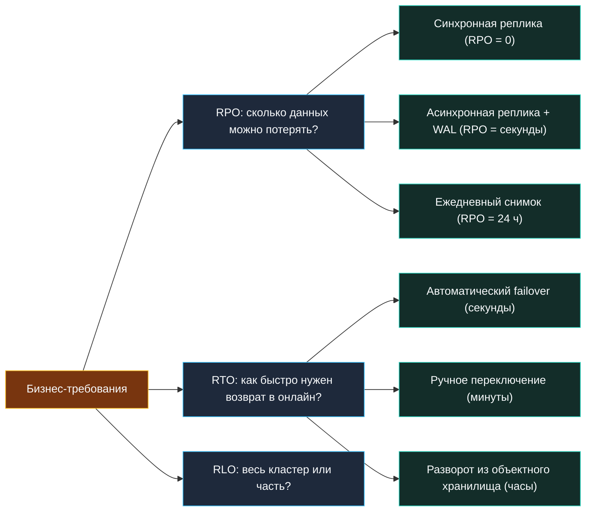
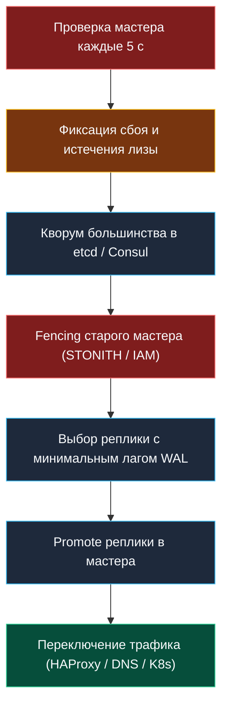

*Как формализовать требования RPO, RTO и RLO, устроить кворумный failover без расщепления мозга (split-brain), безопасно выполнить failback, написать отказоустойчивого Go-агента загрузки бэкапов и доказать живучесть системы регулярными учениями.*

> «Любая функция ввода-вывода обязана считаться с вероятностью сбоя, и лишь наивный программист верит, что простое чтение или запись не могут завершиться ошибкой. Именно тогда, когда внезапно отказывают самые надёжные операции, нам нужнее всего знать почему.»  
> — Алан Донован и Брайан Керниган, *The Go Programming Language*

Представьте атомную подводную лодку в автономном плавании на километровой глубине. Экипаж не ждёт пробоины в третьем отсеке, чтобы впервые открыть инструкцию по борьбе за живучесть: аварийные тревоги отрабатываются каждую неделю по секундомеру в полной темноте.

**Disaster Recovery (DR, аварийное восстановление)** в архитектуре баз данных — это такой же контракт живучести при потере целого дата-центра (ЦОД), коррупции файловой системы, ошибочной миграции или атаке шифровальщика. Отраслевая статистика жёстко отрезвляет: около 60% компаний, потерявших критичные данные без быстрого восстановления, закрываются за полгода, а до 90% организаций хотя бы раз сталкивались с провалом восстановления из «ежедневных» бэкапов.

> [!info] Под капотом: фундаментальный закон хранения
> Любая дополнительная копия данных стоит задержки. Синхронная репликация между зонами доступности даёт нулевую потерю данных, но прибавляет к каждому `COMMIT` минимум один сетевой RTT до самой удалённой синхронной реплики ([[1. Репликация — синхронная, полусинхронная и асинхронная]]). Асинхронная репликация сохраняет низкую задержку записи, но допускает потерю последних транзакций при гибели лидера. Инженер выбирает компромисс явно.

---

## Метрики живучести: RPO, RTO и RLO

Проектирование DR начинается с фиксации трёх измеримых величин совместно с бизнесом:

| Метрика | Определение | Инженерный смысл | Типичный диапазон |
|---|---|---|---|
| **RPO (*Recovery Point Objective*)** | Допустимый период потери данных по времени | Частота архивации WAL/binlog или режим репликации | От `0` (синхронная реплика) до `24 ч` (ночной дамп) |
| **RTO (*Recovery Time Objective*)** | Максимальное время простоя до возврата сервиса | Скорость обнаружения сбоя, переключения или наката бэкапа | От секунд (авто-failover) до часов (подъём из архива) |
| **RLO (*Recovery Level Objective*)** | Гранулярность восстановления: кластер, таблица, строка | Наличие PITR и выборочного восстановления | Точечный откат для OLTP, весь кластер для витрин |



> [!tip] Собеседование [Middle]
> **Вопрос:** Можно ли одновременно достичь `RPO = 0` и `RTO = 0`?  
> **Ответ:** На практике нет или это запредельно дорого. `RPO = 0` требует синхронной репликации: при сетевом разделении мастер блокирует запись или падает доступность (`RTO > 0`). Мгновенный `RTO = 0` без паузы на кворум и фенсинг провоцирует *split-brain* — двух мастеров одновременно. В финтехе уровня `LedgerPulse` выбирают баланс: полусинхронная реплика в соседней зоне доступности плюс непрерывный WAL в кросс-региональном S3 (`RPO <= 5 с`, `RTO <= 30 с`).

---

## Георезервирование, цепочки и физика большого разворота

В [[16. Резервное копирование и восстановление — физические бэкапы и PITR]] мы разобрали физические бэкапы и PITR на одном узле. Для устойчивости к потере ЦОД добавляются географическая изоляция и расчёт скорости разворота:

* **Многоуровневое хранение и дедупликация.** Полный снимок 1 ТБ базы каждый день — это 30 ТБ в месяц. Используйте уровневые схемы (`L0` полный раз в неделю, `L1` инкремент ежедневно, WAL потоково), блочную дедупликацию (`pgBackRest`, `restic`, `borgbackup`) и *Copy-on-Write* снапшоты (ZFS, Btrfs, EBS snapshots). Помните о точке отказа инкрементальной цепочки: коррупция одного звена ломает весь хвост после него, поэтому проверяйте восстановление каждой цепочки еженедельно.
* **Узкое место на развороте `> 100 ГБ`.** При отказе региона база поднимается в резервном регионе из кросс-регионального S3 (качайте через приватный *VPC Endpoint*, а не публичный шлюз). Локально `RTO` упирается в диск и CPU: декомпрессия архивов, случайные записи при восстановлении B-Tree и накат WAL с `fsync`. Ускоряют процесс быстрые NVMe-диски, многопоточность (`pg_restore -j` или воркеры `pgBackRest`) и настройка синхронизации при накате.

---

## Аварийное переключение: Failover, Split-Brain и Failback

Бэкапы спасают данные, но для `RTO` в десятки секунд нужна кворумная автоматизация (*Patroni* + *etcd/Consul*).



1. **Обнаружение и кворум:** проверяется не просто TCP-порт, а `SELECT 1`, лаг и состояние дисков. Решение о смене лидера требует кворума (например, 2 из 3 узлов), чтобы мигание сети не породило ложный переворот.
2. **Выбор цели и переключение:** выбирается реплика с минимальным лагом WAL; трафик перенаправляется через `HAProxy`/`PgBouncer`, Kubernetes Endpoint или DNS с коротким TTL.

> [!warning] Ловушка: Split-Brain
> При сетевом разделении изолированный старый мастер может остаться доступным части клиентов, пока кворум выбирает нового лидера. Два активных мастера создают расходящиеся транзакции, которые нельзя автоматически слить. **Решение:** жёсткий фенсинг (*STONITH* — выключение питания через IPMI, изоляция сети, блокировка диска или отзыв IAM-прав) и *fencing tokens* ([[11. Распределённые блокировки (Distributed Locks) и fencing tokens]]).

### Возврат в строй (*Failback*)

> [!tip] Собеседование [Middle]
> **Вопрос:** Почему при *failback* нельзя просто скопировать файлы нового мастера на старый через `rsync` или `scp`?  
> **Ответ:** Прямое копирование живой базы даёт разорванные страницы (*torn pages*) и не учитывает транзакции, ушедшие в новую временную шкалу (*timeline*). Старый узел нужно принудительно подключить к новому лидеру как **реплику**, откатить расхождение страниц через `pg_rewind`, дождаться нулевого лага и только потом провести плановый *switchover*.

---

## Идиоматичный агент бэкапа и валидатор на Go 1.24

В отличие от Java (Flyway/Liquibase для миграций и внешние скрипты) или C#/.NET (Azure Backup, SSMS GUI), философия Go делает агентов бэкапа, оркестраторов и валидаторов полноценными сервисами с явным контролем контекстов, таймаутов и телеметрии. При выгрузке файлов `> 100 МБ` в S3 обычный `PutObject` проигрывает потоковому **multipart upload** через `manager.Uploader` (меньше давление на GC и устойчивость к обрывам):

```go
package dr

import (
	"context"
	"fmt"
	"math/rand/v2"
	"os"
	"os/exec"
	"path/filepath"
	"time"

	"github.com/aws/aws-sdk-go-v2/aws"
	"github.com/aws/aws-sdk-go-v2/feature/s3/manager"
	"github.com/aws/aws-sdk-go-v2/service/s3"
)

type BackupAgent struct {
	uploader *manager.Uploader
	bucket   string
}

func NewBackupAgent(s3Client *s3.Client, bucket string) *BackupAgent {
	uploader := manager.NewUploader(s3Client, func(u *manager.Uploader) {
		u.PartSize = 32 * 1024 * 1024
		u.Concurrency = 4
	})
	return &BackupAgent{uploader: uploader, bucket: bucket}
}

func (a *BackupAgent) RunPhysicalBackup(ctx context.Context, dsn, s3Prefix string) error {
	workDir, err := os.MkdirTemp("", "pg-basebackup-*")
	if err != nil {
		return fmt.Errorf("create temp dir: %w", err)
	}
	defer os.RemoveAll(workDir)

	cmd := exec.CommandContext(ctx, "pg_basebackup", "-d", dsn, "-D", workDir, "-Ft", "-z", "-X", "stream")
	if out, err := cmd.CombinedOutput(); err != nil {
		return fmt.Errorf("pg_basebackup failed: %w: %s", err, string(out))
	}

	archivePath := filepath.Join(workDir, "base.tar.gz")
	key := fmt.Sprintf("%s/%s/base.tar.gz", s3Prefix, time.Now().UTC().Format("2006-01-02T15-04-05Z"))
	return a.uploadWithRetry(ctx, archivePath, key)
}

func (a *BackupAgent) uploadWithRetry(ctx context.Context, localPath, key string) error {
	const maxAttempts = 5
	baseDelay := time.Second

	for attempt := range maxAttempts {
		f, err := os.Open(localPath)
		if err != nil {
			return fmt.Errorf("open archive: %w", err)
		}
		_, upErr := a.uploader.Upload(ctx, &s3.PutObjectInput{
			Bucket: aws.String(a.bucket),
			Key:    aws.String(key),
			Body:   f,
		})
		_ = f.Close()
		if upErr == nil {
			return nil
		}
		if attempt == maxAttempts-1 {
			return fmt.Errorf("multipart upload failed after %d attempts: %w", maxAttempts, upErr)
		}
		delay := baseDelay << attempt
		select {
		case <-ctx.Done():
			return ctx.Err()
		case <-time.After(delay + rand.N(delay/4)):
		}
	}
	return nil
}
```

---

## Регулярные учения: бэкап без проверки — иллюзия

* **Еженедельно:** автоматический разворот случайного бэкапа в изолированный стенд, `pg_checksums` и проверка бизнес-инвариантов.
* **Ежемесячно:** полный разворот на объёме продакшена с замером фактического `RTO`.
* **Ежеквартально (*DR Drill*):** симуляция потери ЦОД или региона с переключением и отработкой *failback*.

```go
func TestPITRRecovery(t *testing.T) {
	ctx, cancel := context.WithTimeout(context.Background(), 30*time.Minute)
	defer cancel()

	origDB := setupTestDB(t)
	seedTransfers(ctx, t, origDB, 1000)
	backupID := runAgentBackup(ctx, t, origDB)

	origDB.Close()
	destroyTestDB(t)

	restoredDB := restoreToTarget(ctx, t, backupID)
	defer restoredDB.Close()

	var sum int64
	if err := restoredDB.QueryRowContext(ctx, `SELECT COALESCE(SUM(amount), 0) FROM ledger_entries`).Scan(&sum); err != nil {
		t.Fatalf("query ledger sum: %v", err)
	}
	if sum != 0 {
		t.Fatalf("broken double-entry sum: got %d, want 0", sum)
	}
	if _, err := restoredDB.ExecContext(ctx, `INSERT INTO audit_log (event) VALUES ('dr_drill_ok')`); err != nil {
		t.Fatalf("restored instance is not writable: %v", err)
	}
}
```

---

## Ловушки DR и вопросы с собеседований

1. **Незашифрованные S3-бэкапы и публичные права:** шифруйте данные до отправки, ограничивайте IAM по принципу наименьших привилегий и логируйте доступ.
2. **Нехватка диска на восстановление:** архив 1.2 ТБ после распаковки и наката WAL потребует больше 2 ТБ; проверяйте свободное место заранее.
3. **Отсутствие актуальных *runbooks* и «психология галочки»:** храните пошаговые инструкции в Git и регулярно тестируйте их в ночных учениях.

> [!tip] Собеседование [Senior/Staff]
> **Вопрос:** В облачном регионе сгорели и мастер PostgreSQL, и все его реплики, но остались бэкапы и WAL в S3 другого региона. Опишите план восстановления и главные риски.  
> **Ответ:**  
> 1. Развернуть инфраструктуру в резервном регионе с **той же мажорной версией PostgreSQL** и достаточным запасом NVMe-дисков.  
> 2. Обеспечить приватный канал к S3 (*VPC Endpoint*) и доступ к ключам дешифрования KMS.  
> 3. Скачать последний `base backup`, проверить `pg_verifybackup` и применить WAL через `restore_command` до последней точки с `recovery_target_action = 'promote'`.  
> 4. Сверить финансовые инварианты `LedgerPulse`, переключить endpoint сервиса и сразу поднять новые реплики.  
> **Ключевые риски:** время выгрузки терабайтов по сети, совместимость версий, нехватка диска, битый хвост WAL и рассинхронизация с внешними платёжными шлюзами.

---

## Упражнения

1. **Базовое.** Бизнес требует от нового модуля `LedgerPulse`: возврат в строй при падении сервера за `<= 45 с`, потерю транзакций максимум за `5 с` и возможность откатиться на момент до ошибочной миграции. Сопоставьте требования с `RTO`, `RPO`, `RLO` и опишите минимальную конфигурацию БД.

> [!solution] Показать решение
> * Возврат за `<= 45 с` — **`RTO = 45 с`**.  
> * Потеря не более `5 с` — **`RPO = 5 с`**.  
> * Откат на момент до миграции — **`RLO` на уровне гранулярного PITR**.  
> Архитектура: кластер PostgreSQL (мастер + реплики в разных зонах доступности) под управлением `Patroni` + 3-узлового кворума `etcd` для авто-failover и `RTO <= 45 с`, плюс непрерывная архивация WAL в кросс-региональный S3 (`archive_timeout = 5` или `pg_receivewal`) через `pgBackRest`/`WAL-G` для `RPO <= 5 с` и PITR.

2. **Практическое.** В кластере Patroni старый мастер отрезало от `etcd`, но часть сервисов продолжила слать ему `INSERT`, пока кворум выбрал нового мастера. Почему случился *split-brain*, что предотвращает его в продакшене и как безопасно вернуть старый узел?

> [!solution] Показать решение
> *Split-brain* случился из-за отсутствия принудительного фенсинга старого мастера при потере лизы `etcd` и прямых подключений приложений в обход роутера ролей.  
> **Защита:** аппаратный/ядерный watchdog (`softdog`/IPMI) для перезагрузки изолированного мастера, STONITH, и маршрутизация клиентов строго через `HAProxy` (`/primary`) или `target_session_attrs=read-write`.  
> **Failback:** подключить старый узел как реплику нового лидера, выровнять страницы через `pg_rewind`, дождаться нулевого лага и затем выполнить плановый `switchover`.

3. **Со звёздочкой (\*).** Напишите на Go 1.24 функцию `CheckWALContiguity`, проверяющую отсутствие пропусков 16-мегабайтных WAL-сегментов (формат `TTTTTTTTLLLLLLLLSSSSSSSS`, где `SSSSSSSS` переходит от `00` к `FF`) в архиве S3 перед стартом PITR.

> [!solution] Показать решение
> ```go
> package dr
>
> import (
> 	"fmt"
> 	"strconv"
> )
>
> type WALCoord struct {
> 	Timeline, LogID, SegID uint32
> }
>
> func ParseWALName(name string) (WALCoord, error) {
> 	if len(name) != 24 {
> 		return WALCoord{}, fmt.Errorf("invalid WAL length %d: %q", len(name), name)
> 	}
> 	tl, err := strconv.ParseUint(name[0:8], 16, 32)
> 	if err != nil {
> 		return WALCoord{}, err
> 	}
> 	logID, err := strconv.ParseUint(name[8:16], 16, 32)
> 	if err != nil {
> 		return WALCoord{}, err
> 	}
> 	segID, err := strconv.ParseUint(name[16:24], 16, 32)
> 	if err != nil {
> 		return WALCoord{}, err
> 	}
> 	return WALCoord{Timeline: uint32(tl), LogID: uint32(logID), SegID: uint32(segID)}, nil
> }
>
> func (w WALCoord) Next() WALCoord {
> 	if w.SegID == 0xFF {
> 		return WALCoord{Timeline: w.Timeline, LogID: w.LogID + 1, SegID: 0}
> 	}
> 	return WALCoord{Timeline: w.Timeline, LogID: w.LogID, SegID: w.SegID + 1}
> }
>
> func (w WALCoord) String() string {
> 	return fmt.Sprintf("%08X%08X%08X", w.Timeline, w.LogID, w.SegID)
> }
>
> func CheckWALContiguity(startName, endName string, available map[string]struct{}) error {
> 	cur, err := ParseWALName(startName)
> 	if err != nil {
> 		return err
> 	}
> 	target, err := ParseWALName(endName)
> 	if err != nil {
> 		return err
> 	}
> 	if cur.Timeline != target.Timeline {
> 		return fmt.Errorf("timeline mismatch (%d != %d): parse .history file first", cur.Timeline, target.Timeline)
> 	}
> 	for {
> 		if _, ok := available[cur.String()]; !ok {
> 			return fmt.Errorf("missing WAL segment: %s", cur.String())
> 		}
> 		if cur == target {
> 			return nil
> 		}
> 		cur = cur.Next()
> 	}
> }
> ```

---

План аварийного восстановления и регулярные учения гарантируют, что `LedgerPulse` переживёт отказ целого дата-центра. Но гораздо выгоднее увидеть деградацию дисков, рост лага репликации или сбой архивации WAL задолго до аварии. В следующей главе мы перейдём к мониторингу баз данных — ключевым метрикам PostgreSQL, пулов соединений и дискового ввода-вывода.
