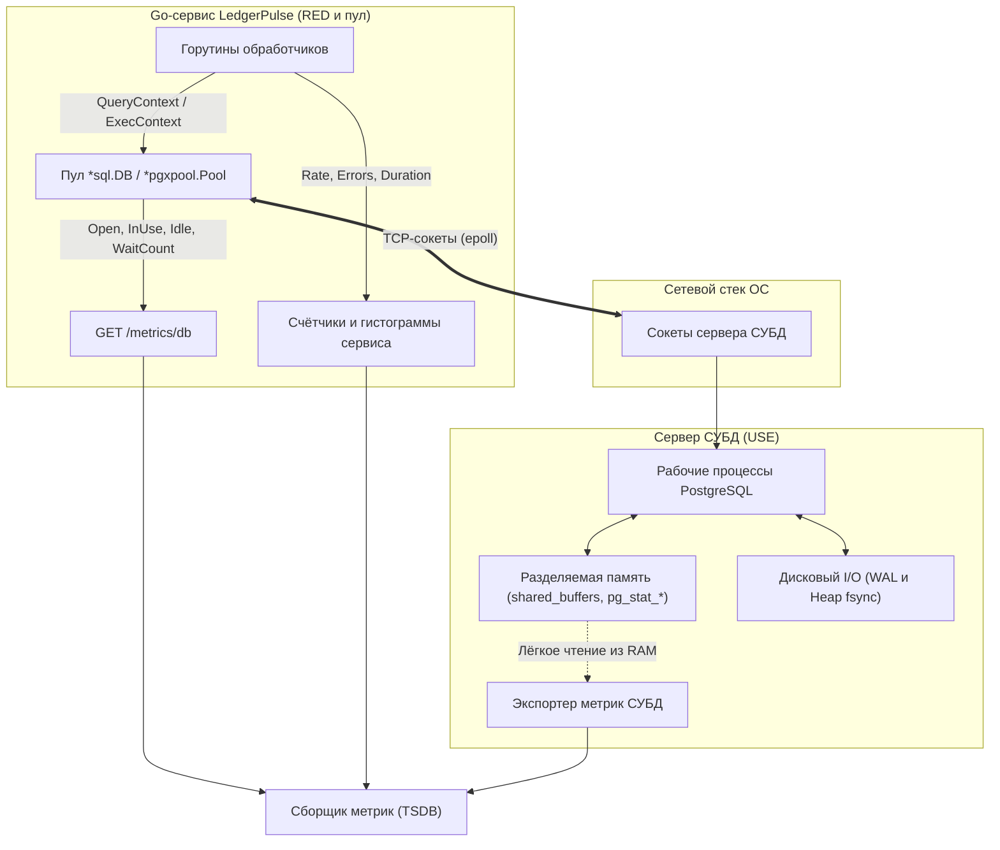

*Двусторонняя телеметрия базы данных: методологии USE и RED, ключевые метрики PostgreSQL, Redis и распределённых СУБД, разбор `db.Stats()` и эндпоинта `/metrics/db` в `LedgerPulse`, а также цена мониторинга для памяти, планировщика Go и дискового кэша.*

> «Любая функция ввода-вывода обязана считаться с вероятностью сбоя, и лишь наивный программист верит, что простое чтение или запись не могут завершиться ошибкой. Именно тогда, когда внезапно отказывают самые надёжные операции, нам нужнее всего знать почему.»  
> — Алан Донован и Брайан Керниган, *The Go Programming Language*

Схема данных нормализована, индексы проверены через `EXPLAIN ANALYZE`, а горячие чтения прикрыты кэшем. Но в пятницу вечером под наплывом платежей `LedgerPulse` внезапно замирает: отклик подскакивает с 8 мс до нескольких секунд. Без телеметрии база данных остаётся непроницаемым чёрным ящиком.

Мониторинг — это непрерывный сбор **метрик** (числовых временных рядов). В отличие от полной наблюдаемости (Observability), объединяющей трейсы и логи для разбора единичных инцидентов (см. [[20. Наблюдаемость БД — корреляция запросов, трейсов и планов]]), задача мониторинга — заранее поймать насыщение ресурсов до отказа транзакций. Для Go-сервиса он обязан быть двусторонним: со стороны сервера СУБД и со стороны клиентского пула соединений.



---

## Методологии USE, RED и Golden Signals для СУБД

Два взаимодополняющих подхода определяют выбор метрик:

1. **USE (Utilization, Saturation, Errors)** Брендана Грегга — для **ресурсов** сервера СУБД и ОС:
   * **Utilization:** доля времени или ёмкости, занятая полезной работой (CPU, диск, память).
   * **Saturation:** очередь отложенной работы при исчерпании ресурса (`await` диска, очередь планировщика ОС, ожидание блокировок).
   * **Errors:** аппаратные и системные сбои (ошибки носителя, потери пакетов, нехватка дескрипторов).
2. **RED (Rate, Errors, Duration)** Тома Уилки — для **сервиса** (клиента БД):
   * **Rate:** частота запросов в секунду (QPS / TPS).
   * **Errors:** доля неуспешных операций (`connection refused`, `deadlock detected`, таймауты).
   * **Duration:** перцентили задержек (`p50`, `p95`, `p99`, `p99.9`).

Оба подхода перекликаются с четырьмя «золотыми сигналами» SRE (Latency, Traffic, Errors, Saturation). Разделять их опасно: видя рост Duration в Go без учёта Saturation диска на СУБД, инженер будет зря переписывать Go-код, хотя SSD уже упёрся в предел IOPS. И наоборот: без `pg_stat_activity` ошибки `too many connections` на клиенте не укажут на виновные сессии.

---

## Ключевые метрики по классам хранилищ

### PostgreSQL и реляционные СУБД

Реляционные базы данных опираются на многоуровневую буферизацию и строгие гарантии ACID. Базовый набор метрик для продакшена включает девять групп показателей:

| Группа метрик | Источник в PostgreSQL | Что показывает и порог тревоги |
|---|---|---|
| Активные сессии | `pg_stat_activity` | Состояния `active`, `idle`, `idle in transaction`, `waiting`. Зависшие `idle in transaction` удерживают MVCC-снимок и блокируют `VACUUM` |
| Транзакции (TPS) | `pg_stat_database` | Соотношение `xact_commit` и `xact_rollback`. Резкий рост откатов указывает на конфликты блокировок или ошибки логики |
| Латентность запросов | `pg_stat_statements` | Перцентили `p95`, `p99` и среднее время. Сам по себе высокий TPS без учёта задержек слеп |
| CPU и диск хоста | Метрики ОС (`iostat`) | `user`, `system`, `iowait`, глубина очереди `await`, в облаке — остаток `CPU/IOPS Burst Credits` |
| Cache Hit Ratio | `pg_stat_database` | `blks_hit / (blks_hit + blks_read)`. Для OLTP значение ниже 99% означает регулярные чтения с диска |
| Checkpoint и WAL | `pg_stat_bgwriter`, `pg_stat_wal` | Скорость генерации WAL (`pg_wal_lsn_diff`), доля экстренных контрольных точек (по `max_wal_size`) против плановых по таймеру |
| Блокировки и дедлоки | `pg_locks`, `pg_stat_database` | Ожидающие сессии (`granted = false`) и счётчик `deadlocks` |
| Лаг и конфликты реплик | `pg_stat_replication`, `pg_stat_database_conflicts` | Отставание в байтах WAL (`sent_lsn - replay_lsn`) и отменённые долгие `SELECT` на реплике |
| Размер, bloat и TOAST | `pg_stat_user_tables`, системные каталоги | Разрастание мёртвых кортежей и индексов (bloat), неконтролируемый рост TOAST-таблиц |

Физический смысл Cache Hit Ratio опирается на иерархию задержек железа: чтение страницы из `shared_buffers` в оперативной памяти занимает около 100 нс, чтение с локального NVMe — порядка 100 мкс (в 1 000 раз медленнее), а с магнитного HDD — около 10 мс (в 100 000 раз медленнее). Падение попаданий в кэш с 99.5% до 94% означает рост обращений к диску более чем в десять раз.

### In-Memory хранилища: Redis и Valkey

Ограничения здесь — объём RAM и однопоточный event loop (см. [[4. Redis под капотом — однопоточный event loop, RDB, AOF, Cluster и пайплайнинг]]):
* **Память:** `used_memory`, `used_memory_rss` и `mem_fragmentation_ratio` (`rss / used`). Коэффициент выше `1.5` указывает на фрагментацию в `jemalloc`.
* **Вытеснение и хиты:** `expired_keys`, `evicted_keys` (рост означает переполнение `maxmemory` и вымывание нужных ключей) и отношение `keyspace_hits / (keyspace_hits + keyspace_misses)`.
* **Клиенты и задержки:** `connected_clients`, `blocked_clients` (`BLPOP`/`BRPOP`/`XREAD BLOCK`), `commandstats` и `LATENCY LATEST`.
* **CPU и сеть:** `used_cpu_user`, `used_cpu_sys`, `total_net_input_bytes` и `total_net_output_bytes`. Загрузка одного ядра на 100% парализует Redis, хотя суммарный график 16-ядерного хоста покажет лишь 6%.

### Документные и колоночные СУБД: MongoDB и Cassandra

* **MongoDB (WiredTiger):** заполнение кэша WiredTiger, `page faults`, очереди `read/write tickets`, лаг `oplog` и балансировка чанков (см. [[8. MongoDB под капотом — WiredTiger, Replica Set и шардирование]]).
* **Cassandra:** пулы `nodetool tpstats` (`MutationStage`, `ReadStage`), `compaction pending tasks`, загрузка диска на узел, статус `repair` и `p99` чтения/записи (см. [[10. Архитектура Cassandra — LSM-Tree, SSTable, Memtable и кворумы]]).

Правило кластерного мониторинга: **собирайте per-node метрики**. Усреднение по 50 узлам скроет один горячий узел (hot partition) до его падения по OOM или таймауту (см. [[15. Горячие партиции (Hot Partition) и перекос данных (Skew)]]).

---

## Метрики на стороне Go-приложения: `db.Stats()` и `/metrics/db`

Даже при идеальных графиках на сервере СУБД пользователь может ждать ответа секунды, если запросы стоят в очереди внутри клиентского пула соединений. В стандартной библиотеке Go состояние пула раскрывает метод `db.Stats()`, возвращающий структуру `sql.DBStats`:

| Поле `sql.DBStats` | Тип | Что означает для эксплуатации |
|---|---|---|
| `MaxOpenConnections` | `int` | Жёсткий верхний предел открытых соединений (`SetMaxOpenConns`) |
| `OpenConnections` | `int` | Текущее число открытых сокетов (`InUse + Idle`) |
| `InUse` | `int` | Соединения, занятые выполнением запроса или привязанной транзакцией прямо сейчас |
| `Idle` | `int` | Свободные соединения, готовые к немедленной выдаче из `freeConn` |
| `WaitCount` | `int64` | Сколько раз горутинам пришлось ждать освобождения соединения |
| `WaitDuration` | `time.Duration` | Суммарное время ожидания свободного сокета всеми горутинами |
| `MaxIdleClosed` | `int64` | Закрыто сокетов из-за превышения `SetMaxIdleConns` |
| `MaxIdleTimeClosed` | `int64` | Закрыто из-за простоя дольше `SetConnMaxIdleTime` |
| `MaxLifetimeClosed` | `int64` | Закрыто по истечении `SetConnMaxLifetime` |

В финальном сервисе `LedgerPulse` (`project/final/server.go`) эти показатели отдаются по HTTP на эндпоинте `GET /metrics/db`:

```go
func (s *Server) handleDBStats(w http.ResponseWriter, _ *http.Request) {
	st := s.db.Stats()
	writeJSON(w, http.StatusOK, map[string]any{
		"max_open_connections": st.MaxOpenConnections,
		"open_connections":     st.OpenConnections,
		"in_use":               st.InUse,
		"idle":                 st.Idle,
		"wait_count":           st.WaitCount,
	})
}
```

На что смотреть в первую очередь при диагностике пула:
* **`WaitCount` стабильно больше нуля и растёт** — лимит `MaxOpenConns` исчерпан, горутины паркуются в очереди ожидания.
* **Среднее ожидание на один запрос** (`delta(WaitDuration) / delta(WaitCount)`) превышает время исполнения самого SQL-запроса — пул стал главным источником `p99` задержки.
* **`OpenConnections` прижат к `MaxOpenConnections` при нулевом `Idle`** — при малейшем всплеске трафика начнётся голодание пула.
* **Быстрый рост `MaxIdleClosed`** при высоком `OpenConnections` — значение `SetMaxIdleConns` занижено относительно пиковой нагрузки, и сервис постоянно переоткрывает TCP- и TLS-сессии.

Для периодического экспорта статистики из стандартного пула в систему сбора временных рядов удобно снимать дельту монотонных счётчиков `WaitCount` и `WaitDuration`, не нагружая горячий путь запроса:

```go
package telemetry

import (
	"context"
	"database/sql"
	"sync/atomic"
	"time"
)

type PoolSnapshot struct {
	OpenConnections int
	InUse           int
	Idle            int
	DeltaWaitCount  int64
	DeltaWaitMillis float64
}

// CollectDBStats периодически снимает снимок пула *sql.DB без блокировки бизнес-запросов.
func CollectDBStats(ctx context.Context, db *sql.DB, interval time.Duration, sink func(PoolSnapshot)) {
	ticker := time.NewTicker(interval)
	defer ticker.Stop()

	var prevWaitCount atomic.Int64
	var prevWaitNanos atomic.Int64

	for {
		select {
		case <-ctx.Done():
			return
		case <-ticker.C:
			st := db.Stats()
			curWait := st.WaitCount
			curNanos := st.WaitDuration.Nanoseconds()

			dCount := curWait - prevWaitCount.Swap(curWait)
			dNanos := curNanos - prevWaitNanos.Swap(curNanos)

			sink(PoolSnapshot{
				OpenConnections: st.OpenConnections,
				InUse:           st.InUse,
				Idle:            st.Idle,
				DeltaWaitCount:  max(0, dCount),
				DeltaWaitMillis: float64(max(0, dNanos)) / 1e6,
			})
		}
	}
}
```

Если вместо `database/sql` используется специализированный драйвер `pgxpool`, те же сигналы доступны через `pool.Stat()`: `TotalConns()`, `IdleConns()`, `AcquiredConns()`, `MaxConns()`, `EmptyAcquireCount()`, `AcquireDuration()` и `CanceledAcquireCount()` (число попыток захватить коннект, прерванных по таймауту контекста). Для `go-redis` метод `rdb.PoolStats()` возвращает `Hits`, `Misses`, `Timeouts`, `TotalConns`, `IdleConns` и `StaleConns` — здесь `Hits/Misses` отражают переиспользование сокетов пула, и их нельзя путать с попаданиями в кэш `keyspace_hits/misses` на сервере Redis.

Для промышленного сбора временных рядов с сервера и клиента применяют связку экспортеров (`postgres_exporter`, `redis_exporter`, `mongodb_exporter`, `cassandra_exporter`), хранилище Prometheus или VictoriaMetrics и визуализацию в Grafana. На одном дашборде сводят серверные панели (TPS, распределение задержек, Cache Hit Ratio, генерация WAL, насыщение соединений, блокировки) и клиентские панели Go-пула — тогда расхождение между клиентской задержкой и нагрузкой на БД видно за секунды. Подробнее об архитектуре сбора метрик, языке запросов PromQL, настройке Alertmanager и построении дашбордов Grafana см. Том 4, раздел о наблюдаемости и мониторинге.

---

## Под капотом: цена телеметрии для БД, ОС и рантайма Go

Сбор метрик должен оставаться дешевле самой полезной работы. Понимание того, как устроена телеметрия в памяти и ядре ОС, защищает систему от «наблюдателя, который ломает эксперимент».

> [!info] Под капотом: как PostgreSQL и Redis отдают статистику
> В PostgreSQL системное представление `pg_stat_activity` читает массив фиксированного размера `PgBackendStatus` из разделяемой памяти (`shared memory`). Каждый рабочий процесс обновляет свою ячейку атомарно по ходу фаз запроса, поэтому опрос `pg_stat_activity` не читает диск и не ставит глобальных блокировок. Расширение `pg_stat_statements` работает сложнее: оно перехватывает запрос через хук, заменяет литералы на позиционные параметры (`$1`, `$2`), вычисляет 64-битный хеш и обновляет счётчики в разделяемой хеш-таблице `HTAB`. Вызов `pg_stat_statements_reset()` берёт эксклюзивный спинлок на эту таблицу, что на десятках тысяч транзакций в секунду может вызвать краткую паузу.
>
> В Redis команда `INFO STATS` или `INFO CLIENTS` лишь форматирует счётчики из структуры `redisServer` за доли миллисекунды. Но вызов `INFO ALL` или `INFO MEMORY` на многогигабайтной базе заставляет аллокатор `jemalloc` подсчитывать статистику фрагментации (`zmalloc_get_memory_size`). Делать `INFO ALL` каждую секунду из нескольких агентов мониторинга опасно для однопоточного цикла событий — в экспортере следует опрашивать только целевые секции.

На стороне Go вызов `db.Stats()` сводится к захвату короткого внутреннего мьютекса и чтению нескольких полей без аллокаций в куче (`heap`). Однако накладные расходы возникают в двух других точках:
1. **Сериализация текстового формата метрик.** Если на HTTP-эндпоинте `/metrics` публикуются тысячи рядов с высококардинальными метками (например, `account_id` или сырой `trace_id` в качестве метки), каждый опрос рождает тысячи временных строк и байтовых слайсов, создавая лишнее давление на сборщик мусора (GC).
2. **Очередь ожидания в пуле.** Когда `WaitCount` растёт, ожидающая горутина уходит в состояние ожидания через `runtime.gopark`. Она не тратит CPU и не занимает поток ОС, но продолжает удерживать свой стек (от 2–4 КБ) и захваченный контекст HTTP-запроса. При 50 000 зависших горутин сервис расходует сотни мегабайт RAM только на стеки, а при внезапном освобождении базы получает шторм пробуждений планировщика.

Со стороны операционной системы каждый опрос экспортера раз в 200 мс от пяти независимых систем порождает события `epoll_wait`, переключения контекста со сбросом кэшей инструкций L1/L2, системные вызовы `read()`/`write()` и разбор SQL. Разумный интервал опроса — 15–30 секунд, при котором накладные расходы на CPU не превышают 0.1%.

> [!warning] Ловушка: тяжёлые запросы мониторинга и ложные алерты
> * **Самодельный `SELECT COUNT(*)` по расписанию:** регулярный подсчёт строк в большой таблице вроде `ledger_entries` без покрывающего индекса превращается в полный `Sequential Scan`, вымывая рабочие страницы из `shared_buffers` и `page cache` ядра Linux. Любой запрос для мониторинга заранее проверяйте через `EXPLAIN (ANALYZE, BUFFERS)`.
> * **Алерты по среднему (`avg`):** если 99% запросов выполняются за 1 мс, а 1% критических переводов висит 10 секунд, среднее значение составит около 100 мс и скроет отказ. Настраивайте оповещения на перцентили `p95`, `p99` и `p99.9`.
> * **Мониторинг без baseline:** без понимания штатного профиля нагрузки в спокойные часы и в пик невозможно отличить норму от деградации.
> * **Утечка соединений в Go:** забытый `defer rows.Close()` или `defer tx.Rollback()` (см. [[2. database_sql под капотом — пул соединений, badconn, Tx-pinning и Prepared Statements]]) исчерпывает пул и даёт рост `WaitCount`, который не вылечится никаким тюнингом `work_mem` в PostgreSQL.

> [!tip] Собеседование [Senior/Staff]
> **Вопрос:** В часы пик `p99` задержка в `LedgerPulse` выросла с 10 мс до 500 мс, но TPS и CPU PostgreSQL не изменились. В чём причина и каков план диагностики?
>
> **Ответ:** Это насыщение очередей без роста утилизации CPU. Причины: (1) сессии `idle in transaction` держат блокировки и мешают `VACUUM`; (2) исчерпан `MaxOpenConns` в Go — горутины ждут сокет 490 мс (`WaitCount`/`WaitDuration` растут), хотя запрос в БД идёт 10 мс; (3) деградация плана редкого тяжёлого запроса (`Index Scan` → `Seq Scan`); (4) всплески `fsync` на контрольных точках (Checkpoint) или конкуренция с `Autovacuum`.
>
> **План:** проверить `/metrics/db` (`wait_count`, `in_use == max_open_connections`) → `pg_stat_activity` (`wait_event_type`, `idle in transaction`) → `pg_stat_statements` (`mean_exec_time`, `blk_read_time`) → `iostat` (`iowait`, `await`).

---

## Упражнения

### Упражнение 1 (Базовое). Расчёт Cache Hit Ratio и оценка I/O
В таблице `pg_stat_database` для базы `ledgerpulse` за час зафиксировано `blks_hit = 48_500_000` и `blks_read = 1_500_000`. Рассчитайте Cache Hit Ratio, оцените объём прочитанных с диска данных (размер страницы PostgreSQL — 8 КБ) и объясните, почему для OLTP-системы это значение требует вмешательства.

> [!solution] Показать решение
> Формула: $\text{CHR} = \frac{\text{blks\_hit}}{\text{blks\_hit} + \text{blks\_read}} = \frac{48\,500\,000}{48\,500\,000 + 1\,500\,000} = \frac{48\,500\,000}{50\,000\,000} = 0.97$ (97%).
>
> Объём чтений с диска (или из page cache ОС): `1 500 000 * 8 КБ = 12 000 000 КБ ≈ 11.44 ГиБ` за час (~3.25 МиБ/с).
>
> Для OLTP-нагрузки целевой порог составляет от 99%. Значение 97% означает в 3 раза больше промахов кэша, чем при 99%, и лишние обращения к NVMe/диску (~100 мкс против ~100 нс в RAM). Нужно проверить размер `shared_buffers`, наличие `Seq Scan` по крупным таблицам (`ledger_entries`) и актуальность `Autovacuum`.

### Упражнение 2 (Практическое). Расширение `/metrics/db` в `LedgerPulse`
В `project/final/server.go` метод `handleDBStats` сейчас возвращает только пять полей `sql.DBStats` и не отдаёт `wait_duration_ms`, `max_idle_closed` и `max_lifetime_closed`. Допишите обновлённую версию `handleDBStats`, добавив эти метрики и вычислив коэффициент загрузки пула `utilization_ratio` (`InUse / MaxOpenConnections`, с защитой от деления на ноль при неограниченном пуле `MaxOpenConnections <= 0`).

> [!solution] Показать решение
> ```go
> func (s *Server) handleDBStats(w http.ResponseWriter, _ *http.Request) {
> 	st := s.db.Stats()
> 	var util float64
> 	if st.MaxOpenConnections > 0 {
> 		util = float64(st.InUse) / float64(st.MaxOpenConnections)
> 	}
> 	writeJSON(w, http.StatusOK, map[string]any{
> 		"max_open_connections": st.MaxOpenConnections,
> 		"open_connections":     st.OpenConnections,
> 		"in_use":               st.InUse,
> 		"idle":                 st.Idle,
> 		"utilization_ratio":    util,
> 		"wait_count":           st.WaitCount,
> 		"wait_duration_ms":     st.WaitDuration.Milliseconds(),
> 		"max_idle_closed":      st.MaxIdleClosed,
> 		"max_idle_time_closed": st.MaxIdleTimeClosed,
> 		"max_lifetime_closed":  st.MaxLifetimeClosed,
> 	})
> }
> ```
> Поле `wait_duration_ms` позволяет сразу сравнивать время ожидания сокета с временем самого SQL-запроса, а `max_idle_closed` показывает, не слишком ли агрессивно закрываются простаивающие сокеты.

### Упражнение 3 (Со звёздочкой \*). Диагностика «невидимого» затора
На дашборде `LedgerPulse` вы видите одновременное сочетание сигналов: `in_use == 25` (при `max_open_connections == 25`), `wait_count` быстро растёт, в `pg_stat_activity` 18 соединений находятся в состоянии `idle in transaction` с давним `xact_start`, а `CPU` базы данных равен 8%. Опишите точную цепочку причин на стороне Go-кода и последствия для PostgreSQL.

> [!solution] Показать решение
> 1. **Причина в Go-коде:** код внутри транзакции (`TxManager.WithinTx` или ручной `db.BeginTx`) либо выполняет долгий внешний HTTP-вызов, либо пропускает вызов `tx.Rollback()` / `tx.Commit()` при ошибке (например, из-за забытого `defer tx.Rollback()`). Из-за `Tx`-pinning (см. [[2. database_sql под капотом — пул соединений, badconn, Tx-pinning и Prepared Statements]]) каждое такое соединение навсегда привязано к незакрытой транзакции.
> 2. **Последствия в пуле Go:** 18 из 25 слотов пула заняты «висящими» транзакциями, оставшихся 7 не хватает для потока переводов — новые горутины встают в очередь ожидания (`WaitCount` растёт), задерживая API при низком CPU базы.
> 3. **Последствия в PostgreSQL:** транзакции в `idle in transaction` удерживают старый MVCC-снимок (`xmin`), не давая `Autovacuum` удалять мёртвые кортежи в `accounts` и `ledger_entries` (см. [[10. VACUUM, Autovacuum, ANALYZE и борьба с раздуванием]]), и держат строковые блокировки, вызывая каскадное ожидание других переводов.
> 4. **Защита:** на стороне СУБД включить `idle_in_transaction_session_timeout` (например, `'10s'`), на стороне Go — гарантировать `defer tx.Rollback()`, задавать таймауты в `context.Context` и выносить внешние сетевые вызовы за пределы транзакции.

---

## Мостик к следующему уроку

Метрики показывают *где* и *когда* система испытывает насыщение: падает Cache Hit Ratio, растёт очередь `WaitCount` или скачет `p99`. Но агрегированные графики не называют конкретного виновника среди сотен SQL-операторов. Какие именно запросы вымывают буферный кэш, сканируют миллионы лишних строк и формируют львиную долю нагрузки на CPU и диск? Ответ даёт анализ журнала медленных запросов и разделяемой статистики `pg_stat_statements` — переходим к главе [[19. Журнал медленных запросов (Slow Query Log) и pg_stat_statements]].
