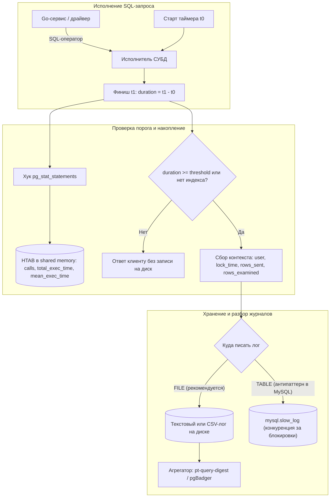

*Поиск дорогих SQL-операций на диске и в памяти: механика Slow Query Log в PostgreSQL и MySQL, нормализация запросов в `pg_stat_statements`, сравнение `mean_exec_time` и `total_exec_time`, а также клиентский перехват через `SetSlowQueryHook` в `ledgerdriver`.*

> «В идеальном мире прикладному программисту достаточно знать только API — без того, как этот API реализован и к какому железу он обращается. В реальности же чуть более глубокие знания порой оказываются весьма кстати.»  
> — Чарльз Петцольд, *Code: The Hidden Language of Computer Hardware and Software*

Общие графики нагрузки бывают обманчивы. Процессор базы данных может быть загружен всего на 25%, а средний TPS — оставаться ровным. При этом один-единственный неудачный запрос, запускаемый раз в секунду, вычитывает десятки миллионов строк с диска, вытесняет рабочие таблицы из `shared_buffers` и отправляет `p99` задержку остальных транзакций в красную зону.

**Slow Query Log (журнал медленных запросов)** — это бортовой самописец СУБД, который фиксирует операции, превысившие заданный порог длительности или выполнившиеся без индекса. А модуль **`pg_stat_statements`** дополняет текстовый журнал агрегированной статистикой в оперативной памяти по всем нормализованным шаблонам запросов. Вместе они отделяют тысячи быстрых штатных операций от нескольких «тяжеловесов», съедающих основную долю IOPS и процессорного времени.



---

## Зачем нужен журнал медленных запросов и как он устроен

Системная работа с журналом медленных запросов решает пять практических задач:
1. **Локализация узких мест:** выявляет запросы, которые потребляют больше всего CPU, дискового ввода-вывода и времени ожидания блокировок.
2. **Точечная оптимизация:** показывает конкретные кандидаты на добавление индекса, переписывание подзапроса или устранение `SELECT *`.
3. **Контроль регрессий:** позволяет заметить деградацию плана при росте объёма таблиц после очередного релиза.
4. **Планирование масштабирования:** отделяет нагрузку чтения, которую можно вынести на реплики, от тяжёлой записи, требующей шардирования (см. [[14. HighLoad-архитектура баз данных — масштабирование чтения и записи]]).
5. **Контроль SLA:** подтверждает, что критические финансовые сценарии укладываются в бюджет задержек.

Внутри движка СУБД регистрация медленного запроса встроена в цикл исполнения команды: перед выполнением фиксируется метка времени `t0`, после возврата или завершения оператора вычисляется `duration = t1 - t0`. Если длительность достигла порога, движок формирует запись с текстом SQL, именем пользователя и базы, временем выполнения (`Query_time`), временем ожидания блокировок (`Lock_time`), числом отданных строк (`Rows_sent`) и числом просмотренных строк (`Rows_examined`).

> [!info] Под капотом: `Rows_sent` против `Rows_examined`
> Главный диагностический маркер в журнале медленных запросов — кратный разрыв между возвращёнными и просканированными строками. Если запрос отдал приложению 5 проводок (`Rows_sent: 5`), но для их поиска движок просмотрел 2 000 000 записей (`Rows_examined: 2000000`), он поднял с диска и пропустил через фильтр почти всю таблицу ради 0.00025% результата. Это прямой сигнал к проверке плана через `EXPLAIN (ANALYZE, BUFFERS)` и подбору индекса (см. [[10. План выполнения запроса — читаем EXPLAIN ANALYZE BUFFERS]]).

---

## Настройка в PostgreSQL и `pg_stat_statements`

Архитектура PostgreSQL делает ставку на минимальное вмешательство в дисковый I/O и разделение текстового журнала и агрегированной статистики в памяти.

### Журнал медленных запросов на сервере

Текстовое логирование управляется тремя основными параметрами:
* **`log_min_duration_statement`** — порог длительности в миллисекундах. Значение `1000` записывает запросы от 1 секунды, `200` — от 200 мс, `-1` отключает порог, а `0` логирует абсолютно все запросы.
* **`log_line_prefix`** — шаблон контекстных полей перед каждой строкой лога: например, `'%m [%p] %u@%d tx=%x '` добавляет время, PID процесса, пользователя, имя базы и идентификатор транзакции.
* **`log_statement`** — фильтр классов команд (`none`, `ddl`, `mod`, `all`). Режим `all` полезен только на тестовых стендах.

Изменить порог можно без перезапуска кластера:

```sql
ALTER SYSTEM SET log_min_duration_statement = '250';
SELECT pg_reload_conf();
```

Дополнительно расширение **`auto_explain`** (загружаемое через `shared_preload_libraries`) автоматически сохраняет в журнал реальный план выполнения `EXPLAIN` для запросов, превысивших `auto_explain.log_min_duration`. Подробнее связку `auto_explain` с трассировкой мы разберём в следующей главе [[20. Наблюдаемость БД — корреляция запросов, трейсов и планов]].

### `pg_stat_statements`: нормализация и поиск деградаций

Записывать на диск каждый быстрый запрос нельзя — на 20 000 QPS дисковый массив захлебнётся от `write()`. Поэтому постоянный сбор профилей в PostgreSQL строится на расширении **`pg_stat_statements`** (см. [[7. Расширения PostgreSQL — pg_stat_statements, pgcrypto и экосистема]]).

Расширение перехватывает каждый запрос в разделяемой памяти:
1. **Лексическая нормализация:** литералы и константы заменяются на позиционные параметры `` `$1` ``, `` `$2` ``. Запросы `WHERE account_id = 101` и `WHERE account_id = 9042` схлопываются в единый шаблон.
2. **Хеширование:** вычисляется 64-битный `queryid`.
3. **Атомарный учёт в RAM:** в разделяемой хеш-таблице `HTAB` инкрементируются `calls`, суммарное время `total_exec_time`, минимальное/максимальное/среднее время (`min_exec_time`, `max_exec_time`, `mean_exec_time`), `rows`, а также счётчики буферного кэша `shared_blks_hit` и `shared_blks_read`.

При анализе `pg_stat_statements` критически важно различать **`mean_exec_time`** и **`total_exec_time`**:
* **`mean_exec_time`** находит единичные тяжёлые запросы (например, аналитический отчёт по балансам за год, выполняющийся 4 секунды).
* **`total_exec_time`** (равно `calls * mean_exec_time`) находит главного потребителя ресурсов кластера. Запрос со средним временем 3 мс, вызываемый 5 000 раз в секунду, съедает 15 ядерных секунд каждую секунду — намного больше, чем редкий 4-секундный отчёт.

Для поиска главных виновников нагрузки и деградаций в базе `LedgerPulse` используется запрос с расчётом доли от общего времени и коэффициента попадания в кэш:

```sql
SELECT
    queryid,
    calls,
    round(total_exec_time::numeric, 2) AS total_ms,
    round(mean_exec_time::numeric, 2)  AS mean_ms,
    rows,
    shared_blks_hit,
    shared_blks_read,
    left(query, 120) AS query_sample
FROM pg_stat_statements
WHERE dbid = (SELECT oid FROM pg_database WHERE datname = current_database())
ORDER BY total_exec_time DESC
LIMIT 15;
```

Если у шаблона высокий `shared_blks_read` относительно `shared_blks_hit` и большой разрыв между `rows` и затраченными блоками — план этого запроса вычитывает лишние страницы с диска и требует проверки индексов или переписывания.

---

## Специфика MySQL, MS SQL Server и Oracle

Другие промышленные СУБД решают ту же задачу со своими архитектурными особенностями:

### MySQL и MariaDB

В MySQL журнал медленных запросов управляется динамическими глобальными переменными:
* `slow_query_log = 'ON'` — включение механизма.
* `long_query_time = 0.2` — порог в секундах с дробной точностью до микросекунд (200 мс).
* `log_queries_not_using_indexes = 'ON'` — регистрация запросов без индекса, даже если они быстрее порога (помогает поймать скрытое полное сканирование, пока таблица ещё мала).
* `log_output = 'FILE'` и `slow_query_log_file` — путь к файлу лога.

```sql
SET GLOBAL slow_query_log = 'ON';
SET GLOBAL long_query_time = 0.2;
SET GLOBAL log_queries_not_using_indexes = 'ON';
```

В форке Percona Server (см. [[7. Percona Server — диагностика, XtraBackup и инструменты эксплуатации]]) доступен параметр `log_slow_rate_limit` для семплирования (логировать каждый N-й запрос), что снижает нагрузку на диск при большом потоке. Для пакетного разбора сырых логов применяют встроенную утилиту `mysqldumpslow -s t /var/log/mysql/mysql-slow.log` или промышленный анализатор `pt-query-digest` из Percona Toolkit, который ранжирует шаблоны по правилу Парето.

> [!warning] Ловушка: `log_output = 'TABLE'` в MySQL
> Никогда не включайте `log_output = 'TABLE'` на нагруженном сервере. Запись в системную таблицу `mysql.slow_log` проходит через механизмы движка хранения и блокировки метаданных. Когда база начинает деградировать и порождает сотни медленных операций в секунду, потоки выстраиваются в очередь на запись в `mysql.slow_log`, создавая каскадный `lock contention`, который окончательно останавливает сервер. Всегда направляйте журнал в файл (`FILE`), где запись идёт последовательно через буферизованный вызов `write()`.

### Microsoft SQL Server и Oracle Database

* **MS SQL Server:** устаревший `SQL Trace / SQL Server Profiler` заменён на событийный механизм **Extended Events (`XEvents`)** с минимальными накладными расходами (`CREATE EVENT SESSION ... WHERE ([duration] > 1000000)` — порог в микросекундах) и встроенное хранилище **Query Store**, которое сохраняет историю статистик и планов с возможностью зафиксировать стабильный план (plan pinning).
* **Oracle Database:** постоянное профилирование опирается на **AWR (Automatic Workload Repository)** — снимки производительности каждые 60 минут — и **ASH (Active Session History)**, опрашивающий активные сессии в памяти каждую секунду. Для детальной отладки отдельной сессии применяют `ALTER SESSION SET SQL_TRACE = TRUE` (или `DBMS_SESSION.SESSION_TRACE_ENABLE`) с последующей обработкой утилитой `tkprof`.

---

## Связь с Go: `SetSlowQueryHook` в `ledgerdriver`

Серверный журнал видит только то, что дошло до ядра СУБД и уложилось в серверный порог. Но приложению на Go полезно иметь **клиентскую** точку наблюдения за длительностью каждого вызова — включая время прохождения по сети, десериализацию и переключение контекста.

В учебном драйвере проекта `LedgerPulse` (`project/final/ledgerdriver/driver.go`) эта механика встроена прямо в виртуальный движок `Instance` через метод `SetSlowQueryHook`:

```go
type Instance struct {
	mu          sync.Mutex
	state       *dbState
	failNextBad atomic.Bool
	slowHook    func(query string, dur time.Duration)
}

func (i *Instance) SetSlowQueryHook(fn func(query string, dur time.Duration)) {
	i.mu.Lock()
	defer i.mu.Unlock()
	i.slowHook = fn
}
```

Внутри `conn.runQuery` перед разбором SQL фиксируется `start := time.Now()`, а в отложенном `defer` извлекается ссылка на хук и передаётся текст запроса вместе с измеренной длительностью:

```go
	start := time.Now()
	defer func() {
		c.inst.mu.Lock()
		hook := c.inst.slowHook
		c.inst.mu.Unlock()
		if hook != nil {
			hook(query, time.Since(start))
		}
	}()
```

Обратите внимание на две инженерные детали этой реализации:
1. Под мьютексом `c.inst.mu` выполняется только копирование указателя на функцию `hook := c.inst.slowHook`, а сам вызов `hook(query, time.Since(start))` происходит уже **после** `Unlock()`. Это гарантирует, что медленный логгер внутри хука не заблокирует другие соединения к `Instance`.
2. Если транзакция или запрос в `runQuery` вернёт ошибку после `start := time.Now()`, `defer` всё равно сработает — вы увидите длительность даже неуспешных операций.

Подключить такой клиентский детектор медленных запросов при старте `LedgerPulse` можно в несколько строк через `log/slog`:

```go
package main

import (
	"log/slog"
	"os"
	"strings"
	"time"

	"github.com/UnrealTemplier/go-textbook-v2-vol2/project/final/ledgerdriver"
)

func setupSlowQueryMonitor(inst *ledgerdriver.Instance, logger *slog.Logger, threshold time.Duration) {
	inst.SetSlowQueryHook(func(query string, dur time.Duration) {
		if dur < threshold {
			return
		}
		// Убираем лишние переводы строк, не сохраняя значения параметров
		compact := strings.Join(strings.Fields(query), " ")
		logger.Warn("slow sql detected on client",
			slog.Duration("duration", dur),
			slog.String("query", compact),
		)
	})
}
```

Если в продакшене вместо `ledgerdriver` используется `pgx` или `database/sql` с внешним драйвером, ту же роль играет перехватчик `pgx.QueryTracer` или обёртка над `driver.Conn` — об этом подробнее в следующей главе. А на стороне SQL-текста команды нередко дополняют метаданными в виде комментария (`/* handler=transfer */`), чтобы DBA в серверном логе видел, какой именно обработчик Go породил тяжёлый запрос. Однако при использовании Prepared Statements в PostgreSQL динамические значения вроде уникального `trace_id` в текст SQL подставлять нельзя — это разрушает кэш планов (разберём ловушку в главе [[20. Наблюдаемость БД — корреляция запросов, трейсов и планов]]).

---

## Подводные камни эксплуатации и вопросы с собеседований

Сбор медленных запросов без оглядки на физику дискового ввода-вывода способен остановить продакшен быстрее, чем сама нагрузка:

> [!warning] Ловушка: дисковое переполнение и завышенные пороги
> * **Нулевой порог на высоком RPS:** включение `log_min_duration_statement = 0` (или `long_query_time = 0` в MySQL) на сервере с 20 000 QPS превращает каждый быстрый `SELECT` в системный вызов `write()` на диск. Журнал вырастает на десятки гигабайт за часы и приводит к остановке СУБД при нехватке места (`Disk Full`).
> * **Отсутствие ротации (`logrotate`):** неротируемый файл медленного лога разрастается до десятков гигабайт, и попытка разобрать его утилитами анализа приводит к исчерпанию оперативной памяти.
> * **Слепой перебор параметров вместо `ANALYZE`:** после выявления медленного запроса недостаточно просто добавить индекс — проверьте свежесть статистики таблицы (`ANALYZE`) и реальный план выполнения через `EXPLAIN (ANALYZE, BUFFERS)`, иначе оптимизатор может выбрать неверный `Nested Loop` из-за устаревшей кардинальности.

> [!tip] Собеседование [Middle]
> **Вопрос:** В сервисе включён `log_min_duration_statement = 1000` (1 секунда), база ощутимо тормозит, страницы баланса открываются по 3 секунды, но журнал медленных запросов абсолютно пуст. Как такое возможно?
>
> **Ответ:** Это классическая ситуация «смерти от тысячи порезов» (Death by a thousand cuts):
> 1. **Проблема N+1:** код в цикле отправляет 1 500 быстрых запросов по 1–2 мс каждый. Ни один из них не нарушает порог в 1 секунду, поэтому в логе пусто, но суммарно из-за сетевых RTT набегает 3 секунды.
> 2. **Слишком грубый порог:** в OLTP-системе запрос длительностью 700 мс уже нарушает SLA, но остаётся невидимым при пороге 1 000 мс.
> 3. **Удержание транзакции на стороне Go:** сам SQL выполняется за 2 мс, но клиент удерживает открытую транзакцию, делая долгий сетевой вызов до `Commit()`.
>
> **Решение:** снизить порог до реалистичного (например, 100–200 мс) и обратиться к `pg_stat_statements` с сортировкой по `total_exec_time DESC` (а не только по `max_exec_time`), чтобы увидеть суммарный вклад частых микро-запросов.

---

## Упражнения

### Упражнение 1 (Базовое). Выбор между `mean_exec_time` и `total_exec_time`
В `pg_stat_statements` базы `ledgerpulse` обнаружены две записи за последний час:
* Запрос A: `calls = 4`, `mean_exec_time = 1850 ms` (ежедневная сверка отчёта).
* Запрос B: `calls = 1_200_000`, `mean_exec_time = 6.5 ms` (получение баланса счёта без покрывающего индекса).

Какой из запросов сильнее нагружает сервер, почему он не попал в Slow Query Log при `log_min_duration_statement = 200`, и с оптимизации какого запроса следует начать?

> [!solution] Показать решение
> Считаем суммарное время `total_exec_time = calls * mean_exec_time`:
> * Запрос A: `4 * 1850 мс = 7 400 мс` (7.4 секунды за весь час).
> * Запрос B: `1 200 000 * 6.5 мс = 7 800 000 мс` (7 800 секунд — больше двух часов процессорного и дискового времени за один астрономический час).
>
> Запрос B не попал в Slow Query Log, потому что его одиночное выполнение (6.5 мс) в 30 раз ниже порога 200 мс. Начинать оптимизацию нужно именно с Запроса B (проверить `EXPLAIN (ANALYZE, BUFFERS)` и при необходимости добавить индекс или кэширование в `LedgerService`), так как он определяет базовую утилизацию кластера.

### Упражнение 2 (Практическое). Порог и асинхронный учёт в `SetSlowQueryHook`
Допишите обёртку для `ledgerdriver.Instance`, которая через `SetSlowQueryHook` отслеживает запросы длиннее 20 мс, подсчитывает общее число медленных запросов через `atomic.Int64` и не допускает блокировки вызывающей горутины, если логгер временно тормозит (используйте неблокирующую отправку в буферизованный канал фиксированной ёмкости с подсчётом отброшенных записей при переполнении).

> [!solution] Показать решение
> ```go
> package telemetry
>
> import (
> 	"context"
> 	"log/slog"
> 	"sync/atomic"
> 	"time"
>
> 	"github.com/UnrealTemplier/go-textbook-v2-vol2/project/final/ledgerdriver"
> )
>
> type SlowEvent struct {
> 	Query string
> 	Dur   time.Duration
> }
>
> type SlowTracker struct {
> 	TotalSlow   atomic.Int64
> 	DroppedLogs atomic.Int64
> 	ch          chan SlowEvent
> }
>
> func AttachSlowTracker(ctx context.Context, inst *ledgerdriver.Instance, logger *slog.Logger, threshold time.Duration) *SlowTracker {
> 	t := &SlowTracker{ch: make(chan SlowEvent, 256)}
>
> 	go func() {
> 		for {
> 			select {
> 			case <-ctx.Done():
> 				return
> 			case ev := <-t.ch:
> 				logger.Warn("slow ledger query",
> 					slog.Duration("duration", ev.Dur),
> 					slog.String("query", ev.Query),
> 				)
> 			}
> 		}
> 	}()
>
> 	inst.SetSlowQueryHook(func(query string, dur time.Duration) {
> 		if dur < threshold {
> 			return
> 		}
> 		t.TotalSlow.Add(1)
> 		select {
> 		case t.ch <- SlowEvent{Query: query, Dur: dur}:
> 		default:
> 			t.DroppedLogs.Add(1)
> 		}
> 	})
>
> 	return t
> }
> ```
> Приём с неблокирующим `select` и счётчиком `DroppedLogs` защищает горячий путь выполнения SQL от задержек вывода логов на диск.

### Упражнение 3 (Со звёздочкой \*). Диагностика раздувания `pg_stat_statements`
После обновления сервиса в таблице `pg_stat_statements` резко выросло число уникальных строк (`count(*)` упёрся в `pg_stat_statements.max = 5000`), появилось много вытеснений (`dealloc` в `pg_stat_statements_info`), а среднее время планирования выросло. В коде Go нашли две конструкции:
1. `SELECT * FROM accounts WHERE id IN (1, 2, 3)` с динамической генерацией плейсхолдеров разной длины;
2. вставку в текст SQL уникального идентификатора запроса `/* req_id=uuid */`.

Объясните, как каждая из них влияет на `pg_stat_statements` и кэш планов, и предложите исправление.

> [!solution] Показать решение
> 1. **Разное число плейсхолдеров в `IN (...)`:** шаблоны `IN ($1)`, `IN ($1, $2)`, `IN ($1, $2, $3)` имеют разное синтаксическое дерево, поэтому `pg_stat_statements` регистрирует для каждого количества элементов отдельный `queryid`. Исправление: перейти на передачу массива через `WHERE id = ANY($1::bigint[])` — тогда для любого числа ID используется один и тот же шаблон и один план.
> 2. **Уникальный `req_id` в SQL-комментарии:** если драйвер не вырезает комментарии до хеширования или использует текстовый протокол с уникальными строками, каждый запрос получает новый `queryid` и вымывает полезную статистику из фиксированной `HTAB` (растёт `dealloc`), а также не даёт переиспользовать подготовленные выражения. Исправление: убрать динамические UUID из текста SQL, передавая их через структурированные логи приложения или `SET LOCAL application_name`, когда это действительно нужно.

---

## Мостик к следующему уроку

Журнал медленных запросов и `pg_stat_statements` называют конкретные SQL-шаблоны, которые создают нагрузку. Но что делать, если в базе все отдельные запросы быстрые (по 1–2 мс), а конкретный перевод у конкретного клиента занимает 4 секунды? Чтобы увидеть всю цепочку от HTTP-запроса до блокировки строки в PostgreSQL и реального плана `auto_explain`, нужны сквозные идентификаторы трассировки. Переходим к главе [[20. Наблюдаемость БД — корреляция запросов, трейсов и планов]].
