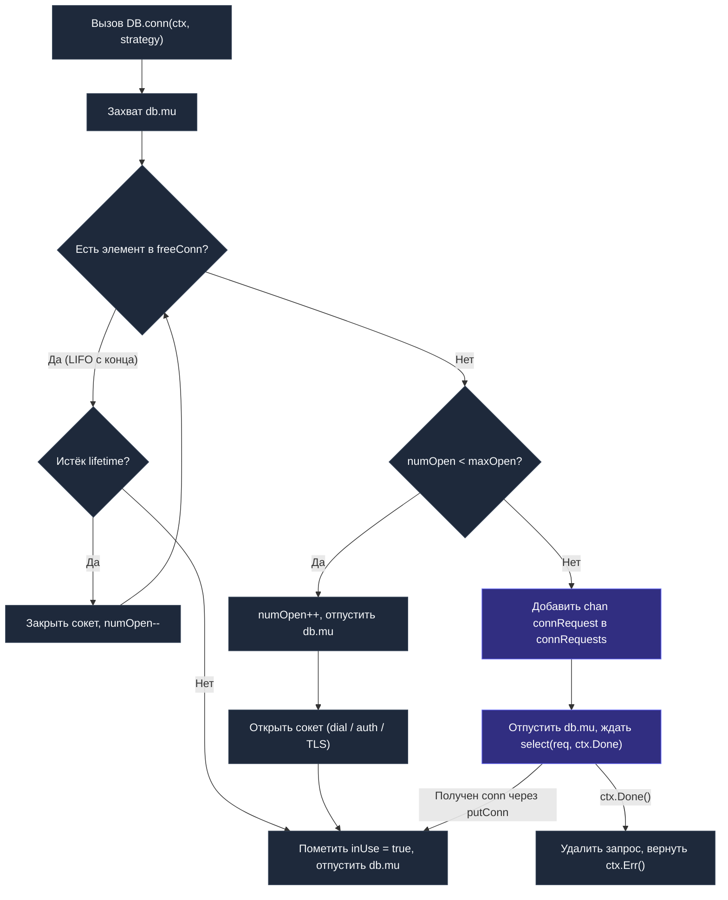

*Что происходит внутри `*sql.DB` под нагрузкой: состояния `idle`/`inUse`/`closed`, горутина `connOpener`, ловушка `PingContext` против `db.retry` при `driver.ErrBadConn`, привязка транзакции к сокету и цена подготовленных выражений.*

> «Блеск Unix заключался в выборе абстракции, достаточно общей, чтобы быть поразительно полезной, и при этом не слишком дорогой по производительности.»  
> — Брайан Керниган, *UNIX: A History and a Memoir*

Открывать новое TCP-соединение с базой на каждый HTTP-запрос — верный способ положить сервис под первой же волной трафика. В отличие от обращения к RAM (~100 нс) или чтения с NVMe (~100 мкс), установка сессии с СУБД требует 5–15 системных вызовов (`socket`, `connect`, `write`, `read`) и занимает миллисекунды:
* тройное рукопожатие TCP (`SYN`, `SYN-ACK`, `ACK`) — минимум 1 RTT;
* рукопожатие TLS — ещё 2–4 RTT и асимметричная криптография на CPU;
* аутентификация на сервере (проверка хеша пароля и правил `pg_hba.conf` или `mysql.user`);
* выделение ресурсов СУБД — PostgreSQL на каждое соединение форкает отдельный процесс `postgres`, подключает разделяемую память и резервирует `work_mem` (см. [[1. Архитектура PostgreSQL — процессы, общая память и бэкенды]]).

Если закрывать сокет после каждого запроса, ядро Linux переведёт тысячи сокетов в `TIME_WAIT` на 60 секунд, исчерпав эфемерные порты и файловые дескрипторы (`ulimit -n`). Поэтому Go встраивает пул соединений прямо в `*sql.DB`. В отличие от Java (`HikariCP`) или Python (`SQLAlchemy`), пул стандартной библиотеки Go паркует ожидающие горутины в `_Gwaiting` без блокировки потоков ОС.

---

## Внутренняя машина состояний `*sql.DB`

Каждый `driver.Conn` в обёртке `*driverConn` находится в одном из трёх состояний:

| Состояние | Где хранится | Что происходит |
|---|---|---|
| `idle` | В слайсе `db.freeConn` | Сокет свободен и готов к выдаче |
| `inUse` | В `*sql.conn`, `*sql.Rows` или `*sql.Tx` | Помечен `inUse = true`, недоступен другим горутинам |
| `closed` | Удалён из пула | Вызван `driver.Conn.Close()`, `numOpen` уменьшен |

Состояние координируют пять полей `sql.DB`: защитный мьютекс `mu sync.Mutex`, срез свободных соединений `freeConn []*driverConn`, карта ожидающих запросов `connRequests map[uint64]chan connRequest`, счётчик открытых соединений `numOpen` и канал `openerCh chan struct{}` для фоновой горутины `connectionOpener` (`connOpener`).



Три ключевых решения в устройстве пула Go:
1. **LIFO вместо FIFO в `freeConn`.** При стратегии `cachedOrNewConn` метод `DB.conn` забирает элемент с конца слайса (`freeConn[len-1]`). Недавно освобождённый сокет с высокой вероятностью ещё «тёплый» (активный TLS и буферы ОС), а фоновый `connectionCleaner` выметает просроченные по простою сокеты начиная с головы `freeConn[0]`.
2. **Буферизованные каналы `chan connRequest` вместо `sync.Cond`.** `sync.Cond.Wait()` нельзя прервать по сигналу `ctx.Done()`. Канальная модель позволяет горутине ждать в `select` одновременно с отменой контекста (иначе без таймаута в `ctx` горутина застрянет навечно). При возврате сокета `putConnDBLocked` отдаёт его напрямую первому ожидающему в канал.
3. **Горутина `connOpener` (`connectionOpener`).** Она слушает `openerCh` и асинхронно дооткрывает соединения, когда лимит ещё не выбран и есть ожидающие в `connRequests`. Если `openNewConnection` падает с ошибкой, счётчик `numOpen` откатывается.

> [!warning] Ловушка: конкуренция за `db.mu` на высоких RPS
> Каждая выдача и возврат сокета захватывают единый `db.mu`. Свыше 5 000 RPS на коротких запросах возникает `cache line bouncing` вокруг мьютекса. Увеличивайте `MaxIdleConns`, а при росте числа подов ставьте перед PostgreSQL внешний пулер вроде PgBouncer (см. [[9. Настройка и оптимизация PostgreSQL — память, планировщик и PgBouncer]]).

---

## `driver.ErrBadConn`: механизм `db.retry` и ловушка `PingContext`

Сетевые экраны, NAT, AWS NLB и перезапуск самой СУБД могут молча оборвать простаивающий TCP-сокет. Когда Go берёт его из `freeConn` и посылает запрос, драйвер возвращает `driver.ErrBadConn`.

В `database/sql` работает встроенный цикл повторов `db.retry`:

```go
// Схема из стандартной библиотеки Go (database/sql/sql.go)
const maxBadConnRetries = 2

func (db *DB) retry(fn func(strategy connReuseStrategy) error) error {
	for i := int64(0); i < maxBadConnRetries; i++ {
		err := fn(cachedOrNewConn)
		if err == nil || !errors.Is(err, driver.ErrBadConn) {
			return err
		}
	}
	return fn(alwaysNewConn)
}
```

Дважды пул пробует `cachedOrNewConn`; если оба раза драйвер ответил `driver.ErrBadConn`, третья попытка принудительно открывает свежее соединение (`alwaysNewConn`), а битые сокеты закрывает.

**Критический нюанс `PingContext`.** Методы `QueryContext`, `QueryRowContext`, `ExecContext`, `BeginTx` и `PrepareContext` оборачивают внутри `db.retry` само выполнение на соединении. А `PingContext` устроен иначе:

```go
func (db *DB) PingContext(ctx context.Context) error {
	var dc *driverConn
	var err error

	err = db.retry(func(strategy connReuseStrategy) error {
		dc, err = db.conn(ctx, strategy) // db.retry защищает ТОЛЬКО получение сокета
		return err
	})
	if err != nil {
		return err
	}

	return db.pingDC(ctx, dc, dc.releaseConn) // Проверка Ping выполняется ВНЕ db.retry
}
```

Если в пуле лежало «мёртвое» соединение, обычный запрос (`GetAccount` в `project/final/ledger_test.go`) сам переиграет `driver.ErrBadConn` и пройдёт успешно. А вот `PingContext` на эндпоинте `/healthz` получит `driver.ErrBadConn` от `pingDC`, закроет сокет и **вернёт ошибку вызывающему коду** (`503`).

> [!tip] Собеседование [Senior/Staff]
> **Вопрос:** Почему после рестарта БД `db.QueryContext` может отработать без ошибки, а `db.PingContext` на том же пуле вернёт `driver.ErrBadConn`?  
> **Ответ:** `QueryContext` оборачивает в `db.retry` (`maxBadConnRetries = 2` на `cachedOrNewConn`, затем `alwaysNewConn`) весь цикл выполнения. В `PingContext` под `db.retry` обёрнут только захват соединения `db.conn`, а `db.pingDC` вызывается снаружи и отдаёт `driver.ErrBadConn` наружу, закрывая битый сокет.

---

## `Tx`-pinning и сессионный `*sql.Conn`

Вызов `db.BeginTx(ctx, opts)` **привязывает (`pins`) одно физическое соединение из пула** исключительно к `*sql.Tx` до `Commit()` или `Rollback()`. Это необходимо для гарантий MVCC (см. [[7. MVCC — многоверсионный контроль конкурентности]]): все операторы транзакции должны идти в одной сессии.

Две главные ловушки привязки:
1. **Голодание пула (`pool starvation`) из-за внешнего I/O.** Внешний HTTP-вызов или тяжёлая генерация отчёта внутри открытой транзакции блокируют сокет на секунды. При `MaxOpenConns = 25` 25 медленных запросов парализуют всю базу. Внешнюю работу делайте **до** `BeginTx`, публикацию событий — **после** `Commit`.
2. **Утечка без `defer tx.Rollback()`.** При раннем `return` или панике сокет останется занятым навсегда. Ставьте `defer tx.Rollback()` сразу после `BeginTx`: `Commit()` и `Rollback()` атомарно взводят флаг `tx.done`, поэтому `Rollback()` после успешного `Commit()` не шлёт ничего в сеть и возвращает безопасную ошибку `sql.ErrTxDone` (её игнорируют).

Ещё три тонкости:
* **Вложенных транзакций нет:** вызов `db.BeginTx` внутри функции с активным `*sql.Tx` заберёт **второй** сокет из пула и приведёт к самоблокировке. Для частичного отката используйте `tx.ExecContext(ctx, "SAVEPOINT sp1")` и `ROLLBACK TO SAVEPOINT sp1`.
* **Отмена контекста:** отмена `ctx`, переданного в `BeginTx`, откатывает всю транзакцию (драйвер закрывает сокет), а отмена `ctx` в отдельном `tx.ExecContext` прерывает только этот оператор — `tx.Rollback()` всё равно обязателен.
* **Сессионный `*sql.Conn` (с Go 1.9):** `db.Conn(ctx)` монопольно закрепляет сокет за горутиной без транзакции — нужно для `SET TIME ZONE`, `CREATE TEMPORARY TABLE`, `LOCK TABLES` или сессионных advisory locks. Всегда закрывайте его через `defer conn.Close()`.

---

## Prepared Statements: кэш `Stmt`, «прилипание» и `db.Prepare` против `db.Query`

На сервере СУБД подготовленное выражение (`PREPARE`) живёт в памяти **конкретной TCP-сессии**, а не всего пула. Внутри `*sql.Stmt` пакет `database/sql` ведёт список соединений, где этот стейтмент уже скомпилирован:
* при вызове `stmt.QueryContext`/`ExecContext` диспетчер старается получить одно из этих соединений («прилипание», *sticky behavior*);
* если они заняты или закрылись, берётся любой свободный сокет, и драйвер прозрачно отправляет туда `PREPARE`.

Ловушки:
* **Расход памяти СУБД:** 30 глобальных `Stmt` в пуле из 50 соединений порождают до 1 500 дескрипторов на сервере (`max_prepared_stmt_count` в MySQL, планы в бэкендах PostgreSQL). Забытый `stmt.Close()` быстро исчерпает лимит.
* **`db.Prepare` против `db.QueryContext` с параметрами:** для разового запроса `db.Prepare` + `stmt.Query` **медленнее**, потому что требует двух сетевых roundtrip'ов (`PREPARE` + `EXECUTE`) и ещё `Close`. Драйверы с `driver.QueryerContext`/`ExecerContext` (например, `pgx/v5/stdlib` на Extended Query Protocol) шлют SQL и параметры за один roundtrip. Если же драйвер не реализует `QueryerContext`, `database/sql` сам делает `Prepare` → `Query` → `Close` на каждый вызов.

> [!info] Учёт устройства железа: парсинг SQL, буферы и GC
> 1. **CPU на парсинг SQL:** свыше 10 000 RPS непараметризованный SQL заставляет СУБД каждый раз строить AST и план; параметризованные запросы и переиспользуемые `*sql.Stmt` для горячих циклов разгружают CPU базы.
> 2. **Память сокетов и GC:** каждое соединение держит буферы ~4–8 КБ на чтение и запись (~20 КБ с накладными расходами, ~2 МБ на 100 коннектов). При низком `MaxIdleConns` сокеты постоянно пересоздаются, создавая мусор в куче.
> 3. **Сканирование и `string`:** переиспользование переменных цикла (`var id int64; var kind string`) снижает аллокации, но строки в Go иммутабельны и при чтении из сетевого буфера всё равно аллоцируются в куче — для zero-alloc в горячем пути используют сырые буферы `pgx` (см. главу 4 этого модуля).

---

## Тюнинг пула и мониторинг `db.Stats()`

Дефолты (`MaxOpenConns = 0`, `MaxIdleConns = 2`, `ConnMaxLifetime = 0`, `ConnMaxIdleTime = 0`) опасны для продакшена. Ориентир по закону Литтла:

$$\text{MaxConns} \approx \text{QPS} \times \text{AvgQueryLatency} \times 1.25$$

Для CPU-нагруженных запросов на локальной БД ориентир близок к `(ядра CPU БД × 2) + эффективные диски`, для типичного веб-API — `25–100` на под (сумма по подам строго меньше `max_connections` PostgreSQL), для serverless — `5–10` с `MaxIdleConns = 2`. На стороне СУБД ставят `statement_timeout` и `idle_in_transaction_session_timeout`, а в драйвере — TCP keepalive (30–60 с).

| Параметр пула | Назначение и правило настройки |
|---|---|
| `SetMaxOpenConns(n)` | Потолок `inUse + idle`; `n = 1` превращает БД в последовательное бутылочное горлышко |
| `SetMaxIdleConns(n)` | 25–60% от `MaxOpenConns`; если `n > MaxOpenConns`, Go молча урежет до `MaxOpenConns` |
| `SetConnMaxLifetime(d)` | Возраст с момента создания; ротирует сокеты при смене DNS/балансировщиков |
| `SetConnMaxIdleTime(d)` | Максимум простоя; ставят короче таймаута NAT/NLB/firewall против `broken pipe` |

Состояние пула снимается без блокировок через `db.Stats()` (в `LedgerPulse` — эндпоинт `GET /metrics/db` в `project/final/server.go`):

| Метрика `sql.DBStats` | Норма | Тревожный сигнал |
|---|---|---|
| `InUse` | < 70% от `MaxOpenConns` | Постоянно равно `MaxOpenConns` — утечка `rows.Close()` или нехватка пула |
| `Idle` | 20–80% от `MaxOpenConns` | Постоянно `0` под нагрузкой — поднимите `MaxIdleConns` |
| `WaitCount` / `WaitDuration` | `0` или редкие миллисекунды | Быстрый рост и `WaitDuration > 100 мс` — голодание пула |
| `MaxIdleClosed` | Низкий стабильный темп | Скачки — слишком малый `MaxIdleConns` при всплесках трафика |

---

## Упражнения

### Упражнение 1 (Базовое). Расчёт лимитов пула для `LedgerPulse`
У PostgreSQL `max_connections = 300` (50 слотов под администрирование и репликацию). Запущено 10 подов `LedgerPulse`, средняя транзакция — 8 мс, пик на под — 1 500 QPS, таймаут простоя облачного NLB — 350 секунд. Подберите параметры пула на один под.

> [!solution] Показать решение
> 1. Бюджет на 10 подов: $300 - 50 = 250$ → **`SetMaxOpenConns(25)`**.
> 2. По закону Литтла: $1500 \times 0.008 = 12$ активных соединений (с запасом ~15) — лимит `25` уверенно держит пик.
> 3. **`SetMaxIdleConns(12)`** (около 50% от `MaxOpenConns`), чтобы избежать лишних TCP/TLS handshake на спадах.
> 4. **`SetConnMaxIdleTime(3 * time.Minute)`** (< 350 с NLB) и **`SetConnMaxLifetime(15 * time.Minute)`** для плавной ротации.

### Упражнение 2 (Практическое). Диагностика `ErrBadConn` на `/healthz`
Ночью при низком трафике `GET /healthz` (`project/final/server.go`) иногда возвращает `503` с текстом `driver: bad connection`, тогда как `POST /api/v1/transfers` работает без сбоев. Объясните причину и исправьте `handleHealth`.

> [!solution] Показать решение
> Простаивающие сокеты закрываются сетью/БД. Рабочие запросы (`Transfer`, `GetAccount`) идут через `db.retry` и прозрачно переоткрывают сокет, а `s.db.PingContext` защищает через `db.retry` только захват `db.conn` — сам `db.pingDC` выполняется вне `db.retry` и отдаёт `driver.ErrBadConn` наружу.
>
> Исправление: уменьшить `ConnMaxIdleTime`, а в `handleHealth` либо делать один повтор при `errors.Is(err, driver.ErrBadConn)`, либо проверять БД через `s.db.QueryRowContext(ctx, "SELECT 1").Scan(&one)`, проходящий через полный `db.retry`.

### Упражнение 3 (Со звёздочкой \*). Массовое начисление бонусов без starvation
Воркер должен начислить бонусы 5 000 счетов после проверки каждого во внешнем HTTP-антифроде. Коллега открыл одну `db.BeginTx`, внутри цикла вызывает HTTP API и `tx.PrepareContext` на каждой итерации. Назовите три ошибки и предложите правильную архитектуру.

> [!solution] Показать решение
> Ошибки:
> 1. Внешний HTTP-запрос внутри `Tx` намертво привязывает сокет из пула на минуты и удерживает блокировки/MVCC-снимки.
> 2. `tx.PrepareContext` внутри цикла без `stmt.Close()` создаёт 5 000 подготовленных дескрипторов на одном соединении.
> 3. Одна транзакция на 5 000 строк блокирует `VACUUM` и откатывает всю пачку из-за одной ошибки.
>
> Решение: сначала выполнить ограниченные по конкурентности HTTP-проверки **до** транзакции; затем разбить запись на батчи по 100 счетов в коротких транзакциях, используя один `tx.PrepareContext` с `defer stmt.Close()` или один пакетный `UPDATE ... FROM unnest($1::bigint[], $2::bigint[])`.

---

## Мостик к следующему уроку

Мы разобрали механику пула, `db.retry` против `PingContext`, `Tx`-pinning и кеширование `*sql.Stmt`. Но писать `BeginTx` и `defer tx.Rollback()` в каждом бизнес-сценарии неудобно: бизнес-логика обрастает SQL-шаблонами. Как изолировать запросы в `Repository` и прокинуть транзакцию (`Unit of Work`) через замыкание или `context.Context`? Переходим к главе [[3. Паттерн Repository и транзакции в Go — Unit of Work через context]].
