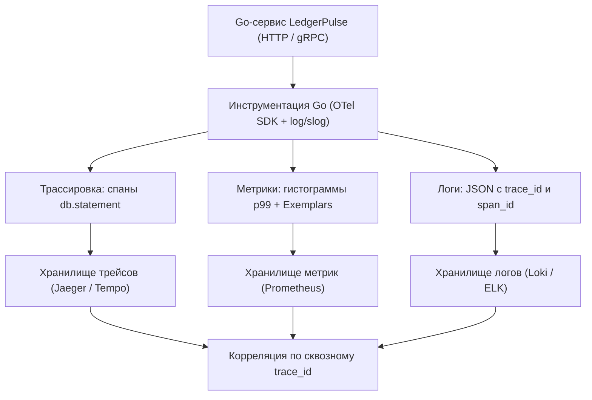

*Сквозная диагностика задержек от HTTP-обработчика до плана выполнения в PostgreSQL: три столпа наблюдаемости, Exemplars, `otelpgx` и `otelsql`, прокидывание `traceparent` через `sqlcommenter` без разрушения кэша планов, настройка `auto_explain` и цена телеметрии для GC.*

> «Хотя поддержка конкурентности — одна из главных сильных сторон Go, рассуждать о конкурентных программах по природе труднее, чем о последовательных, и интуиция, выработанная на последовательном коде, порой подводит.»  
> — Алан Донован и Брайан Керниган, *The Go Programming Language*

Классический мониторинг отвечает на вопрос «что сломалось прямо сейчас»: он фиксирует рост `p99`, падение Cache Hit Ratio или исчерпание соединений в пуле (см. [[18. Мониторинг баз данных — ключевые метрики PostgreSQL, соединений и I_O]]). Но в распределённой системе этого недостаточно. Клиент жалуется, что перевод в `LedgerPulse` выполнялся 4 секунды, а графики базы данных показывают ровный пульс: загрузка CPU — 14%, средний TPS стабилен, а средняя задержка SQL-запросов равна 2 миллисекундам.

Здесь вступает **наблюдаемость (Observability)** — свойство системы, позволяющее по внешним сигналам расследовать произвольные инциденты без выкатки нового отладочного кода. Она отвечает на точные вопросы: почему именно у запроса с `trace_id = 4bf9...` транзакция длилась 4 секунды, какие операторы SQL в ней исполнялись, где сработала блокировка и какой план выбрал оптимизатор PostgreSQL.

Наблюдаемость базы данных строится на трёх связанных сигналах:
1. **Распределённая трассировка (Distributed Tracing)** — дерево спанов от входного HTTP/gRPC-запроса через горутины до драйвера СУБД.
2. **Структурированные логи** — события в JSON (через стандартный `log/slog`), привязанные к единому `trace_id`.
3. **Метрики с Exemplars** — числовые временные ряды, в которых конкретный выброс гистограммы хранит ссылку на `trace_id` породившего его запроса.



Связка работает как единый маршрут расследования: скачок на графике `p99` в дашборде ведёт через **Exemplar** прямо в водопад спанов, где виден проблемный вызов к БД, а по тому же `trace_id` извлекаются структурированные логи и серверный план выполнения. Подробнее о развёртывании OpenTelemetry Collector, настройке хранилищ Jaeger/Tempo, Loki и продакшен-конвейеров `log/slog` см. Том 4, раздел о наблюдаемости. В этой главе мы сосредоточимся на стороне базы данных и Go-драйверов.

---

## Инструментация Go-драйверов и семантика OpenTelemetry

Трассировка моделирует путь запроса как направленный ациклический граф отрезков времени — **спанов (Spans)**, связанных сквозным контекстом W3C Trace Context (`trace_id` и `span_id`). Для унификации телеметрии разных хранилищ OpenTelemetry задаёт семантические атрибуты:
* `db.system` — тип СУБД (`postgresql`, `mysql`, `redis`, `mongodb`);
* `db.name` — имя целевой базы;
* `db.statement` — нормализованный текст SQL-запроса (без сырых секретов и персональных данных);
* `db.user` — роль, от имени которой открыто соединение;
* `net.peer.name` и `net.transport` — адрес узла и транспорт (`IP.TCP`).

В экосистеме Go эти атрибуты автоматически заполняют три основные обёртки:
* **`otelsql`** — обёртка над стандартным `database/sql`, перехватывающая `QueryContext`, `ExecContext`, `PrepareContext` и транзакции `BeginTx`;
* **`otelpgx`** — инструментация для `pgx` и `pgxpool` через встроенный интерфейс `pgx.QueryTracer`;
* **`redisotel`** — хук для `go-redis`, создающий спаны для одиночных команд и пайплайнов.

Рассмотрим подключение `otelpgx` и структурированного логгера `log/slog` к пулу соединений:

```go
package observability

import (
	"context"
	"log/slog"
	"time"

	"github.com/exaring/otelpgx"
	"github.com/jackc/pgx/v5/pgxpool"
	"go.opentelemetry.io/otel"
	"go.opentelemetry.io/otel/trace"
)

func NewTracedPool(ctx context.Context, dsn string) (*pgxpool.Pool, error) {
	cfg, err := pgxpool.ParseConfig(dsn)
	if err != nil {
		return nil, err
	}

	// Подключаем Tracer уровня драйвера без изменения SQL в репозитории
	cfg.ConnConfig.Tracer = otelpgx.NewTracer(
		otelpgx.WithTracerProvider(otel.GetTracerProvider()),
		otelpgx.WithTrimSQLInSpanName(),
	)

	return pgxpool.NewWithConfig(ctx, cfg)
}

func LogDBEvent(ctx context.Context, logger *slog.Logger, op string, dur time.Duration, err error) {
	sc := trace.SpanFromContext(ctx).SpanContext()
	l := logger.With(
		slog.String("trace_id", sc.TraceID().String()),
		slog.String("span_id", sc.SpanID().String()),
		slog.String("db.system", "postgresql"),
		slog.String("db.operation", op),
		slog.Float64("duration_ms", float64(dur.Microseconds())/1000.0),
	)

	if err != nil {
		l.ErrorContext(ctx, "database operation failed", slog.String("error", err.Error()))
		return
	}
	if dur > 100*time.Millisecond {
		l.WarnContext(ctx, "slow database operation")
	}
}
```

Под капотом `otelpgx` реализует методы жизненного цикла `TraceQueryStart` и `TraceQueryEnd`. При старте запроса из переданного `context.Context` извлекается родительский спан, создаётся дочерний спан с атрибутами СУБД, а при завершении фиксируются длительность и статус ошибки (`codes.Error`). Главная обязанность разработчика в Go — **не разрывать цепочку `ctx`** при переходе к базе данных и фоновым задачам.

---

## Корреляция с сервером БД: `sqlcommenter` и `auto_explain`

Клиентский спан заканчивается на сетевом сокете приложения. Он говорит, что запрос к `ledger_entries` занял 850 мс, но не объясняет, что происходило внутри PostgreSQL: было ли это ожидание блокировки, промах кэша или сканирование таблицы. Чтобы связать спан приложения с серверной стороной СУБД, используют два инструмента.

### Прокидывание `traceparent` через `sqlcommenter`

Формат **SQLCommenter** добавляет к тексту SQL-запроса комментарий с метаданными маршрута и контекстом W3C Trace Context:

```sql
/* traceparent='00-4bf92f3577b34da6a3ce929d0e0e4736-00f067aa0ba902b7-01', handler='Transfer' */
UPDATE accounts SET balance = balance + $1 WHERE id = $2 RETURNING balance;
```

Когда такой запрос попадает в журнал медленных запросов PostgreSQL (см. [[19. Журнал медленных запросов (Slow Query Log) и pg_stat_statements]]), аналитические системы вроде `pgBadger` или `pganalyze` извлекают `traceparent`, вычленяют `trace_id` и связывают запись серверного журнала с конкретным спаном в трейсе.

> [!warning] Ловушка: `traceparent` в комментарии ломает кэш планов и Prepared Statements
> Передача уникального для каждого запроса `traceparent` внутри текста SQL несёт серьёзную скрытую угрозу для PostgreSQL. Сервер строит хеш подготовленных выражений (Prepared Statements) и записей `pg_stat_statements` на основе текста запроса. Поскольку значение `traceparent` меняется при каждом HTTP-вызове:
> 1. Кэш подготовленных выражений перестаёт попадать в сохранённые планы — каждый запрос принудительно проходит полный цикл лексического разбора, построения AST и планирования.
> 2. В `pg_stat_statements` плодятся тысячи дублей одного и того же запроса с разными комментариями, вытесняя полезную статистику из разделяемой `HTAB`.
>
> **Как делать безопасно:** если в сервисе включены Prepared Statements (по умолчанию в `pgx` и `database/sql`), не добавляйте уникальный `traceparent` в текст SQL. Для разметки источника безопаснее использовать статические комментарии с именем обработчика (`/* handler='Transfer' */`), а при расследовании редких сбоев — передавать идентификатор через лёгкий параметр сессии (например, `SET LOCAL application_name = 'req-...'` внутри транзакции) или ограничивать `sqlcommenter` только некешируемыми диагностическими пробами.

### Серверные планы через `auto_explain`

Иногда обычный `EXPLAIN`, запущенный вручную на стенде, показывает быстрый `Index Scan`, тогда как в продакшене при определённом значении параметра или перекосе данных (см. [[15. Горячие партиции (Hot Partition) и перекос данных (Skew)]]) тот же запрос скатывается в `Seq Scan`. Увидеть реальный план именно того запроса, который тормозил ночью, помогает встроенный модуль PostgreSQL **`auto_explain`**.

Он загружается при старте сервера через `shared_preload_libraries = 'auto_explain'` и конфигурируется параметрами:

```ini
# postgresql.conf
shared_preload_libraries = 'pg_stat_statements,auto_explain'

auto_explain.log_min_duration = '250ms'   # логировать планы только медленных запросов
auto_explain.log_analyze = on             # включать фактическое время и число строк (actual)
auto_explain.log_buffers = on             # показывать статистику shared hit/read
auto_explain.log_timing = off             # снизить накладные расходы системных вызовов таймера
auto_explain.log_format = 'json'          # удобный формат для парсинга агентами сбора логов
auto_explain.log_nested_statements = off  # не раздувать лог триггерами и вложенными функциями

log_destination = 'csvlog'
log_line_prefix = '%m [%p] %q%u@%d '
```

Включение `auto_explain.log_analyze = on` принуждает исполнитель замерять реальное время и число обработанных строк на каждом узле дерева плана. Если одновременно оставить `auto_explain.log_timing = on`, на каждом кортеже вызывается системный таймер (`clock_gettime` или `rdtsc`), что способно замедлить запросы с миллионами просматриваемых строк на десятки процентов. Отключение `log_timing` при включённом `log_analyze` сохраняет фактическое число строк (`actual rows`) и статистику буферов (`Buffers: shared hit=... read=...`), минимизируя потери CPU. Формат `csvlog` и `json` позволяет агентам доставки логов автоматически парсить PID процесса `%p`, пользователя `%u`, базу `%d` и извлекать готовое дерево плана.

---

## Цена наблюдаемости для железа и рантайма Go

Телеметрия конкурирует с бизнес-логикой за процессор, память и дисковый I/O. При проектировании контура наблюдаемости необходимо учитывать четыре физических ограничения:

1. **Давление на память и GC в Go.** Каждый созданный спан — это аллокации в куче: структура спана, срез атрибутов `[]attribute.KeyValue`, форматирование имени. На сервисе со 100 000 вызовов БД в секунду стопроцентная трассировка перегрузит сборщик мусора и сеть. Используйте вероятностное семплирование на корневом сервисе:
   ```go
   sampler := trace.ParentBased(trace.TraceIDRatioBased(0.01)) // 1% штатного трафика
   ```
   При этом медленные или ошибочные операции всё равно фиксируются локально в `log/slog` или через хвостовое семплирование (tail-based sampling) в коллекторе.
2. **Пакетная отправка спанов.** В продакшене применяйте только `BatchSpanProcessor` (никогда `SimpleSpanProcessor`). Кольцевой буфер накапливает спаны и сбрасывает их в коллектор по сети крупными пакетами, кратно снижая число системных вызовов `write()` и переключений контекста ОС.
3. **Неблокирующее логирование и защита IOPS.** Синхронная запись каждого запроса на сервере (`log_statement = 'all'`) способна быстро забить диск и заблокировать транзакции. На стороне Go приложение логирует только ошибки и аномально медленные операции, а запись в `stdout`/файл не должна блокировать критический путь обработки.
4. **Защита от утечки PII.** Сохранение сырых аргументов SQL в атрибуты спана или логи может отправить в систему трассировки номера карт, токены, хеши паролей и персональные данные. В продакшене оставляйте только нормализованный шаблон SQL без значений параметров и маскируйте чувствительные поля на уровне `slog.Handler`.

> [!warning] Ловушка: потеря контекста в фоновых горутинах
> Частая ошибка в Go-сервисах — запуск асинхронной задачи (например, обновления аналитики или фонового ретранслятора) через `go func() { repo.Save(context.Background(), ...) }()`. Пустой `context.Background()` обрывает цепочку трассировки: спаны работы с БД отделяются от родительского HTTP-запроса и не ищутся по исходному `trace_id`. Для фоновых задач, переживающих отмену клиентского HTTP-соединения, передавайте контекст сохранённого спана через `context.WithoutCancel(ctx)` (доступно со стандартной библиотеки Go 1.21) — он сохраняет значения трассировки, но игнорирует отмену исходного запроса.

> [!tip] Собеседование [Middle]
> **Вопрос:** Пользователи жалуются на задержку загрузки карточки счёта в 3–4 секунды. Мониторинг PostgreSQL показывает: средняя задержка запроса 2 мс, утилизация CPU — 15%, алерты молчат. Как найти и устранить проблему?
>
> **Ответ:** Это классический разрыв между общими метриками и наблюдаемостью:
> 1. Средняя задержка базы в 2 мс маскирует **проблему N+1** (см. [[13. Проблема N+1 и как её устранить]]). Обработчик в цикле выполняет 1 000 быстрых последовательных запросов по 2–3 мс (включая сетевой RTT). Для базы каждый запрос тривиален, но сумма на клиенте даёт 3 секунды.
> 2. **Диагностика:** открыть проблемный распределённый трейс в Jaeger/Tempo по `trace_id` из лога или Exemplar. На водопаде спанов сразу видна характерная «лесенка» из сотен однотипных дочерних спанов `db.statement`. По этому же `trace_id` в структурированных логах уточнить имя обработчика и входные параметры.
> 3. **Исправление:** заменить цикл запросов на пакетную выборку (`WHERE id = ANY($1::bigint[])`) или `JOIN`, сократив число сетевых обменов с тысячи до одного.

---

## Упражнения

### Упражнение 1 (Базовое). Чтение водопада спанов
В распределённом трейсе запроса `POST /api/v1/transfers` длительностью 620 мс вы видите следующую иерархию дочерних спанов:
* `http.server POST /api/v1/transfers`: `0..620 ms`
  * `db.BeginTx`: `5..8 ms`
  * `db.QueryContext SELECT ... FROM idempotency_keys`: `8..11 ms`
  * `db.QueryContext SELECT ... FROM accounts (from)`: `11..14 ms`
  * `db.ExecContext UPDATE accounts`: `15..590 ms`
  * `db.ExecContext INSERT INTO ledger_entries`: `591..594 ms`
  * `db.Commit`: `595..618 ms`

На какой узел приходится главная задержка, в чём вероятная причина в PostgreSQL при том, что `SELECT` по тем же строкам занял 3 мс, и какой системный каталог PostgreSQL подтвердит гипотезу?

> [!solution] Показать решение
> Главная задержка (575 мс из 620 мс) приходится на `UPDATE accounts`. Поскольку точечный `SELECT` по индексу прошёл за 3 мс, проблема не в отсутствии индекса и не в сканировании таблицы. Наиболее вероятная причина — **ожидание строковой блокировки (`Lock: tuple` / `Lock: transactionid`)**, вызванное конкурентным обновлением того же счёта в другой параллельной транзакции (характерно для «горячего» счёта-агрегатора в `LedgerPulse`).
>
> Подтвердить гипотезу в момент инцидента помогает `pg_stat_activity` (колонки `wait_event_type = 'Lock'` и `wait_event`) и `pg_locks`, а ретроспективно — включённый `log_lock_waits = on` в `postgresql.conf`, который записывает в журнал все ожидания блокировок дольше `deadlock_timeout`.

### Упражнение 2 (Практическое). Сохранение трассировки в фоне без отмены
В методе `Transfer` (`project/final/service.go`) после успешного `Commit()` нужно асинхронно записать событие в OLAP-витрину в отдельной горутине, чтобы клиент не ждал, если витрина замедлится, но при этом спан записи в OLAP оставался привязанным к `trace_id` исходного перевода. Напишите обёртку на Go 1.24, устраняющую обрыв трейса и не зависящую от отмены клиентского HTTP-соединения.

> [!solution] Показать решение
> ```go
> package telemetry
>
> import (
> 	"context"
> 	"time"
>
> 	"go.opentelemetry.io/otel"
> )
>
> func DispatchOLAPAsync(parentCtx context.Context, writeFn func(ctx context.Context)) {
> 	// Сохраняем trace_id и прочие значения контекста, отвязываясь от отмены HTTP-запроса
> 	detached := context.WithoutCancel(parentCtx)
>
> 	go func() {
> 		ctx, cancel := context.WithTimeout(detached, 2*time.Second)
> 		defer cancel()
>
> 		tracer := otel.Tracer("ledgerpulse/olap")
> 		ctx, span := tracer.Start(ctx, "olap.InsertBatch")
> 		defer span.End()
>
> 		writeFn(ctx)
> 	}()
> }
> ```
> Использование `context.WithoutCancel(parentCtx)` сохраняет `SpanContext` родительского запроса (в отличие от `context.Background()`), а внутренний `context.WithTimeout` ограничивает время жизни фоновой горутины, предотвращая её утечку.

### Упражнение 3 (Со звёздочкой \*). Влияние `sqlcommenter` и настройки `auto_explain`
Команда добавила в middleware Go-драйвера внедрение комментария `/* traceparent='00-<trace_id>-<span_id>-01' */` в каждый SQL-запрос, а на PostgreSQL включила `auto_explain.log_min_duration = 0` и `auto_explain.log_analyze = on` с `log_timing = on`. После выкатки загрузка CPU на сервере БД подскочила в 3 раза, а буферный диск логов заполнился за 40 минут. Назовите три причины деградации и предложите безопасную продакшен-конфигурацию.

> [!solution] Показать решение
> Три причины деградации:
> 1. **Уникальный `traceparent` в тексте SQL:** при использовании Prepared Statements каждый запрос стал уникальным текстом для парсера, сломал кэш планов и раздул `pg_stat_statements`, увеличив CPU на постоянный повторный парсинг и планирование.
> 2. **`auto_explain.log_min_duration = 0`:** сервер записывает полный план выполнения абсолютно каждого запроса, включая тривиальные 0.2-миллисекундные чтения, создавая гигантский поток записи на диск.
> 3. **`log_analyze = on` вместе с `log_timing = on` для всех запросов:** замеры времени на каждом узле плана вызывают накладные расходы системных таймеров на каждой обработанной строке.
>
> **Безопасная конфигурация:** убрать динамический `traceparent` из текста SQL (оставить только статический тег обработчика `/* handler=... */` или использовать клиентскую трассировку `otelpgx`), выставить `auto_explain.log_min_duration = '300ms'`, оставить `auto_explain.log_analyze = on`, `auto_explain.log_buffers = on`, но выставить `auto_explain.log_timing = off` и `auto_explain.log_format = 'json'`.

---

## Мостик к следующему уроку

Мы научились видеть всю картину работы базы данных — от пула горутин и агрегированных графиков до конкретного плана `auto_explain` по `trace_id`. Но безупречная производительность и прозрачность теряют смысл, если злоумышленник может прослушать трафик между сервисом и базой, вычитать пароль из памяти процесса или подключиться к СУБД мимо сети. Как выстроить защиту данных по принципу нулевого доверия — через TLS 1.3, `sslmode=verify-full`, безопасную работу с секретами и сетевую изоляцию? Переходим к главе [[21. Безопасность баз данных — TLS, шифрование, секреты и сетевая изоляция]].
