*Как устроена SQL-инъекция на уровне лексера и AST-парсера СУБД, почему `Parse` и `Bind` в бинарном протоколе исключают подмену логики, как работает allowlist сортировки в `BuildEntriesQuery` проекта `LedgerPulse` и чем опасны инъекции второго порядка.*

> «В идеальном мире прикладному программисту достаточно знать только API — без того, как этот API реализован и к какому железу он обращается. В реальности же чуть более глубокие знания порой оказываются весьма кстати.»  
> — Чарльз Петцольд, *Code: The Hidden Language of Computer Hardware and Software* (2nd ed.)

В 1950-х годах Джон фон Нейман сформулировал принцип современной архитектуры ЭВМ: программы и данные хранятся в одной и той же памяти. Это упростило железо, но породило главную проблему безопасности: процессор не отличает инструкцию от числа. **SQL-инъекция (SQL Injection, SQLi)** повторяет ту же дилемму между Go-приложением и реляционной СУБД.

Когда разработчик собирает SQL-запрос через `fmt.Sprintf`:

```go
// Уязвимый код: смешивание SQL-шаблона и пользовательского ввода
query := fmt.Sprintf(
	"SELECT id, external_id, balance FROM accounts WHERE owner_name = '%s' AND status = 'active'",
	ownerInput,
)
rows, err := db.QueryContext(ctx, query)
```

строка `"Alice"` проходит штатно. Но ввод `Alice' OR '1'='1' --` превращает запрос в другую программу:

```sql
SELECT id, external_id, balance FROM accounts WHERE owner_name = 'Alice' OR '1'='1' --' AND status = 'active'
```

Символы `--` начинают однострочный комментарий, отбрасывая проверку `status = 'active'`. Предикат `'1'='1'` истинен для каждой строки `accounts` — атакующий выгружает все счета. При поддержке пакетных операторов через `;` (Stacked Queries) злоумышленник может выполнить `UPDATE`, `DELETE`, `DROP TABLE` или системные команды ОС.

---

## Что происходит внутри парсера СУБД: код против данных

PostgreSQL обрабатывает текстовый запрос в четыре этапа:

1. **Лексический анализ (Lexing):** разрезает строку на токены (`SELECT`, идентификаторы, операторы, литералы).
2. **Синтаксический анализ (Parsing):** строит абстрактное синтаксическое дерево (AST).
3. **Планирование (Cost-Based Optimizer):** выбирает индексы и строит дерево физических операторов.
4. **Исполнение (Execution):** обходит план с конкретными значениями фильтров.

При строковой конкатенации пользовательский ввод попадает на **первый этап**: кавычки и ключевые слова перестраивают само AST. Параметризованный запрос (Prepared Statement) разделяет эти фазы по сетевому протоколу PostgreSQL (Extended Query Protocol):

1. **`Parse`:** драйвер Go отправляет шаблон с позиционными маркерами (`$1`, `$2`), и сервер фиксирует AST до получения аргументов.
2. **`Bind`:** сырые байты параметров уходят отдельно в обход лексера и привязываются напрямую к узлам готового плана.
3. **`Execute`:** запускает план с привязанными литералами.

```mermaid
flowchart TD
    subgraph Vulnerable["Уязвимый путь (Конкатенация)"]
        UserBad["Ввод: Alice' OR '1'='1' --"] --> Concat["fmt.Sprintf('... %s ...', input)"]
        Concat --> RawSQL["Единая строка с кавычками и --"]
        RawSQL --> Lexer["Лексер и парсер СУБД"]
        Lexer --> BrokenAST["Искажённое AST: условие status отброшено"]
        BrokenAST --> ExecBad["Утечка всех счетов из accounts"]
    end

    subgraph Secure["Безопасный путь (Prepared Statement)"]
        UserGood["Ввод: Alice' OR '1'='1' --"] --> Driver["Драйвер Go (database/sql или pgx)"]
        SQLTemplate["Шаблон Parse: ... WHERE owner_name = $1"] --> Parser["Парсер СУБД: фиксированное AST"]
        Parser --> FixedPlan["Зафиксированный план выполнения"]
        Driver -->|"Сообщение Bind"| BindParam["Параметр $1 как байтовый литерал"]
        BindParam --> FixedPlan
        FixedPlan --> ExecGood["Поиск строки со значением 'Alice\' OR \'1\'=\'1\' --'"]
    end

    classDef vuln fill:#1e293b,stroke:#f43f5e,stroke-width:1px,color:#f8fafc;
    classDef sec fill:#1e293b,stroke:#34d399,stroke-width:1px,color:#f8fafc;
    class Vulnerable,UserBad,Concat,RawSQL,Lexer,BrokenAST,ExecBad vuln;
    class Secure,UserGood,Driver,SQLTemplate,Parser,FixedPlan,BindParam,ExecGood sec;
```



Даже строка `'; DROP TABLE accounts; --` внутри аргумента `$1` останется для исполнителя пассивным текстовым литералом.

---

## Классификация атак: три канала эксфильтрации

* **Классические (In-band):** ввод и украденные данные идут через один HTTP-канал.
  * *UNION-based:* атакующий дописывает `UNION SELECT id, payload::text, 0 FROM outbox_events --` и читает соседние таблицы в ответе API.
  * *Error-based:* приложение выводит ошибки БД наружу, а атакующий провоцирует сбой приведения типов (`CAST((SELECT secret FROM keys) AS integer)`), получая секрет в тексте `ERROR: invalid input syntax for integer: "..."`.
* **Слепые (Blind):** сервер отвечает шаблонным `404` или `500`, но выдаёт истинность условия косвенно.
  * *Boolean-based:* ответ отличается наличием/отсутствием записи при переборе символов (`AND substring(external_id, 1, 1) = 'e'`).
  * *Time-based:* при совпадении символа вызывается пауза (`pg_sleep(5)` в PostgreSQL, `SLEEP(5)` в MySQL, `WAITFOR DELAY '0:0:5'` в MS SQL), и данные извлекаются по задержке ответа.
* **Внеполосные (Out-of-band):** при избыточных правах на системные функции или расширения СУБД инициирует внешний DNS/HTTP-запрос (например, резолвинг `<секрет>.evil.example`), передавая данные на сервер атакующего.

---

## Динамические запросы в Go и allowlist из `LedgerPulse`

Фильтры `WHERE` легко закрыть параметрами `$1`, `$2`, но в API нужны опциональные условия и выбор сортировки. В файле `project/step02/query.go` конструктор `BuildEntriesQuery` решает обе задачи безопасно:

```go
// Фрагмент BuildEntriesQuery из project/step02/query.go
var allowedOrderColumns = []string{"created_at", "id", "amount"}

func BuildEntriesQuery(f EntryFilter) (BuiltQuery, error) {
	orderCol := "created_at"
	if f.OrderBy != "" {
		if !slices.Contains(allowedOrderColumns, f.OrderBy) {
			return BuiltQuery{}, fmt.Errorf("%w: %q", ErrInvalidSortColumn, f.OrderBy)
		}
		orderCol = f.OrderBy
	}

	var where []string
	var args []any
	addArg := func(v any) string {
		args = append(args, v)
		return fmt.Sprintf("$%d", len(args))
	}

	where = append(where, "account_id = "+addArg(f.AccountID))
	if f.Currency != "" {
		where = append(where, "currency = "+addArg(strings.ToUpper(f.Currency)))
	}
	if f.CursorTime != nil && f.CursorID != nil {
		where = append(where, fmt.Sprintf("(created_at, id) < (%s, %s)", addArg(*f.CursorTime), addArg(*f.CursorID)))
	}

	query := fmt.Sprintf(
		"SELECT id, transaction_id, account_id, amount, currency, created_at\n"+
			"FROM ledger_entries WHERE %s ORDER BY %s DESC, id DESC LIMIT %s",
		strings.Join(where, " AND "), orderCol, addArg(limit),
	)
	return BuiltQuery{SQL: query, Args: args}, nil
}
```

Ключевые принципы здесь: замыкание `addArg` никогда не вставляет данные клиента в строку — только счётчики `$1`, `$2`, `$3`, а сами значения кладёт в `args`. Имя колонки `f.OrderBy` проходит через белый список `slices.Contains(allowedOrderColumns, f.OrderBy)` и при промахе возвращает ошибку `ErrInvalidSortColumn`.

> [!tip] Собеседование [Middle]
> **Вопрос:** Почему нельзя написать `ORDER BY $1 $2` в подготовленном запросе PostgreSQL и как реализовать динамическую сортировку правильно?  
> **Ответ:** Параметры `$1`, `$2` в SQL предназначены только для **литералов данных**. Имена таблиц, колонок и ключевые слова (`ASC`, `DESC`) формируют структуру AST и план запроса. Подстановка `$1` в `ORDER BY` заставит СУБД сортировать по строковой константе (а направление сортировки через `$2` вызовет синтаксическую ошибку). Безопасное решение — строгий allowlist (`map[string]string` или `slices.Contains`) в коде Go, подставляющий только проверенные идентификаторы.

---

## Четыре мифа о защите и инъекции второго порядка

1. **«Достаточно экранировать кавычки»:** самописные эскейп-функции бессильны против числовых полей (`id = 1 OR 1=1`) и ломаются на многобайтовых кодировках. В `GBK` и `BIG5` байт `0xbf` перед экранированной кавычкой `\'` образует символ `0xbf5c`, «съедая» слэш и оставляя кавычку открытой.
2. **«ORM полностью защищает от SQLi»:** вызовы вроде `db.Where(fmt.Sprintf("owner_name = '%s'", name))` или `db.Raw(...)` в GORM и других ORM так же уязвимы, как прямой вызов `database/sql`.
3. **«Хранимые процедуры исключают инъекции»:** динамический SQL внутри PL/pgSQL через конкатенацию (`EXECUTE 'SELECT ... ' || user_input`) открывает ту же дыру внутри СУБД.
4. **«Шифрование данных защищает от SQLi»:** шифрование на диске (TDE) или в колонках не мешает атакующему менять логику `WHERE`, удалять таблицы или вызывать отказ в обслуживании через `pg_sleep`.

> [!warning] Ловушка: инъекция второго порядка (Second-Order SQLi)
> Допустим, клиент передал `owner_name = "Bob'; DROP TABLE audit_log; --"`. Метод `CreateAccount` в `project/final/repo.go` безопасно сохранил эту строку через `$2` как обычный текст.
>
> Уязвимость срабатывает позже: если ночной воркер вычитывает `owner_name` из `accounts` и, считая содержимое своей БД доверенным, подставляет его через `fmt.Sprintf` в другой SQL-запрос, срабатывает отложенная инъекция. Значения из таблиц БД при формировании новых запросов всегда передают через параметры `$1`, `$2`.

---

## Эшелонированная оборона (Defense in Depth)

Оборону выстраивают слоями, чтобы ошибка на одном уровне не открыла всю базу:


* **Статический анализ и кодогенерация:** включите в CI линтер `gosec -include=G201,G202 ./...`, который отлавливает конкатенацию в `QueryContext`/`ExecContext`. Для типобезопасных запросов подходит генератор `sqlc` ([[4. ORM против SQL — database_sql, pgx, sqlx, sqlc и GORM]]).
* **Минимальные привилегии:** приложение не должно работать под `postgres`/`root`. Запрет DDL, `pg_read_file` и `COPY FROM PROGRAM` резко сокращает радиус поражения (`blast radius`) — подробнее о ролях и RLS см. [[23. Разграничение прав (RBAC) и Row-Level Security (RLS) в БД]], а о TLS и сетевой изоляции — [[21. Безопасность баз данных — TLS, шифрование, секреты и сетевая изоляция]].
* **Мониторинг и контур AppSec:** отслеживайте аномалии и всплески синтаксических ошибок через `pg_stat_statements` ([[19. Журнал медленных запросов (Slow Query Log) и pg_stat_statements]]) и скрывайте тексты ошибок БД от клиентов. Практика настройки WAF и сканеров SAST/DAST в пайплайнах разбирается в Томе 4 (раздел AppSec).

---

## Упражнения

### 1. Базовое: Взлом уязвимого поиска `LedgerPulse`

Дан уязвимый фрагмент кода:

```go
func findAccounts(ctx context.Context, db *sql.DB, currency string) (*sql.Rows, error) {
	q := fmt.Sprintf("SELECT id, owner_name, balance FROM accounts WHERE currency = '%s' AND status = 'active'", currency)
	return db.QueryContext(ctx, q)
}
```

1. Какая строка `currency` выведет все счета независимо от `status`?
2. Какая строка `currency` извлечёт `id` и `payload` из таблицы `outbox_events`?
3. Перепишите функцию безопасно.

> [!solution] Показать решение
> 1. `RUB' OR '1'='1' --` — закрывает литерал, делает условие истинным и комментирует `AND status = 'active'`.
> 2. `' UNION SELECT id, payload::text, 0 FROM outbox_events --` — совпадает по трём столбцам (`BIGINT`, `TEXT`, `BIGINT`).
> 3. Безопасный вариант с валидацией длины ISO 4217 и параметром `$1`:
> ```go
> func findAccounts(ctx context.Context, db *sql.DB, currency string) (*sql.Rows, error) {
> 	if len(currency) != 3 {
> 		return nil, errors.New("invalid currency code")
> 	}
> 	const q = `SELECT id, owner_name, balance FROM accounts WHERE currency = $1 AND status = 'active'`
> 	return db.QueryContext(ctx, q, strings.ToUpper(currency))
> }
> ```

### 2. Практическое: Конструктор фильтра и сортировки `accounts` на Go 1.24

Напишите функцию `BuildAccountsQuery(currency, status, sortBy, sortDir string, limit int) (string, []any, error)` для `accounts`, которая:
* добавляет фильтры по `currency` и `status` только через позиционные параметры `$1`, `$2`;
* разрешает сортировку по `"balance"` (`balance`), `"created"` (`created_at`), `"owner"` (`owner_name`) и направления `"ASC"`/`"DESC"` через белый список;
* ограничивает `limit` диапазоном `1..200`.

> [!solution] Показать решение
> ```go
> var allowedSort = map[string]string{"balance": "balance", "created": "created_at", "owner": "owner_name"}
> 
> func BuildAccountsQuery(currency, status, sortBy, sortDir string, limit int) (string, []any, error) {
> 	col := "created_at"
> 	if sortBy != "" {
> 		mapped, ok := allowedSort[sortBy]
> 		if !ok {
> 			return "", nil, fmt.Errorf("invalid sort field: %q", sortBy)
> 		}
> 		col = mapped
> 	}
> 	dir := "DESC"
> 	if strings.EqualFold(sortDir, "ASC") {
> 		dir = "ASC"
> 	} else if sortDir != "" && !strings.EqualFold(sortDir, "DESC") {
> 		return "", nil, fmt.Errorf("invalid sort dir: %q", sortDir)
> 	}
> 	if limit <= 0 || limit > 200 {
> 		limit = 50
> 	}
> 
> 	var conds []string
> 	var args []any
> 	addArg := func(v any) string {
> 		args = append(args, v)
> 		return fmt.Sprintf("$%d", len(args))
> 	}
> 	if currency != "" {
> 		conds = append(conds, "currency = "+addArg(strings.ToUpper(currency)))
> 	}
> 	if status != "" {
> 		conds = append(conds, "status = "+addArg(status))
> 	}
> 	where := ""
> 	if len(conds) > 0 {
> 		where = "WHERE " + strings.Join(conds, " AND ") + " "
> 	}
> 	q := fmt.Sprintf("SELECT id, external_id, owner_name, balance FROM accounts %sORDER BY %s %s, id DESC LIMIT %s",
> 		where, col, dir, addArg(limit))
> 	return q, args, nil
> }
> ```

### 3. Со звёздочкой (\*): Инъекция второго порядка в PL/pgSQL

Исправьте хранимую функцию PostgreSQL, уязвимую к инъекции второго порядка через `owner_name`:

```sql
CREATE OR REPLACE FUNCTION build_owner_summary(p_account_id BIGINT)
RETURNS TABLE(total_entries BIGINT, net_amount BIGINT) AS $$
DECLARE
    v_owner TEXT;
BEGIN
    SELECT owner_name INTO v_owner FROM accounts WHERE id = p_account_id;
    RETURN QUERY EXECUTE
        'SELECT count(*), coalesce(sum(amount), 0) FROM ledger_entries le ' ||
        'JOIN accounts a ON a.id = le.account_id WHERE a.owner_name = ''' || v_owner || '''';
END;
$$ LANGUAGE plpgsql;
```

> [!solution] Показать решение
> Значение `v_owner`, ранее сохранённое через параметризованный `INSERT`, при конкатенации в `EXECUTE` становится исполняемым SQL. Для значений в динамическом `EXECUTE` необходимо передавать параметры через клаузу `USING` (а для идентификаторов объектов — `format('%I', ...)`):
> ```sql
> CREATE OR REPLACE FUNCTION build_owner_summary(p_account_id BIGINT)
> RETURNS TABLE(total_entries BIGINT, net_amount BIGINT) AS $$
> DECLARE
>     v_owner TEXT;
> BEGIN
>     SELECT owner_name INTO v_owner FROM accounts WHERE id = p_account_id;
>     RETURN QUERY EXECUTE
>         'SELECT count(*), coalesce(sum(le.amount), 0)
>          FROM ledger_entries le
>          JOIN accounts a ON a.id = le.account_id
>          WHERE a.owner_name = $1'
>     USING v_owner;
> END;
> $$ LANGUAGE plpgsql;
> ```

---

## Главный вывод и мостик дальше

SQL-инъекция возникает на границе смешения кода и данных до лексического разбора. Параметризованные запросы разделяют шаблон AST (`Parse`) и значения литералов (`Bind`) на уровне протокола, а для динамических идентификаторов и сортировок единственной надёжной опорой служит белый список (как в `BuildEntriesQuery`).

Но что, если атакующий обойдёт прикладную логику или получит доступ к контейнеру сервиса? В следующей главе [[23. Разграничение прав (RBAC) и Row-Level Security (RLS) в БД]] мы ограничим радиус поражения на уровне самой СУБД: настроим роли с минимальными привилегиями и разберём политику изоляции строк `accounts_tenant_isolation` в `LedgerPulse`.
