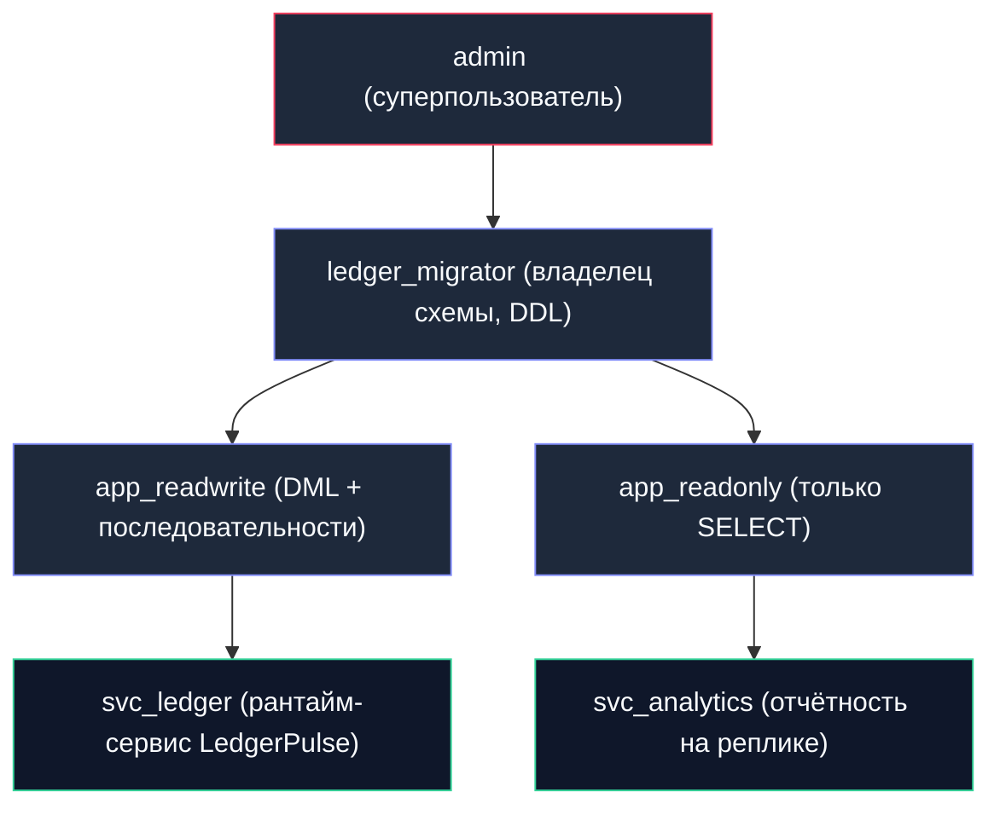

*Как устроена ролевая модель PostgreSQL в `pg_catalog` и планировщике `setrefs.c`, почему `SET ROLE` опасен в общем пуле `*sql.DB`, как работает политика `accounts_tenant_isolation` из `003_idempotency_outbox.sql` и сколько стоит Row-Level Security на уровне CPU и памяти.*

> «Простота требует больше труда в начале проекта — чтобы очистить идею до самой сути — и больше дисциплины на всём сроке его жизни, чтобы отличать хорошие изменения от плохих и вредоносных.»  
> — Алан Донован и Брайан Керниган (со ссылкой на Фреда Брукса), *The Go Programming Language*

В банке никто не выдаёт мастер-ключ от главного сейфа каждому кассиру или водителю инкассации: допуск строго ограничен зоной ответственности. В архитектуре баз данных этот принцип называется **управлением доступом на основе ролей (Role-Based Access Control, RBAC)**.

Когда все Go-микросервисы ходят в общую базу под единым суперпользователем `postgres` или владельцем схемы, любая ошибка становится катастрофой. Одна пропущенная [[22. SQL-инъекции — механика атак и параметризация запросов|SQL-инъекция]] или компрометация контейнера с отчётами открывает атакующему команды `DROP TABLE`, чтение чужих платежей и системные каталоги.

RBAC работает по принципу герметичных переборок (Bulkhead Pattern), сужая радиус поражения (`blast radius`). Сервис переводов имеет DML-права на `accounts` и `ledger_entries`, сервис аналитики читает исключительно реплику под ролью `readonly`, а DDL-операции разрешены только роли `migrator` в CI/CD-пайплайне.

---

## Модель RBAC в PostgreSQL и `pg_catalog`

Ролевая модель PostgreSQL строится на трёх элементах:

1. **Субъект (Login Role):** учётная запись с правом TCP-входа (`CREATE ROLE ... WITH LOGIN`). В современных версиях PostgreSQL пользователи и группы унифицированы.
2. **Роль-группа (Group Role):** именованный контейнер привилегий без флага `LOGIN`, образующий иерархию наследования.
3. **Привилегия (Privilege):** атомарное право над объектом — `SELECT`, `INSERT`, `UPDATE`, `DELETE`, `EXECUTE` (функции), `USAGE` (схемы, расширения и генераторы `SEQUENCE`).

С атрибутом `INHERIT` сервисный аккаунт автоматически наследует права всех ролей-предков:



Эталонная настройка прав для базы `ledgerpulse`:

```sql
CREATE ROLE app_readonly;
CREATE ROLE app_readwrite;
CREATE ROLE ledger_migrator WITH LOGIN PASSWORD 'migrator_secret' INHERIT;

GRANT CONNECT ON DATABASE ledgerpulse TO app_readonly;
GRANT USAGE ON SCHEMA public TO app_readonly;
GRANT SELECT ON ALL TABLES IN SCHEMA public TO app_readonly;

GRANT app_readonly TO app_readwrite;
GRANT INSERT, UPDATE, DELETE ON ALL TABLES IN SCHEMA public TO app_readwrite;
GRANT USAGE, SELECT ON ALL SEQUENCES IN SCHEMA public TO app_readwrite;

-- Автоматические права на БУДУЩИЕ таблицы, созданные ролью ledger_migrator
ALTER DEFAULT PRIVILEGES FOR ROLE ledger_migrator IN SCHEMA public
    GRANT SELECT ON TABLES TO app_readonly;
ALTER DEFAULT PRIVILEGES FOR ROLE ledger_migrator IN SCHEMA public
    GRANT INSERT, UPDATE, DELETE ON TABLES TO app_readwrite;
ALTER DEFAULT PRIVILEGES FOR ROLE ledger_migrator IN SCHEMA public
    GRANT USAGE, SELECT ON SEQUENCES TO app_readwrite;

CREATE ROLE svc_ledger WITH LOGIN PASSWORD 'runtime_secret' INHERIT;
GRANT app_readwrite TO svc_ledger;

CREATE ROLE svc_analytics WITH LOGIN PASSWORD 'analytics_secret' INHERIT;
GRANT app_readonly TO svc_analytics;
```

Для хранимых функций и расширений вроде `pgcrypto` права выдают явно: `GRANT EXECUTE ON FUNCTION ...` и `GRANT USAGE ON SCHEMA extensions TO ...`.

> [!important] `ALTER DEFAULT PRIVILEGES` спасает ночные миграции
> Команда `GRANT SELECT ON ALL TABLES` действует **только на таблицы, существующие на момент её выполнения**. Если ночная миграция под ролью `ledger_migrator` добавит новую таблицу, `svc_ledger` мгновенно упадёт с `permission denied`. Правило `ALTER DEFAULT PRIVILEGES FOR ROLE ledger_migrator` автоматически прописывает нужные права в ACL каждого нового объекта при его создании.

### Что происходит под капотом: `pg_catalog` и `setrefs.c`

Права хранятся в системных таблицах `pg_catalog`: `pg_authid` (роли, хеши `SCRAM-SHA-256`, флаги `rolsuper`, `rolcanlogin`, `rolbypassrls`), `pg_auth_members` (рёбра графа наследования), `pg_class.relacl` (массивы ACL таблиц и представлений), `pg_attribute.attacl` (колонки), `pg_database` и `pg_namespace`. Модуль планировщика `setrefs.c` и исполнитель `ExecCheckPermissions` проверяют ACL-списки до сканирования страниц.

---

## Row-Level Security (RLS): разбор `accounts_tenant_isolation`

RBAC отвечает на вопрос «можно ли читать таблицу `accounts`», но в мультитенантном биллинге разные организации хранятся в одной таблице. Чтобы исключить утечку строк даже при забытом `WHERE` в Go-коде, в PostgreSQL включают **Row-Level Security (RLS)**.

В миграции `project/sql/migrations/003_idempotency_outbox.sql` проекта `LedgerPulse` определена такая политика:

```sql
ALTER TABLE accounts ENABLE ROW LEVEL SECURITY;

CREATE POLICY accounts_tenant_isolation ON accounts
    USING (metadata ->> 'tenant_id' = current_setting('app.tenant_id', true));
```

Разберём четыре ключевые детали этой конструкции:

1. **Узел `Qual` в плане запроса:** при включённом RLS планировщик встраивает условие `USING (...)` как скрытый фильтр `Qual` поверх `Seq Scan` или `Index Scan`. Запрос `SELECT id, balance FROM accounts` вернёт только строки текущего тенанта.
2. **Флаг `missing_ok = true` в `current_setting('app.tenant_id', true)`:** без второго аргумента `true` неинициализированная переменная `app.tenant_id` вызовет ошибку `unrecognized configuration parameter`. С `true` вызов возвращает `NULL`. По правилам трёхзначной логики `metadata ->> 'tenant_id' = NULL` даёт `UNKNOWN`, а RLS трактует `UNKNOWN` как **`false`** — срабатывает защита **fail-closed** (0 строк вместо утечки).
3. **`USING` против `WITH CHECK`:** клауза `USING` фильтрует видимость при `SELECT`, `UPDATE`, `DELETE`, а `WITH CHECK` контролирует, чтобы `INSERT` или `UPDATE` не записали строку с чужим `tenant_id` (для `FOR ALL` без явного `WITH CHECK` переиспользуется условие `USING`).
4. **Обход владельцем таблицы:** создатель таблицы (`ledger_migrator`) и роли с `SUPERUSER`/`BYPASSRLS` по умолчанию игнорируют RLS. Чтобы политика действовала и на владельца, добавляют `ALTER TABLE accounts FORCE ROW LEVEL SECURITY;`.

---

## Интеграция с Go 1.24: пулы соединений и `WithinTenantTx`

Динамическое переключение прав через `SET ROLE` или `SET app.tenant_id` на общем пуле `*sql.DB` / `pgxpool.Pool` — опасный антипаттерн: если соединение вернётся в пул без сброса, следующая горутина унаследует чужую роль или чужого тенанта.

Правила надёжной интеграции с Go ([[2. database_sql под капотом — пул соединений, badconn, Tx-pinning и Prepared Statements]]):

1. **Раздельные пулы `RWPool` и `ROPool`:** каждый пул сразу открывает сокеты под своей целевой ролью (`svc_ledger` к Primary и `svc_analytics` к Read Replica).
2. **Транзакционная привязка тенанта через `set_config`:** третий аргумент `true` (`is_local`) работает как `SET LOCAL`, сбрасывая `app.tenant_id` ровно в момент `COMMIT` или `ROLLBACK`:

```go
func WithinTenantTx(ctx context.Context, db *sql.DB, tenantID string, fn func(tx *sql.Tx) error) error {
	if tenantID == "" {
		return errors.New("tenant_id is required")
	}
	tx, err := db.BeginTx(ctx, &sql.TxOptions{Isolation: sql.LevelReadCommitted})
	if err != nil {
		return fmt.Errorf("begin tx: %w", err)
	}
	defer func() { _ = tx.Rollback() }()

	if _, err := tx.ExecContext(ctx, `SELECT set_config('app.tenant_id', $1, true)`, tenantID); err != nil {
		return fmt.Errorf("set tenant_id: %w", err)
	}
	if err := fn(tx); err != nil {
		return err
	}
	return tx.Commit()
}
```

В отличие от команды `SET LOCAL`, функция `set_config` принимает значение через позиционный параметр `$1`, защищая от SQL-инъекций.

---

## Аппаратная цена прав и подводные камни

* **Локальный кэш ACL и `Shared Invalidation Message`:** процессы PostgreSQL не ходят в таблицы `pg_catalog` на каждом запросе — ACL компилируется в хеш-таблицу в RAM процесса (~100 нс). Но любая команда `GRANT`/`REVOKE` рассылает широковещательный сигнал инвалидации всем бэкендам, сбрасывая их кэши. Менять права допустимо только в миграциях, но не в рантайме.
* **Цена предиката RLS и индексы:** условие `USING` вычисляется для каждой просмотренной строки. Без индекса по селектору PostgreSQL просканирует всю таблицу `accounts` (`Seq Scan`). Для политики из `003_idempotency_outbox.sql` под нагрузкой заводят функциональный индекс `CREATE INDEX idx_accounts_tenant ON accounts ((metadata ->> 'tenant_id'))` (или используют `idx_accounts_metadata_gin` из `002_indexes.sql` с оператором `@>`), отсекая чужие страницы на уровне `Index Scan`.
* **Стоимость `SCRAM-SHA-256`:** проверка пароля при открытии TCP-сокета требует тысяч тактов CPU и нескольких RTT — пул соединений полностью амортизирует эти затраты.
* **Колоночный RBAC и `SELECT *`:** выдача прав на отдельные поля (`GRANT SELECT (id, owner_name, currency) ON accounts TO svc_analytics`) ломает любой код или ORM, делающий `SELECT *` — столбцы в SQL нужно перечислять явно.

> [!warning] Ловушка: эскалация прав в функциях `SECURITY DEFINER`
> Функции с флагом `SECURITY DEFINER` исполняются с привилегиями **владельца функции** (часто суперпользователя). Если злоумышленник подменит `SET search_path = evil_schema, public`, функция без явной привязки схемы обратится к подставной таблице. Всегда фиксируйте путь поиска в определении функции: `ALTER FUNCTION archive_old_keys() SET search_path = pg_catalog, public;`.

> [!tip] Собеседование [Middle]
> **Вопрос:** Как изолировать сервис заказов от сервиса аналитики на уровне прав и архитектуры БД?  
> **Ответ:** Создаём роль `orders_rw` (`SELECT, INSERT, UPDATE` без `DELETE` и DDL) и `analytics_ro` (только `SELECT`, при необходимости колоночный доступ без чувствительных полей). Аналитику направляем через отдельный `ROPool` исключительно на физическую Read Replica с жёстким `statement_timeout`, где запись невозможна на уровне ядра СУБД.

> [!tip] Собеседование [Junior]
> **Вопрос:** Команда `DROP ROLE analyst` падает с ошибкой `cannot be dropped because some objects depend on it`. Как удалить роль корректно?  
> **Ответ:** Нужно передать владение её объектами и отозвать все выданные привилегии:
> ```sql
> REASSIGN OWNED BY analyst TO ledger_migrator;
> DROP OWNED BY analyst;
> DROP ROLE analyst;
> ```

Права БД должны версионироваться в миграциях вместе со схемой (Schema as Code). Инфраструктурный контур безопасности — хранение секретов в Vault/KMS, mTLS между сервисами и аутентификация на API-шлюзе — разбирается в Томе 4 (раздел AppSec), а TLS-защиту подключений к PostgreSQL мы рассмотрели в [[21. Безопасность баз данных — TLS, шифрование, секреты и сетевая изоляция]].

---

## Упражнения

### 1. Базовое: Разбор политики `accounts_tenant_isolation`

Посмотрите на политику из `003_idempotency_outbox.sql`:

```sql
ALTER TABLE accounts ENABLE ROW LEVEL SECURITY;

CREATE POLICY accounts_tenant_isolation ON accounts
    USING (metadata ->> 'tenant_id' = current_setting('app.tenant_id', true));
```

1. Что вернёт `SELECT * FROM accounts` под ролью `svc_ledger` (не владелец таблицы), если в сессии не задан `app.tenant_id`?
2. Почему тот же запрос под ролью `ledger_migrator` (создатель таблицы) всё равно вернёт все строки, и как это исправить?

> [!solution] Показать решение
> 1. Благодаря `missing_ok = true` функция `current_setting` вернёт `NULL` вместо исключения. Сравнение с `NULL` даёт `UNKNOWN`, что в RLS означает `false` — запрос вернёт **0 строк** (безопасный режим fail-closed).
> 2. Владелец таблицы в PostgreSQL по умолчанию обходит RLS. Необходимо выполнить `ALTER TABLE accounts FORCE ROW LEVEL SECURITY;`.

### 2. Практическое: `WithinTenantTx` для `TxManager` на Go 1.24

Реализуйте метод `(m *TxManager) WithinTenantTx(ctx context.Context, tenantID string, fn func(txRepo TxRepository) error) error` поверх `project/final/repo.go`, который отвергает пустой `tenantID`, выставляет `app.tenant_id` через `set_config` строго на время транзакции и гарантирует откат при ошибке.

> [!solution] Показать решение
> ```go
> func (m *TxManager) WithinTenantTx(
> 	ctx context.Context,
> 	tenantID string,
> 	fn func(txRepo TxRepository) error,
> ) error {
> 	if strings.TrimSpace(tenantID) == "" {
> 		return errors.New("tenant_id must not be empty")
> 	}
> 	tx, err := m.db.BeginTx(ctx, &sql.TxOptions{Isolation: sql.LevelReadCommitted})
> 	if err != nil {
> 		return fmt.Errorf("begin tx: %w", err)
> 	}
> 	defer func() { _ = tx.Rollback() }()
> 
> 	if _, err := tx.ExecContext(ctx, `SELECT set_config('app.tenant_id', $1, true)`, tenantID); err != nil {
> 		return fmt.Errorf("bind tenant context: %w", err)
> 	}
> 	if err := fn(&sqlRepo{q: tx}); err != nil {
> 		return err
> 	}
> 	return tx.Commit()
> }
> ```

### 3. Со звёздочкой (\*): Миграция RBAC + колоночный доступ + индекс под RLS

Напишите SQL-миграцию для `LedgerPulse`, которая создаёт роли `ledger_ro` (чтение `accounts` без колонки `metadata`, а также `transactions` и `ledger_entries`) и `ledger_rw` (запись в `accounts`/`idempotency_keys`/`outbox_events`, но только `SELECT, INSERT` в `ledger_entries`), настраивает `ALTER DEFAULT PRIVILEGES` от `ledger_migrator`, включает `FORCE ROW LEVEL SECURITY` с `USING` и `WITH CHECK` и добавляет индекс под предикат `tenant_id`.

> [!solution] Показать решение
> ```sql
> CREATE ROLE ledger_ro;
> CREATE ROLE ledger_rw;
> 
> GRANT USAGE ON SCHEMA public TO ledger_ro, ledger_rw;
> GRANT SELECT (id, external_id, owner_name, currency, balance, status) ON accounts TO ledger_ro;
> GRANT SELECT ON transactions, ledger_entries TO ledger_ro;
> 
> GRANT SELECT, INSERT, UPDATE ON accounts, idempotency_keys, outbox_events TO ledger_rw;
> GRANT SELECT, INSERT ON transactions, ledger_entries TO ledger_rw;
> GRANT USAGE, SELECT ON ALL SEQUENCES IN SCHEMA public TO ledger_rw;
> 
> ALTER DEFAULT PRIVILEGES FOR ROLE ledger_migrator IN SCHEMA public GRANT SELECT ON TABLES TO ledger_ro;
> ALTER DEFAULT PRIVILEGES FOR ROLE ledger_migrator IN SCHEMA public GRANT SELECT, INSERT, UPDATE ON TABLES TO ledger_rw;
> ALTER DEFAULT PRIVILEGES FOR ROLE ledger_migrator IN SCHEMA public GRANT USAGE, SELECT ON SEQUENCES TO ledger_rw;
> 
> CREATE INDEX IF NOT EXISTS idx_accounts_tenant_id ON accounts ((metadata ->> 'tenant_id'));
> 
> ALTER TABLE accounts ENABLE ROW LEVEL SECURITY;
> ALTER TABLE accounts FORCE ROW LEVEL SECURITY;
> 
> DROP POLICY IF EXISTS accounts_tenant_isolation ON accounts;
> CREATE POLICY accounts_tenant_isolation ON accounts
>     FOR ALL TO ledger_rw
>     USING ((metadata ->> 'tenant_id') = current_setting('app.tenant_id', true))
>     WITH CHECK ((metadata ->> 'tenant_id') = current_setting('app.tenant_id', true));
> ```

---

## Главный вывод и мостик дальше

RBAC и Row-Level Security превращают базу данных в эшелонированную систему: минимальные привилегии ролей с `ALTER DEFAULT PRIVILEGES` сдерживают радиус поражения, а RLS с `FORCE ROW LEVEL SECURITY` и `set_config(..., true)` гарантирует изоляцию тенантов в пулах соединений без протечки контекста.

Все строительные блоки Тома 2 собраны. В следующей главе [[24. Практика LedgerPulse (финал) — биллинг, кэш, витрина и замеры]] мы откроем каталог `project/final/`, разберём каждый модуль итогового сервиса `LedgerPulse` и прогоним полный тестовый стенд под `go test -race ./...`.
