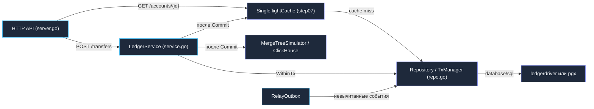

*Сквозной разбор финального сервиса `LedgerPulse` в `project/final/`: драйвер `ledgerdriver`, `TxManager`, двойная запись без дедлоков, идемпотентность, `Outbox`, кэш с `Singleflight`, колоночная витрина и подтверждённый прогон `go test -race ./...`.*

> «Автор теста должен стремиться помочь программисту, которому придётся разбираться в причинах его падения.»  
> — Алан Донован и Брайан Керниган, *The Go Programming Language*

Пока отдельные паттерны — `database/sql`, `Unit of Work`, `Singleflight`, `Outbox`, идемпотентность и предотвращение дедлоков — лежат в разных главах, каждый кажется простым. Настоящая инженерная сложность появляется на их стыке: сбой кэша не должен ломать коммит, встречные переводы обязаны не блокировать друг друга, а повторный HTTP-запрос обязан вернуть исходный чек без второго списания.

В каталоге `project/final/` все эти слои собраны в работающий сервис финансового учёта **`LedgerPulse`** на Go 1.24 с нулём внешних зависимостей. Автономные тесты проходят за секунду в памяти, а рядом в `project/docker-compose.yml` и `project/sql/` лежит готовый стенд на PostgreSQL 17, Valkey 8 и ClickHouse 24.

---

## Инфраструктурный контур и архитектура `project/final/`

Конфигурация `project/docker-compose.yml` поднимает три хранилища с healthcheck-проверками:

* **PostgreSQL 17 (`postgres:17-alpine`)** применяет миграции `001_init_ledger.sql` (`accounts` в целых единицах `BIGINT`, `transactions`, `ledger_entries`), `002_indexes.sql` (покрывающий индекс `INCLUDE` для keyset-пагинации, частичные и GIN-индексы) и `003_idempotency_outbox.sql` (`idempotency_keys`, `outbox_events` с частичным индексом `WHERE published_at IS NULL`, политика RLS `accounts_tenant_isolation`).
* **Valkey 8 (`valkey/valkey:8-alpine`)** с `--appendonly yes` для кэширования горячих счетов.
* **ClickHouse 24 (`clickhouse/clickhouse-server:24-alpine`)** с `001_ledger_events.sql` (`MergeTree` для проводок и `SummingMergeTree` + `Materialized View` `daily_turnover`).



---

## Слой 1: Чистый драйвер `ledgerdriver` (`project/final/ledgerdriver/driver.go`)

Чтобы проверять настоящий пул `*sql.DB`, `Tx-pinning`, возврат `driver.ErrBadConn` и отмену по `context.Context` без запущенного Docker, в `driver.go` реализован чистый Go-драйвер `database/sql/driver`:

1. **Изоляция экземпляров через `connector`:** структура `Instance` хранит состояние виртуальной БД (`dbState` — мапы счетов, транзакций, ключей идемпотентности и слайсы проводок и `outbox`) под `sync.Mutex`. Вызов `inst.OpenDB()` передаёт `&connector{inst: i}` в `sql.OpenDB`, изолируя параллельные тесты. Регистрация `sql.Register("ledgerpulse", Driver{})` также поддержана через DSN.
2. **Транзакционный снимок в `BeginTx`:** при старте транзакции соединение клонирует текущее состояние `c.inst.state.clone()` в `c.tx`. Все запросы внутри транзакции меняют только клон; `Commit()` атомарно подменяет `c.inst.state`, а `Rollback()` сбрасывает `c.tx = nil` (модель `Snapshot Isolation`, [[12. Snapshot Isolation и Serializable Snapshot Isolation (SSI)]]).
3. **Инъекция сбоев и профилирование:** `FailNextWithBadConn()` заставляет следующий `runQuery` или `Ping` вернуть `driver.ErrBadConn`, а `SetSlowQueryHook(fn)` замеряет длительность каждого запроса.

---

## Слой 2: Репозиторий и `TxManager` (`project/final/repo.go`)

В `repo.go` применён паттерн `Repository + Unit of Work` ([[3. Паттерн Repository и транзакции в Go — Unit of Work через context]]):

* **Интерфейс `DBTX`:** единый контракт из `ExecContext`, `QueryContext`, `QueryRowContext`, которому удовлетворяют и `*sql.DB`, и `*sql.Tx`.
* **Разделение `Repository` и `TxRepository`:** чтение и `RelayOutbox` доступны на базовом `Repository`, а методы записи перевода (`GetIdempotency`, `InsertTransaction`, `UpdateAccountBalance`, `InsertEntry`, `InsertOutbox`, `InsertIdempotency`) доступны только через `TxRepository` внутри колбэка `TxManager.WithinTx`.
* **Защита соединения:** `defer func() { _ = tx.Rollback() }()` гарантирует возврат сокета в пул при любой ошибке или панике.
* **Безопасный параметризованный SQL:** все запросы используют `$1`, `$2`, keyset-пагинация идёт по `id < $2 ORDER BY id DESC`, а списание защищено от овердрафта атомарным условием в `UPDATE`:

```sql
UPDATE accounts
SET balance = balance + $1
WHERE id = $2 AND balance + $1 >= 0
RETURNING balance
```

---

## Слой 3: Бизнес-логика `Transfer`, кэш и витрина (`project/final/service.go`)

Метод `(s *LedgerService) Transfer` объединяет двойную запись, борьбу с дедлоками, идемпотентность и `Outbox` в одной транзакции:

```go
err := s.txMgr.WithinTx(ctx, &sql.TxOptions{Isolation: sql.LevelReadCommitted}, func(txRepo TxRepository) error {
	if existing, found, err := txRepo.GetIdempotency(ctx, req.IdempotencyKey); err != nil {
		return err
	} else if found {
		if err := json.Unmarshal([]byte(existing.ResponseBody), &result); err != nil {
			return err
		}
		result.Replayed = true
		return nil
	}
	// Проверка счетов и валют, затем InsertTransaction -> txID
	var fromBal, toBal int64
	if req.FromAccountID < req.ToAccountID {
		if fromBal, err = txRepo.UpdateAccountBalance(ctx, req.FromAccountID, -req.Amount); err != nil {
			return err
		}
		if toBal, err = txRepo.UpdateAccountBalance(ctx, req.ToAccountID, req.Amount); err != nil {
			return err
		}
	} else {
		if toBal, err = txRepo.UpdateAccountBalance(ctx, req.ToAccountID, req.Amount); err != nil {
			return err
		}
		if fromBal, err = txRepo.UpdateAccountBalance(ctx, req.FromAccountID, -req.Amount); err != nil {
			return err
		}
	}
	// InsertEntry (-req.Amount и +req.Amount), InsertOutbox, InsertIdempotency
	return nil
})
```

Три ключевых механизма `service.go`:

1. **Детерминированный порядок блокировок:** при встречных переводах `A -> B` и `B -> A` ветка `if req.FromAccountID < req.ToAccountID` гарантирует единый порядок захвата строк, исключая взаимную блокировку (`Deadlock`, [[6. Взаимоблокировки (Deadlock) — граф ожиданий и предотвращение]]).
2. **Пост-коммитная синхронизация кэша и OLAP:** только после успешного возврата из `WithinTx` (и при `!result.Replayed`) сервис сбрасывает ключи `acc:<id>` в `SingleflightCache` и отправляет пару событий в колоночный `MergeTreeSimulator` (`OLAPTurnover`).
3. **Защита от Cache Stampede:** `GetAccount` обращается к `s.cache.GetOrLoad(ctx, key, 15*time.Second, ...)` из `project/step07/cache_olap.go`, объединяя конкурентные промахи в один запрос к БД и добавляя к TTL случайный джиттер `±15%` ([[8. Кэширование поверх БД — Cache-Aside, Write-Through, Write-Back и Cache Stampede]]).

---

## Слой 4: HTTP API, настройки пула и Graceful Shutdown (`server.go`, `main.go`)

В `project/final/server.go` и `project/final/cmd/ledgerpulse/main.go` собрана обвязка стандартной библиотеки без сторонних фреймворков:

* Маршруты Go 1.22+ (`GET /api/v1/accounts/{id}`, `POST /api/v1/transfers`, `GET /api/v1/accounts/{id}/entries`) с `r.PathValue("id")` и `http.MaxBytesReader(w, r.Body, 1<<20)`.
* Явный маппинг доменных ошибок: `ErrNotFound`/`ErrAccountNotFound` -> `404`, `ErrInsufficientFunds`/`ErrCurrencyMismatch` -> `422`, `ErrDuplicateKey` -> `409`.
* Эндпоинты эксплуатации: `GET /healthz` (`s.db.PingContext`) и `GET /metrics/db` (снимок `s.db.Stats()`: `max_open_connections`, `open_connections`, `in_use`, `idle`, `wait_count`).
* Конфигурация пула в `main.go`: `MaxOpenConns(25)`, `MaxIdleConns(10)`, `ConnMaxLifetime(30*time.Minute)`, `ConnMaxIdleTime(5*time.Minute)`, таймауты `http.Server` (`ReadHeaderTimeout: 5s`, `WriteTimeout: 15s`) и `signal.NotifyContext` с 5-секундным `srv.Shutdown`.

---

## Сквозные тесты и подтверждённый прогон под `-race`

Тест `TestLedgerPulseEndToEndAndConcurrency` в `project/final/ledger_test.go` последовательно проверяет:
1. Создание счетов `10 000` и `5 000` в `RUB` и списание `2 500` через `POST /api/v1/transfers`.
2. Повтор с тем же `IdempotencyKey: "idem-001"`: сервер возвращает `Replayed: true`, балансы остаются `7 500` и `7 500`, в `Outbox` ровно `1` событие.
3. Овердрафт на `999 999` отдаёт HTTP `422`, а `RelayOutbox` видит `0` новых событий — транзакция откатилась целиком.
4. **20 конкурентных горутин** с встречными переводами `A -> B` и `B -> A` завершаются без дедлоков и гонок со строгим инвариантом `finalA.Balance + finalB.Balance == 15_000`.
5. Эндпоинты `/healthz` и `/metrics/db` отдают корректный JSON, инъекция `FailNextWithBadConn()` прозрачно переигрывается `database/sql` внутри `repo.GetAccount` (в отличие от `PingContext`, который не оборачивает `pingDC` в `db.retry`), а `TestSQLArtifactsExistAndValid` проверяет наличие всех SQL-миграций и `docker-compose.yml`.

Реальный вывод прогона без кеша (`-count=1`) под детектором гонок (`-race`):

```text
$ cd project && go test -count=1 -race -v ./final/... && go test -count=1 -race ./...
=== RUN   TestLedgerPulseEndToEndAndConcurrency
--- PASS: TestLedgerPulseEndToEndAndConcurrency (0.00s)
=== RUN   TestSQLArtifactsExistAndValid
--- PASS: TestSQLArtifactsExistAndValid (0.00s)
PASS
ok  	github.com/UnrealTemplier/go-textbook-v2-vol2/project/final	1.014s
?   	github.com/UnrealTemplier/go-textbook-v2-vol2/project/final/cmd/ledgerpulse	[no test files]
?   	github.com/UnrealTemplier/go-textbook-v2-vol2/project/final/ledgerdriver	[no test files]
ok  	github.com/UnrealTemplier/go-textbook-v2-vol2/project/step01	1.008s
ok  	github.com/UnrealTemplier/go-textbook-v2-vol2/project/step02	1.009s
ok  	github.com/UnrealTemplier/go-textbook-v2-vol2/project/step03	1.008s
ok  	github.com/UnrealTemplier/go-textbook-v2-vol2/project/step04	1.008s
ok  	github.com/UnrealTemplier/go-textbook-v2-vol2/project/step05	1.010s
ok  	github.com/UnrealTemplier/go-textbook-v2-vol2/project/step06	1.013s
ok  	github.com/UnrealTemplier/go-textbook-v2-vol2/project/step07	1.023s
```

---

## От учебного каркаса к продакшену

> [!warning] Четыре доработки для боевого HighLoad-прод контура
> 1. **Сверка `request_hash` и перехват `23505`:** в учебном `Transfer` при `found == true` не проверяется совпадение `RequestHash` с новыми параметрами, а при одновременном двойном клике до коммита стоит перехватывать `SQLSTATE 23505` и дочитывать уже зафиксированный ответ ([[13. Идемпотентность операций на уровне базы данных]]).
> 2. **`FOR UPDATE SKIP LOCKED` в `RelayOutbox`:** при запуске нескольких экземпляров воркера выборка неопубликованных событий без `SKIP LOCKED` вызовет дублирование доставки.
> 3. **Батчинг в ClickHouse через брокер:** вместо синхронного `s.olap.InsertBatch` на каждый запрос события должны идти через `RelayOutbox` и Kafka батчами по 1 000–10 000 строк.
> 4. **Интеграция с настоящим PostgreSQL (`pgx`):** `ledgerdriver` не моделирует реальные блокировки строк MVCC и планировщик `EXPLAIN` — перед релизом набор тестов прогоняют против `postgres:17-alpine` из `docker-compose.yml`.

> [!tip] Собеседование [Senior/Staff]
> **Вопрос:** Что произойдёт в `LedgerPulse`, если процесс Go упадёт по OOM сразу после `tx.Commit()` в PostgreSQL, но до вызова `s.cache.Invalidate()`?  
> **Ответ:** Источник истины (PostgreSQL) останется полностью консистентным, но в кэше Valkey до истечения `TTL` (15 с) сохранится старый баланс. Поэтому (1) критические списания в `Transfer` всегда читают баланс из Primary внутри транзакции, а не из кэша, и (2) в строгих системах инвалидацию кэша дополнительно дублируют через Outbox/CDC-воркер, который гарантированно переиграет событие после перезапуска.

---

## Упражнения

### 1. Базовое: Почему `Invalidate` и `InsertBatch` стоят после `WithinTx`

В `project/final/service.go` вызовы `s.cache.Invalidate(...)` и `s.olap.InsertBatch(...)` расположены **после** завершения `s.txMgr.WithinTx(...)`. Что сломается, если перенести их внутрь замыкания `WithinTx`, а затем транзакция откатится на `InsertIdempotency`? И почему их нельзя выполнять при `result.Replayed == true`?

> [!solution] Показать решение
> 1. Кэш и OLAP-витрина **не участвуют в ACID-транзакции PostgreSQL** — `tx.Rollback()` их не откатит. Запись в `olap.InsertBatch` до коммита оставит в аналитике фантомные обороты, которых нет в `ledger_entries`. Инвалидация кэша до коммита приведёт к тому, что параллельное чтение попадёт на промах, прочитает ещё *старый* баланс до коммита и закэширует его заново на 15 секунд.
> 2. При `result.Replayed == true` повторно вернули чек уже выполненного ранее перевода — сбрасывать кэш или повторно начислять обороты в витрину нельзя.

### 2. Практическое: Проверка `RequestHash` в `LedgerService.Transfer`

Доработайте логику `GetIdempotency` в `repo.go` и `Transfer` в `service.go` так, чтобы при совпадении `IdempotencyKey`, но изменении суммы или счёта получателя возвращалась ошибка `ErrIdempotencyMismatch`, а `server.go` отдавал HTTP `422`.

> [!solution] Показать решение
> Выносим вычисление хеша в `transferRequestHash(req)` и выбираем `request_hash` в `GetIdempotency` (добавив поле `RequestHash string` в `IdempotencyRecord`). В `WithinTx`:
> ```go
> reqHash := transferRequestHash(req)
> if existing, found, err := txRepo.GetIdempotency(ctx, req.IdempotencyKey); err != nil {
> 	return err
> } else if found {
> 	if existing.RequestHash != reqHash {
> 		return ErrIdempotencyMismatch
> 	}
> 	if err := json.Unmarshal([]byte(existing.ResponseBody), &result); err != nil {
> 		return err
> 	}
> 	result.Replayed = true
> 	return nil
> }
> ```
> В `writeDomainError` (`server.go`) добавляем `errors.Is(err, ErrIdempotencyMismatch)` в ветку `http.StatusUnprocessableEntity`.

### 3. Со звёздочкой (\*): Конкурентный бенчмарк `LedgerPulse` и диагностика пула

Напишите бенчмарк `BenchmarkLedgerPulseTransfer(b *testing.B)` с `b.RunParallel` поверх `ledgerdriver.NewInstance()`, который выполняет конкурентные переводы между двумя счетами и выводит `db.Stats().WaitCount` через `b.ReportMetric`. Объясните разницу показателей при `SetMaxOpenConns(1)` и `SetMaxOpenConns(16)` с флагом `-benchmem`.

> [!solution] Показать решение
> ```go
> func BenchmarkLedgerPulseTransfer(b *testing.B) {
> 	db := ledgerdriver.NewInstance().OpenDB()
> 	defer db.Close()
> 	db.SetMaxOpenConns(16)
> 	db.SetMaxIdleConns(16)
> 
> 	svc := NewLedgerService(db)
> 	ctx := context.Background()
> 	accA, _ := svc.CreateAccount(ctx, "bench-a", "A", "RUB", 1_000_000_000)
> 	accB, _ := svc.CreateAccount(ctx, "bench-b", "B", "RUB", 1_000_000_000)
> 
> 	var seq atomic.Int64
> 	b.ReportAllocs()
> 	b.ResetTimer()
> 	b.RunParallel(func(pb *testing.PB) {
> 		for pb.Next() {
> 			n := seq.Add(1)
> 			from, to := accA.ID, accB.ID
> 			if n%2 == 0 {
> 				from, to = accB.ID, accA.ID
> 			}
> 			if _, err := svc.Transfer(ctx, TransferRequest{
> 				IdempotencyKey: fmt.Sprintf("b-%d", n),
> 				FromAccountID:  from, ToAccountID: to, Amount: 1, Currency: "RUB",
> 			}); err != nil {
> 				b.Error(err)
> 				return
> 			}
> 		}
> 	})
> 	b.StopTimer()
> 	b.ReportMetric(float64(db.Stats().WaitCount), "pool_waits")
> }
> ```
> При `SetMaxOpenConns(1)` пул сериализует все переводы, а `pool_waits` становится сопоставимым с `b.N` из-за Tx-pinning на единственном соединении. При `SetMaxOpenConns(16)` ожидания пула падают к нулю, а `-benchmem` показывает стоимость аллокаций на `json.Marshal`, `sha256` и `dbState.clone()`.

---

## Главный вывод и мостик дальше

`LedgerPulse` в `project/final/` показывает на рабочем коде, как чистые интерфейсы Go (`DBTX`, `Repository`, `TxManager`), параметризованный SQL с проверкой баланса, детерминированный порядок блокировок, идемпотентность и `Outbox` складываются в единый надёжный сервис.

В заключительной главе Тома 2 [[25. Итоги Тома 2 — полная карта баз данных и мостик к Тому 3]] мы соберём все 10 модулей в полную карту баз данных, матрицу выбора хранилищ, чеклист продакшен-готовности и перекинем мостик к Тому 3.
