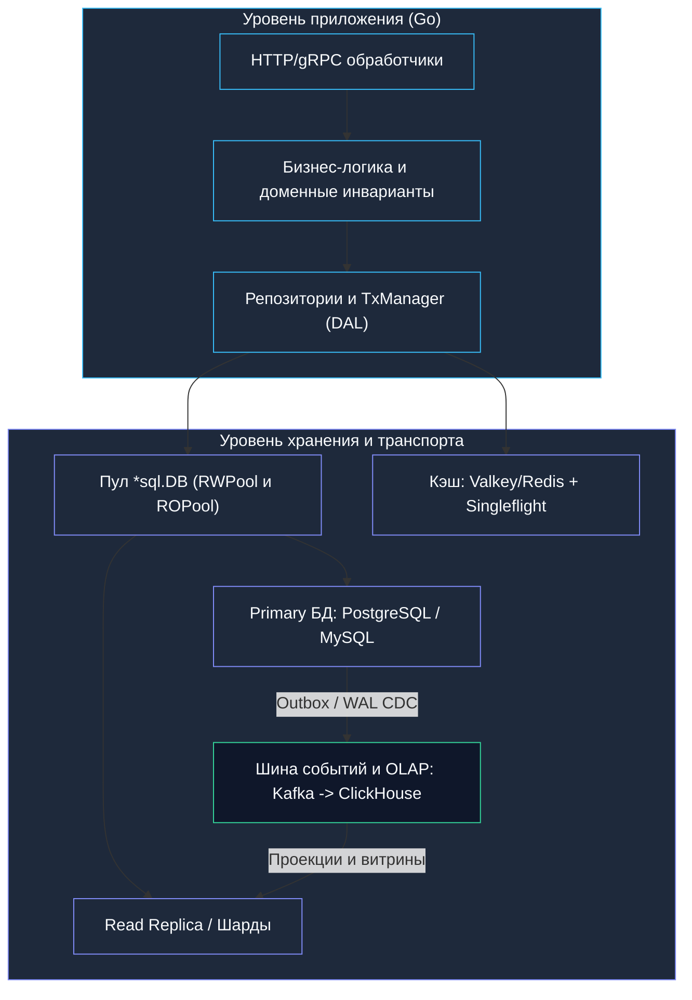
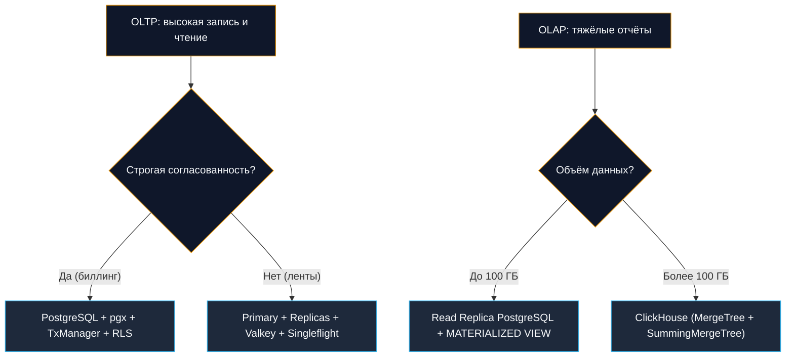

*Синтез десяти модулей Тома 2: архитектурная матрица работы с данными в Go, сводная матрица выбора БД, механика `netpoll` и GC на горячем пути, дерево решений для OLTP/OLAP/микросервисов, чеклист продакшен-готовности и переход к Тому 3.*

> «Можно уверенно предсказать, что новые языки, делающие программирование проще и безопаснее, будут появляться и дальше. Но столь же уверенно можно сказать, что единого языка не будет никогда: в разработке слишком много компромиссов, чтобы один-единственный язык одинаково хорошо подходил для всех задач.»  
> — Брайан Керниган, *UNIX: A History and a Memoir*

Устойчивость свода собора зависит не от прочности одного камня, а от того, как арки и контрфорсы распределяют давление. В архитектуре баз данных работает тот же принцип. Вы уже знаете, как устроены 8-килобайтные страницы `B-Tree` ([[2. B-Tree индекс под капотом — страницы, ветвление и page split]]), как `WAL` гарантирует долговечность ([[8. WAL — журнал упреждающей записи и долговечность на диске]]), зачем `database/sql` держит пул соединений и как устроен `LedgerPulse`. Инженерная зрелость уровня Senior и Staff начинается там, где эти детали складываются в единую систему под нагрузкой.

---

## Архитектурная матрица: восемь слоёв данных в Go-сервисе



1. **HTTP/gRPC-граница:** проверяет входные форматы, ставит лимиты на тело запроса и создаёт сквозной `context.Context` с таймаутом и трассировкой ([[20. Наблюдаемость БД — корреляция запросов, трейсов и планов]]).
2. **Бизнес-логика:** удерживает доменные инварианты и задаёт транзакционные границы через `TxManager.WithinTx`.
3. **DAL (`Repository`):** прячет SQL-диалект за consumer-driven интерфейсами и обеспечивает 100% параметризацию.
4. **Пулы `*sql.DB`:** управляют TCP-сокетами (`SetMaxOpenConns`, `SetMaxIdleConns`, `SetConnMaxLifetime`), разделяя контуры чтения и записи.
5. **Кэш (`Valkey`/`Redis` + `Singleflight`):** разгружает диски Primary БД через `Cache-Aside`, TTL с джиттером и защиту от лавины промахов.
6. **Primary БД:** единый источник истины с жёсткими ACID-гарантиями.
7. **Read Replicas / Шарды:** горизонтально масштабируют чтение и запись по ключам в модели `eventual consistency`.
8. **Асинхронная шина и OLAP:** доставляют события из `Outbox` для обновления аналитических витрин ClickHouse и проекций CQRS.

> [!tip] Собеседование [Middle]
> **Вопрос:** Почему в нагруженном Go-сервисе нельзя использовать один пул `*sql.DB` для транзакционной записи на Primary и аналитических выборок?  
> **Ответ:** Во-первых, у контуров разные таймауты и оптимальные размеры пула (короткий пул на запись против широкого на чтение). Во-вторых, при общем пуле всплеск тяжёлых `SELECT` забьёт все `MaxOpenConns`, `WaitCount` вырастет, и критические платежи встанут по таймауту при свободном мастере. В-третьих, раздельные пулы (`RWPool`/`ROPool`) изолируют права доступа через RBAC.

---

## Матрица выбора базы данных (Модули 6–9)

Ни одно хранилище не выигрывает все нагрузки сразу: выбор определяется моделью хранения, стоимостью I/O и компромиссами `CAP`/`PACELC` ([[7. CAP и PACELC в выборе баз данных]]).

| Класс и движок | Физика хранения | Сильные стороны | Компромиссы | Типовые задачи |
|---|---|---|---|---|
| **PostgreSQL** (OLTP) | Страницы 8 КБ (`Heap` + `B-Tree`/`GIN`/`GiST`), `MVCC` | Строгий ACID, богатый SQL, `JSONB`, RLS, `SKIP LOCKED` | Предел записи одного узла; нагрузка от `VACUUM` | Биллинг `LedgerPulse`, заказы, `Outbox` |
| **MySQL / InnoDB** (OLTP) | Кластерный `B+Tree` по `PK`, `Buffer Pool`, `Undo`/`Redo` | Быстрый поиск по `PK`, простая репликация `GTID`, `Vitess` | `Gap Locks` на `Repeatable Read`, беднее типы индексов | Веб-бэкенды с чтением по `PK`, шардированный MySQL |
| **Valkey / Redis** (In-Memory) | Однопоточный event loop в RAM + `RDB`/`AOF` | Задержки ~100 мкс, атомарные структуры, TTL | Ограничен объёмом RAM; не заменяет ACID-реестр | `Cache-Aside`, rate limiting, сессии, блокировки |
| **ClickHouse** (OLAP) | Колонки `MergeTree`, сортировка `ORDER BY`, сжатие | Агрегации по миллиардам строк, 10x сжатие | Не любит точечных `UPDATE` и вставок по 1 строке | Витрины `daily_turnover`, продуктовая аналитика |
| **Cassandra** (Wide-Column) | `LSM-Tree` (`Memtable` + `SSTable`), Masterless | Линейное масштабирование записи без единой точки отказа | Нет `JOIN` и произвольных `WHERE` | Телеметрия IoT, потоки событий |
| **MongoDB** (Документная) | `WiredTiger` (`B-Tree`), BSON, Replica Set | Полиморфная схема, встроенное шардирование | Слабее в сложных связях, оверхед на имена полей | Контент, каталоги с разными атрибутами |
| **CockroachDB** (NewSQL) | Распределённый `Pebble` (`LSM`) + `Raft` | Горизонтальный SQL со строгой согласованностью (CP) | Сетевая задержка кворума `Raft` на каждый коммит | Геораспределённые реестры |
| **Векторные БД / `pgvector`** | Графы `HNSW`, списки `IVF` | Быстрый поиск ближайших соседей (ANN) | Большой расход RAM под `HNSW`, компромисс `recall` | Семантический поиск, RAG-пайплайны |

---

## Семь законов работы с данными в Go

| Принцип | Реализация в Go | Механика «под капотом» | Когда отступать |
|---|---|---|---|
| **Явность превыше магии** | `database/sql` / `pgx` / `sqlc` | Контроль над SQL, планами и аллокациями | Простые админки и прототипы |
| **Контекст для всего** | `QueryContext`, `BeginTx` | Интеграция с `netpoll`, отмена горутин | Фоновые задачи со своим `Shutdown` |
| **Пул — это ресурс** | `SetMaxOpenConns`, `db.Stats()` | Мьютексы и очереди ожидания сокетов | Разовые CLI-скрипты миграций |
| **Транзакции — короткие** | `TxManager.WithinTx` | Удержание сокета (`Tx-pinning`) и блокировки строк | Пакетный импорт вне онлайн-трафика |
| **Идемпотентность — закон** | `idempotency_keys`, `ON CONFLICT` | Уникальный `B-Tree` сериализует вставки | Сырая телеметрия с очисткой позже |
| **Кэш — оптимизация** | `SingleflightCache`, `TTL + jitter` | Сетевые RTT против дисковых IOPS | Балансы внутри транзакций списания |
| **Безопасность по умолчанию** | Параметры `$1`, RBAC/RLS, TLS | Разделение `Parse` и `Bind` в протоколе | Локальные стенды без сети |

> [!warning] Ловушка: забытые `rows.Close()` и `tx.Rollback()`
> Незакрытый `*sql.Rows` навсегда оставляет TCP-сокет в статусе `inUse`. Сотня таких ошибок парализует пул `MaxOpenConns = 100`. Ставьте `defer rows.Close()` и `defer tx.Rollback()` немедленно после проверки ошибки (как в `project/final/repo.go`).

---

## Рантайм Go и дерево решений (Decision Framework)

* **`netpoll` вместо блокировки потоков ОС:** когда горутина ждёт ответа PostgreSQL (~100 мкс–10 мс), дескриптор сокета регистрируется в `epoll`/`kqueue`, а горутина паркуется (`runtime.gopark` в `_Gwaiting`), освобождая поток ОС `M`.
* **Thundering Herd и GC:** если 20 000 горутин встали в очередь к пулу из 50 соединений, освобождение сокетов вызывает контеншн на мьютексах; лечится таймаутами `context.WithTimeout` и `Singleflight`. Передача `&[]byte` или `any` в `rows.Scan` выносит буферы в кучу (`heap`), создавая нагрузку на сборщик мусора при 10 000 RPS (~20 МБ/с мусора при ответах по 2 КБ) — переиспользуйте буферы через `sync.Pool` и проверяйте профиль через `go tool pprof -alloc_space`.



---

## Чеклист продакшен-готовности

* **Подключения:** пул создаётся один раз на старте; заданы `MaxOpenConns`, `MaxIdleConns`, `ConnMaxLifetime`; везде есть `context.WithTimeout` и `statement_timeout`; при тысячах клиентов включён `PgBouncer`.
* **Запросы и транзакции:** 100% параметров через `$1`, `$2`; динамическая сортировка через allowlist; внутри транзакций нет сетевых вызовов во внешние API; стоят `defer rows.Close()` и `defer tx.Rollback()`.
* **Надёжность и безопасность:** настроены `idempotency_key` и `Outbox`; ретраи с backoff и джиттером; `sslmode=verify-full`, роли DML без DDL и RLS с `FORCE ROW LEVEL SECURITY`.
* **Наблюдаемость и DR:** экспортируются `db.Stats()`, включён `pg_stat_statements` ([[18. Мониторинг баз данных — ключевые метрики PostgreSQL, соединений и I_O]]), настроены физические бэкапы с архивом WAL (PITR) и регулярные учения по восстановлению ([[16. Резервное копирование и восстановление — физические бэкапы и PITR]], [[17. Аварийное восстановление (Disaster Recovery) — RPO, RTO и учения]]).

> [!tip] Собеседование [Senior/Staff]
> **Вопрос:** В продакшене внезапно посыпались ошибки `connection pool exhausted`, хотя входящий RPS не изменился. Ваш план локализации?  
> **Ответ:** (1) Проверяем `db.Stats()`: рост `WaitCount`/`WaitDuration` при `InUse == MaxOpenConns` подтверждает исчерпание пула. (2) Запрашиваем `pg_stat_activity`: `idle in transaction` указывает на утечку транзакции или внешний HTTP-вызов внутри `BeginTx`, а `active` с `wait_event_type = 'Lock'` — на цепочку блокировок. (3) По `trace_id` и `/debug/pprof/goroutine` находим эндпоинт. (4) Локализуем аварию через `idle_in_transaction_session_timeout`, `pg_terminate_backend` и вынос внешних вызовов из транзакций.

---

## Упражнения

### 1. Базовое: Выбор хранилища по матрице

Выберите оптимальное хранилище (или связку) для трёх сценариев:
1. Зарплатный процессинг с точностью до копейки и годовыми отчётами по отделам (200 RPS).
2. Глобальный `Rate Limiter` на API-шлюзе с минутным окном (50 000 RPS).
3. Сырой кликстрим объёмом 80 ТБ с воронками конверсии за секунду.

> [!solution] Показать решение
> 1. **PostgreSQL:** небольшой OLTP-поток обслужит один Primary плюс реплика для отчётов, а ACID и `CHECK`/`FK` гарантируют точность.
> 2. **Valkey / Redis:** 50 000 RPS на счётчиках с TTL идеально ложатся на однопоточную память с атомарными `INCR`/Lua и задержкой ~100 мкс.
> 3. **ClickHouse:** для 80 ТБ аналитики критичны колоночное хранение `MergeTree`, сжатие `LZ4`/`ZSTD` и векторизованное сканирование ([[12. ClickHouse под капотом — колоночное хранение, MergeTree и векторизация]]).

### 2. Практическое: Аудит и исправление Go-обработчика

Найдите ошибки и перепишите функцию для Go 1.24:

```go
func ProcessOrderReport(w http.ResponseWriter, r *http.Request, db *sql.DB) {
	tx, _ := db.Begin()
	rows, err := tx.Query("SELECT id, amount FROM ledger_entries WHERE account_id = " + r.URL.Query().Get("acc"))
	if err != nil {
		http.Error(w, err.Error(), 500)
		return
	}
	_, _ = http.Get("https://billing-partner.example/notify")
	var total int64
	for rows.Next() {
		var id, amt int64
		_ = rows.Scan(&id, &amt)
		total += amt
	}
	_ = tx.Commit()
	_, _ = fmt.Fprintf(w, "%d", total)
}
```

> [!solution] Показать решение
> Ошибки: SQL-инъекция через конкатенацию; игнорирование ошибки `Begin` и отсутствие `context.WithTimeout`; утечка соединения без `defer tx.Rollback()` и `defer rows.Close()`, нет проверки `rows.Err()`; внешний HTTP-вызов внутри транзакции; лишняя транзакция на чтении.
>
> ```go
> func ProcessOrderReport(w http.ResponseWriter, r *http.Request, roPool *sql.DB) {
> 	accID, err := strconv.ParseInt(r.URL.Query().Get("acc"), 10, 64)
> 	if err != nil || accID <= 0 {
> 		http.Error(w, "invalid account id", http.StatusBadRequest)
> 		return
> 	}
> 	ctx, cancel := context.WithTimeout(r.Context(), 3*time.Second)
> 	defer cancel()
> 
> 	rows, err := roPool.QueryContext(ctx, `SELECT id, amount FROM ledger_entries WHERE account_id = $1`, accID)
> 	if err != nil {
> 		http.Error(w, "query failed", http.StatusInternalServerError)
> 		return
> 	}
> 	defer rows.Close()
> 
> 	var total int64
> 	for rows.Next() {
> 		var id, amt int64
> 		if err := rows.Scan(&id, &amt); err != nil {
> 			http.Error(w, "scan failed", http.StatusInternalServerError)
> 			return
> 		}
> 		total += amt
> 	}
> 	if err := rows.Err(); err != nil {
> 		http.Error(w, "rows failed", http.StatusInternalServerError)
> 		return
> 	}
> 	_, _ = fmt.Fprintf(w, "%d", total)
> }
> ```

### 3. Со звёздочкой (\*): Схема данных высоконагруженного маркетплейса

Спроектируйте архитектуру хранения для маркетплейса, где есть: (1) каталог товаров с разными атрибутами (15 000 RPS на чтение), (2) резерв остатков и заказы без overselling, (3) аналитика продавцов за 2 года. Укажите движки, паттерны Тома 2 и границу согласованности.

> [!solution] Показать решение
> 1. **Заказы и остатки (строгая согласованность):** PostgreSQL с таблицами `orders`, `inventory` (`CHECK (available >= 0)`), `idempotency_keys` и `outbox_events`. Списание остатка и создание заказа идут в одной короткой ACID-транзакции (`UPDATE inventory SET available = available - $1 WHERE sku_id = $2 AND available >= $1`).
> 2. **Каталог (15 000 RPS, eventual consistency):** хранение полиморфных атрибутов в `JSONB` с GIN-индексом (или MongoDB) поверх горячего кэша Valkey с `Cache-Aside`, `Singleflight` и джиттером TTL; инвалидация кэша идёт по событиям из `outbox_events` / CDC.
> 3. **Аналитика продавцов (OLAP за 2 года):** ClickHouse (`MergeTree` для событий и `SummingMergeTree` + `Materialized View` для дневной выручки), куда события доставляются батчами из `outbox_events` через брокер сообщений без нагрузки на Primary PostgreSQL.

---

## Мостик к Тому 3: Промышленный бэкенд, API, Архитектура и Брокеры

Мы прошли весь путь Тома 2 — от нормальных форм и страниц `B-Tree` до `WAL`, `MVCC`, `database/sql`, `Outbox`, мониторинга, защиты от SQL-инъекций и финала `LedgerPulse` ([[24. Практика LedgerPulse (финал) — биллинг, кэш, витрина и замеры]]). Теперь база данных для вас — не чёрный ящик за ORM, а прозрачная инженерная система со своими физическими ограничениями и гарантиями.

Но хранилище — это лишь фундамент. В следующем **Томе 3 «Промышленный бэкенд, API, Архитектура и Брокеры»** мы построим над этим фундаментом распределённые сервисы на Go: разберём проектирование REST и gRPC API, слоистую и гексагональную архитектуру, работу с брокерами сообщений (Kafka, RabbitMQ, NATS), оркестрацию саг (Saga) и паттерн CQRS на уровне сервисов и очередей.
