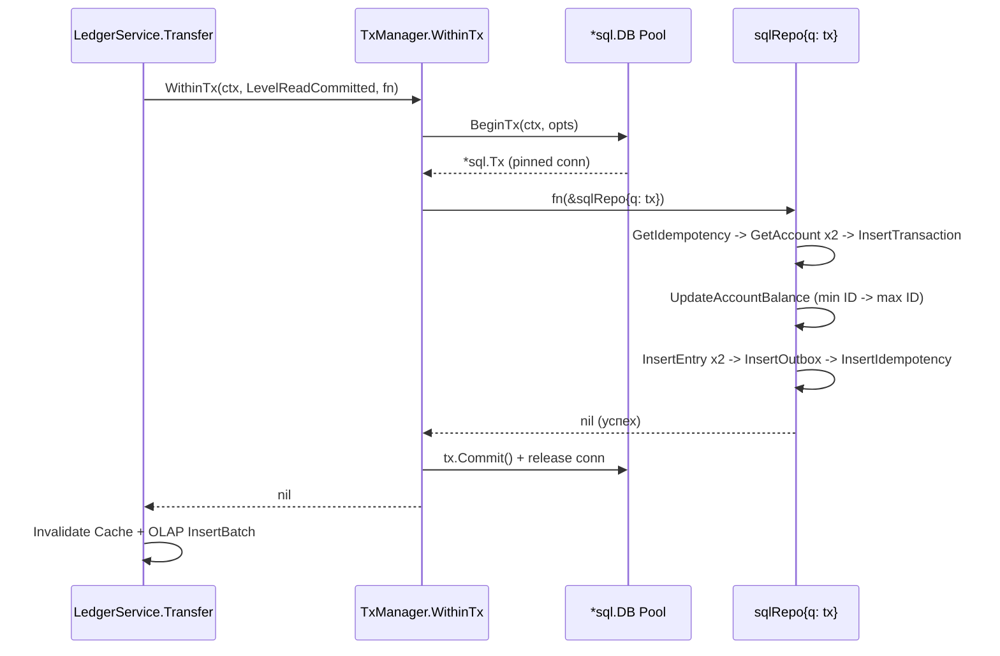

*Как отделить бизнес-логику от SQL без «архитектурного астронавтизма», объединить `*sql.DB` и `*sql.Tx` через `DBTX`, устроить `TxManager.WithinTx` как в `LedgerPulse` и когда стоит прокидывать транзакцию через `context.Context`.*

> «Новым типам проще удовлетворять маленьким интерфейсам. Хорошее практическое правило проектирования интерфейсов: требуйте только то, что вам действительно нужно.»  
> — Алан Донован и Брайан Керниган, *The Go Programming Language*

В проектировании систем хранения легко впасть в крайность, которую Джоэл Спольски назвал «архитектурным астронавтизмом»: под каждую таблицу заводят слой фабрик, адаптеров и интерфейсов, механически дублирующих пять CRUD-методов ORM. Но обратная крайность не лучше: если писать `db.BeginTx`, `defer tx.Rollback()`, SQL и `rows.Scan` прямо в HTTP-хендлерах, доменная логика срастается со схемой таблиц и не поддаётся модульному тестированию.

Та же дилемма возникает с транзакциями. В Java/Spring или Rails транзакционность часто прячут за аннотациями вроде `@Transactional`: среда создаёт динамический AOP-прокси, привязывает соединение к `ThreadLocal` и откатывает работу при исключении. Стоит вызвать приватный метод того же класса в обход прокси — и транзакция незаметно исчезает. Go отвергает скрытую магию: здесь транзакция — явный объект `*sql.Tx` с предсказуемым жизненным циклом.

---

## Зачем нужен `Repository` в Go и как работают интерфейсы

`Repository` в Go — это **архитектурный шов**, который изолирует бизнес-логику (правила двойной записи в `LedgerPulse`, проверку валют, идемпотентность) от диалекта SQL, драйвера и маппинга строк.

Различайте три модели:
* **Active Record** (`account.Save()`): структура домена хранит логику БД — в Go это смешение данных и I/O.
* **DAO (Data Access Object)**: обёртка над конкретной таблицей, часто отдающая сырые строки или мапы.
* **Repository**: создаёт иллюзию коллекции доменных сущностей (`Account`, `LedgerEntry`, `OutboxEvent`), пряча джойны и SQL-ошибки.

Главное правило Go: **интерфейсы определяет потребитель** (сервис), а не пакет хранения. Если приложение работает с 1–2 таблицами без сложной логики, отдельный `Repository` избыточен — прямой `db.QueryContext` проще. Когда же появляются транзакции, кэш и тесты, узкий контракт окупается сразу.

### Механика интерфейсов под капотом

При присваивании `*sqlRepo` интерфейсу `Repository` Go формирует двухсловный `iface`: указатель `itab` (тип + `vtable` методов) и указатель `data` на сам `*sqlRepo`. Косвенный вызов через `vtable` стоит 1–2 такта CPU — ничто на фоне микросекунд и миллисекунд сетевого I/O. Если конкретный тип известен в пределах пакета, компилятор часто встраивает вызов (*inlining*), а компактная структура репозитория (одно поле `q DBTX`) улучшает локальность данных в кэше L1.

> [!warning] Четыре антипаттерна слоя данных
> 1. **Универсальный `GenericRepository[T any]`:** убивает специфику SQL (keyset-пагинацию, `FOR UPDATE`, частичные обновления).
> 2. **Утечка типов `database/sql` наружу:** не возвращайте `*sql.Rows`, `*sql.Tx`, `driver.Value` и `sql.ErrNoRows` в сервис — преобразуйте в доменные DTO и `ErrNotFound`.
> 3. **Скрытая транзакция внутри репозитория:** метод, сам вызывающий `r.db.BeginTx`, нельзя объединить с записью в `outbox_events` в одной атомарной операции.
> 4. **Внешний I/O внутри транзакции:** вызов HTTP/gRPC при открытом `*sql.Tx` удерживает сокет и вызывает голодание пула (см. [[2. database_sql под капотом — пул соединений, badconn, Tx-pinning и Prepared Statements]]).

---

## Общий контракт `DBTX`, `Repository` и `TxManager` в `LedgerPulse`

Чтобы один и тот же SQL-код работал и поверх пула `*sql.DB`, и внутри `*sql.Tx`, оба типа объединяют минимальным интерфейсом `DBTX` (реализация из `project/final/repo.go`):

```go
// DBTX задаёт общий контракт для *sql.DB и *sql.Tx.
type DBTX interface {
	ExecContext(ctx context.Context, query string, args ...any) (sql.Result, error)
	QueryContext(ctx context.Context, query string, args ...any) (*sql.Rows, error)
	QueryRowContext(ctx context.Context, query string, args ...any) *sql.Row
}

type Repository interface {
	CreateAccount(ctx context.Context, externalID, ownerName, currency string, balance int64) (Account, error)
	GetAccount(ctx context.Context, id int64) (Account, error)
	ListEntriesKeyset(ctx context.Context, accountID, cursorID int64, limit int) ([]LedgerEntry, error)
	ListUnpublishedOutbox(ctx context.Context, limit int) ([]OutboxEvent, error)
	MarkOutboxPublished(ctx context.Context, id int64, publishedAt time.Time) error
}

// TxRepository расширяет Repository методами, доступными только внутри Unit of Work.
type TxRepository interface {
	Repository
	GetIdempotency(ctx context.Context, key string) (IdempotencyRecord, bool, error)
	InsertTransaction(ctx context.Context, refID, kind, status, desc string) (int64, error)
	UpdateAccountBalance(ctx context.Context, accountID, delta int64) (int64, error)
	InsertEntry(ctx context.Context, txID, accountID, amount int64, currency string) (int64, error)
	InsertOutbox(ctx context.Context, aggType, aggID, evType, payload string) (int64, error)
	InsertIdempotency(ctx context.Context, key, reqHash string, txID int64, code int, body string) error
}
```

Разделение `Repository` и `TxRepository` даёт защиту на этапе компиляции: `NewSQLRepository(db)` возвращает `Repository`, где сервис физически не может списать баланс мимо транзакции. А `TxManager.WithinTx` оборачивает `*sql.Tx` в `&sqlRepo{q: tx}` и передаёт его внутрь замыкания как `TxRepository`:

```go
// Фрагмент из project/final/repo.go
func (m *TxManager) WithinTx(ctx context.Context, opts *sql.TxOptions, fn func(txRepo TxRepository) error) error {
	tx, err := m.db.BeginTx(ctx, opts)
	if err != nil {
		return fmt.Errorf("begin tx: %w", err)
	}
	defer func() {
		_ = tx.Rollback()
	}()

	if err := fn(&sqlRepo{q: tx}); err != nil {
		return err
	}
	if err := tx.Commit(); err != nil {
		return fmt.Errorf("commit tx: %w", err)
	}
	return nil
}
```

> [!tip] Собеседование [Middle]
> **Вопрос:** Безопасно ли ставить `defer tx.Rollback()` до `tx.Commit()`? Не откатит ли он зафиксированную транзакцию и сработает ли при панике?  
> **Ответ:** Безопасно: это каноническая идиома Go. Методы `Commit()` и `Rollback()` атомарно выставляют внутренний флаг `tx.done`. После успешного `Commit()` вызов `Rollback()` в `defer` не отправляет ничего в сеть и сразу возвращает `sql.ErrTxDone`. При ошибке `fn` или при панике `defer` гарантирует откат и возврат сокета в пул.

В `project/final/service.go` метод `LedgerService.Transfer` выполняет внутри `WithinTx` проверку идемпотентности, обновление балансов в порядке возрастания `ID` против дедлоков (см. [[6. Взаимоблокировки (Deadlock) — граф ожиданий и предотвращение]]), запись проводок и `outbox_events`, а кэш и OLAP обновляет строго после коммита:



---

## Альтернатива: Unit of Work через `context.Context`

Подход с `TxRepository` удобен, пока транзакция нужна одному репозиторию. Но если сценарий координирует пять независимых пакетов (`AccountRepo`, `LedgerRepo`, `FeeRepo`, `OutboxRepo`, `AuditRepo`), прокидывать `exec DBTX` в каждый метод неудобно. Тогда **Unit of Work** строят через `context.Context`:

```go
package uow

import (
	"context"
	"database/sql"
	"fmt"
)

type txCtxKey struct{} // Неэкспортируемый ключ защищает от коллизий между пакетами

type DBTX interface {
	ExecContext(ctx context.Context, query string, args ...any) (sql.Result, error)
	QueryContext(ctx context.Context, query string, args ...any) (*sql.Rows, error)
	QueryRowContext(ctx context.Context, query string, args ...any) *sql.Row
}

type Manager struct{ db *sql.DB }

func NewManager(db *sql.DB) *Manager { return &Manager{db: db} }

func (m *Manager) WithinTx(ctx context.Context, opts *sql.TxOptions, fn func(ctx context.Context) error) error {
	if _, ok := ctx.Value(txCtxKey{}).(*sql.Tx); ok {
		return fn(ctx) // Повторный вход переиспользует внешнюю транзакцию
	}
	tx, err := m.db.BeginTx(ctx, opts)
	if err != nil {
		return fmt.Errorf("begin tx: %w", err)
	}
	defer func() { _ = tx.Rollback() }()

	if err := fn(context.WithValue(ctx, txCtxKey{}, tx)); err != nil {
		return err
	}
	if err := tx.Commit(); err != nil {
		return fmt.Errorf("commit tx: %w", err)
	}
	return nil
}

func Executor(ctx context.Context, fallback *sql.DB) DBTX {
	if tx, ok := ctx.Value(txCtxKey{}).(*sql.Tx); ok && tx != nil {
		return tx
	}
	return fallback
}
```

Репозиторий остаётся чистым и достаёт `q := uow.Executor(ctx, r.db)` внутри метода.

| Критерий | `TxRepository` (`LedgerPulse`) | `Unit of Work` через `context.Context` | Параметр `exec DBTX` |
|---|---|---|---|
| **Защита компилятора** | Высокая: мутации видны только на `TxRepository` | Нет: вызов вне `WithinTx` уйдёт в autocommit | Средняя: `DBTX` виден в сигнатурах |
| **Композиция N репозиториев** | Нужен общий `TxRepository` или фабрика | Отличная: любой репозиторий берёт `tx` из `ctx` | Громоздкая передача |
| **Аллокации на вызов** | Одна структура `&sqlRepo{q: tx}` | `context.WithValue` аллоцирует узел в куче | Ноль аллокаций |

---

## Изоляция, повторы `40001` и производственные ловушки

Через `*sql.TxOptions` передаются уровни изоляции (`LevelDefault`, `LevelReadCommitted`, `LevelRepeatableRead`, `LevelSerializable`) и флаг `ReadOnly` (см. [[3. Read Committed, Repeatable Read и Serializable]]). На `RepeatableRead` и `Serializable` PostgreSQL прерывает конфликтующие транзакции ошибкой сериализации (`SQLSTATE 40001`) или deadlock (`40P01`). После такой ошибки транзакция на сервере уже мертва, поэтому цикл повторов обязан оборачивать **весь** `WithinTx` снаружи:

```go
func RunSerializableWithRetry(ctx context.Context, mgr *TxManager, fn func(TxRepository) error) error {
	opts := &sql.TxOptions{Isolation: sql.LevelSerializable}
	for attempt := range 4 {
		err := mgr.WithinTx(ctx, opts, fn)
		if err == nil {
			return nil
		}
		if !isRetryablePgError(err) || attempt == 3 {
			return err
		}
		backoff := time.Duration(10*(1<<attempt)) * time.Millisecond
		select {
		case <-ctx.Done():
			return ctx.Err()
		case <-time.After(backoff):
		}
	}
	return nil
}
```

Три правила продакшена:
1. **Не делите `*sql.Tx` между горутинами:** несмотря на внутренний мьютекс, один TCP-сокет не мультиплексирует команды — параллельные вызовы выстроятся в очередь или повредят состояние протокола.
2. **Неопределённость `driver.ErrBadConn` на `Commit()`:** при обрыве связи в момент коммита БД могла уже записать транзакцию в WAL. От двойного списания при повторе спасает ключ идемпотентности в той же транзакции (см. главу 13 этого модуля).
3. **Цена длинных транзакций и аллокаций:** долгие транзакции держат блокировки и снимки MVCC, мешая `VACUUM` убирать мёртвые версии и раздувая таблицы, а `args ...any` на каждом `ExecContext` создаёт нагрузку на кучу. Когда накладные расходы `database/sql` становятся критичными, используют нативный драйвер `pgx` с бинарным кодированием и `pgx.Batch`.

| Аспект | Spring (`@Transactional`) | Python (`SQLAlchemy`) | Go (`TxManager` / `UoW`) |
|---|---|---|---|
| **Механизм** | AOP-прокси + `ThreadLocal` | `Session` / `with session.begin()` | Явный `BeginTx` + `WithinTx` |
| **Скрытая ловушка** | Self-invocation теряет транзакцию | Неявный `flush` и `N+1` | Забытый `WithinTx` при `UoW` в `ctx` |
| **Вложенность** | `REQUIRES_NEW` (второй коннект) | `SAVEPOINT` | Явный `SAVEPOINT` или переиспользование `tx` |

---

## Упражнения

### Упражнение 1 (Базовое). Интерфейс со стороны потребителя
Воркер рассылки `LedgerPulse` раз в минуту забирает до 100 записей из `outbox_events` и проставляет `published_at`. Опишите минимальный интерфейс `OutboxRelayStore` на стороне воркера и объясните отказ от `TxRepository`.

> [!solution] Показать решение
> ```go
> type OutboxRelayStore interface {
> 	ListUnpublishedOutbox(ctx context.Context, limit int) ([]OutboxEvent, error)
> 	MarkOutboxPublished(ctx context.Context, id int64, publishedAt time.Time) error
> }
> ```
> Узкий интерфейс (2 метода вместо 11 у `TxRepository`) упрощает моки в тестах и изолирует ретранслятор от таблиц `accounts` и `ledger_entries`. `*sqlRepo` из `project/final/repo.go` удовлетворяет ему структурно.

### Упражнение 2 (Практическое). Повтор при ошибке сериализации `40001`
Почему повтор `UpdateAccountBalance` в цикле **внутри** `txMgr.WithinTx` с `LevelSerializable` всегда ломается на второй итерации в PostgreSQL, и как это исправить?

> [!solution] Показать решение
> После первой ошибки SQL PostgreSQL переводит текущую транзакцию в состояние `aborted` и отклоняет любые команды до `ROLLBACK`. Цикл повторов обязан оборачивать **весь** `txMgr.WithinTx` снаружи:
> ```go
> var lastErr error
> for attempt := range 3 {
> 	lastErr = txMgr.WithinTx(ctx, &sql.TxOptions{Isolation: sql.LevelSerializable}, func(r TxRepository) error {
> 		_, err := r.UpdateAccountBalance(ctx, accID, -500)
> 		return err
> 	})
> 	if lastErr == nil || !isRetryable(lastErr) || attempt == 2 {
> 		return lastErr
> 	}
> 	time.Sleep(time.Duration(10*(1<<attempt)) * time.Millisecond)
> }
> return lastErr
> ```

### Упражнение 3 (Со звёздочкой \*). Вложенный `Unit of Work` через `SAVEPOINT`
Доработайте `uow.Manager.WithinTx` так, чтобы при обнаружении уже открытого `*sql.Tx` в `context.Context` создавался `SAVEPOINT sp_<n>` (с монотонным счётчиком `atomic.Uint64`), при ошибке `fn` делался `ROLLBACK TO SAVEPOINT sp_<n>`, а при успехе — `RELEASE SAVEPOINT sp_<n>`.

> [!solution] Показать решение
> ```go
> var spCounter atomic.Uint64
>
> func (m *Manager) WithinTxSavepoint(ctx context.Context, opts *sql.TxOptions, fn func(context.Context) error) error {
> 	if tx, ok := ctx.Value(txCtxKey{}).(*sql.Tx); ok && tx != nil {
> 		sp := fmt.Sprintf("sp_%d", spCounter.Add(1))
> 		if _, err := tx.ExecContext(ctx, "SAVEPOINT "+sp); err != nil {
> 			return fmt.Errorf("savepoint %s: %w", sp, err)
> 		}
> 		if err := fn(ctx); err != nil {
> 			if _, rbErr := tx.ExecContext(ctx, "ROLLBACK TO SAVEPOINT "+sp); rbErr != nil {
> 				return fmt.Errorf("rollback %s (%w): %v", sp, rbErr, err)
> 			}
> 			return err
> 		}
> 		if _, relErr := tx.ExecContext(ctx, "RELEASE SAVEPOINT "+sp); relErr != nil {
> 			return fmt.Errorf("release %s: %w", sp, relErr)
> 		}
> 		return nil
> 	}
> 	return m.WithinTx(ctx, opts, fn)
> }
> ```
> Имя `sp_<n>` генерируется из числа без пользовательского ввода. Откат к `SAVEPOINT` снимает состояние `aborted` в PostgreSQL и позволяет внешней транзакции продолжить работу.

---

## Мостик к следующему уроку

Мы собрали слой `Repository` и `Unit of Work` поверх `database/sql`. Но ручной `rows.Scan` и слайсы `[]any` заставляют спросить: когда остаться на стандартном `database/sql`, а когда выбрать нативный `pgx`, лёгкий `sqlx`, кодогенератор `sqlc` или ORM вроде GORM? В следующей главе (**«ORM против SQL — database_sql, pgx, sqlx, sqlc и GORM»**) разберём честную матрицу этих инструментов.
