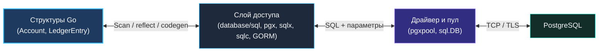
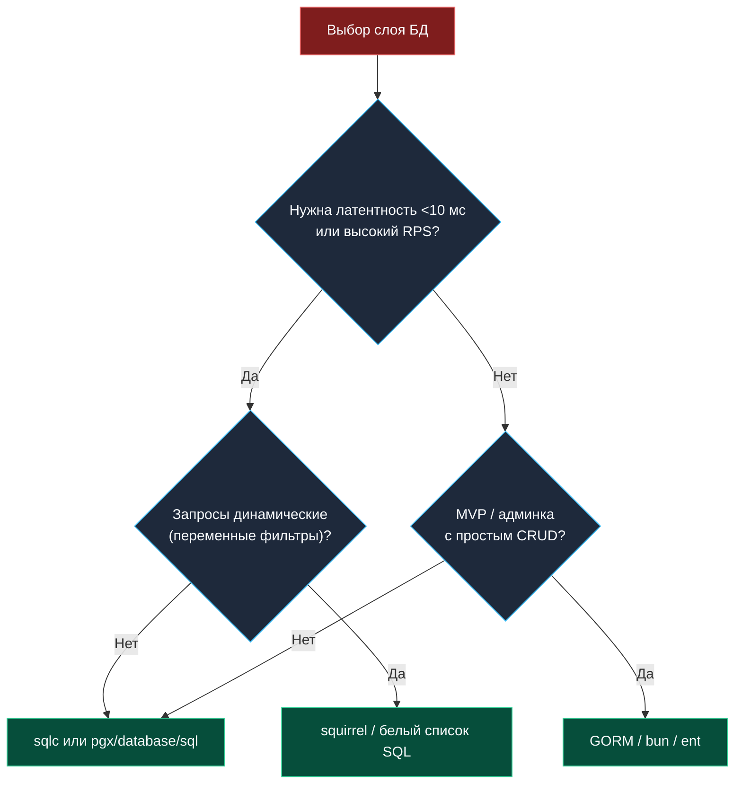

*Какую цену программа на Go платит за уровень абстракции над базой данных: от `database/sql` и `pgx` до `sqlx`, кодогенерации `sqlc` и runtime-ORM вроде GORM.*

> «Блеск Unix заключался в выборе абстракции, достаточно общей, чтобы быть поразительно полезной, и при этом не слишком дорогой по производительности.»
> — Брайан Керниган, *UNIX: A History and a Memoir*

Эндпоинт выписки в `LedgerPulse` возвращает 200 проводок по счёту. На стенде при 10 RPS всё чисто, но в продакшене при 1 500 RPS задержка p99 подскакивает с 4 до 55 мс, а треть времени CPU забирает сборщик мусора. Профиль `pprof` показывает две причины: цикл запросов N+1 для подгрузки транзакций и тысячи аллокаций в `reflect`, которыми runtime-ORM разбирает теги структур на каждый вызов.

Выбор между чистым SQL, лёгкими обёртками и ORM решает, где именно строки таблицы превращаются в структуры Go: на этапе сборки, один раз при старте или динамически в горячем пути запроса.

## Метафора переводчика и карта инструментов Go

Можно выучить иностранный язык и вести переговоры напрямую, а можно нанять переводчика. Для простых дел переводчик экономит время, но в сложном контракте вносит задержку и искажает детали. Граница аналогии проста: в отличие от живой речи, SQL — строгий декларативный контракт, который планировщик СУБД переводит в физический план чтения страниц.

Между структурами Go и сокетом PostgreSQL всегда лежат слой маппинга данных (*data path*) и драйвер пула соединений (*control path*):



В отличие от Rails или Django, стандартная библиотека Go даёт только базовый контракт `database/sql` ([[1. Пакет database_sql — архитектура драйверов, запросы и ошибки]]). Поверх него сложились пять подходов:

| Инструмент | Подход | Маппинг | Когда оправдан в Go |
|---|---|---|---|
| `database/sql` | Явный SQL (stdlib) | Ручной `rows.Scan` | Библиотеки, кастомные драйверы, ядро `LedgerPulse` |
| `pgx/v5` | Нативный драйвер PG | `Scan` / `pgx.CollectRows` | Максимум пропускной способности, `COPY`, `Batch` |
| `sqlx` | Обёртка `database/sql` | Кэш рефлексии (`db:"..."`) | Быстрый отказ от ручного `Scan` без смены модели |
| `sqlc` | SQL-first codegen | Статический код при сборке | Прод-сервисы с жёстким SLA и строгими типами |
| `ent` / `bun` | Codegen / гибрид ORM | Граф Go-схем / кэш тегов | Сложные графовые домены (`ent`) или компромисс с SQL |
| `GORM` / `xorm` | Runtime ORM | Активная рефлексия в рантайме | Админ-панели, MVP и CRUD с низким трафиком |

> [!tip] Собеседование [Middle]
> **Вопрос:** Почему в нагруженных Go-сервисах отказываются от runtime-ORM вроде GORM в пользу `pgx`, `sqlx` или `sqlc`?
> **Ответ:** Runtime-ORM на каждый запрос разбирает теги структур через `reflect`, динамически клеит SQL и выделяет временные объекты в куче, нагружая CPU и GC. Кроме того, скрытая генерация запросов маскирует проблему N+1 и мешает контролировать план в `EXPLAIN ANALYZE`.

## Под капотом: цена рефлексии, аллокации и протокол

Чтение оперативной памяти занимает **~100 нс**, страницы с NVMe SSD — **~100 мкс** (в 1 000 раз дольше), сетевой раунд-трип до PostgreSQL — **200–500 мкс**. Но пока горутина ждёт сеть в `netpoller`, ядро CPU свободно; а вот разбор строк через `reflect` тратит реальные такты процессора и засоряет кучу:

```go
// Упрощённая механика runtime-ORM: динамический разбор полей на каждый вызов
func buildInsert(value any) (string, []any) {
	rv := reflect.ValueOf(value).Elem()
	rt := rv.Type()
	for i := range rt.NumField() {
		_ = rt.Field(i).Tag.Get("gorm") // Парсинг тега + упаковка полей в any
	}
	return "INSERT INTO ...", nil
}
```

Это создаёт три издержки: аллокации в куче из-за упаковки значений в `any` (*escape analysis*), запрет инлайнинга компилятором и задержку преобразования типов. На вставке 1 000 строк одиночные вызовы GORM занимают **~150 мс** и ~5 000 аллокаций, подготовленный запрос `database/sql` или `sqlc` — **45–50 мс** и 200–250 аллокаций, а пакетный `pgx.Batch`/`CopyFrom` ещё в разы быстрее за счёт бинарного протокола и сжатия сетевых раунд-трипов ([[16. Пакетные (Batch) запросы, UNNEST и COPY]]).

## От `database/sql` и `sqlx` до `pgx` и `sqlc`

Сравним эти подходы на выборке проводок по счёту из `project/sql/migrations/001_init_ledger.sql` под покрывающий индекс `002_indexes.sql`.

В **`database/sql`** (`project/final/repo.go`) вы контролируете каждый столбец через `DBTX` ([[3. Паттерн Repository и транзакции в Go — Unit of Work через context]]). Цена — позиционная хрупкость: добавите колонку в `SELECT` и забудете переменную в `rows.Scan` — код скомпилируется и упадёт в рантайме с `sql: expected 7 destination arguments in Scan, not 6`.

**`sqlx`** снимает позиционную хрупкость через теги `db:"..."` и кэш смещений `reflectx`, который разбирает тип структуры один раз, а не на каждую строку:

```go
type LedgerEntry struct {
	ID            int64     `db:"id"`
	TransactionID int64     `db:"transaction_id"`
	AccountID     int64     `db:"account_id"`
	Amount        int64     `db:"amount"`
	Currency      string    `db:"currency"`
	CreatedAt     time.Time `db:"created_at"`
}

func listEntriesSQLX(ctx context.Context, db *sqlx.DB, accountID, cursorID int64, limit int) ([]LedgerEntry, error) {
	var out []LedgerEntry
	err := db.SelectContext(ctx, &out, `
		SELECT id, transaction_id, account_id, amount, currency, created_at
		FROM ledger_entries WHERE account_id = $1 AND id < $2
		ORDER BY id DESC LIMIT $3`, accountID, cursorID, limit)
	return out, err
}
```

Опечатка в имени колонки или неверный тип (`BIGINT` против `int32`) в `sqlx` всё равно проявятся лишь при запуске запроса.

**Нативный `pgx/v5`** (`*pgxpool.Pool`) работает по бинарному протоколу PostgreSQL без адаптера `database/sql`, поддерживает `pgx.Batch` и собирает слайсы через `pgx.CollectRows` (сам вызывает `rows.Close()` и `rows.Err()`):

```go
func listEntriesPGX(ctx context.Context, pool *pgxpool.Pool, accountID, cursorID int64, limit int) ([]LedgerEntry, error) {
	rows, err := pool.Query(ctx, `
		SELECT id, transaction_id, account_id, amount, currency, created_at
		FROM ledger_entries WHERE account_id = $1 AND id < $2
		ORDER BY id DESC LIMIT $3`, accountID, cursorID, limit)
	if err != nil {
		return nil, err
	}
	return pgx.CollectRows(rows, pgx.RowToStructByName[LedgerEntry])
}
```

**`sqlc`** переносит проверку контракта на этап сборки. Вы пишете чистый SQL, а `sqlc` парсит его движком `pgquery-go` против миграций и генерирует статический Go-код без `reflect`:

```sql
-- name: ListEntriesKeyset :many
SELECT id, transaction_id, account_id, amount, currency, created_at
FROM ledger_entries WHERE account_id = $1 AND id < $2 ORDER BY id DESC LIMIT $3;
```

```go
// Сгенерировано sqlc: типы аргументов и Scan проверены по схеме миграций
func (q *Queries) ListEntriesKeyset(ctx context.Context, arg ListEntriesKeysetParams) ([]LedgerEntry, error) {
	rows, err := q.db.QueryContext(ctx, listEntriesKeyset, arg.AccountID, arg.ID, arg.Limit)
	// ... цикл rows.Next() + rows.Scan(&i.ID, ...) + rows.Err()
}
```

Удаление или переименование колонки в миграции ломает `sqlc generate` и сборку Go ещё до запуска тестов. При этом сохраняется полный доступ к CTE, оконным функциям, JSONB (`metadata @> $1`) и анализу планов в [[10. План выполнения запроса — читаем EXPLAIN ANALYZE BUFFERS]].

> [!tip] Собеседование [Middle]
> **Вопрос:** Когда в Go оправданы чистый SQL или `sqlc` вместо ORM?
> **Ответ:** Когда нужны сложные запросы (оконные функции, рекурсивные CTE, JSONB, keyset-пагинация), предсказуемая латентность, контроль планов через `EXPLAIN ANALYZE` или интеграция с унаследованной схемой, которую неудобно выражать через модели ORM.

## Гибридные паттерны выбора

На практике инструменты комбинируют по простому дереву решений:



Рабочие комбинации:
- **`sqlc` для 90% запросов + ручной `pgx`/`database/sql` для 10% сложных отчётов** поверх единого интерфейса `DBTX`.
- **`Masterminds/squirrel`** для конструкторов фильтров с переменным числом условий, чтобы не путать номера `$1`, `$2` при склейке строк (цена — рантайм-сборка SQL).
- **Runtime-ORM** только для бэк-офиса и админок с низким трафиком.

## Подводные камни

1. **Проблема N+1 и Lazy Loading.** Цикл `db.Find(&accounts)` с внутренним `db.Where("account_id = ?", acc.ID).Find(&entries)` превращает один запрос в 1 + N сетевых раунд-трипов. В ORM это лечат `Preload`/`Joins`, в `sqlc` и `pgx` — одним `JOIN` или `WHERE account_id = ANY($1)` ([[13. Проблема N+1 и как её устранить]]).
2. **Неявное состояние сессии и хуки ORM.** Кэширование изменённых полей и скрытые коллбэки `BeforeSave` усложняют отладку транзакций. В `database/sql` и `pgx` состояние явно: нет `Exec` — нет изменений в БД.
3. **Маппинг `JSONB` и SQL-инъекции.** Колонку `metadata` лучше маппить в строгую структуру `AccountMetadata`, а не в `map[string]any`. Значения фильтров всегда передают параметрами (`$1`), а не через `fmt.Sprintf`, и защищают имена колонок сортировки белым списком (подробнее — в главе 22 этого модуля).

> [!warning] Ловушка: `db.AutoMigrate()` в продакшене
> Автомиграции удобны локально, но опасны на живой БД: рефакторинг поля в Go-структуре может сгенерировать непредсказуемый DDL, повесить блокировку на таблицу без `CONCURRENTLY` и не оставляет явного SQL-файла и отката для ревью в PR.

> [!tip] Собеседование [Senior/Staff]
> **Вопрос:** Какой стек работы с БД вы выберете для нового биллинг-сервиса и как аргументируете решение?
> **Ответ:** Для ядра переводов (`LedgerPulse`) — `pgx/v5` или `sqlc` поверх `pgxpool`: нулевые расходы на `reflect`, compile-time проверка схем, явные транзакции, поддержка `FOR UPDATE`, `SKIP LOCKED` и `CopyFrom`. Схема управляется только явными SQL-миграциями, а не `AutoMigrate`.

## Упражнения

**Упражнение 1 (Базовое). Поиск N+1 и дрейфа типов.**
Посмотрите на фрагмент кода на Go. Найдите две ошибки — одну архитектурную (производительность), вторую — опасность рантайма при изменении схемы `accounts`:
```go
func printActiveBalances(ctx context.Context, db *sql.DB) error {
	rows, err := db.QueryContext(ctx, "SELECT id FROM accounts WHERE status = 'active'")
	if err != nil {
		return err
	}
	defer rows.Close()

	for rows.Next() {
		var id int32
		if err := rows.Scan(&id); err != nil {
			return err
		}
		var balance int64
		err := db.QueryRowContext(ctx, "SELECT balance FROM accounts WHERE id = $1", id).Scan(&balance)
		if err != nil {
			return err
		}
		fmt.Println(id, balance)
	}
	return rows.Err()
}
```

> [!solution] Показать решение
> 1. **Проблема N+1 и блокировка курсора пула:** на каждую строку внешнего цикла делается отдельный запрос `QueryRowContext`. Помимо N лишних сетевых раунд-трипов, пока открыт `rows`, соединение с БД занято, и внутренний запрос захватывает второе соединение из пула — при `MaxOpenConns=1` программа повиснет в deadlock. Решение: выбрать обе колонки одним запросом `SELECT id, balance FROM accounts WHERE status = 'active'`.
> 2. **Риск переполнения `int32`:** в `001_init_ledger.sql` поле `id` имеет тип `BIGINT` (`int64` в Go). Пока идентификаторов меньше 2,14 млрд, `Scan(&id)` в `int32` работает, а затем начнёт падать с ошибкой конвертации. Для `BIGINT` всегда используйте `int64`.

**Упражнение 2 (Практическое). Переход от `database/sql` к `sqlc` или `pgx.CollectRows`.**
Перепишите метод `ListEntriesKeyset` из `project/final/repo.go` на использование `pgx/v5` с `pgx.CollectRows` и `pgx.RowToStructByName`, сохранив защиту лимита (`1..200`, по умолчанию `50`). Используйте составной курсор `(created_at, id)` под покрывающий индекс `idx_ledger_entries_account_created` из `002_indexes.sql`.

> [!solution] Показать решение
> В `002_indexes.sql` индекс построен по `(account_id, created_at DESC, id DESC)`, поэтому keyset-условие должно сравнивать кортеж `(created_at, id) < ($2, $3)`, чтобы планировщик использовал `Index-Only Scan`:
> ```go
> func listEntriesKeysetPGX(
> 	ctx context.Context,
> 	pool *pgxpool.Pool,
> 	accountID int64,
> 	cursorTime time.Time,
> 	cursorID int64,
> 	limit int,
> ) ([]LedgerEntry, error) {
> 	if limit <= 0 || limit > 200 {
> 		limit = 50
> 	}
> 	rows, err := pool.Query(ctx, `
> 		SELECT id, transaction_id, account_id, amount, currency, created_at
> 		FROM ledger_entries
> 		WHERE account_id = $1 AND (created_at, id) < ($2, $3)
> 		ORDER BY created_at DESC, id DESC
> 		LIMIT $4`,
> 		accountID, cursorTime, cursorID, limit,
> 	)
> 	if err != nil {
> 		return nil, fmt.Errorf("query ledger entries: %w", err)
> 	}
> 	return pgx.CollectRows(rows, pgx.RowToStructByName[LedgerEntry])
> }
> ```
> `pgx.CollectRows` гарантированно закрывает `rows` и проверяет `rows.Err()`, а теги `db:"..."` в структуре `LedgerEntry` связывают столбцы по имени без позиционной хрупкости.

**Упражнение 3 (Со звёздочкой \*). Безопасный динамический фильтр.**
Спроектируйте функцию `BuildAccountFilterSQL(status, currency string, minBalance *int64, sortCol string) (string, []any, error)` без использования ORM. Допустимые колонки сортировки — только `id`, `balance`, `created_at`. Любое другое значение `sortCol` должно возвращать ошибку, а параметры фильтрации не должны конкатенироваться в SQL-строку.

> [!solution] Показать решение
> Разделяем пользовательские значения (параметры `$N`) и идентификаторы схемы (белый список `switch`):
> ```go
> func BuildAccountFilterSQL(status, currency string, minBalance *int64, sortCol string) (string, []any, error) {
> 	var orderBy string
> 	switch sortCol {
> 	case "", "id":
> 		orderBy = "id DESC"
> 	case "balance":
> 		orderBy = "balance DESC"
> 	case "created_at":
> 		orderBy = "created_at DESC"
> 	default:
> 		return "", nil, fmt.Errorf("unsupported sort column: %q", sortCol)
> 	}
> 
> 	conds := []string{"1=1"}
> 	var args []any
> 	if status != "" {
> 		args = append(args, status)
> 		conds = append(conds, fmt.Sprintf("status = $%d", len(args)))
> 	}
> 	if currency != "" {
> 		args = append(args, currency)
> 		conds = append(conds, fmt.Sprintf("currency = $%d", len(args)))
> 	}
> 	if minBalance != nil {
> 		args = append(args, *minBalance)
> 		conds = append(conds, fmt.Sprintf("balance >= $%d", len(args)))
> 	}
> 
> 	query := "SELECT id, external_id, owner_name, currency, balance, status FROM accounts WHERE " +
> 		strings.Join(conds, " AND ") + " ORDER BY " + orderBy + " LIMIT 100"
> 	return query, args, nil
> }
> ```
> Такой запрос не поддаётся SQL-инъекции через `sortCol` и сохраняет явную нумерацию позиционных параметров PostgreSQL.

Выбор слоя доступа к данным — только половина дела, и даже самый быстрый код на `sqlc` или `pgx` упадёт, если схема таблицы под ним изменилась с блокировкой на пять минут или с нарушением обратной совместимости. В следующей главе разберём, как менять таблицы и индексы в живом продакшене без минуты простоя: [[5. Миграции базы данных — expand-and-contract без простоя]].
