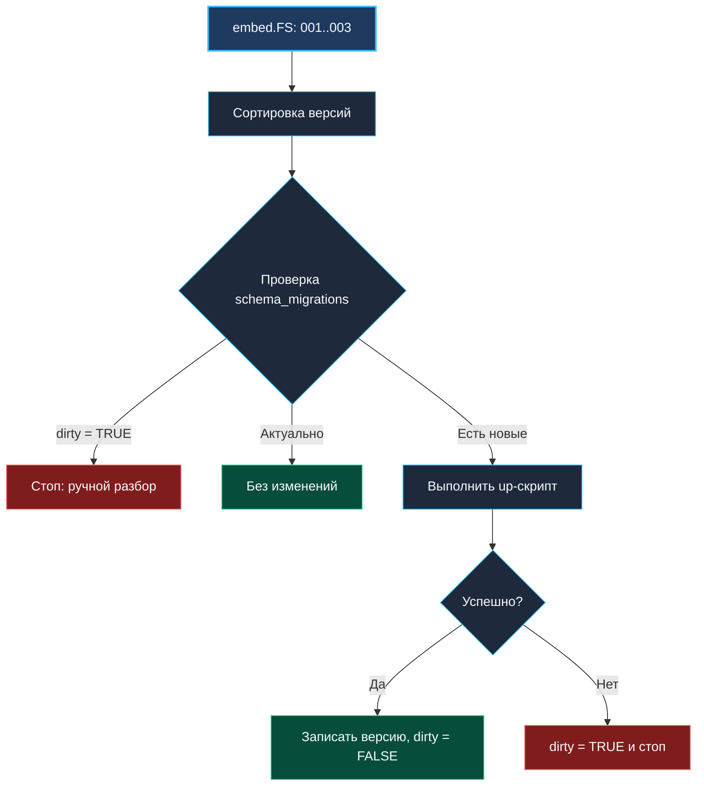
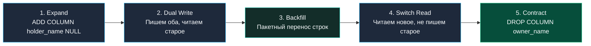

*Почему безобидный `ALTER TABLE` способен положить продакшен за секунды, как работают `lock_timeout`, `CONCURRENTLY` и `embed.FS`, и как устроена выкатка схемы без простоя по паттерну Expand-and-Contract.*

Пятница, 18:10. Вы выкатываете миграцию для `LedgerPulse`: добавляете индекс по `created_at` на таблицу `ledger_entries` в 120 миллионов строк. На тестовой базе с сотней строк скрипт прошёл за 12 мс. В продакшене обычный `CREATE INDEX` берёт блокировку `SHARE`, запрещая запись, а последующий `ALTER TABLE` встаёт в очередь с `AccessExclusiveLock`. За три секунды все 50 соединений пула Go-сервиса застревают в ожидании блокировки, и сервис падает.

Живую базу данных нельзя остановить на перерисовку чертежа. Пока клиенты переводят деньги, схема обязана меняться без блокировки чтения и записи.

## Движок миграций и разбивка `001..003` в `LedgerPulse`

Инструмент миграций (`golang-migrate`, `pressly/goose`, `atlas`) переводит схему из версии `V` в `V+k` ровно один раз, фиксируя состояние в служебной таблице:

```sql
CREATE TABLE schema_migrations (
    version    BIGINT  PRIMARY KEY,
    dirty      BOOLEAN NOT NULL DEFAULT FALSE,
    applied_at TIMESTAMPTZ NOT NULL DEFAULT now()
);
```

Перед применением очередного файла движок действует по строгому циклу:



Если многошаговый скрипт упал посередине, движок выставляет `dirty = TRUE` и блокирует дальнейшие миграции. Сбрасывать этот флаг вслепую нельзя: сначала по логам и `pg_catalog` проверяют, что успело примениться, вручную завершают или откатывают изменения, и только потом снимают `dirty`.

В каталоге `project/sql/migrations/` миграции `LedgerPulse` намеренно разделены по зонам ответственности:
- `001_init_ledger.sql` — создаёт базовые таблицы `accounts`, `transactions`, `ledger_entries` с ключами `GENERATED ALWAYS AS IDENTITY`, внешними ключами `ON DELETE RESTRICT` и инвариантами `CHECK (balance >= 0)` и `CHECK (amount <> 0)`.
- `002_indexes.sql` — выносит отдельно индексы: покрывающий `idx_ledger_entries_account_created` с `INCLUDE`, частичные `idx_transactions_pending` / `idx_accounts_status_currency` и GIN по `metadata`.
- `003_idempotency_outbox.sql` — добавляет таблицы `idempotency_keys`, `outbox_events` с частичным индексом `idx_outbox_unpublished` и включает Row-Level Security (`accounts_tenant_isolation`).

На пустой базе при первом запуске `002_indexes.sql` создаёт индексы через `CREATE INDEX IF NOT EXISTS`. Но если через год на таблице `ledger_entries` с миллионами строк понадобится ещё один индекс, его обязательно выносят в отдельный файл с `CREATE INDEX CONCURRENTLY`.

## Под капотом: транзакционный DDL, блокировки и очередь ожидания

Любой DDL обновляет системные каталоги (`pg_class`, `pg_attribute`) и пишется в WAL ([[8. WAL — журнал упреждающей записи и долговечность на диске]]). При этом PostgreSQL и MySQL ведут себя по-разному ([[6. PostgreSQL против MySQL — честное архитектурное сравнение]]):

- **PostgreSQL** поддерживает транзакционный DDL (`CREATE TABLE`, `ALTER TABLE`, обычный `CREATE INDEX` оборачиваются в `BEGIN ... COMMIT` и откатываются целиком при ошибке).
- **MySQL (InnoDB)** перед большинством `ALTER TABLE` делает неявный коммит (*implicit commit*). Если вторая команда в скрипте упадёт, первая уже на диске.

> [!tip] Собеседование [Middle]
> **Вопрос:** Как обеспечить надёжные миграции в MySQL при отсутствии транзакционного DDL?
> **Ответ:** Дробить изменения на минимальные файлы (строго одна DDL-операция на миграцию) и использовать пошаговые Go-миграции (например, в `pressly/goose`) с явной компенсирующей логикой отката.

### Очередная ловушка `AccessExclusiveLock`

Даже мгновенный `ALTER TABLE accounts ADD COLUMN ...` в PostgreSQL требует `AccessExclusiveLock`, несовместимый даже с `SELECT`. Если на лидере идёт долгий 40-секундный отчёт `SELECT ... FROM accounts`, запущенный в этот момент `ALTER TABLE` встаёт в очередь ожидания. Хуже всего, что все следующие быстрые веб-запросы `SELECT` и `UPDATE` встают в очередь **позади** `ALTER TABLE` и за секунды исчерпывают пул соединений.

Обязательное правило каждой прод-миграции — задавать короткие таймауты на сессию:

```sql
BEGIN;
SET LOCAL lock_timeout = '2s';
SET LOCAL statement_timeout = '30s';
ALTER TABLE accounts ADD COLUMN display_name TEXT;
COMMIT;
```

Если за 2 секунды блокировку взять не удалось, миграция сама прервётся, освободив очередь рабочих запросов.

> [!warning] Ловушка: `CREATE INDEX` без `CONCURRENTLY`
> Обычный `CREATE INDEX` берёт блокировку `SHARE`, замораживая все `INSERT`/`UPDATE`/`DELETE` до конца сканирования таблицы. На живых таблицах используйте `CREATE INDEX CONCURRENTLY`: индекс строится за 2–3 прохода без блокировки записи, но дольше и с большим I/O. Команду нельзя запускать внутри `BEGIN ... COMMIT` (в `goose` добавляют `-- +goose NO TRANSACTION`).

## Интеграция в Go через `embed.FS` и отдельный Job

Пакет `embed` встраивает SQL-файлы прямо в бинарник Go, исключая рассинхрон между кодом и файлами на сервере:

```go
package migrateutil

import (
	"database/sql"
	"embed"
	"errors"
	"fmt"

	"github.com/golang-migrate/migrate/v4"
	"github.com/golang-migrate/migrate/v4/database/postgres"
	"github.com/golang-migrate/migrate/v4/source/iofs"
)

//go:embed sql/migrations/*.sql
var migrationFS embed.FS

// ApplyUp применяет ожидающие SQL-миграции из встроенного embed.FS.
func ApplyUp(db *sql.DB) error {
	driver, err := postgres.WithInstance(db, &postgres.Config{})
	if err != nil {
		return fmt.Errorf("create postgres driver: %w", err)
	}
	src, err := iofs.New(migrationFS, "sql/migrations")
	if err != nil {
		return fmt.Errorf("create iofs source: %w", err)
	}
	m, err := migrate.NewWithInstance("iofs", src, "postgres", driver)
	if err != nil {
		return fmt.Errorf("init migrator: %w", err)
	}
	if err := m.Up(); err != nil && !errors.Is(err, migrate.ErrNoChange) {
		return fmt.Errorf("apply migrations: %w", err)
	}
	return nil
}
```

Для сложной логики трансформации данных `pressly/goose` позволяет писать миграции на Go (`goose.AddMigrationContext`).

> [!warning] Ловушка: вызов `m.Up()` в `main()` HTTP-сервиса
> Если 10 подов Kubernetes стартуют одновременно и каждый запускает `m.Up()`, поды устроят гонку DDL и сорвут `readinessProbe`. Выносите миграции в отдельный `Job` или `initContainer` до старта приложения и страхуйтесь `pg_try_advisory_lock(lock_id)`, чтобы мигратор работал строго в одном экземпляре.

## Zero-Downtime: паттерн Expand-and-Contract

Прямое переименование `ALTER TABLE accounts RENAME COLUMN owner_name TO holder_name` мгновенно сломает старые поды приложения, ещё работающие во время rolling deploy. Изменение проводят в пять шагов (**Expand-and-Contract**):



1. **Expand (миграция 1):** добавляем `holder_name TEXT` (допускает `NULL`). Старый код `v1` продолжает работать без изменений.
2. **Dual Write (код `v2`):** приложение пишет в оба столбца, а читает из `owner_name`.
3. **Backfill (воркер):** пакетами заполняем `holder_name` для старых строк и при необходимости ставим `NOT NULL` через `CHECK (holder_name IS NOT NULL) NOT VALID` + `VALIDATE CONSTRAINT`.
4. **Switch Read (код `v3`):** переводим чтение на `holder_name` и прекращаем запись в `owner_name`.
5. **Contract (миграция 2):** после вывода старых подов выполняем `ALTER TABLE accounts DROP COLUMN owner_name;`.

## Диск, WAL и MVCC при миграциях

В старых версиях PostgreSQL и в MySQL InnoDB добавление столбца со значением `DEFAULT` или смена типа (`INT` → `BIGINT`) запускало **Table Rewrite**: полное чтение всех 8-килобайтных страниц, копирование в новую таблицу и перестройку индексов. С PostgreSQL 11 команда `ADD COLUMN ... DEFAULT 0` для **статического** значения обновляет только метаданные в `pg_attribute` за миллисекунды, но недетерминированный `DEFAULT gen_random_uuid()` всё ещё переписывает таблицу.

Массовый `UPDATE` при backfill в PostgreSQL создаёт новую версию кортежа на каждую строку и помечает старую мёртвой ([[11. VACUUM и сборка мёртвых версий кортежей]]). Обновление 10 млн строк одним запросом удваивает размер таблицы, заливает гигабайты WAL и вымывает горячие данные из `shared_buffers` и Page Cache ОС. Поэтому backfill дробят на батчи по 1 000–5 000 строк по первичному ключу с паузами:

```sql
UPDATE accounts
SET holder_name = owner_name
WHERE id > $1 AND id <= $2 AND holder_name IS NULL;
```

> [!tip] Собеседование [Senior/Staff]
> **Вопрос:** Таблице `ledger_entries` (500 млн строк) нужно поменять первичный ключ или тип колонки `transaction_id` с `INT` на `BIGINT` без даунтайма. Как вы это проведёте?
> **Ответ:** Обычный `ALTER TABLE ... ALTER COLUMN TYPE BIGINT` вызовет полный Table Rewrite под `AccessExclusiveLock` и положит продакшен на часы. Решение — Expand-and-Contract на уровне колонки (или shadow-таблицы с триггером/логической репликацией): добавляем новую колонку `transaction_id_v2 BIGINT`, включаем Dual Write в коде (или триггер на `INSERT/UPDATE`), пакетами по первичному ключу переливаем старые значения, строим индексы через `CREATE INDEX CONCURRENTLY`, переводим чтение на `v2` и в финале удаляем или переименовываем старую колонку в короткое окно с `lock_timeout`.

## Антипаттерны миграций

1. **Гигантский файл на 500 строк.** Десять несвязанных `ALTER TABLE` в одном файле усложняют диагностику и превращают откат в ручную хирургию. Один логический шаг — одна миграция.
2. **Отсутствие `lock_timeout` и `statement_timeout`.** Без них случайный долгий отчёт превращает быструю миграцию в блокировщик всей очереди пула соединений.
3. **Размешивание DDL и тяжёлого DML.** Создание таблицы и заливка миллиона тестовых строк в одном файле с `CREATE INDEX` мешает откату и перегружает транзакцию.

## Упражнения

**Упражнение 1 (Базовое). Поиск опасной блокировки.**
На продакшен-таблице `transactions` (80 млн строк) решено добавить частичный индекс из `002_indexes.sql` новой миграцией:
```sql
BEGIN;
CREATE INDEX idx_transactions_failed ON transactions (created_at) WHERE status = 'failed';
COMMIT;
```
Объясните две проблемы этого скрипта и исправьте его для безопасного запуска без простоя (с учётом синтаксиса `golang-migrate` или `goose`).

> [!solution] Показать решение
> 1. **Блокировка записи:** `CREATE INDEX` без `CONCURRENTLY` захватывает блокировку `SHARE`, замораживая все `INSERT`/`UPDATE` в таблицу `transactions` на время сканирования 80 млн строк.
> 2. **Несовместимость с транзакцией:** `CREATE INDEX CONCURRENTLY` запрещено запускать внутри явного блока `BEGIN ... COMMIT` (PostgreSQL вернёт ошибку `CREATE INDEX CONCURRENTLY cannot run inside a transaction block`).
> Исправление (без транзакции, с таймаутом на ожидание метаданных):
> ```sql
> -- +goose NO TRANSACTION
> SET lock_timeout = '3s';
> CREATE INDEX CONCURRENTLY IF NOT EXISTS idx_transactions_failed
>     ON transactions (created_at)
>     WHERE status = 'failed';
> ```
> При обрыве построения из-за сбоя или таймаута `CONCURRENTLY` может оставить индекс в статусе `INVALID` (проверяется через `pg_index.indisvalid`); перед повтором такой индекс удаляют через `DROP INDEX CONCURRENTLY IF EXISTS`.

**Упражнение 2 (Практическое). Пакетный backfill на Go.**
Напишите функцию `BackfillHolderName(ctx context.Context, db *sql.DB, batchSize int64, pause time.Duration) error`, которая переносит значение из `owner_name` в `holder_name` в таблице `accounts` порциями по `batchSize` записей по возрастанию `id` (используя `WHERE id > $1 AND id <= $2 AND holder_name IS NULL`) до достижения максимального `id`, делая паузу `pause` между батчами и уважая отмену `ctx`.

> [!solution] Показать решение
> Читаем текущий `MAX(id)` один раз, а затем идём скользящим диапазоном по первичному ключу, чтобы каждый `UPDATE` касался ограниченного числа страниц и не блокировал живой трафик:
> ```go
> func BackfillHolderName(ctx context.Context, db *sql.DB, batchSize int64, pause time.Duration) error {
> 	var maxID sql.NullInt64
> 	if err := db.QueryRowContext(ctx, `SELECT MAX(id) FROM accounts`).Scan(&maxID); err != nil {
> 		return fmt.Errorf("select max id: %w", err)
> 	}
> 	if !maxID.Valid {
> 		return nil
> 	}
> 
> 	for start := int64(0); start < maxID.Int64; start += batchSize {
> 		if err := ctx.Err(); err != nil {
> 			return err
> 		}
> 		endID := start + batchSize
> 		_, err := db.ExecContext(ctx, `
> 			UPDATE accounts
> 			SET holder_name = owner_name
> 			WHERE id > $1 AND id <= $2 AND holder_name IS NULL`,
> 			start, endID,
> 		)
> 		if err != nil {
> 			return fmt.Errorf("backfill range (%d, %d]: %w", start, endID, err)
> 		}
> 		select {
> 		case <-ctx.Done():
> 			return ctx.Err()
> 		case <-time.After(pause):
> 		}
> 	}
> 	return nil
> }
> ```
> Каждая итерация фиксируется отдельной короткой транзакцией, не удерживает старые снимки MVCC и позволяет `autovacuum` спокойно собирать мёртвые кортежи между пачками.

**Упражнение 3 (Со звёздочкой \*). Безопасное ограничение `CHECK` на большой таблице.**
В `001_init_ledger.sql` стоит `CHECK (balance >= 0)`. Предположим, вам нужно добавить новое правило `CHECK (balance <= 1000000000)` на живую таблицу `accounts` с десятками миллионов строк. Почему прямой `ALTER TABLE accounts ADD CONSTRAINT chk_max_balance CHECK (balance <= 1000000000)` опасен и как применить его в два шага без блокировки чтения и записи?

> [!solution] Показать решение
> Обычный `ADD CONSTRAINT ... CHECK` берёт `AccessExclusiveLock` на всё время полного последовательного сканирования таблицы, чтобы проверить каждую существующую строку.
> Решение в PostgreSQL — разбить проверку на два шага с `NOT VALID`:
> ```sql
> -- Шаг 1: мгновенный метаданный контракт (AccessExclusiveLock на доли миллисекунды).
> -- Новые INSERT/UPDATE уже проверяются, старые строки ещё не сканируются.
> SET lock_timeout = '2s';
> ALTER TABLE accounts
>     ADD CONSTRAINT chk_max_balance CHECK (balance <= 1000000000) NOT VALID;
> 
> -- Шаг 2: проверка исторических строк под ShareUpdateExclusiveLock.
> -- Не блокирует ни SELECT, ни INSERT/UPDATE/DELETE.
> ALTER TABLE accounts VALIDATE CONSTRAINT chk_max_balance;
> ```
> Такой двухфазный приём работает и для новых `FOREIGN KEY`, позволяя проверять целостность на живом трафике без остановки сервиса.

Умение провести отдельную миграцию без блокировок защищает базу в момент выкатки скрипта. Но в распределённом кластере код и схема не меняются одномоментно: во время rolling deploy или canary-релиза с одной базой одновременно работают старая и новая версии бинарника. В следующей главе разберём, как версионировать схему, проверять изменения в CI и удерживать совместимость версий кода `N` и `N+1`: [[6. Версионирование схемы и совместимость с выкатками сервиса]].
