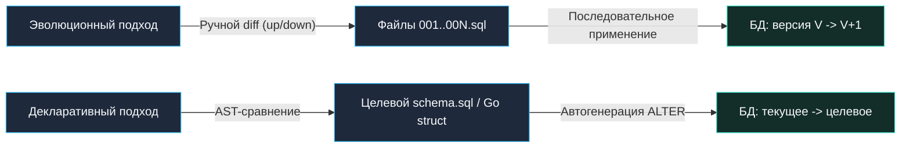
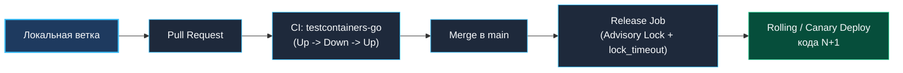

*Как управлять историей изменений схемы, выбирать между миграциями и декларативным diff, проверять совместимость в CI и не ронять rolling-выкатки, когда версии кода `N` и `N+1` работают с одной базой.*

При выкатке новой версии `LedgerPulse` в Kubernetes оркестратор не останавливает весь кластер разом. Пять минут поды старого релиза `v14` и нового `v15` обслуживают трафик параллельно, обращаясь к одной базе данных. Если релиз `v15` удалил колонку или добавил жёсткое ограничение `NOT NULL` без значения по умолчанию, старые поды `v14` немедленно посыплют ошибками. А если в `v15` нашли баг бизнес-логики и откатили бинарник обратно на `v14`, но схема на диске уже изменилась необратимо, откат превратится в двойную аварию.

Главная асимметрия версионирования в том, что **код можно откатить атомарно простым перезапуском бинарника, а мутацию данных на диске — нельзя**. Поэтому версионирование схемы — это не просто хранение SQL-файлов в Git, а строгий контракт совместимости между версиями приложения, пайплайном CI и системными каталогами СУБД.

## Эволюционный и декларативный подходы: выбор инструментов

В современной разработке сложились две модели управления схемой:

| Критерий | Эволюционный (Migration-based) | Декларативный (State-based) |
|---|---|---|
| **Источник истины** | Последовательность дельт (`001_...`, `002_...`) | Итоговое состояние (`schema.sql` или Go-структуры) |
| **Инструменты в Go** | `golang-migrate`, `pressly/goose`, `sql-migrate` | `ariga/atlas`, `ent` |
| **Контроль над SQL** | Полный: `CONCURRENTLY`, `lock_timeout`, батчи | Ограничен генератором diff (возможен неожиданный `DROP`) |
| **Слияние веток в Git** | Конфликты нумерации при параллельной работе | Обычное текстовое слияние файла состояния |
| **Откат** | Явный `down`-скрипт или прямая миграция | Повторное приведение к предыдущему файлу состояния |

В эволюционном подходе история выглядит как линейная лента шагов, аналогичная `project/sql/migrations/` (`001_init_ledger.sql`, `002_indexes.sql`, `003_idempotency_outbox.sql`). В декларативном подходе разработчик правит единый файл `schema.sql` или описание сущностей `ent`, а инструмент сам вычисляет разницу с живой базой и генерирует `ALTER TABLE`:



> [!tip] Собеседование [Middle]
> **Вопрос:** Когда стоит выбрать декларативный инструмент вроде `atlas`, а когда остаться на классических миграциях?
> **Ответ:** Декларативный подход хорошо работает в командах с множеством параллельных веток, где разработчики часто правят одни и те же сущности: Git-merge файла состояния проходит чище, чем ручное переименование пронумерованных скриптов. Но для нагруженных OLTP-систем вроде биллинга критичен точный контроль над блокировками, `CREATE INDEX CONCURRENTLY` и пакетным обновлением данных — там надёжнее эволюционные SQL-миграции (либо гибрид: `atlas` генерирует миграционный SQL-файл, который затем проверяет инженер на PR).

## Под капотом: системные каталоги и цена вычисления diff

Чтобы понять текущее состояние базы, декларативный инструмент не угадывает схему — он опрашивает системные каталоги СУБД (`information_schema` и `pg_catalog`):

```sql
-- Сбор колонок текущей схемы
SELECT table_name, column_name, data_type, is_nullable
FROM information_schema.columns
WHERE table_schema = 'public';

-- Сбор определений индексов
SELECT indexname, indexdef
FROM pg_indexes
WHERE schemaname = 'public';
```

Эти запросы читают системные таблицы из тех же 8-килобайтных страниц и обслуживаются отдельными внутренними кэшами PostgreSQL (`relcache`, `catcache`). При холодном старте БД чтение каталога порождает лишние системные вызовы `read` к диску. Затем клиентский инструмент загружает метаданные в память, строит абстрактное синтаксическое дерево (AST) и граф зависимостей внешних ключей. На крупной базе из 500+ таблиц расчёт diff требует заметного CPU и памяти на клиенте, тогда как эволюционный мигратор делает один точечный `SELECT version, dirty FROM schema_migrations` и сразу применяет следующий скрипт.

В CI/CD пайплайне, запускающем валидацию десятки раз в день, добавляются сетевые накладные расходы: TCP/TLS-рукопожатие, раунд-трипы чтения каталога и запись WAL при накатке тестовой схемы. Ускорить конвейер помогают предсобранные образы PostgreSQL с уже применённой базовой схемой или переиспользование контейнера между тестами.

## Совместимость при rolling deploy и canary-релизах

При бесшовной выкатке сервиса версии `N` и `N+1` работают одновременно. Canary-релиз может держать 5% трафика на `vN+1` и 95% на `vN` несколько часов. Чтобы ни один под не упал, соблюдайте **правило окна совместимости `N ↔ N+1`**:

1. **Схема `N+1` обязана быть обратно совместимой с кодом `N`.** Нельзя удалять столбцы, переименовывать таблицы или менять типы данных, пока в кластере живёт хотя бы один под версии `N`.
2. **Код не делает `SELECT *` и не полагается на порядок колонок.** Если в таблицу `accounts` добавили колонку `risk_tier`, запрос `SELECT * FROM accounts` с ручным `rows.Scan` в старом коде `vN` немедленно сломается из-за несовпадения числа аргументов. Всегда перечисляйте нужные столбцы явно: `SELECT id, external_id, owner_name, currency, balance, status FROM accounts`.
3. **Указывайте список столбцов в `INSERT`.** Запрос `INSERT INTO ledger_entries VALUES (...)` сломается при любом добавлении колонки; явный `INSERT INTO ledger_entries (transaction_id, account_id, amount, currency) VALUES (...)` переживёт расширение схемы без ошибок, если новые поля допускают `NULL` или имеют `DEFAULT`.
4. **Переименования и удаления выносятся в отдельный цикл релиза.** Сначала релиз `vN+1` начинает писать и читать по новому контракту (паттерн Expand-and-Contract из [[5. Миграции базы данных — expand-and-contract без простоя]]), а очистка (`Contract`) запускается отдельной миграцией только после полного вывода `vN` из эксплуатации и подтверждения, что откат бинарника к `vN` уже не потребуется.

| Изменение в схеме | Совместимо с кодом `N`? | Безопасный способ выкатки |
|---|---|---|
| `CREATE TABLE` / `ADD COLUMN ... NULL` | Да | Прямая миграция до выкатки `N+1` |
| `ADD COLUMN ... NOT NULL DEFAULT x` (PG 11+) | Да (если код `N` перечисляет колонки в `INSERT`) | Прямая миграция с `lock_timeout` |
| `CREATE INDEX CONCURRENTLY` | Да | Отдельный не-транзакционный шаг |
| `ADD CONSTRAINT ... CHECK ... NOT VALID` | Опасно (если `N` пишет невалидные данные) | Сначала обновить валидацию в коде, затем `VALIDATE` |
| `RENAME COLUMN` / `DROP COLUMN` | Нет | Только через Expand-and-Contract в два релиза |

## Пайплайн доставки и конфликты ветвления в команде

Надёжный процесс доставки изменений в схему выглядит как автоматический конвейер от локального коммита до продакшена:



Когда над одним сервисом параллельно работают 5–10 инженеров, в эволюционном подходе возникает **конфликт нумерации**: два разработчика в разных ветках одновременно создают файлы `004_add_risk_tier.sql` и `004_add_audit_log.sql`. На этапе CI после слияния оба файла претендуют на версию `4`.

Инженерные способы решить эту проблему без ручного хаоса:
- **Именование с временной меткой (`timestamp`):** `20261124103000_add_risk_tier.sql`. Вероятность коллизии до секунды практически нулевая.
- **Проверка монотонности и дублей в CI:** скрипт на PR сверяет, что номера версий уникальны и не переписывают уже применённые в `main` миграции.
- **Гибрид с декларативной схемой (`atlas --dev`):** инструмент прогоняет изменения на временной dev-базе, проверяет граф зависимостей (чтобы `DROP INDEX` не обогнал зависимый объект), а сгенерированный SQL-план проходит обязательное ревью человека перед попаданием на прод.

> [!tip] Собеседование [Middle]
> **Вопрос:** Как безопасно слить две параллельные ветки, в каждой из которых менялась схема БД?
> **Ответ:** Во-первых, запретить на уровне CI дубликаты номеров версий (или использовать timestamp-префиксы). Во-вторых, после rebase на `main` прогнать весь набор миграций с нуля в чистом контейнере PostgreSQL, а затем прогнать тест отката последней миграции и повторного применения. При декларативном подходе `diff` пересчитывается строго против эталонного состояния целевой ветки с ручным просмотром итогового `ALTER`-плана.

## Тестирование миграций и отката в Go 1.24

Лучшая страховка от падения на проде — автоматическая проверка жизненного цикла миграций в CI против реального движка PostgreSQL. В Go для этого связывают `embed.FS` и `testcontainers-go`.

```go
//go:build integration

package migrations_test

import (
	"context"
	"embed"
	"testing"
	"time"

	"github.com/golang-migrate/migrate/v4"
	_ "github.com/golang-migrate/migrate/v4/database/postgres"
	"github.com/golang-migrate/migrate/v4/source/iofs"
	"github.com/testcontainers/testcontainers-go/modules/postgres"
	"github.com/testcontainers/testcontainers-go/wait"
)

//go:embed sql/migrations/*.sql
var migrationFS embed.FS

func TestMigrationsUpDownUp(t *testing.T) {
	ctx, cancel := context.WithTimeout(context.Background(), 2*time.Minute)
	defer cancel()

	pg, err := postgres.Run(ctx, "postgres:17-alpine",
		postgres.WithDatabase("ledgerpulse"),
		postgres.WithUsername("test"),
		postgres.WithPassword("test"),
		postgres.BasicWaitStrategies(),
		postgres.WithWaitStrategy(wait.ForLog("database system is ready to accept connections").WithOccurrence(2)),
	)
	if err != nil {
		t.Fatalf("start postgres container: %v", err)
	}
	t.Cleanup(func() { _ = pg.Terminate(context.Background()) })

	dsn, err := pg.ConnectionString(ctx, "sslmode=disable")
	if err != nil {
		t.Fatalf("get dsn: %v", err)
	}

	src, err := iofs.New(migrationFS, "sql/migrations")
	if err != nil {
		t.Fatalf("open iofs: %v", err)
	}
	m, err := migrate.NewWithSourceInstance("iofs", src, dsn)
	if err != nil {
		t.Fatalf("init migrate: %v", err)
	}

	if err := m.Up(); err != nil {
		t.Fatalf("migrate up: %v", err)
	}
	if err := m.Steps(-1); err != nil {
		t.Fatalf("rollback last step: %v", err)
	}
	if err := m.Up(); err != nil {
		t.Fatalf("re-apply up: %v", err)
	}
}
```

Заметьте три важных детали:
1. **Тег сборки `//go:build integration`.** Подъём контейнера занимает 1–2 секунды и требует Docker-демона, поэтому такие тесты отделяют от быстрых юнит-тестов (`go test -short ./...`).
2. **Проверка «вверх → шаг вниз → снова вверх».** Если разработчик написал `004_...up.sql`, но ошибся в `004_...down.sql` (или оставил после отката лишний индекс), тест упадёт до слияния PR.
3. **Настоящий `pg_catalog` и WAL.** Контейнер проверяет реальные ограничения `CHECK`, внешние ключи и синтаксис PostgreSQL 17, чего не даст ни один мок.

## Ловушки версионирования в эксплуатации

1. **Гонка версий при пропущенном Expand-Contract.** Попытка сэкономить один релиз и удалить столбец сразу вместе с выкаткой нового кода гарантированно ломает старые поды при rolling update или canary.
2. **Неидемпотентные ручные правки мимо мигратора.** Если инженер зашёл в прод через `psql` и вручную добавил индекс, следующий релиз с тем же `CREATE INDEX` (без `IF NOT EXISTS`) упадёт и переведёт таблицу `schema_migrations` в состояние `dirty`. С другой стороны, прятать логические ошибки под слепым `IF NOT EXISTS` на каждом `CREATE TABLE` тоже не стоит: лучше доверять трекеру версий и запрещать ручные правки схемы в проде.
3. **Потеря `down`-скрипта.** Отсутствие парного файла отката не мешает накатке `Up`, но лишает команду возможности автоматически проверять обратимость шага в CI.

> [!tip] Собеседование [Senior/Staff]
> **Вопрос:** Вы запустили миграцию в продакшене, и она зависла, заблокировав таблицу `accounts`. Сервис начинает падать по таймаутам. Ваши действия в первые минуты?
> **Ответ:**
> 1. Найти зависшую сессию и её блокировщика через `pg_stat_activity` и `pg_blocking_pids(pid)`.
> 2. Проверить `wait_event_type = 'Lock'` и понять, держит ли сама миграция `AccessExclusiveLock` (или стоит в очереди за долгим отчётом, блокируя приходящие запросы).
> 3. Немедленно отменить висящую сессию DDL через `SELECT pg_cancel_backend(pid)` (или `pg_terminate_backend(pid)` при отсутствии реакции), чтобы мгновенно расчистить очередь пула соединений приложения.
> 4. Проверить таблицу `schema_migrations`: если транзакция откатилась, а движок выставил `dirty = TRUE`, убедиться в консистентности каталога и сбросить флаг только после проверки.
> 5. На будущее — обязательно задавать `lock_timeout` (1–3 секунды) на сессию миграций и выносить тяжелые индексы в `CONCURRENTLY`.

## Упражнения

**Упражнение 1 (Базовое). Совместимость контракта `N` и `N+1`.**
В текущей версии `LedgerPulse` (`v1`) таблица `transactions` содержит столбцы `(id, reference_id, kind, status, description, created_at)`, а код `v1` выполняет `SELECT * FROM transactions WHERE id = $1` и сканирует в 6 переменных. Команда хочет добавить обязательное поле `channel TEXT NOT NULL DEFAULT 'api'` и убрать поле `description`. Какие шаги сломают `v1` во время rolling deploy и как перестроить план выкатки?

> [!solution] Показать решение
> Сломают `v1` сразу два действия:
> 1. Добавление колонки `channel` при живом `SELECT *` в `v1`: база вернёт 7 колонок вместо 6, и `rows.Scan` в `v1` упадёт с ошибкой несоответствия числа аргументов.
> 2. Прямое удаление `description` при живом `v1`, который читает и, вероятно, пишет это поле.
> Правильный порядок выкатки:
> - **Релиз `v2` (подготовка кода):** заменить `SELECT *` на явный список 6 колонок и убедиться, что `INSERT` явно перечисляет столбцы. Раскатить `v2` на 100% подов.
> - **Миграция `expand`:** добавить `ALTER TABLE transactions ADD COLUMN channel TEXT NOT NULL DEFAULT 'api';` с `lock_timeout = '2s'`. Код `v2` её ещё не читает и не ломается.
> - **Релиз `v3`:** научить код работать с `channel` и полностью убрать обращения к `description` (при `INSERT` колонка `description` должна иметь `DEFAULT ''`, как в `001_init_ledger.sql`, чтобы `v3` мог не передавать её).
> - **Миграция `contract`:** только после полного вывода `v2` (и завершения окна безопасного отката) удалить `ALTER TABLE transactions DROP COLUMN description;`.

**Упражнение 2 (Практическое). Интеграционный тест проверки чистоты схемы.**
Дополните функцию `TestMigrationsUpDownUp` проверкой того, что после цикла `Up() -> Steps(-1) -> Up()` политика Row-Level Security на таблице `accounts` из `003_idempotency_outbox.sql` действительно включена (`relrowsecurity = true` в `pg_class`), а не была потеряна при откате и повторной накатке. Напишите SQL-запрос к системному каталогу и Go-проверку.

> [!solution] Показать решение
> Состояние RLS хранится в системной таблице `pg_class` в булевом поле `relrowsecurity`:
> ```go
> db, err := sql.Open("postgres", dsn)
> if err != nil {
> 	t.Fatalf("open db: %v", err)
> }
> defer db.Close()
>
> var rlsEnabled bool
> err = db.QueryRowContext(ctx, `
> 	SELECT c.relrowsecurity
> 	FROM pg_class c
> 	JOIN pg_namespace n ON n.oid = c.relnamespace
> 	WHERE n.nspname = 'public' AND c.relname = 'accounts'`,
> ).Scan(&rlsEnabled)
> if err != nil {
> 	t.Fatalf("query pg_class: %v", err)
> }
> if !rlsEnabled {
> 	t.Fatal("expected RLS to be enabled on accounts after Up-Down-Up")
> }
> ```
> Такая проверка в CI гарантирует, что `down`-миграция в `003_idempotency_outbox.down.sql` корректно снимает политику и не блокирует повторную накатку `up`-скрипта.

**Упражнение 3 (Со звёздочкой \*). Диагностика застрявшей миграции.**
Напишите SQL-запрос к `pg_stat_activity`, который выводит все сессии, ожидающие блокировку (`wait_event_type = 'Lock'`), их длительность ожидания и массив PID блокирующих сессий (`pg_blocking_pids(pid)`), чтобы дежурный инженер мог за одну команду найти виновника простоя во время миграции.

> [!solution] Показать решение
> ```sql
> SELECT
>     a.pid,
>     a.usename,
>     a.application_name,
>     now() - a.query_start AS waiting_for,
>     a.wait_event,
>     pg_blocking_pids(a.pid) AS blocked_by_pids,
>     left(a.query, 120) AS query_snippet
> FROM pg_stat_activity a
> WHERE a.wait_event_type = 'Lock'
>   AND a.state = 'active'
> ORDER BY waiting_for DESC;
> ```
> По выводу дежурный сразу видит цепочку: если `query_snippet` начинается с `ALTER TABLE`, а в `blocked_by_pids` висит долгий аналитический `SELECT`, достаточно отменить либо сам `ALTER TABLE` (если пул сервиса уже забит ожидающими запросами), либо мешающий отчёт.

Мы научились безопасно менять структуру таблиц и удерживать совместимость схемы при выкатках сервиса. Но пустые таблицы из `001_init_ledger.sql` бесполезны без начальных справочников и воспроизводимых наборов тестовых записей. В следующей главе разберём, как быстро и безопасно наполнять тестовые стенды данными и почему продакшен-дамп — плохая идея для CI: [[7. Seed-данные, фикстуры и воспроизводимые тестовые стенды]].
