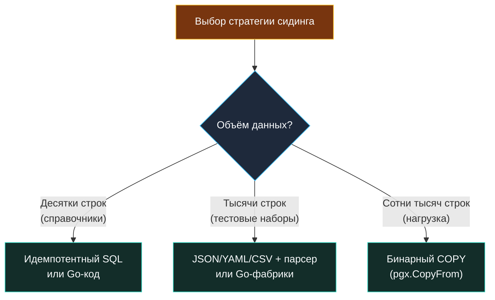
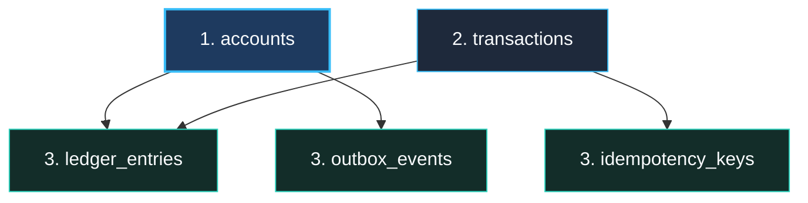

*Как отличить сиды от фикстур, загружать сотни тысяч тестовых строк через бинарный `COPY` и строить воспроизводимые стенды в `testcontainers` без утечки продакшен-дампа в CI.*

> «Автор теста должен стремиться помочь программисту, которому придётся разбираться в причинах его падения.»
> — Алан Донован и Брайан Керниган, *The Go Programming Language*

Локально тесты `LedgerPulse` проходят за три секунды. На сервере CI те же тесты падают с `duplicate key value violates unique constraint` или не находят системный счёт комиссий `fee_usd`: один разработчик загрузил старый SQL-файл, второй снял дамп со staging, а на CI крутится третья версия данных. Попытка решить проблему дампом продакшена приносит утечку персональных данных в логи, нагрузку на боевую реплику и 40-минутный старт тестов.

Воспроизводимый стенд держится на разделении трёх сущностей: **миграций** (структура таблиц), **seed-данных** (стартовые справочники и синтетика) и **тестовых фикстур** (изолированные наборы под отдельный тест).

## Сиды, фикстуры и отказ от прод-дампа

Миграции создают пустые таблицы `accounts`, `transactions` и `ledger_entries`. Но чтобы биллинг провёл первый перевод, в базе нужны технические счета (`treasury_usd`, `fee_usd`), а для нагрузочного теста — сотни тысяч проводок. Продакшен-дамп здесь непригоден по четырём причинам: утечка PII из `owner_name`/`metadata`, огромный объём архива, недетерминированные балансы и отставание дампа от новых миграций в ветке.

Стратегию сидинга выбирают от объёма и динамики данных:



- **SQL-скрипты (`INSERT ... ON CONFLICT`)** просты, но не умеют считать хэши, генерировать детерминированные UUID и подстраиваться под окружение.
- **Go-код через `database/sql`/`pgx`** проверяет доменные инварианты до вставки и контролирует транзакции.
- **YAML/JSON/CSV + парсер** удобно версионировать в Git и валидировать при чтении.
- **Смешивание DML-сидов с DDL-миграциями** оправдано только для крошечных неизменных справочников; тяжёлые данные в миграции могут перевести схему в `dirty` ([[5. Миграции базы данных — expand-and-contract без простоя]]).

## Под капотом: как СУБД переваривает массовую вставку

Одиночный `INSERT` в своей транзакции пишет WAL-запись, обновляет 8-килобайтную страницу кучи в `shared_buffers`, случайно меняет страницы B-Tree индексов и вызывает `fsync()` на `COMMIT`. Одна случайная запись на NVMe SSD стоит **~100 мкс**, на HDD — **~10 мс** (в 100 раз дольше). На 100 000 одиночных транзакций это минуты ожидания.

Пакетная загрузка радикально меняет профиль I/O:
- **Многострочный `INSERT` и `UNNEST`** группируют WAL-записи и убирают сетевые раунд-трипы ([[16. Пакетные (Batch) запросы, UNNEST и COPY]]).
- **Бинарный `COPY`** обходит SQL-парсер, потоком пишет кортежи в новые страницы кучи последовательными блоками (дружелюбно к префетчеру и контроллеру SSD) и сокращает системные вызовы `write()`/`fsync()`.
- **Отложенные внешние ключи (`DEFERRED`):** по умолчанию `FOREIGN KEY` проверяется построчно через `IndexScan`. Для `DEFERRABLE` ограничений команда `SET CONSTRAINTS ALL DEFERRED` переносит проверку на `COMMIT`, где планировщик делает один массовый `HashJoin` или `MergeJoin`.

## Идиоматичный Go 1.24: чанки и `pgx.CopyFrom`

Никогда не склеивайте один `INSERT` на 100 000 строк: он пробьёт лимит параметров протокола PostgreSQL (65 535) и перегрузит GC. Разбивайте сиды на чанки по 500–5 000 записей:

```go
package seeder

import (
	"context"
	"database/sql"
	"fmt"
)

type AccountSeed struct {
	ExternalID, OwnerName, Currency string
	Balance                         int64 // В копейках/центах
}

// SeedAccounts идемпотентно загружает счета батчами по 1000 записей.
func SeedAccounts(ctx context.Context, db *sql.DB, items []AccountSeed) error {
	const batchSize = 1000
	for i := 0; i < len(items); i += batchSize {
		end := min(i+batchSize, len(items))
		if err := insertBatch(ctx, db, items[i:end]); err != nil {
			return fmt.Errorf("seed offset %d: %w", i, err)
		}
	}
	return nil
}

func insertBatch(ctx context.Context, db *sql.DB, batch []AccountSeed) (err error) {
	tx, err := db.BeginTx(ctx, &sql.TxOptions{Isolation: sql.LevelReadCommitted})
	if err != nil {
		return fmt.Errorf("begin tx: %w", err)
	}
	defer func() {
		if err != nil {
			_ = tx.Rollback()
		}
	}()

	stmt, err := tx.PrepareContext(ctx, `
		INSERT INTO accounts (external_id, owner_name, currency, balance)
		VALUES ($1, $2, $3, $4) ON CONFLICT (external_id) DO NOTHING`)
	if err != nil {
		return fmt.Errorf("prepare: %w", err)
	}
	defer stmt.Close()

	for _, acc := range batch {
		if _, err = stmt.ExecContext(ctx, acc.ExternalID, acc.OwnerName, acc.Currency, acc.Balance); err != nil {
			return fmt.Errorf("exec %s: %w", acc.ExternalID, err)
		}
	}
	return tx.Commit()
}
```

Для заливки 500 000 строк в `ledger_entries` используйте `pgx.CopyFrom`: он работает по бинарному протоколу поверх `sync.Pool` буферов и ускоряет загрузку в 5–15 раз по сравнению с `ExecContext`:

```go
func SeedBulkEntries(ctx context.Context, pool *pgxpool.Pool, rows [][]any) (int64, error) {
	return pool.CopyFrom(
		ctx,
		pgx.Identifier{"ledger_entries"},
		[]string{"transaction_id", "account_id", "amount", "currency"},
		pgx.CopyFromRows(rows),
	)
}
```

Для миллионов строк без аллокации `[][]any` в памяти передавайте реализацию `pgx.CopyFromSource` (`Next`, `Values`, `Err`).

## Идемпотентность, топология FK и `testcontainers-go`

Повторный запуск сидера не должен ломаться:

| Стратегия | Механика SQL | Когда применять |
|---|---|---|
| `ON CONFLICT DO NOTHING` | `INSERT ... ON CONFLICT (external_id) DO NOTHING` | Стартовые счета и неизменяемые справочники |
| `ON CONFLICT DO UPDATE` | `... DO UPDATE SET owner_name = EXCLUDED.owner_name` | Конфигурация, синхронизируемая с кодом |
| `TRUNCATE + INSERT` | `TRUNCATE ledger_entries, transactions, accounts RESTART IDENTITY CASCADE` | Полный сброс тестовой БД |
| `MERGE` | Стандарт SQL:2003 (PostgreSQL 15+) | Сложная условная синхронизация |

Загрузку ведут в топологическом порядке графа внешних ключей (`001_init_ledger.sql` и `003_idempotency_outbox.sql`):



> [!warning] Ловушка: параллельный сидинг
> Одновременный запуск сидера из нескольких горутин по пересекающимся счетам вызывает `deadlock` или гонку вставки. Инициализируйте общие справочники через `sync.Once` в `TestMain`, а на уровне БД сериализуйте через `pg_advisory_lock`.

Чтобы не поднимать Docker-контейнер для каждого теста (100 тестов по 1,5 с = 2,5 минуты простоя), стартуйте один контейнер в `TestMain`, а тесты изолируйте либо откатом транзакции (`tx.Rollback()` в `t.Cleanup`), либо уникальными бизнес-ключами фикстур (`acc-` + `t.Name()`) для `t.Parallel()`.

```go
//go:build integration

package ledger_test

import (
	"context"
	"database/sql"
	"os"
	"testing"
	"time"

	"github.com/testcontainers/testcontainers-go/modules/postgres"
)

var testDB *sql.DB

func TestMain(m *testing.M) {
	ctx, cancel := context.WithTimeout(context.Background(), 2*time.Minute)
	defer cancel()

	pg, err := postgres.Run(ctx, "postgres:17-alpine",
		postgres.WithDatabase("ledgerpulse"),
		postgres.WithUsername("test"),
		postgres.WithPassword("test"),
		postgres.BasicWaitStrategies(),
	)
	if err != nil {
		panic(err)
	}
	dsn, err := pg.ConnectionString(ctx, "sslmode=disable")
	if err != nil {
		panic(err)
	}
	testDB, err = sql.Open("postgres", dsn)
	if err != nil {
		panic(err)
	}
	testDB.SetMaxOpenConns(5) // Тестам не нужен боевой пул в 50 соединений

	// Здесь: RunMigrations(testDB) и SeedReferenceAccounts(ctx, testDB)
	code := m.Run()

	_ = testDB.Close()
	_ = pg.Terminate(context.Background())
	os.Exit(code)
}
```

> [!tip] Собеседование [Middle]
> **Вопрос:** Почему сидеры и слой работы с БД в Go бесполезно тестировать моками и как ускорить интеграционные тесты в CI?
> **Ответ:** Моки проверяют только ваши собственные предположения о SQL-запросе, но не ловят синтаксические ошибки, нарушения `CHECK`/`FOREIGN KEY` и неверные типы в `Scan`. Сидеры и репозитории тестируют против реального PostgreSQL в `testcontainers-go`. Чтобы не тратить лишнее время на каждый тест, контейнер запускают один раз в `TestMain`, а тесты изолируют либо откатом транзакции, либо уникальными идентификаторами фикстур; для гигантских наборов в CI собирают преднакатанный Docker-образ с уже залитыми данными.

## Ловушки сидинга и сравнение с другими экосистемами

1. **Исчерпание WAL и `disk full`.** Массовая вставка миллионов строк одной гигантской транзакцией удерживает старые сегменты WAL до самого `COMMIT` и способна переполнить диск при ограниченном `max_wal_size`. Разбивайте заливку на транзакции по 10–50 тысяч строк или используйте `COPY`.
2. **Дрейф сидов и локальных баз.** Если разработчик руками поправил баланс тестового счёта у себя на ноутбуке, тест начинает опираться на «магическое» состояние локальной БД. На CI такой тест упадёт. Возьмите за правило: любой тест создаёт нужные ему фикстуры сам или стартует с чистого детерминированного сида.
3. **Секреты в репозитории.** В сид-файлы нередко утекают реальные API-ключи, токены платёжных шлюзов и пароли администраторов. В Git должны лежать только публичные или фиктивные тестовые значения, а учётные данные для стендов приходят из Secret Manager или переменных окружения.

В экосистемах вроде PHP (Laravel Seeders) или C# (EF Core `HasData`) сидеры традиционно привязаны к ORM или вшиты внутрь файлов миграций — это удобно на малых проектах, но замедляет массовую загрузку из-за рефлексии и связывает историю схемы с данными при слиянии веток. В Go выбирают явный императивный подход: инженер сам управляет транзакциями, аллокациями, бинарным `COPY` и тестовыми фабриками.

> [!tip] Собеседование [Senior/Staff]
> **Вопрос:** Можно ли запускать сид-скрипты в продакшене?
> **Ответ:** Для тестовых и демо-данных — категорически нет. В продакшене допустима только первичная инициализация неизменяемых системных справочников или технических счетов сервиса (например, счёта комиссий `fee_usd`) строго с идемпотентной защитой `ON CONFLICT DO NOTHING`. Любой автоматический `TRUNCATE` или неидемпотентный `UPDATE` из сидера на продакшене — грубая архитектурная ошибка, ведущая к потере клиентских данных.

## Упражнения

**Упражнение 1 (Базовое). Порядок загрузки и идемпотентность.**
Разработчик написал SQL-сидер для стенда `LedgerPulse`:
```sql
INSERT INTO ledger_entries (transaction_id, account_id, amount, currency) VALUES (1, 1, -5000, 'USD');
INSERT INTO ledger_entries (transaction_id, account_id, amount, currency) VALUES (1, 2, 5000, 'USD');
INSERT INTO transactions (reference_id, kind, status) VALUES ('seed-tx-1', 'transfer', 'posted');
INSERT INTO accounts (external_id, owner_name, currency, balance) VALUES ('alice', 'Alice', 'USD', 10000);
INSERT INTO accounts (external_id, owner_name, currency, balance) VALUES ('bob', 'Bob', 'USD', 5000);
```
Назовите три ошибки этого скрипта и исправьте его так, чтобы он выполнялся безопасно при первом и повторном запуске.

> [!solution] Показать решение
> Ошибки:
> 1. **Нарушен топологический порядок FK:** `ledger_entries` вставляются до создания записей в `transactions` и `accounts`, что упадёт с нарушением `FOREIGN KEY`.
> 2. **Жёсткие числовые ID (`1`, `2`):** в `001_init_ledger.sql` первичные ключи определены как `BIGINT GENERATED ALWAYS AS IDENTITY`. Повторная вставка или вставка при непустой таблице собьёт нумерацию или упадёт.
> 3. **Нет идемпотентности:** при повторном запуске `INSERT INTO accounts` упадёт по `UNIQUE (external_id)`, а `INSERT INTO transactions` — по `UNIQUE (reference_id)`.
> Исправленный вариант (использует CTE с `ON CONFLICT` и подтягивает актуальные ID по бизнес-ключам):
> ```sql
> WITH accs AS (
>     INSERT INTO accounts (external_id, owner_name, currency, balance)
>     VALUES ('alice', 'Alice', 'USD', 10000),
>            ('bob', 'Bob', 'USD', 5000)
>     ON CONFLICT (external_id) DO NOTHING
> ),
> tx AS (
>     INSERT INTO transactions (reference_id, kind, status)
>     VALUES ('seed-tx-1', 'transfer', 'posted')
>     ON CONFLICT (reference_id) DO NOTHING
>     RETURNING id
> )
> INSERT INTO ledger_entries (transaction_id, account_id, amount, currency)
> SELECT t.id, a.id, v.amount, 'USD'
> FROM (VALUES ('alice', -5000::bigint), ('bob', 5000::bigint)) AS v(ext_id, amount)
> CROSS JOIN tx t
> JOIN accounts a ON a.external_id = v.ext_id;
> ```
> При повторном запуске `tx` вернёт 0 строк, и дублирующие проводки в `ledger_entries` не появятся.

**Упражнение 2 (Практическое). Потоковый `pgx.CopyFromSource` без лишних аллокаций.**
Реализуйте генератор `entryCopySource`, удовлетворяющий интерфейсу `pgx.CopyFromSource` (`Next() bool`, `Values() ([]any, error)`, `Err() error`), который генерирует `n` парных детерминированных проводок для `pgx.CopyFrom` в таблицу `ledger_entries` (чередуя суммы `-100` и `+100` в валюте `'USD'`), не выделяя заранее слайс `[][]any` на все `n` элементов.

> [!solution] Показать решение
> Реализуем `pgx.CopyFromSource` поверх переиспользуемого буфера из 4 элементов:
> ```go
> type entryCopySource struct {
> 	txID    int64
> 	fromID  int64
> 	toID    int64
> 	total   int
> 	current int
> 	rowBuf  []any
> }
> 
> func NewEntryCopySource(txID, fromID, toID int64, total int) *entryCopySource {
> 	return &entryCopySource{
> 		txID:   txID,
> 		fromID: fromID,
> 		toID:   toID,
> 		total:  total,
> 		rowBuf: make([]any, 4),
> 	}
> }
> 
> func (s *entryCopySource) Next() bool {
> 	s.current++
> 	return s.current <= s.total
> }
> 
> func (s *entryCopySource) Values() ([]any, error) {
> 	if s.current%2 == 1 {
> 		s.rowBuf[0], s.rowBuf[1], s.rowBuf[2], s.rowBuf[3] = s.txID, s.fromID, int64(-100), "USD"
> 	} else {
> 		s.rowBuf[0], s.rowBuf[1], s.rowBuf[2], s.rowBuf[3] = s.txID, s.toID, int64(100), "USD"
> 	}
> 	return s.rowBuf, nil
> }
> 
> func (s *entryCopySource) Err() error { return nil }
> ```
> При передаче `&entryCopySource{...}` в `pool.CopyFrom(...)` потребление памяти остаётся константным $O(1)$ даже при загрузке 10 миллионов строк.

**Упражнение 3 (Со звёздочкой \*). Транзакционная изоляция тестов поверх `DBTX`.**
У вас есть `Repository`, работающий через интерфейс `DBTX` (как в `project/final/repo.go`). Напишите вспомогательную функцию `WithTxTestDB(t *testing.T, db *sql.DB) DBTX`, которая открывает транзакцию перед тестом, возвращает её как `DBTX` и автоматически откатывает через `t.Cleanup`. Объясните, в каком случае этот приём сломается и что нужно использовать вместо него.

> [!solution] Показать решение
> ```go
> func WithTxTestDB(t *testing.T, db *sql.DB) DBTX {
> 	t.Helper()
> 	tx, err := db.BeginTx(t.Context(), nil)
> 	if err != nil {
> 		t.Fatalf("begin test tx: %v", err)
> 	}
> 	t.Cleanup(func() {
> 		_ = tx.Rollback()
> 	})
> 	return tx
> }
> ```
> **Когда приём ломается:**
> 1. Если тестируемый метод внутри сервиса сам открывает новую транзакцию через `TxManager.WithinTx` поверх `*sql.DB` (у PostgreSQL нет полноценных независимых вложенных транзакций — `BeginTx` на `*sql.DB` откроет отдельное соединение из пула, которое не увидит незафиксированные данные внешней тестовой `tx`). Для поддержки такого сценария `TxManager` в тестах должен заменяться на savepoint-менеджер (`SAVEPOINT` / `ROLLBACK TO SAVEPOINT`).
> 2. Если проверяется конкурентное поведение блокировок (`SELECT ... FOR UPDATE`, `deadlock`, `SKIP LOCKED`) между двумя горутинами: двум конкурентным воркерам нужны два разных реальных соединения и реальные коммиты, поэтому для них изолируют тесты отдельными счетами/таблицами и очисткой через `TRUNCATE`.

Мы научились быстро и воспроизводимо наполнять базу начальными и тестовыми данными. Но в реальном сервисе нагрузка чтения обычно в десятки раз превышает нагрузку записи, и даже идеально настроенный PostgreSQL с покрывающими индексами упирается в потолок IOPS и CPU на однотипных горячих запросах. В следующей главе этого модуля (глава 8) разберём стратегии кэширования поверх баз данных (`Cache-Aside`, `Write-Through`, `Write-Back`) и защиту от лавины промахов `Cache Stampede` через `Singleflight`.
