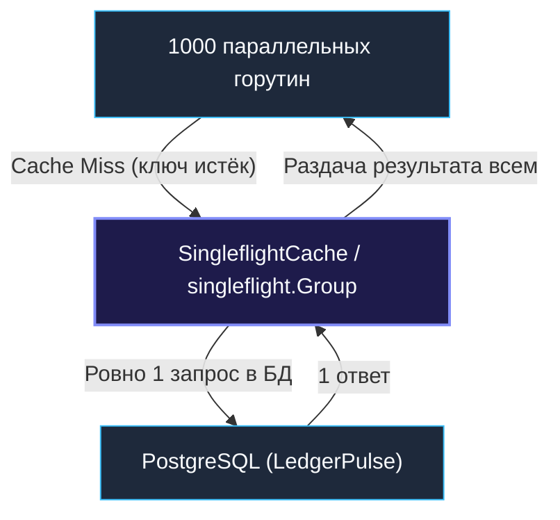

*Четыре стратегии кэширования поверх БД, TTL с джиттером, подавление Cache Stampede через `Singleflight`, устройство памяти Go и подводные камни инвалидации.*

> «Сборка мусора — огромное подспорье при написании корректных программ, но она не избавляет вас от необходимости думать о памяти. Вам не нужно выделять и освобождать память вручную, однако для написания эффективного кода всё равно приходится понимать время жизни переменных.»  
> — Алан Донован и Брайан Керниган, *The Go Programming Language*

---

## Цена одной миллисекунды: зачем БД кэш и чем за него платят

Представьте стол инженера-конструктора. Под рукой лежит тонкий блокнот с ключевыми формулами: заглянуть в него можно за полсекунды. Но если нужного чертежа нет, приходится спускаться в подвальный архив и искать папку среди стеллажей. Так соотносятся уровни памяти: чтение из локальной RAM занимает ~100 нс (L1 кэш CPU — ~1 нс), сетевой запрос к Redis или Valkey укладывается в 0.2–2 мс, а поиск по B-Tree в PostgreSQL со считыванием страниц с NVMe (~100 мкс) или HDD (~10 мс) под нагрузкой растягивается на 5–50 мс.

В сервисе `LedgerPulse` 100 000 RPS на чтение остатков счетов из таблицы `accounts` быстро перегрузят даже мощный узел PostgreSQL. Кэш снимает эту нагрузку и опускает p99 задержки чтения ниже 5 мс. Но как только данные появляются в двух местах — в авторитетной БД и в кэше — система сталкивается с проблемой, которую Фил Карлтон назвал одной из двух самых трудных в информатике (наряду с придумыванием имён): инвалидацией кэша. Каждый слой кэша — компромисс между латентностью, согласованностью (см. [[6. Модели согласованности в БД — Strong, Eventual, Read-Your-Writes и Causal]]) и потреблением памяти.

---

## Четыре паттерна кэширования

Взаимодействие приложения, кэша (локального или внешнего вроде Redis/Valkey/Memcached) и БД подчиняется одной из четырёх стратегий.

```mermaid
flowchart TD
    subgraph CA["1. Cache-Aside (Lazy Loading)"]
        A1["Приложение"] -->|"1. Get"| C1["Кэш"]
        C1 -.->|"Miss"| A1
        A1 -->|"2. Query"| D1["База данных"]
        A1 -->|"3. Set с TTL"| C1
    end

    subgraph RT["2. Read-Through"]
        A2["Приложение"] -->|"1. Get"| C2["Кэш / Прокси"]
        C2 -->|"2. Загрузка при Miss"| D2["База данных"]
        C2 -->|"3. Данные"| A2
    end

    subgraph WT["3. Write-Through"]
        A3["Приложение"] -->|"1. Write"| C3["Кэш"]
        C3 -->|"2. Синхронный Write"| D3["База данных"]
    end

    subgraph WB["4. Write-Behind (Write-Back)"]
        A4["Приложение"] -->|"1. Write"| C4["Кэш"]
        C4 -.->|"2. Асинхронный Batch Write"| D4["База данных"]
    end

    classDef box fill:#1e293b,stroke:#38bdf8,stroke-width:1px,color:#f8fafc;
    class A1,C1,D1,A2,C2,D2,A3,C3,D3,A4,C4,D4 box;
```



1. **Cache-Aside (Look-Aside, Lazy Loading).** Стандарт для микросервисов на Go. Приложение проверяет кэш; при `Cache Hit` сразу отдаёт ответ; при `Cache Miss` читает из БД, кладёт в кэш с `TTL` и возвращает клиенту; при изменении обновляет БД и удаляет ключ из кэша. Плюсы: отказ кэша не роняет сервис, в RAM попадают только горячие записи. Минусы: штраф холодного старта на первом запросе и риск окна устаревших данных.
2. **Read-Through.** Приложение обращается только к обёртке кэша. При промахе сам кэш вызывает зарегистрированный `loader`, сохраняет результат и возвращает данные. Код сервиса становится чище, метрики Hit Ratio централизуются, но сложнее настраивать нестандартную логику выборок.
3. **Write-Through.** Сервис пишет в кэш, а кэш **синхронно** обновляет БД и подтверждает операцию только после ответа СУБД. Данные в кэше всегда свежие, но каждая запись платит двойную сетевую задержку, а редко читаемые сущности засоряют дорогую RAM (`Cache Churn`).
4. **Write-Behind (Write-Back).** Кэш мгновенно подтверждает запись в RAM, а сброс пачками (`batch`) в БД идёт асинхронно в фоне. Это даёт максимальную скорость записи и сглаживание пиков (`Traffic Smoothing` — тысячи обновлений счётчика просмотров схлопываются в один `UPDATE`). Главный риск: потеря «грязных» страниц при падении узла кэша до сброса на диск.

| Паттерн | Координатор | Консистентность | Сценарий применения |
|---|---|---|---|
| **Cache-Aside** | Приложение | Eventual (TTL / `DEL`) | 90% Read-Heavy сервисов, профили, справочники |
| **Read-Through** | Библиотека / прокси | Eventual | Единые корпоративные SDK доступа к данным |
| **Write-Through** | Слой кэша | Высокая (синхронная) | Критичные реестры с мгновенным чтением после записи |
| **Write-Behind** | Кэш + фоновый воркер | Слабая (риск потери) | Счётчики, лайки, телеметрия |

> [!tip] Собеседование [Middle]
> **Вопрос:** Почему в Go-сервисах выбирают Cache-Aside, а не Write-Through?  
> **Ответ:** Горутины работают с `*sql.DB` напрямую (см. [[1. Пакет database_sql — архитектура драйверов, запросы и ошибки]]), а кэш служит лишь ускорителем чтения. Write-Through смешивает слой кэша с транзакционной логикой и удваивает задержку мутаций. Cache-Aside изолирует отказы: при падении Redis сервис продолжает читать из PostgreSQL.

---

## Локальный кэш против внешнего и устройство памяти

Физически кэш размещают внутри процесса Go (`L1`) или во внешнем кластере (`L2` — Redis, Valkey, Memcached; см. [[3. Redis — архитектура, структуры данных, RESP и работа из Go]], [[5. Memcached — slab-аллокатор и многопоточный кэш в памяти]], [[6. Valkey — открытый форк Redis и совместимость экосистемы]]). Часто их объединяют в двухуровневую схему `L1 + L2`.

| Критерий | Локальный in-memory (L1, Go) | Внешний кэш (L2, Redis / Valkey) |
|---|---|---|
| **Латентность** | 10–100 нс (RAM и кэш CPU) | 0.2–2 мс (TCP/IP, ядро ОС, сериализация) |
| **Сетевые syscalls** | 0 байт, без переключений в ядро | `sendto`/`recvfrom`, `epoll`, `copy_from_user` |
| **Давление на GC Go** | Высокое при указателях в куче | Нулевое (память в другом процессе) |
| **Когерентность** | Своя копия на каждом поде | Общее состояние для всех реплик |
| **Рестарт процесса** | Холодный старт | Переживает перезапуск сервиса |

### Сетевой стек, `netpoll` и пайплайнинг

Обращение к внешнему Redis требует системного вызова записи команды (`write`/`sendto`), ожидания ответа через `epoll`/`kqueue` и копирования буфера ядра (`copy_from_user`), а также сериализации (RESP, JSON, Protobuf или MessagePack). Планировщик Go через `netpoll` паркует горутину без блокировки потока ОС, но при 100 000 RPS накладные расходы на syscalls и парсинг доминируют.

Чтобы не тратить `10 * RTT` на десять ключей, в `github.com/redis/go-redis/v9` используют **пайплайнинг** (см. [[4. Redis под капотом — однопоточный event loop, RDB, AOF, Cluster и пайплайнинг]]): пачка команд уходит одним `write()` и читается за один `RTT` + время исполнения в Redis. Всегда задавайте размеры пула соединений (`PoolSize`, `MinIdleConns`, `ConnMaxLifetime`), чтобы не исчерпать сокеты.

### Ловушка указателей в куче и `GC` Go

Сборщик мусора Go применяет трёхцветную маркировку (Tri-color Mark and Sweep) и в фазе разметки обходит **каждый указатель** в куче. Если положить в `map[string]*Account` пять миллионов указателей, `gcMarkWorker` сожжёт до 25–30% CPU, а разбросанные объекты вызовут промахи кэша процессора (`dTLB-load-misses`).

Четыре правила локальности данных для in-memory кэша в Go:

1. **Убирайте указатели из долгоживущих карт.** Если ключи и значения `map` не содержат указателей (например, `map[uint64]uint64`), компилятор помечает таблицу флагом `noscan`, и GC её не сканирует. Библиотеки `bigcache`, `fastcache` и `ristretto` хранят байты в плоских кольцевых массивах `[]byte`, а в хеш-таблице держат лишь 64-битные смещения: десятки гигабайт такого кэша дают нулевую нагрузку на GC.
2. **Ограничивайте размер против OOM.** Внутренняя `hmap` в Go после `delete()` помечает ячейки как свободные (`tombstones`), но не возвращает страницы памяти ОС мгновенно. Нужен жёсткий лимит ключей с LRU/LFU-эвикцией.
3. **Уменьшайте конкуренцию мьютексов.** Один `sync.RWMutex` при частых записях переводит горутины в `_Gwaiting` через `futex` и создаёт `false sharing` на 64-байтных кэш-линиях. Делите кэш на 16–64 шарда по хешу (`xxhash`/`farmhash`). Встроенный `sync.Map` выгоден только при стабильных ключах и редких записях.
4. **Переиспользуйте буферы.** При 50 000 ответов по 2 КБ десериализация JSON создаёт 100 МБ мусора в секунду. Используйте `sync.Pool`, Protobuf/MessagePack или храните в кэше готовые байты ответа.

---

## Реализация в Go 1.24: `Singleflight` и TTL с джиттером

Когда истекает TTL популярного ключа (курс валюты, профиль крупного мерчанта в `LedgerPulse`), тысячи горутин одновременно видят `Cache Miss` и шлют одинаковый `SELECT` в PostgreSQL. Это **Cache Stampede** (*Thundering Herd* — «стадо бизонов»): пул БД исчерпывается, и система падает.

В `project/step07/cache_olap.go` показана компактная реализация `SingleflightCache[V any]`, которая объединяет две защиты: слияние одновременных промахов через `inflight` + `sync.WaitGroup` и **джиттер TTL (`±15%`)** через `math/rand/v2`, чтобы ключи не истекали синхронно.



```go
// Фрагмент из project/step07/cache_olap.go (Go 1.24)
func (c *SingleflightCache[V]) GetOrLoad(
	ctx context.Context,
	key string,
	baseTTL time.Duration,
	loader func(context.Context) (V, error),
) (V, error) {
	c.mu.Lock()
	if ent, ok := c.items[key]; ok && c.now().Before(ent.expiresAt) {
		c.mu.Unlock()
		return ent.val, nil
	}
	if existing, ok := c.inflight[key]; ok {
		c.mu.Unlock()
		existing.wg.Wait()
		return existing.val, existing.err
	}

	cl := &call[V]{}
	cl.wg.Add(1)
	c.inflight[key] = cl
	c.mu.Unlock()

	val, err := loader(ctx)
	cl.val, cl.err = val, err

	c.mu.Lock()
	delete(c.inflight, key)
	if err == nil && baseTTL > 0 {
		// Джиттер ±15% размазывает время истечения ключей
		jitter := time.Duration(float64(baseTTL) * (0.85 + rand.Float64()*0.30))
		c.items[key] = cacheEntry[V]{val: val, expiresAt: c.now().Add(jitter)}
	}
	c.mu.Unlock()

	cl.wg.Done()
	return val, err
}
```

Проверить работу `SingleflightCache` на 32 конкурентных горутинах можно тестом из `project/step07`:

```text
$ go test -race -v ./step07 -run TestSingleflightCacheAndMergeTree
=== RUN   TestSingleflightCacheAndMergeTree
--- PASS: TestSingleflightCacheAndMergeTree (0.02s)
PASS
```

В продакшене обычно используют пакет `golang.org/x/sync/singleflight` (`group.Do` / `DoChan`), который также пробрасывает паники загрузчика и возвращает флаг `shared bool`.

> [!warning] Ловушка / Gotcha
> **Отмена `ctx` первого вызывающего.** Если первая горутина в `singleflight` принесла клиентский `ctx`, а клиент разорвал соединение через 5 мс, запрос в БД отменится для всех 500 ожидающих горутин. Передавайте в загрузчик `context.WithoutCancel(ctx)` с отдельным жёстким таймаутом 1–2 с и используйте `DoChan` с `select` по `ctx.Done()` для каждого читателя.

---

## Три распределённые катастрофы и защита от них

Когда кластер состоит из десятков подов и внешнего Redis, локального `singleflight` уже недостаточно.

1. **Межподовый Cache Stampede.** Для координации между подами используют распределённую блокировку `SETNX` в Redis с коротким TTL или вероятностную досрочную регенерацию **XFetch** (разработанную в Стэнфорде). При чтении незадолго до конца TTL клиент с вероятностью, зависящей от длительности прошлой загрузки $\delta$ и коэффициента $\beta > 0$, запускает фоновое обновление заранее:
   $$\text{Time} - (\beta \times \delta \times \ln(\text{rand}())) > \text{Expiry}$$
   Тяжёлые ключи обновляются в фоне до реального протухания.
2. **Cache Penetration (проход мимо кэша).** Запросы по несуществующим ID пробивают кэш насквозь и бьют в БД. **Решение:** *Negative Caching* — сохранять факт отсутствия (`ErrNotFound`) с коротким TTL (15–30 с) — и фильтр Блума перед кэшем.
3. **Cache Avalanche (лавинный отказ).** Одновременное протухание тысяч ключей или падение узла Redis. **Решение:** обязательный Jitter TTL при записи, плавная деградация с коротким таймаутом на кэш (20–30 мс) и **Circuit Breaker** (см. Том 3 и Том 4), ограничивающий трафик к резервному пулу БД.

---

## Стратегии инвалидации и антипаттерны

Четыре механизма поддержания актуальности кэша:

1. **TTL.** Простейший вариант с предсказуемым окном Eventual Consistency.
2. **Явная инвалидация (`DEL`).** Выполняйте удаление **строго после `tx.Commit()`**. Удаление *до* коммита открывает гонку: параллельный читатель промахнётся, вычитает старую версию строки по MVCC и закэширует её на весь TTL. После коммита тоже остаётся редкое окно гонки при падении процесса между `Commit` и `Del`, поэтому к явному удалению всегда добавляют разумный TTL.
3. **Версионированные ключи (`acc:42:v17` → `acc:42:v18`).** Исключают гонку перезаписи старым значением; прежний ключ сам истекает по TTL.
4. **CDC через WAL и Outbox.** Отдельный воркер читает логическую репликацию PostgreSQL (или таблицу `outbox_events` из `003_idempotency_outbox.sql`, см. главу 12) и инвалидирует Redis и L1 через Pub/Sub.

> [!tip] Собеседование [Senior/Staff]
> **Вопрос:** Спроектируйте кэш для `LedgerPulse` на 100 000 RPS с p99 < 15 мс, сохранив строгую корректность переводов.  
> **Ответ:** Проверку баланса при списании никогда не делают по кэшу — она идёт строго в транзакции PostgreSQL. Для чтения профилей счетов, курсов и витрин применяется двухуровневый кэш: **L1** в памяти подов Go (без указателей — `ristretto`/`bigcache`, TTL 3–5 с + джиттер) снимает до 80% горячего трафика за наносекунды, **L2** в Redis/Valkey Cluster (TTL 5–15 мин) объединяет поды. Промахи схлопываются через `singleflight`, таймаут к Redis ограничен 20 мс с Circuit Breaker, а инвалидация идёт через поток WAL/Outbox и Pub/Sub.

### Частые антипаттерны

* **Кэш как источник истины:** любые данные в кэше должны восстанавливаться из БД.
* **Крупные JSON-ключи в Redis:** фрагментируют `jemalloc` и тормозят однопоточный event loop; кэшируйте компактные DTO.
* **Слепота без метрик:** отслеживайте `Cache Hit Ratio` (падение ниже 70% сигнализирует о проблеме с ключами или TTL), `p99` задержки и потребление памяти.
* **Кэш медленнее БД:** без агрессивных таймаутов и Circuit Breaker деградация Redis накапливает тысячи горутин и роняет приложение по OOM.
* **Копирование привычек из PHP:** в PHP-FPM процесс умирает после запроса, поэтому локальный L1 там невозможен; в долгоживущем процессе Go L1 эффективен, но требует контроля указателей для GC.

---

## Упражнения

### 1. Базовое: джиттер TTL и порядок инвалидации
В сервисе курсов валют ровно в 00:00 прогреваются 50 000 ключей с `TTL = 10 * time.Minute`. В 00:10 и 00:20 база данных уходит в 100% CPU, а при обновлении курса через «`redis.Del()` до `tx.Commit()`» клиенты ещё 10 минут получают старое значение. Объясните причины и исправьте оба дефекта.

> [!solution] Показать решение
> 1. **Всплески каждые 10 минут** — *Cache Avalanche* из-за одинакового TTL без разброса. Добавьте джиттер `±15%` к `baseTTL` через `math/rand/v2`.
> 2. **Устаревший курс** — гонка: между `Del()` и `Commit()` читатель промахнулся в кэш, вычитал ещё не обновлённую строку в PostgreSQL и записал её в Redis. Вызывайте `Del()` строго **после `tx.Commit()`**, используйте версионирование ключей (`rate:USD:v12`) или инвалидацию по CDC/Outbox.

### 2. Практическое: `singleflight` без отмены чужого запроса
Напишите на Go 1.24 обёртку поверх `golang.org/x/sync/singleflight.Group`, которая загружает `Account` по `id`, позволяя отменившему свой `ctx` клиенту сразу выйти с `ctx.Err()`, но не обрывая общую загрузку из БД (с таймаутом 2 с) для остальных ожидающих горутин.

> [!solution] Показать решение
> ```go
> func (l *SafeLoader) Load(ctx context.Context, id int64) (Account, error) {
> 	key := fmt.Sprintf("acc:%d", id)
> 	ch := l.sf.DoChan(key, func() (any, error) {
> 		dbCtx, cancel := context.WithTimeout(context.WithoutCancel(ctx), 2*time.Second)
> 		defer cancel()
> 		return l.fetch(dbCtx, id)
> 	})
>
> 	select {
> 	case <-ctx.Done():
> 		return Account{}, ctx.Err()
> 	case res := <-ch:
> 		if res.Err != nil {
> 			return Account{}, res.Err
> 		}
> 		return res.Val.(Account), nil
> 	}
> }
> ```
> `context.WithoutCancel` отвязывает запрос к БД от отмены первой горутины, а `DoChan` + `select` даёт каждому читателю независимую отмену.

### 3. Со звёздочкой (\*): Negative Caching против `Cache Penetration`
Дополните кэш хранением признака `notFound` (для `sql.ErrNoRows`) на короткий `negTTL = 15 * time.Second` и напишите тест, проверяющий, что 20 конкурентных запросов несуществующего `acc:missing` выполняют ровно 1 запрос к БД.

> [!solution] Показать решение
> ```go
> type cachedVal[V any] struct {
> 	val       V
> 	notFound  bool
> 	expiresAt time.Time
> }
>
> func (c *NegCache[V]) GetOrLoad(ctx context.Context, key string, posTTL, negTTL time.Duration, loader func(context.Context) (V, error)) (V, error) {
> 	c.mu.RLock()
> 	ent, ok := c.items[key]
> 	c.mu.RUnlock()
> 	if ok && time.Now().Before(ent.expiresAt) {
> 		if ent.notFound {
> 			var zero V
> 			return zero, sql.ErrNoRows
> 		}
> 		return ent.val, nil
> 	}
>
> 	v, err, _ := c.sf.Do(key, func() (any, error) {
> 		data, loadErr := loader(ctx)
> 		c.mu.Lock()
> 		defer c.mu.Unlock()
> 		if errors.Is(loadErr, sql.ErrNoRows) {
> 			var zero V
> 			c.items[key] = cachedVal[V]{val: zero, notFound: true, expiresAt: time.Now().Add(negTTL)}
> 			return nil, sql.ErrNoRows
> 		}
> 		if loadErr != nil {
> 			return nil, loadErr
> 		}
> 		c.items[key] = cachedVal[V]{val: data, expiresAt: time.Now().Add(posTTL)}
> 		return data, nil
> 	})
> 	if err != nil {
> 		var zero V
> 		return zero, err
> 	}
> 	return v.(V), nil
> }
> ```
> В тесте запустите 20 горутин через `sync.WaitGroup`, инкрементирующих `atomic.Int64` внутри `loader` (возвращающего `sql.ErrNoRows`), затем выполните 21-й последовательный вызов и проверьте `calls.Load() == 1`.

---

Кэширование ускоряет точечные чтения по ключу. Но когда тяжёлые отчёты с фильтрами и агрегациями невозможно уложить в простой ключ-значение и они начинают блокировать транзакции записи, разделяют сами модели чтения и записи: [[9. CQRS со стороны базы данных — разделение моделей чтения и записи]].
