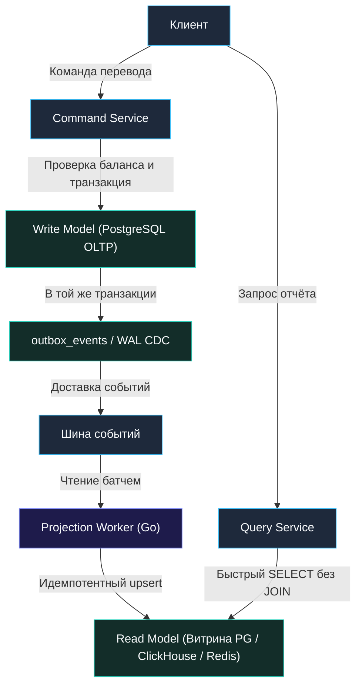

*Почему одна таблица плохо обслуживает одновременно строгие транзакции и аналитические выборки, как разделяются модели записи и чтения, проекционные воркеры на Go 1.24 и идемпотентность.*

> «Блеск Unix заключался в выборе абстракции, достаточно общей, чтобы быть поразительно полезной, и при этом не слишком дорогой по производительности.»  
> — Брайан Керниган, *UNIX: A History and a Memoir*

---

## Когда одна модель мешает и писать, и читать

Представьте оптовую продовольственную базу. С заднего двора к ней подъезжают фуры: погрузчики разгружают паллеты, кладовщики сверяют накладные и ведут строгий учёт (контур записи — `Commands`). С фасада расположен розничный супермаркет: покупатели с корзинками выбирают товар и сканируют штрихкоды (контур чтения — `Queries`). Если пустить покупателей прямо между работающими погрузчиками, работа склада встанет.

В сервисе `LedgerPulse` точно так же конфликтуют два профиля нагрузки:

* **Запись** — денежные переводы (`accounts`, `transactions`, `ledger_entries`). Им нужна нормализация (3NF), внешние ключи, короткие блокировки и минимум индексов.
* **Чтение** — выписки с фильтрацией по валютам, датам и контрагентам, а также дневные обороты. Десятки составных и GIN-индексов ради быстрых `SELECT` замедляют каждый `INSERT` и держат долгие снимки MVCC.

Когда чтений в 100 раз больше записей или форма отчёта сильно отличается от нормализованных таблиц, одна схема БД становится тормозом.

**CQRS (Command Query Responsibility Segregation)** — разделение операций записи (`Commands`) и чтения (`Queries`) на уровне моделей, кода и нередко физических хранилищ. Архитектура командных шин, доменов и брокеров событий подробно рассматривается в Томе 3 (подробнее об архитектуре CQRS и брокерах событий см. Том 3). Здесь мы разберём **сторону базы данных**: профили ввода-вывода, синхронизацию проекций, два пула `*sql.DB` и идемпотентность.

---

## Разделение профилей ввода-вывода и потоки данных

На стороне записи (`Write Model`) транзакции выполняют компактные проверки инвариантов и добавляют строки почти как последовательный аппенд с минимальными блокировками. На стороне чтения (`Read Model`) данные лежат денормализованными, с покрывающими индексами или в колоночной СУБД вроде ClickHouse (см. [[11. ClickHouse — аналитическая OLAP-база для миллиардов строк]] и [[12. ClickHouse под капотом — колоночное хранение, MergeTree и векторизация]]).



Выделяют три контура данных:

1. **Command Side.** Валидирует намерение, проверяет баланс и фиксирует изменения в нормализованной Write-модели.
2. **Projection Layer.** Фоновые воркеры читают поток изменений и строят денормализованные витрины.
3. **Query Side.** Читает готовые представления из Read-модели без дорогих `JOIN`.

> [!tip] Собеседование [Middle]
> **Вопрос:** CQRS и Event Sourcing — это одно и то же?  
> **Ответ:** Нет, это независимые паттерны. CQRS разделяет модели чтения и записи, а Event Sourcing хранит состояние как последовательность неизменяемых событий вместо обновляемых строк. CQRS часто применяют поверх обычных таблиц (`accounts`, `ledger_entries`), транслируя изменения через Outbox или CDC. И наоборот, Event Sourcing можно использовать без отдельной Read-модели, восстанавливая состояние чтением событий по запросу (хотя это медленно).

---

## Механика синхронизации: Outbox, CDC и `Projection Lag`

В распределённом CQRS модели записи и чтения не связаны общей транзакцией, поэтому Read-модель согласована в конечном счёте (**Eventual Consistency**, см. [[6. Модели согласованности в БД — Strong, Eventual, Read-Your-Writes и Causal]]).

### Три способа доставки изменений из Write DB

1. **Outbox Pattern.** Бизнес-транзакция в одной атомарной фиксации меняет рабочие таблицы и добавляет событие в `outbox_events` (`003_idempotency_outbox.sql`). Фоновый ретранслятор читает таблицу и отправляет события проекторам, гарантируя доставку *at-least-once* (детали на уровне БД разберём в главе 12).
2. **Logical Replication / CDC.** Инструменты вроде Debezium читают бинарный журнал СУБД (WAL в PostgreSQL, binlog в MySQL). Нагрузка на бизнес-транзакции нулевая, но сложнее инфраструктура и связь со схемой Write-таблиц.
3. **Публикация из кода после коммита (опасно).** Вызов `tx.Commit()`, а затем отправка в брокер без Outbox теряет события при сбое процесса между двумя операциями.

### Задержка проекции (`Projection Lag`)

Рабочий лаг витрины в продакшене обычно составляет **10–500 мс**. Он складывается из:
* публикации события в брокер (сеть и `fsync` брокера);
* доставки до воркера (латентность сети и очереди);
* обработки в Go-воркере (десериализация и вычисления);
* транзакции в Read DB (собственный WAL и обновление индексов).

Если лаг растёт, воркеры не успевают за потоком записи — нужно батчить обновления или масштабировать группу потребителей.

---

## Проекционный воркер на Go 1.24: батчинг, идемпотентность и GC

При 10 000 событий/сек коммит каждого события отдельной транзакцией упрётся в `fsync` и сетевой `RTT`, а десериализация JSON создаст десятки мегабайт временных структур в куче и нагрузит сборщик мусора. Решение — батчить по 100–500 событий, переиспользовать слайс батча и буферы (`sync.Pool`), выбирать компактные форматы (Protobuf, MessagePack) и защищаться от дублей в той же транзакции Read DB.

```go
package projection

import (
	"context"
	"database/sql"
	"fmt"
	"time"
)

type LedgerEvent struct {
	EventID   string
	AccountID int64
	Day       time.Time
	Currency  string
	Amount    int64
}

type DailyTurnoverWorker struct {
	readDB    *sql.DB
	batch     []LedgerEvent
	batchSize int
	maxDelay  time.Duration
}

func (w *DailyTurnoverWorker) Run(ctx context.Context, events <-chan LedgerEvent) error {
	ticker := time.NewTicker(w.maxDelay)
	defer ticker.Stop()
	for {
		select {
		case <-ctx.Done():
			flushCtx, cancel := context.WithTimeout(context.Background(), 3*time.Second)
			defer cancel()
			return w.flushBatch(flushCtx)
		case ev, ok := <-events:
			if !ok {
				return w.flushBatch(ctx)
			}
			w.batch = append(w.batch, ev)
			if len(w.batch) >= w.batchSize {
				if err := w.flushBatch(ctx); err != nil {
					return err
				}
			}
		case <-ticker.C:
			if len(w.batch) > 0 {
				if err := w.flushBatch(ctx); err != nil {
					return err
				}
			}
		}
	}
}

func (w *DailyTurnoverWorker) flushBatch(ctx context.Context) error {
	if len(w.batch) == 0 {
		return nil
	}
	defer func() { w.batch = w.batch[:0] }()

	tx, err := w.readDB.BeginTx(ctx, nil)
	if err != nil {
		return fmt.Errorf("begin read-db tx: %w", err)
	}
	defer func() { _ = tx.Rollback() }()

	dedupStmt, err := tx.PrepareContext(ctx, `
		INSERT INTO projection_applied_events (event_id, applied_at)
		VALUES ($1, now()) ON CONFLICT (event_id) DO NOTHING
	`)
	if err != nil {
		return err
	}
	defer dedupStmt.Close()

	upsertStmt, err := tx.PrepareContext(ctx, `
		INSERT INTO account_daily_summary (day, account_id, currency, net_delta, tx_count)
		VALUES ($1, $2, $3, $4, 1)
		ON CONFLICT (day, account_id, currency) DO UPDATE
		SET net_delta = account_daily_summary.net_delta + EXCLUDED.net_delta,
		    tx_count  = account_daily_summary.tx_count + 1
	`)
	if err != nil {
		return err
	}
	defer upsertStmt.Close()

	for _, ev := range w.batch {
		res, err := dedupStmt.ExecContext(ctx, ev.EventID)
		if err != nil {
			return fmt.Errorf("dedup %s: %w", ev.EventID, err)
		}
		if n, _ := res.RowsAffected(); n == 0 {
			continue // Повторная доставка уже учтённого события
		}
		if _, err := upsertStmt.ExecContext(ctx, ev.Day.UTC().Truncate(24*time.Hour), ev.AccountID, ev.Currency, ev.Amount); err != nil {
			return fmt.Errorf("upsert %s: %w", ev.EventID, err)
		}
	}
	return tx.Commit()
}
```

Пример вывода метрик воркера после прогона пачки из 200 событий с двумя дублями:

```text
level=INFO msg="projection batch flushed" batch_size=200 applied=198 skipped_duplicates=2 duration_ms=11.4
```

> [!warning] Ловушка / Gotcha
> **Неидемпотентные инкременты.** Без проверки `projection_applied_events` в той же транзакции повторная доставка сообщения дважды прибавит сумму в `account_daily_summary.net_delta`. Для любых инкрементов и счётчиков проверка уникального `event_id` обязательна.

---

## Полиглотное хранение и разделение пулов `*sql.DB`

CQRS позволяет выбирать оптимальный движок для каждой стороны. В `LedgerPulse` транзакционное ядро хранится в PostgreSQL (`001_init_ledger.sql`), а дневная витрина оборотов — в ClickHouse на `SummingMergeTree` (`001_ledger_events.sql`), который фоново сворачивает суммы при слияниях частей.

| Контур | Требования | Рекомендуемые СУБД | Почему |
|---|---|---|---|
| **Write** | ACID, FK, `CHECK`, строгая целостность | PostgreSQL, MySQL (InnoDB) | Надёжные транзакции, блокировки строк |
| **Read (Аналитика)** | Агрегации, денормализация, фильтры | PostgreSQL (MatView), ClickHouse | Покрывающие индексы, колоночное хранение |
| **Read (Поиск)** | Полнотекстовый поиск, фасеты | Elasticsearch, OpenSearch | Инвертированные индексы, ранжирование |
| **Read (Кэш)** | Латентность < 1 мс | Redis, Valkey | Операции в RAM, структуры `Hash`/`ZSet` |

### Два независимых пула `*sql.DB`

Даже если Write и Read модели живут на одном кластере PostgreSQL (мастер и read-реплика), в Go **запрещено делить один `*sql.DB`** (см. [[2. database_sql под капотом — пул соединений, badconn, Tx-pinning и Prepared Statements]]):
* **Write-пул:** консервативный `SetMaxOpenConns`, жёсткие таймауты контекста, чтобы короткие денежные переводы не стояли за тяжёлыми отчётами.
* **Read-пул:** больший лимит соединений и раздельные метрики `db.Stats()` для параллельных выборок.

---

## Ловушки, миграции и наблюдаемость

1. **Игнорирование задержки в UI.** Пользователь сделал перевод, сразу открыл историю и не видит его из-за лага 150 мс. **Решение:** оптимистичный UI, уведомление через WebSocket/SSE или временное чтение собственных записей из Write DB (*Read-Your-Writes*, см. [[6. Модели согласованности в БД — Strong, Eventual, Read-Your-Writes и Causal]]).
2. **Монструозные проекции.** Обновление десяти таблиц в одном обработчике создаёт долгие блокировки. Разделяйте проекторы по агрегатам: отдельный воркер для `account_daily_summary`, отдельный для поискового индекса.
3. **Независимые миграции Write и Read.** Эволюция Read-схемы не должна блокировать или откатывать миграции Write-модели (см. [[5. Миграции базы данных — expand-and-contract без простоя]] и [[6. Версионирование схемы и совместимость с выкатками сервиса]]).
4. **CQRS «на всякий случай».** При 100 RPS разделение баз и воркеры дают только операционные издержки. Вводите CQRS, когда метрики доказывают конфликт чтения и записи.
5. **Сравнение с Java/C#.** В Axon (Java) или MassTransit (C#) маршрутизация и проекции скрыты за рефлексией фреймворка. В Go принято явное программирование воркеров, контекстов и SQL-запросов без скрытого оверхеда.

### Метрики наблюдаемости

Отслеживайте здоровье контура чтения по пяти сигналам: `projection_lag_seconds`, `events_processed_total`, `events_failed_total` (с уходом «ядовитых» событий в Dead Letter Queue после 3–5 попыток), `batch_flush_duration_seconds` / `consumer_group_lag`, а также раздельные `write_db_query_duration_seconds` и `read_db_query_duration_seconds`.

> [!tip] Собеседование [Senior/Staff]
> **Вопрос:** Как гарантировать отсутствие потерь и дубликатов, если проектор упал посередине батча?  
> **Ответ:** Сочетанием доставки *at-least-once* (`outbox_events` или Kafka) и идемпотентности внутри транзакции Read DB. Смещение потребителя коммитится строго **после** успешного `tx.Commit()` в Read DB. При падении батч придёт повторно, а проверка `INSERT INTO projection_applied_events ... ON CONFLICT DO NOTHING` внутри той же транзакции отсечёт уже применённые `event_id`.

---

## Упражнения

### 1. Базовое: границы применения CQRS в `LedgerPulse`
Разработчик предлагает проверять достаточность баланса при переводе (`balance >= amount`) по Read-витрине CQRS, чтобы разгрузить мастер PostgreSQL. Объясните, почему это сломает финансовый инвариант, и назовите два сценария в `LedgerPulse`, где CQRS действительно нужен.

> [!solution] Показать решение
> 1. Read-модель работает в режиме Eventual Consistency (лаг 10–500 мс). Два параллельных перевода по 1000 копеек при остатке 1000 увидят устаревший баланс и оба пройдут проверку, что недопустимо для списаний. Проверки инвариантов всегда выполняются в Write-модели.
> 2. CQRS нужен для фильтрации выписок по периодам/контрагентам и для аналитики дневных оборотов (`account_daily_summary` / ClickHouse `SummingMergeTree`).

### 2. Практическое: функция замера `projection_lag_seconds`
Напишите на Go 1.24 функцию `MeasureProjectionLag(ctx context.Context, writeDB, readDB *sql.DB) (time.Duration, error)`, сравнивающую `MAX(created_at)` из `outbox_events` и `MAX(source_created_at)` из `projection_applied_events` с обработкой пустых таблиц через `sql.NullTime`.

> [!solution] Показать решение
> ```go
> func MeasureProjectionLag(ctx context.Context, writeDB, readDB *sql.DB) (time.Duration, error) {
> 	var writeTS, readTS sql.NullTime
> 	if err := writeDB.QueryRowContext(ctx, `SELECT MAX(created_at) FROM outbox_events`).Scan(&writeTS); err != nil {
> 		return 0, fmt.Errorf("query write ts: %w", err)
> 	}
> 	if !writeTS.Valid {
> 		return 0, nil
> 	}
> 	if err := readDB.QueryRowContext(ctx, `SELECT MAX(source_created_at) FROM projection_applied_events`).Scan(&readTS); err != nil {
> 		return 0, fmt.Errorf("query read ts: %w", err)
> 	}
> 	if !readTS.Valid {
> 		return time.Since(writeTS.Time), nil
> 	}
> 	if lag := writeTS.Time.Sub(readTS.Time); lag > 0 {
> 		return lag, nil
> 	}
> 	return 0, nil
> }
> ```
> Агрегат `MAX` по пустой таблице возвращает одну строку `NULL`, а не `sql.ErrNoRows`, поэтому требуется `sql.NullTime`.

### 3. Со звёздочкой (\*): пересборка Read-витрины на 50 млн строк без простоя
Опишите пошаговый план и SQL-переключение для добавления колонки `fee_total BIGINT` и полного пересчёта `account_daily_summary` без остановки чтения и потери текущих событий.

> [!solution] Показать решение
> 1. Создайте теневую таблицу `account_daily_summary_v2` с новой колонкой `fee_total BIGINT NOT NULL DEFAULT 0`.
> 2. Запустите второй проектор с отдельным чекпоинтом (`consumer_group = 'summary_v2'`), вычитывающий всю историю от начала журнала и доходящий до живого потока, пока старая таблица обслуживает запросы.
> 3. Когда лаг `summary_v2` сравняется с продом, атомарно поменяйте таблицы местами в короткой транзакции (с `lock_timeout`):
>    ```sql
>    BEGIN;
>    SET LOCAL lock_timeout = '2s';
>    ALTER TABLE account_daily_summary    RENAME TO account_daily_summary_old;
>    ALTER TABLE account_daily_summary_v2 RENAME TO account_daily_summary;
>    COMMIT;
>    ```
> 4. После проверки метрик удалите `account_daily_summary_old` и остановите старый воркер.

---

CQRS разделил таблицы записи и витрины чтения. Но пока в Write-модели строки перезаписываются через `UPDATE accounts SET balance = ...`, история изменений теряется. Что если хранить саму последовательность фактов в неизменяемом журнале? В следующей главе: [[10. Event Sourcing и хранение журнала событий в СУБД]].
