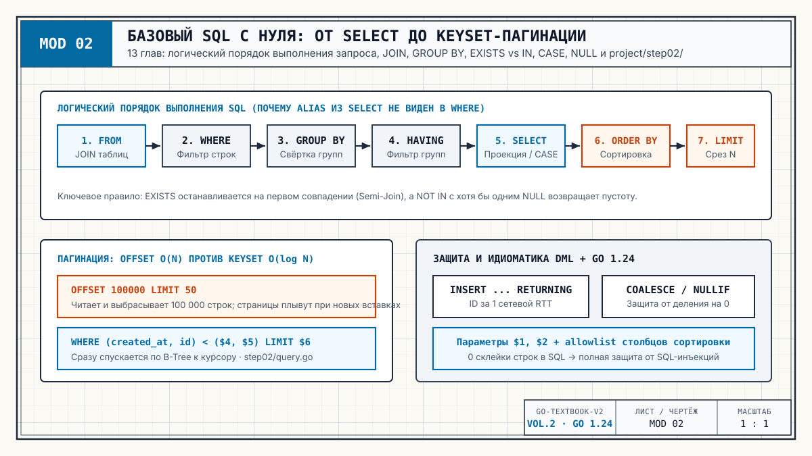

*Тринадцать глав о языке SQL с нуля: от декларативных запросов `SELECT` и фильтрации с трёхзначной логикой до `JOIN`, группировки `GROUP BY`, `EXISTS` и keyset-пагинации в `project/step02/`.*

> «Цель вычислений — понимание сути, а не числа.»  
> — Ричард Хэмминг

## Что нужно знать до старта

* **Модуль 1 (`1. Фундамент баз данных и моделирование`):** реляционная модель, первичные и внешние ключи, ограничения целостности (`NOT NULL`, `UNIQUE`, `CHECK`), трёхзначная логика `NULL` и таблицы `LedgerPulse` (`accounts`, `transactions`, `ledger_entries`).

## Что вы соберёте в этом разделе

* **Уверенное владение базовым SQL (DDL и DML)** — научитесь создавать таблицы, выбирать данные с проекцией и вычисляемыми столбцами, фильтровать строки без ловушек `NULL` и изменять данные с `RETURNING`.
* **Понимание логического порядка выполнения запроса** — перестанете путать `WHERE` и `HAVING`, разберётесь с `INNER`/`LEFT`/`RIGHT`/`FULL`/`CROSS JOIN`, подзапросами, `EXISTS` vs `IN` и условной агрегацией `CASE`.
* **Защиту от деградации `OFFSET` и SQL-инъекций** — разберёте `project/step02/query.go`, где keyset-пагинация `(created_at, id) < ($4, $5)` и параметризация `$1, $2` соединены с белым списком столбцов сортировки.

## Карта раздела

1. [[1. Введение в SQL — декларативный язык, DDL, DML и схема LedgerPulse]] — почему SQL описывает «что», а не «как», подмножества языка и схема `LedgerPulse`.
2. [[2. SELECT — выборка, проекция и вычисляемые столбцы]] — логический порядок выполнения запроса, цена `SELECT *`, алиасы и скалярные выражения.
3. [[3. WHERE и фильтрация строк]] — предикаты, приоритет `AND`/`OR`, `BETWEEN`, `LIKE` и SARGable-условия.
4. [[4. ORDER BY, LIMIT и пагинация (OFFSET против keyset)]] — сортировка, `NULLS FIRST/LAST`, деградация `OFFSET` и курсор из `project/step02/`.
5. [[5. INSERT, UPDATE, DELETE и RETURNING]] — модификация данных, `ON CONFLICT` (UPSERT), каскады и атомарный возврат изменённых строк.
6. [[6. JOIN — INNER, LEFT, RIGHT, FULL и CROSS]] — алгоритмы объединения, сохранение несовпавших строк и ловушка фильтрации в `WHERE` после `LEFT JOIN`.
7. [[7. GROUP BY и агрегатные функции]] — схлопывание строк в группы, `COUNT(*)` vs `COUNT(col)` и правило столбцов в `SELECT`.
8. [[8. HAVING — фильтрация групп после агрегации]] — граница между фильтрацией до и после группировки, влияние на I/O и планы.
9. [[9. Подзапросы — скалярные, табличные и коррелированные]] — вложенные запросы, `ANY`/`ALL` и почему коррелированный подзапрос может превратиться в цикл.
10. [[10. EXISTS и IN — семантика, NULL и производительность]] — ловушка `NOT IN` с `NULL` и ранний выход `Semi Join` в `EXISTS`.
11. [[11. Выражения CASE и условная агрегация]] — ветвление внутри запроса, защита от деления на ноль и отчёты за один проход по таблице.
12. [[12. Работа с NULL в SQL — COALESCE, NULLIF и ловушки агрегатов]] — функции замены `NULL`, `IS DISTINCT FROM` и сортировка с пустыми значениями.
13. [[13. DISTINCT, дубликаты и операции над множествами]] — `DISTINCT`, `DISTINCT ON`, `UNION`/`UNION ALL`/`INTERSECT`/`EXCEPT` и итог `project/step02/`.
