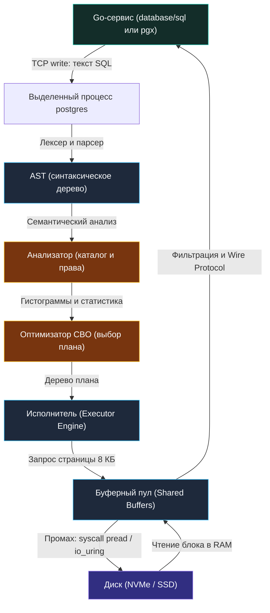
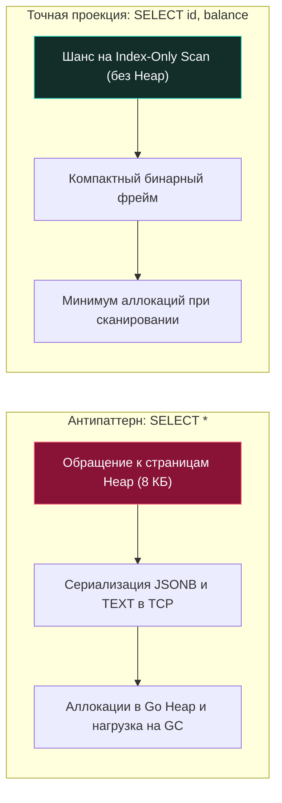

*От декларативной реляционной алгебры к физическому конвейеру PostgreSQL: как SQL превращается в вызовы ядра ОС, зачем нужны подготовленные выражения, пять подъязыков и боевая схема `LedgerPulse`.*

> «В идеальном мире прикладному программисту достаточно знать только API — без того, как этот API реализован и к какому железу он обращается. В реальности же чуть более глубокие знания порой оказываются весьма кстати.»  
> — Чарльз Петцольд, *Code: The Hidden Language of Computer Hardware and Software*

Разработчик на Go привык контролировать каждый шаг: выделить слайс, запустить цикл `for`, проверить условие `if` и скопировать байты в буфер. В императивном коде вы сами задаёте порядок обхода памяти и точку выхода.

Стоит отправить запрос в базу данных, и эта власть исчезает. Вы передаёте строку SQL, не указывая процессору, какие страницы поднимать с NVMe и в каком порядке перебирать кортежи. Если не понимать внутренний конвейер СУБД, безобидный запрос к таблице `LedgerPulse` способен загрузить CPU парсингом планов или вытеснить горячие страницы из оперативной памяти.

---

## Декларативная природа SQL: вы просите, СУБД решает

Язык **SQL** (*Structured Query Language*, выросший в 1970-х в IBM Research из прототипа *SEQUEL* поверх реляционной модели Эдгара Кодда) опирается на исчисление кортежей и реляционную алгебру. Это **декларативный** язык: вы описываете *что* требуется получить, но не диктуете, *как* машина обязана добраться до данных.

Вы не командуете PostgreSQL открывать файл `accounts`, читать блоки по 8 КБ через `pread`, искать смещение `balance` и собирать строки в буфер. Вместо пошаговой инструкции вы формулируете условие:

```sql
SELECT id, external_id, balance
FROM accounts
WHERE balance > 0;
```

Превращение этой декларации в системные вызовы Linux (`pread`, `epoll`, `fsync`), работу с общей памятью и блокировки берёт на себя движок СУБД на C/C++. На десятках миллионов проводок `ledger_entries` выбор плана определяет, уложится ли ответ в **0,2 мс** из RAM или растянется на **10 секунд** дискового чтения.

---

## Анатомия выполнения SQL-запроса

Чтобы диагностировать задержки в продакшене без гадания, полезно проследить весь путь SQL-запроса от вызова `db.QueryContext` в Go до возврата байтов по TCP-сокету:



На физическом уровне этот конвейер распадается на три строгие фазы.

### 1. Парсинг и семантический анализ

Когда пакет с текстом запроса приходит по TCP в выделенный процесс бэкенда PostgreSQL (или в рабочий поток `mysqld`), СУБД ещё ничего не знает о смысле команды:

1. **Лексический и синтаксический анализ (*Lexer & Parser*).** Движок разбивает строку на токены (`SELECT`, `id`, `FROM`, `accounts`), проверяет грамматику — закрыты ли скобки, на месте ли запятые — и строит абстрактное синтаксическое дерево (**AST**).
2. **Семантический анализ (*Analyzer*).** Сырое дерево сверяется с системным каталогом метаданных (`pg_class`, `pg_attribute` в PostgreSQL). Анализатор проверяет, существуют ли таблицы и столбцы, есть ли у роли права на чтение и совместимы ли типы в сравнениях — например, сравнивается ли числовой `balance` с числом `0`, а не со строкой `'ноль'`.

Если здесь найдена ошибка, клиент сразу получает протокольный пакет с ошибкой. Тяжёлые этапы планирования и чтения диска даже не запускаются.

### 2. Оптимизация (Cost-Based Optimizer)

Декларативность порождает свободу выбора: один и тот же запрос можно выполнить десятками способов. Можно прочитать таблицу `accounts` целиком последовательно (*Sequential Scan*), а можно спуститься по индексу B-Tree (*Index Scan*). При соединении таблиц можно сначала отфильтровать счета, а потом подтянуть проводки, или пойти в обратном порядке.

Проверенное дерево передаётся **стоимостному оптимизатору** (*Cost-Based Optimizer, CBO*). Опираясь на статистику — размер таблиц в страницах, долю `NULL`, гистограммы распределения значений, — он строит пространство планов, оценивает стоимость каждого в условных единицах I/O и CPU и выбирает самый дешёвый вариант. Детальный разбор алгоритмов CBO и чтения планов через `EXPLAIN (ANALYZE, BUFFERS)` ждёт вас в Модуле 4.

### 3. Исполнение и физика буферного пула

Выбранный план поступает в **Executor Engine**. Большинство реляционных СУБД строят его по итераторной модели (*Volcano Iterator Model*): каждый узел плана реализует интерфейс вроде `Next()` и запрашивает очередной кортеж у дочернего узла снизу вверх.

Исполнитель не читает файлы таблиц в обход собственной памяти. Он обращается за 8-килобайтной страницей данных в PostgreSQL (16-килобайтной в MySQL InnoDB) к буферному пулу (**Shared Buffers** / **Buffer Pool**):

* Если страница уже лежит в RAM (*Buffer Hit*), доступ занимает около **100 нс** — кортеж сразу идёт в регистры CPU на фильтрацию.
* Если страницы в пуле нет (*Buffer Miss*), движок делает системный вызов к ядру ОС (`pread` или `io_uring`), считывает блок с NVMe-диска за **~100 мкс** (в 1 000 раз дольше RAM) или с магнитного HDD за **~10 мс** (в 100 000 раз дольше RAM), размещает его в буферном пуле и лишь потом извлекает строки.

> [!info] Под капотом: CPU-Bound и IO-Bound фазы запроса
> При анализе нагрузки полезно разделять два профиля потребления ресурсов на сервере БД. Парсинг текста, проверка каталогов и перебор вариантов плана оптимизатором — чисто **CPU-Bound** работа. На высокочастотных OLTP-сервисах с десятками тысяч однотипных запросов в секунду повторный разбор сырого SQL способен сжигать до 30–40% процессорного времени. Само чтение страниц и сброс журнала транзакций — **Memory-Bound** и **IO-Bound** работа, упирающаяся в объём буферного пула и задержки накопителя.

---

## Подготовленные выражения (Prepared Statements)

Каждый раз, когда сервис отправляет сырую текстовую строку без подготовки, СУБД заново прогоняет лексер, парсер, анализатор и оптимизатор. Хуже того, если разработчик склеивает параметры в строку через `fmt.Sprintf`, он не только грузит процессор БД бесконечными уникальными строками, но и открывает прямую дорогу к SQL-инъекциям (подробнее об инъекциях см. Модуль 10).

Клиент-серверный протокол PostgreSQL решает обе задачи двухфазным расширенным протоколом (*Extended Query Protocol*) через **подготовленные выражения** (*Prepared Statements*):

1. **Фаза подготовки (`PREPARE` / Parse):** клиент отправляет шаблон запроса с позиционными плейсхолдерами (`$1`, `$2`):

```sql
PREPARE get_accounts_above_balance AS
SELECT id, external_id, balance
FROM accounts
WHERE currency = $1 AND balance >= $2;
```

СУБД проверяет синтаксис и каталог, строит обобщённый план, сохраняет его в памяти текущей серверной сессии и возвращает клиенту компактный дескриптор.

2. **Фаза связывания и исполнения (`EXECUTE` / Bind & Execute):** приложение передаёт лишь идентификатор стейтмента и бинарные аргументы:

```sql
EXECUTE get_accounts_above_balance('RUB', 10000);
```

Никакого повторного парсинга текста и поиска в системных таблицах. Движок подставляет параметры, при необходимости уточняет план и сразу запускает исполнитель.

```go
// Каноническое использование PrepareContext в Go 1.24 для частых запросов LedgerPulse.
stmt, err := db.PrepareContext(ctx,
	"SELECT id, external_id, balance FROM accounts WHERE currency = $1 AND balance >= $2",
)
if err != nil {
	return nil, fmt.Errorf("prepare accounts query: %w", err)
}
defer stmt.Close()

rows, err := stmt.QueryContext(ctx, "RUB", int64(10000))
if err != nil {
	return nil, fmt.Errorf("execute prepared query: %w", err)
}
defer rows.Close()
```

> [!warning] Ловушка: Prepared Statements поверх пула соединений в Go
> Вызов `db.QueryContext(ctx, "SELECT ... WHERE id = $1", id)` в `database/sql` автоматически создаёт подготовленное выражение, выполняет его и сразу закрывает. На стороне СУБД стейтмент привязан к памяти **конкретного TCP-соединения**, а не пула целиком.
>
> При высокой конкурентности одноразовый `db.QueryContext` поверх пула провоцирует лавину лишних сетевых циклов `Parse` и `Close`. Решение: либо держать долгоживущий `*sql.Stmt`, созданный на старте (`database/sql` сам переподготовит его на новом соединении), либо использовать `pgxpool`, кэширующий стейтменты внутри каждого коннекта (подробнее см. Модуль 10).

---

## Пять подъязыков SQL

Команды SQL делят на пять функциональных групп. Это деление отражается не только в документации стандарта, но и в устройстве блокировок, прав доступа и журнала транзакций:

| Подъязык | Назначение | Ключевые команды | Физика работы в СУБД |
|---|---|---|---|
| **DDL** (*Data Definition Language*) | Описание схемы и объектов хранения | `CREATE`, `ALTER`, `DROP`, `TRUNCATE` | Меняет системные каталоги; часто берёт жёсткую блокировку таблицы (`AccessExclusiveLock` в PostgreSQL) |
| **DML** (*Data Manipulation Language*) | Изменение данных внутри таблиц | `INSERT`, `UPDATE`, `DELETE` | Записывает изменения в журнал упреждающей записи (WAL) и создаёт версии кортежей для MVCC |
| **DQL** (*Data Query Language*) | Выборка и анализ данных | `SELECT` | Читает видимые версии кортежей; при нехватке памяти сортирует через временные файлы на диске |
| **DCL** (*Data Control Language*) | Управление правами и ролями | `GRANT`, `REVOKE` | Обновляет списки контроля доступа (ACL) в системных справочниках |
| **TCL** (*Transaction Control Language*) | Управление границами транзакций | `BEGIN`, `COMMIT`, `ROLLBACK`, `SAVEPOINT` | Координирует снимки видимости MVCC и гарантирует сброс записей WAL на диск (`fsync`) |

В литературе `SELECT` иногда причисляют к DML в широком смысле, но инженерно важно отделять чтение от мутаций: `DQL` не меняет персистентное состояние страниц таблицы.

---

## DDL на практике: схема `LedgerPulse`

В Модуле 1 мы спроектировали концептуальную и логическую модель финансового учёта с двойной записью (см. [[15. ER-диаграммы и моделирование схемы LedgerPulse]]). Теперь посмотрим на реальный DDL из миграции `project/sql/migrations/001_init_ledger.sql`, с которым мы будем работать на протяжении всего курса:

```sql
-- Денежные суммы хранятся строго в минимальных неделимых единицах (копейки/центы) в BIGINT.
CREATE TABLE IF NOT EXISTS accounts (
    id          BIGINT GENERATED ALWAYS AS IDENTITY PRIMARY KEY,
    external_id TEXT        NOT NULL UNIQUE,
    owner_name  TEXT        NOT NULL,
    currency    CHAR(3)     NOT NULL CHECK (currency ~ '^[A-Z]{3}$'),
    balance     BIGINT      NOT NULL DEFAULT 0 CHECK (balance >= 0),
    status      TEXT        NOT NULL DEFAULT 'active' CHECK (status IN ('active', 'frozen', 'closed')),
    metadata    JSONB       NOT NULL DEFAULT '{}'::jsonb,
    created_at  TIMESTAMPTZ NOT NULL DEFAULT now(),
    updated_at  TIMESTAMPTZ NOT NULL DEFAULT now()
);

CREATE TABLE IF NOT EXISTS transactions (
    id           BIGINT GENERATED ALWAYS AS IDENTITY PRIMARY KEY,
    reference_id TEXT        NOT NULL UNIQUE,
    kind         TEXT        NOT NULL CHECK (kind IN ('transfer', 'deposit', 'withdrawal', 'fee')),
    status       TEXT        NOT NULL DEFAULT 'pending' CHECK (status IN ('pending', 'posted', 'failed', 'reversed')),
    description  TEXT        NOT NULL DEFAULT '',
    created_at   TIMESTAMPTZ NOT NULL DEFAULT now()
);

CREATE TABLE IF NOT EXISTS ledger_entries (
    id             BIGINT GENERATED ALWAYS AS IDENTITY PRIMARY KEY,
    transaction_id BIGINT      NOT NULL REFERENCES transactions(id) ON DELETE RESTRICT,
    account_id     BIGINT      NOT NULL REFERENCES accounts(id)     ON DELETE RESTRICT,
    amount         BIGINT      NOT NULL CHECK (amount <> 0),
    currency       CHAR(3)     NOT NULL CHECK (currency ~ '^[A-Z]{3}$'),
    created_at     TIMESTAMPTZ NOT NULL DEFAULT now()
);
```

Каждая строка этого DDL решает конкретную инженерную задачу, разобранную в Модуле 1 (см. [[7. Ограничения целостности данных — NOT NULL, UNIQUE, CHECK]]):

* `BIGINT` для `balance` и `amount` исключает ошибки округления двоичной плавающей запятой (`FLOAT8`), неизбежные при сложении копеек.
* `GENERATED ALWAYS AS IDENTITY` — современный стандарт SQL для автоинкрементных ключей, заменивший устаревший `SERIAL` и защищающий от случайной ручной подстановки `id`.
* `ON DELETE RESTRICT` на внешних ключах `ledger_entries` не позволяет удалить счёт или транзакцию, если по ним уже прошли проводки: финансовая история не стирается, а исправляется компенсирующей записью.
* `TIMESTAMPTZ` сохраняет время в UTC с привязкой к часовому поясу, избавляя от сдвигов при переходе на летнее время или миграции серверов.

---

## Цена запроса `SELECT *`

Под влиянием ORM разработчики часто забирают сущность целиком: `SELECT * FROM accounts WHERE id = 42`. На маленькой таблице в десять строк это кажется безобидной ленью, но под нагрузкой такая привычка бьёт сразу по трём узлам системы:



1. **Лишний дисковый и страничный I/O.** Даже при идеальном индексе по `id` звёздочка заставляет исполнитель идти в основную таблицу (*Heap Tuple Fetch*), чтобы прочитать `metadata` (`JSONB`) и `owner_name`. Покрывающий индекс (*Index-Only Scan*, см. Модуль 4) становится невозможным.
2. **Насыщение сети.** Поле `metadata` может хранить килобайты вложенного JSON. СУБД тратит такты CPU на упаковку ненужных байтов в пакеты протокола, а сетевые карты передают лишний трафик.
3. **Давление на аллокатор и GC в Go.** Драйвер вынужден выделить буферы в куче Go под каждую запрошенную колонку, разобрать `JSONB` или `TEXT` и вскоре отдать их сборщику мусора. Замена `SELECT *` на `SELECT id, balance, currency` кратно снижает аллокации на горячем пути.

> [!tip] Собеседование [Middle]
> **Вопрос:** В чём разница между SQL и Go, и почему бизнес-логику обычно не переносят в хранимые процедуры и триггеры?  
> **Ответ:**  
> 1. **Декларативность против императивности.** SQL предназначен для операций над множествами рядом с диском; Go — для императивной логики, сетей и ветвлений.  
> 2. **Масштабирование состояния.** Go-сервисы *stateless* (легко поднять десятки реплик), а БД — *stateful* узел с персистентным диском.  
> 3. **Защита дефицитного ресурса.** CPU базы данных — узкое горлышко системы. Вычисления на PL/pgSQL отнимают ресурсы у единого хранилища вместо дешёвого масштабирования на Go.

---

## Упражнения

### Базовое
Определите, к какому подъязыку SQL (`DDL`, `DML`, `DQL`, `DCL`, `TCL`) относится каждая из приведённых команд, и укажите, меняет ли она данные в страницах таблицы или метаданные каталога:
1. `CREATE TABLE holds (...);`
2. `SELECT id, balance FROM accounts;`
3. `UPDATE accounts SET status = 'frozen' WHERE id = 7;`
4. `GRANT SELECT ON ledger_entries TO analytics_ro;`
5. `BEGIN;` и `ROLLBACK;`

> [!solution] Показать решение
> 1. `CREATE TABLE` — **DDL**, изменяет системные каталоги (`pg_class`, `pg_attribute`) и регистрирует новый объект хранения.
> 2. `SELECT` — **DQL**, читает видимые кортежи без изменения данных таблиц.
> 3. `UPDATE` — **DML**, мутирует кортежи таблицы (в PostgreSQL создаёт новую версию строки и пишет запись в WAL).
> 4. `GRANT` — **DCL**, изменяет списки контроля доступа (ACL) в системных таблицах прав.
> 5. `BEGIN` и `ROLLBACK` — **TCL**, открывают и откатывают границы транзакции, управляя снимками MVCC.

### Практическое
В проекте `LedgerPulse` нужно поддержать таблицу аудита `audit_log` для фиксации смен статуса счетов (`active` → `frozen` → `closed`). Напишите DDL-команду `CREATE TABLE IF NOT EXISTS audit_log`, соблюдая стиль `001_init_ledger.sql`:
* первичный ключ `id` через `BIGINT GENERATED ALWAYS AS IDENTITY`;
* обязательная ссылка `account_id` на `accounts(id)` с защитой от удаления (`ON DELETE RESTRICT`);
* поля `old_status` и `new_status` с проверкой допустимых значений `('active', 'frozen', 'closed')` и условием, что новый статус отличается от старого;
* поле `changed_at` типа `TIMESTAMPTZ` со значением по умолчанию `now()`.

> [!solution] Показать решение
> Для проверки отличия статусов достаточно табличного или строкового ограничения `CHECK (old_status <> new_status)`:
> ```sql
> CREATE TABLE IF NOT EXISTS audit_log (
>     id         BIGINT GENERATED ALWAYS AS IDENTITY PRIMARY KEY,
>     account_id BIGINT      NOT NULL REFERENCES accounts(id) ON DELETE RESTRICT,
>     old_status TEXT        NOT NULL CHECK (old_status IN ('active', 'frozen', 'closed')),
>     new_status TEXT        NOT NULL CHECK (new_status IN ('active', 'frozen', 'closed')),
>     changed_at TIMESTAMPTZ NOT NULL DEFAULT now(),
>     CHECK (old_status <> new_status)
> );
> ```
> Такая конструкция гарантирует на уровне самой СУБД, что в журнал аудита не попадёт бессмысленная запись о смене `'active'` на `'active'` и что ни один счёт с историей аудита не будет удалён напрямую.

### Со звёздочкой (*)
Сервис `LedgerPulse` на Go выполняет 15 000 однотипных запросов в секунду вида:
```go
query := fmt.Sprintf("SELECT balance FROM accounts WHERE id = %d", accountID)
row := db.QueryRowContext(ctx, query)
```
Через неделю нагрузка выросла вдвое, и профилирование сервера PostgreSQL показало, что 35% CPU уходит на парсинг и планирование запросов, хотя самих чтений с диска почти нет (`Buffer Hit` равен 99,8%). Объясните две инженерные причины такого расхода CPU и перепишите фрагмент на Go 1.24 так, чтобы снять нагрузку на парсер и убрать риск SQL-инъекций.

> [!solution] Показать решение
> 1. **Отсутствие параметризации:** подстановка `accountID` через `fmt.Sprintf` генерирует миллионы синтаксически разных SQL-строк (`... id = 101`, `... id = 102`). СУБД вынуждена для каждого запроса заново запускать лексер, парсер, семантический анализатор и оптимизатор, а кэш планов и `pg_stat_statements` засоряются уникальными текстами. Кроме того, если вместо `int64` попадёт пользовательская строка, возникнет SQL-инъекция.
> 2. **Однократная подготовка на старте или `pgx`:** в `database/sql` для горячего пути стоит подготовить `stmt` один раз при инициализации репозитория (или использовать `pgxpool` с кэшем стейтментов), передавая аргумент через плейсхолдер `$1`:
> ```go
> // Инициализация один раз на уровне репозитория:
> getBalanceStmt, err := db.PrepareContext(ctx, "SELECT balance FROM accounts WHERE id = $1")
> if err != nil {
>     return fmt.Errorf("prepare getBalanceStmt: %w", err)
> }
>
> // Горячий путь (без повторного парсинга текста на сервере БД):
> var balance int64
> err = getBalanceStmt.QueryRowContext(ctx, accountID).Scan(&balance)
> ```
> Теперь СУБД разбирает и планирует запрос один раз на соединение, а дальше получает компактный бинарный дескриптор и 8-байтный `int64`.

---

## Мостик к следующему уроку

Мы увидели, как декларативный SQL проходит путь от текстовой строки до страниц в `Shared Buffers`, научились читать DDL схемы `LedgerPulse` и разобрались, почему `SELECT *` дорого обходится диску, сети и сборщику мусора Go.

Но даже в простом запросе чтения есть скрытые правила: в каком порядке база данных на самом деле вычисляет разделы команды, почему алиас из `SELECT` не виден в условии фильтрации и как безопасно принимать десятки тысяч строк в слайсы Go без утечки соединений. Разберём механику выборки и проекции в следующей главе: [[2. SELECT — выборка, проекция и вычисляемые столбцы]].
