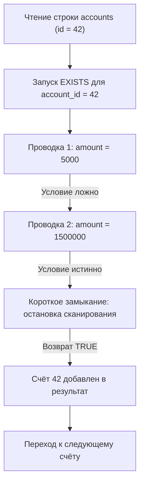

*Чем предикат принадлежности множеству `IN` отличается от квантора существования `EXISTS` на уровне планировщика, почему `NOT IN` с единственным `NULL` молча обнуляет выборку и как `SELECT EXISTS(...)` в Go экономит десятки проходов по страницам.*

В [[9. Подзапросы — скалярные, табличные и коррелированные]] мы разобрали композитную природу SQL: один запрос можно вложить внутрь другого, превратив промежуточную выборку в источник для фильтрации. На практике такие вложенные фильтры почти всегда опираются на два предиката — `IN` и `EXISTS`.

Среди разработчиков держится устойчивый миф, будто `IN` и `EXISTS` — это просто два разных синтаксиса для одной и той же операции. На уровне декларативного смысла положительные формы действительно часто дают одинаковый результат, но для парсера, оптимизатора и исполнителя СУБД это разные конструкции с разной математической семантикой, разными алгоритмами соединения и совершенно разным поведением при встрече с `NULL`.

---

## Оператор `IN`: проверка принадлежности множеству

Оператор `IN` проверяет, принадлежит ли значение левого операнда заданному множеству ($v \in S$). Справа может стоять как фиксированный список констант, так и табличный подзапрос, возвращающий один столбец.

В системе `LedgerPulse` с его помощью удобно выбирать счета по перечню допустимых состояний или транзакции, связанные с активными счетами:

```sql
-- 1. Статический список констант
SELECT id, external_id, balance
FROM accounts
WHERE status IN ('frozen', 'closed');

-- 2. Динамический список из подзапроса
SELECT id, transaction_id, amount
FROM ledger_entries
WHERE account_id IN (
    SELECT id
    FROM accounts
    WHERE currency = 'EUR' AND status = 'active'
);
```

### Как база данных физически выполняет `IN`

С точки зрения логики предикат `IN` — это синтаксический сахар для цепочки сравнений на равенство, связанных оператором `OR`. Выражение `status IN ('frozen', 'closed')` парсер на этапе построения синтаксического дерева транслирует в эквивалентную дизъюнкцию:

```sql
status = 'frozen' OR status = 'closed'
```

Когда справа перечислено несколько констант и по столбцу построен B-Tree индекс (например, по `id`), стоимостной оптимизатор превращает короткий список в серию точечных спусков по дереву (**Index Seek** / `Index Scan`). Если список содержит пять-десять идентификаторов, каждый спуск проходит через кэшированные в оперативной памяти верхние уровни B-Tree за микросекунды (обращение к RAM занимает около 100 нс, тогда как случайное чтение страницы с NVMe — около 100 мкс, а с HDD — около 10 мс).

> [!warning] Ловушка: гигантские списки `IN (...)`
> Если приложение на Go формирует срез из сотен тысяч идентификаторов и подставляет их в `WHERE id IN ($1, $2, ..., $200000)`, СУБД сталкивается сразу с двумя проблемами:
> 1. **Цена парсинга и памяти.** Движку приходится разбирать гигантский AST-узел из сотен тысяч элементов, переполняя память на разбор и планирование запроса.
> 2. **Отказ от индекса.** Стоимостной оптимизатор (CBO) оценивает цену 200 000 случайных спусков по B-Tree и понимает, что последовательно прочитать всю таблицу подряд (**Sequential Scan**) по 8-килобайтным страницам дешевле, чем прыгать по всему дереву. В итоге индекс отбрасывается, а запрос читает таблицу целиком, нагружая CPU и вытесняя горячие данные из Buffer Pool.
>
> В PostgreSQL для передачи длинных списков из Go-кода вместо раздувания SQL-строки тысячами плейсхолдеров передают один параметр-массив `WHERE id = ANY($1::bigint[])` или соединяют с `UNNEST($1::bigint[])`.

---

## Оператор `EXISTS`: предикат существования

В отличие от `IN`, оператор `EXISTS` выражает математический квантор существования ($\exists$). Он не сравнивает значения столбцов слева и справа. Ему вообще не нужны конкретные данные из внутреннего подзапроса — `EXISTS` возвращает строго булево значение (`TRUE` или `FALSE`), отвечая на единственный вопрос: **вернул ли вложенный подзапрос хотя бы одну строку?**

Почти всегда `EXISTS` используют с **коррелированным подзапросом**, который ссылается на столбец текущей строки внешнего запроса:

```sql
-- Найти активные счета, по которым есть хотя бы одна крупная проводка
SELECT a.id, a.external_id, a.currency
FROM accounts a
WHERE a.status = 'active'
  AND EXISTS (
      SELECT 1
      FROM ledger_entries le
      WHERE le.account_id = a.id
        AND le.amount > 1000000
  );
```

### Короткое замыкание и алгоритм Semi-Join

Главная сила `EXISTS` с точки зрения физики исполнения запросов — поддержка алгоритма **Semi-Join (полусоединение)** и логики **короткого замыкания (Short-circuit evaluation)**.

Представьте, что у счёта `a.id = 42` за последний год накопилось 500 000 проводок. Как только исполнитель встречает в индексе `idx_ledger_entries_account_created` (см. `project/sql/migrations/002_indexes.sql`) **первую же** строку, где `le.account_id = 42` и `le.amount > 1000000`, он немедленно прерывает дальнейший просмотр проводок для этого счёта. Нам не важно, одна там крупная проводка или полмиллиона — факт существования уже доказан.



Вдобавок к раннему выходу, полусоединение принципиально **не размножает строки** внешней таблицы. Обычный `INNER JOIN accounts` с `ledger_entries` выдал бы 500 000 копий одного счёта, если у него полмиллиона крупных проводок, а `EXISTS` гарантирует не более одной строки на каждый подходящий счёт.

> [!info] Под капотом: `SELECT 1`, `SELECT *` или `SELECT NULL` внутри `EXISTS`
> Десятилетиями на форумах спорят, что быстрее писать внутри `EXISTS`: `SELECT 1`, `SELECT *` или `SELECT NULL`.
>
> Современным оптимизаторам (PostgreSQL, MySQL 8+, SQLite) это безразлично. Когда парсер видит `EXISTS (...)`, он полностью отбрасывает этап проекции столбцов внутреннего запроса. Исполнитель не читает лишние атрибуты из Heap-страницы и не распаковывает их в память: ему достаточно проверить видимость версии кортежа по правилам MVCC или даже ограничиться чтением одного индекса (**Index-Only Scan**). Тем не менее `SELECT 1` остаётся общепринятой инженерной конвенцией, которая сразу сигнализирует читателю кода: значения полей не используются, важен только сам факт существования строки.

---

## Что быстрее: `IN` или `EXISTS`

В ранних версиях реляционных СУБД выбор между `IN` и `EXISTS` диктовал производительность запроса напрямую, и учебники формулировали жёсткую эвристику:
* Если внешняя таблица огромна, а подзапрос возвращает крошечный набор значений — берите `IN` (сначала выполняется подзапрос, затем маленькое множество проверяется по большой таблице).
* Если внешняя таблица компактна, а внутренняя таблица огромна и индексирована по ключу корреляции — берите `EXISTS` (короткое замыкание остановит поиск на первом совпадении).

В современных версиях PostgreSQL и MySQL 8+ стоимостной оптимизатор (CBO) выполняет **раскрытие подзапросов (Subquery Unnesting)**. На этапе логической перестройки дерева запроса он сам преобразует и `IN (SELECT ...)`, и `EXISTS (SELECT ...)` в узел полусоединения, выбирая оптимальный физический алгоритм: **Hash Semi Join**, **Merge Semi Join** или **Nested Loop Semi Join** по индексу.

Проверим это на реальном плане выполнения в PostgreSQL 17 (подробно читать вывод `EXPLAIN ANALYZE` и разбираться в стоимостной модели мы научимся в Модуле 4):

```sql
EXPLAIN (COSTS OFF)
SELECT a.id, a.external_id
FROM accounts a
WHERE a.id IN (
    SELECT le.account_id
    FROM ledger_entries le
    WHERE le.amount < -100000
);
```

Оптимизатор строит план с полусоединением, даже несмотря на то что в тексте запроса написано `IN`:

```text
Hash Semi Join
  Hash Cond: (a.id = le.account_id)
  ->  Seq Scan on accounts a
  ->  Hash
        ->  Seq Scan on ledger_entries le
              Filter: (amount < '-100000'::integer)
```

Если заменить `IN` на коррелированный `EXISTS`, план выполнения будет идентичным. Оптимизатор сам решит, строить ли хеш-таблицу по внутреннему набору (`Hash Semi Join`) или идти по индексу (`Nested Loop`).

Но равноправие `IN` и `EXISTS` мгновенно разрушается, как только перед ними появляется частица `NOT`.

---

## Фатальная ловушка: `NOT IN` и `NULL`

В [[8. NULL и трёхзначная логика]] мы познакомились с трёхзначной логикой SQL (`TRUE`, `FALSE`, `UNKNOWN`). При переходе к отрицаниям `NOT IN` и `NOT EXISTS` именно трёхзначная логика превращает, казалось бы, безобидный запрос в скрытый баг, уничтожающий бизнес-логику.

Поставим типовую задачу аудита в `LedgerPulse`: *найти все активные счета, которые не фигурируют в списке проблемных счетов или родительских ссылок*. Допустим, в некоторой таблице исключений `restricted_accounts` или в необязательном поле `parent_transaction_id` таблицы `transactions` (которое допускает `NULL`) хранятся идентификаторы.

### Опасный вариант с `NOT IN`

```sql
-- Найти счета, не упомянутые в таблице аудиторских исключений
SELECT a.id, a.external_id
FROM accounts a
WHERE a.id NOT IN (
    SELECT r.account_id FROM audit_exclusions r
);
```

Предположим, в `audit_exclusions` лежат три строки, и одна из них содержит `NULL` в поле `account_id`: `(10, 25, NULL)`. Подзапрос вернёт множество `(10, 25, NULL)`.

По законам де Моргана отрицание дизъюнкции разворачивается в конъюнкцию строгих неравенств:

```sql
a.id != 10 AND a.id != 25 AND a.id != NULL
```

Проверим, что произойдёт со счётом `a.id = 42`:
1. `42 != 10` → `TRUE`
2. `42 != 25` → `TRUE`
3. `42 != NULL` → `UNKNOWN` (любое сравнение с неизвестностью даёт `UNKNOWN`)

Итоговое выражение:

```text
TRUE AND TRUE AND UNKNOWN  ==>  UNKNOWN
```

Предложение `WHERE` пропускает дальше по конвейеру только строки, для которых предикат вычислился в строгое `TRUE`. Значение `UNKNOWN` отбрасывается точно так же, как `FALSE`. В итоге запрос **вернёт 0 строк**, даже если в таблице `accounts` десять миллионов счетов, ни один из которых не попадал в исключения.

> [!warning] Почему оптимизатор не объединяет `NOT IN` в Anti-Join
> Из-за семантики трёхзначной логики планировщик PostgreSQL **не может** безопасно переписать `NOT IN (SELECT ...)` в быстрый `Hash Anti Join`, если колонка внутри подзапроса не гарантирована ограничением `NOT NULL` в схеме таблицы. Ему приходится использовать более медленный сканирующий план (`SubPlan`), проверяя наличие `NULL` в подзапросе на каждой строке.

### Безопасный вариант с `NOT EXISTS`

```sql
SELECT a.id, a.external_id
FROM accounts a
WHERE NOT EXISTS (
    SELECT 1
    FROM audit_exclusions r
    WHERE r.account_id = a.id
);
```

Здесь мы проверяем не равенство значения каждому элементу списка, а существование хотя бы одной совпадающей строки:
* Если `r.account_id` равно `NULL`, внутреннее условие `NULL = 42` даёт `UNKNOWN`, поэтому строка из `audit_exclusions` с `NULL` просто не проходит внутренний `WHERE`.
* Для счёта `42` подзапрос возвращает пустое множество (0 строк).
* `EXISTS` возвращает `FALSE`, а `NOT EXISTS` инвертирует его в строгое `TRUE`.

Счёт `42` гарантированно попадает в результат, а оптимизатор свободно применяет эффективный алгоритм **Hash Anti Join** или **Merge Anti Join**.

> [!tip] Собеседование [Middle]
> **Вопрос:** В чём разница между `NOT IN` и `NOT EXISTS` при наличии `NULL` в подзапросе и как оптимизатор строит планы для них?  
> **Ответ:** `NOT IN` разворачивается в цепочку `col != v1 AND col != v2 AND ...`, и появление хотя бы одного `NULL` превращает всё выражение в `UNKNOWN`, из-за чего внешний `WHERE` отбрасывает все строки (результат — 0 строк). `NOT EXISTS` проверяет кардинальность результата подзапроса (0 строк или больше) и не ломается от `NULL` в данных. Кроме того, если столбец подзапроса не защищён `NOT NULL`, `NOT IN` часто блокирует преобразование запроса в эффективный `Anti Join`.

---

## Идиомы Go 1.24: `SELECT EXISTS` вместо `SELECT COUNT(*)`

В коде Go-сервисов регулярно возникает необходимость проверить факт: есть ли уже счёт с таким `external_id`, прошла ли транзакция с таким `reference_id`, существуют ли проводки по данному счёту (перед его закрытием).

Начинающие разработчики часто решают задачу через подсчёт строк:

```go
// Антипаттерн: база обязана посчитать ВСЕ подходящие строки,
// хотя приложению нужно лишь знать, есть ли хотя бы одна.
var count int64
const badQuery = `SELECT COUNT(*) FROM ledger_entries WHERE account_id = $1`
if err := db.QueryRowContext(ctx, badQuery, accountID).Scan(&count); err != nil {
	return false, fmt.Errorf("count entries for account %d: %w", accountID, err)
}
hasEntries := count > 0
```

Если у активного счёта `LedgerPulse` 800 000 проводок, `COUNT(*)` заставит движок просканировать все 800 000 индексных записей до конца только ради того, чтобы приложение сравнило `800000 > 0`.

Идиоматичный подход использует короткое замыкание `EXISTS` прямо в проекции `SELECT`:

```go
package ledger

import (
	"context"
	"database/sql"
	"fmt"
)

// HasAccountEntries проверяет наличие хотя бы одной проводки по счёту за O(1) спусков по индексу.
func HasAccountEntries(ctx context.Context, db *sql.DB, accountID int64) (bool, error) {
	const query = `
		SELECT EXISTS (
			SELECT 1
			FROM ledger_entries
			WHERE account_id = $1
		)`

	var exists bool
	if err := db.QueryRowContext(ctx, query, accountID).Scan(&exists); err != nil {
		return false, fmt.Errorf("check entries existence for account %d: %w", accountID, err)
	}
	return exists, nil
}
```

Как только PostgreSQL находит первую запись в индексе `idx_ledger_entries_account_created` для переданного `$1`, он останавливается, возвращает ровно один булев флаг по сети и снимает нагрузку с диска и CPU. Вызов `QueryRowContext` здесь также безопасен без `sql.ErrNoRows`: `SELECT EXISTS(...)` всегда возвращает ровно одну строку (`true` или `false`).

---

## Упражнения

### Упражнение 1 (Базовое)
В таблице `accounts` четыре счёта с `id`: `1, 2, 3, 4`. В таблице `ledger_entries` есть проводки только для `account_id = 1` и `account_id = 3`. Также имеется временная таблица миграции `legacy_links` с колонкой `account_id`, содержащей значения `(1, NULL)`.
Определите точное количество строк и значения `id`, которые вернёт каждый из трёх запросов:
1. `SELECT id FROM accounts WHERE id IN (SELECT account_id FROM legacy_links);`
2. `SELECT id FROM accounts WHERE id NOT IN (SELECT account_id FROM legacy_links);`
3. `SELECT a.id FROM accounts a WHERE NOT EXISTS (SELECT 1 FROM legacy_links l WHERE l.account_id = a.id);`

> [!solution] Показать решение
> 1. **Вернёт 1 строку (`id = 1`).** Предикат `id IN (1, NULL)` эквивалентен `id = 1 OR id = NULL`. Для `id = 1` имеем `TRUE OR UNKNOWN`, что в трёхзначной логике даёт `TRUE`. Для `2, 3, 4` имеем `FALSE OR UNKNOWN` → `UNKNOWN`, и `WHERE` их отбрасывает.
> 2. **Вернёт 0 строк.** Предикат `id NOT IN (1, NULL)` эквивалентен `id != 1 AND id != NULL`. Для любого `id` вторая часть даёт `UNKNOWN`, а `TRUE AND UNKNOWN` сворачивается в `UNKNOWN`.
> 3. **Вернёт 3 строки (`id = 2, 3, 4`).** Подзапрос `WHERE l.account_id = a.id` отсекает строку с `NULL` ещё внутри себя (`NULL = a.id` даёт `UNKNOWN`), поэтому для счетов `2, 3, 4` подзапрос пуст и `NOT EXISTS` возвращает `TRUE`.

### Упражнение 2 (Практическое)
Перепишите следующий запрос с `COUNT(*)` и `IN` для `LedgerPulse` в идиоматичный быстрый запрос без лишнего сканирования и с защитой от `NULL`. Задача: *выбрать `id` и `reference_id` всех проведённых (`'posted'`) транзакций типа `'transfer'`, у которых нет ни одной отрицательной проводки по замороженным (`'frozen'`) счетам*.
Подумайте, как сформулировать предикат через `NOT EXISTS` и `JOIN` внутри подзапроса.

> [!solution] Показать решение
> ```sql
> SELECT t.id, t.reference_id
> FROM transactions t
> WHERE t.kind = 'transfer'
>   AND t.status = 'posted'
>   AND NOT EXISTS (
>       SELECT 1
>       FROM ledger_entries le
>       JOIN accounts a ON a.id = le.account_id
>       WHERE le.transaction_id = t.id
>         AND le.amount < 0
>         AND a.status = 'frozen'
>   );
> ```
> **Разбор:** Внутренний подзапрос проверяет лишь факт существования хотя бы одной списанной проводки по замороженному счёту в рамках транзакции `t.id`. Как только такая проводка найдена, сканирование останавливается (короткое замыкание), а `NOT EXISTS` гарантированно не сломается даже при наличии `NULL` в необязательных полях.

### Упражнение 3 (Со звёздочкой `*`)
В Go-сервисе `LedgerPulse` нужно реализовать функцию `FilterExistingExternalIDs(ctx context.Context, db *sql.DB, ids []string) (map[string]bool, error)`, которая принимает срез до 50 000 внешних идентификаторов счетов и возвращает мапу только тех из них, которые уже есть в таблице `accounts`.
Почему наивная генерация `WHERE external_id IN ($1, $2, ..., $50000)` опасна для PostgreSQL и как написать этот запрос правильно с одним параметром-массивом в Go?

> [!solution] Показать решение
> 1. **Почему `IN ($1, ..., $50000)` опасен:** во-первых, драйвер PostgreSQL (протокол extended query) ограничивает число параметров 65 535 значениями (`uint16`) — при небольшом росте списка запрос упадёт на уровне протокола; во-вторых, каждый запрос с разной длиной списка создаёт уникальный текст SQL, не переиспользует планы и нагружает парсер разбором десятков тысяч узлов.
> 2. **Идиоматичное решение:** передать один массив `TEXT[]` через `= ANY($1)` (или `JOIN UNNEST($1::text[])` для ещё более чистого планирования при 50 000 элементов):
> ```go
> func FilterExistingExternalIDs(ctx context.Context, db *sql.DB, ids []string) (map[string]bool, error) {
> 	found := make(map[string]bool)
> 	if len(ids) == 0 {
> 		return found, nil
> 	}
>
> 	const query = `
> 		SELECT a.external_id
> 		FROM accounts a
> 		WHERE EXISTS (
> 			SELECT 1
> 			FROM UNNEST($1::text[]) AS inp(ext_id)
> 			WHERE inp.ext_id = a.external_id
> 		)`
> 	// Альтернатива с драйвером pgx или pq.Array: WHERE a.external_id = ANY($1)
> 	rows, err := db.QueryContext(ctx, query, ids)
> 	if err != nil {
> 		return nil, fmt.Errorf("filter existing external_ids: %w", err)
> 	}
> 	defer rows.Close()
>
> 	for rows.Next() {
> 		var extID string
> 		if err := rows.Scan(&extID); err != nil {
> 			return nil, fmt.Errorf("scan external_id: %w", err)
> 		}
> 		found[extID] = true
> 	}
> 	if err := rows.Err(); err != nil {
> 		return nil, fmt.Errorf("iterate external_ids: %w", err)
> 	}
> 	return found, nil
> }
> ```
> **Разбор:** Текст SQL всегда фиксирован (ровно один параметр `$1`), `EXISTS` гарантирует отсутствие дубликатов даже при повторах во входном срезе `ids`, а оптимизатор может применить `Hash Semi Join` между массивом и уникальным индексом `accounts(external_id)`. (При использовании стандартного `database/sql` с драйвером `lib/pq` массив передаётся через `pq.Array(ids)`, а с `pgx/v5` срез `[]string` поддерживается напрямую.)

---

## Мостик к следующему уроку

Мы выяснили, как проверять вхождение в множество через `IN`, отсекать лишнее полусоединением `EXISTS` с коротким замыканием и не попадать в ловушку `NOT IN` с `NULL`. 

Но все эти конструкции отвечали на бинарный вопрос: включить строку в выборку или отбросить. А что делать, если нужно не просто отфильтровать строки, а прямо на стороне базы данных разветвить расчёт — например, за один проход по таблице `ledger_entries` посчитать отдельно сумму зачислений и сумму списаний или задать сложные правила приоритета? Для декларативного ветвления внутри запроса служит выражение `CASE`, к которому мы переходим в главе [[11. Выражения CASE и условная агрегация]].
