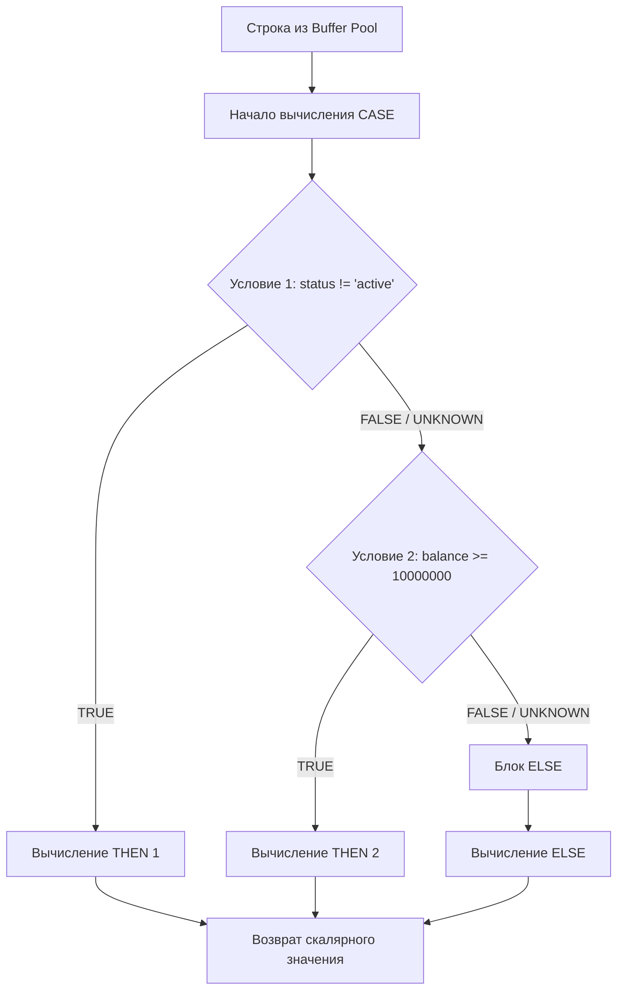

*Как декларативное скалярное выражение `CASE` переносит ветвление на сторону СУБД, зачем ему короткое замыкание, как условная агрегация строит отчёт за один проход по таблице и где проходит граница между `CASE` в SQL и `switch` в Go.*

> «Пишите ясно — не умничайте.»  
> — Брайан Керниган

Когда бэкенд-разработчику нужно сгруппировать финансовые операции по разным правилам — скажем, разнести в один отчёт общую сумму оборота, поступления, списания и объём замороженных средств — первое импульсивное решение выглядит просто: выгрузить строки в Go и разложить их в цикле `for` через `if` или `switch`.

На тестовой базе из тысячи записей такой подход работает незаметно. На таблице `ledger_entries` из пяти миллионов проводок он превращается в узкое горлышко: по сети перекачиваются сотни мегабайт сырых кортежей, драйвер тратит время на их сканирование, а сборщик мусора Go разгребает миллионы временных аллокаций.

Стандарт ANSI SQL решает эту задачу на уровне ядра СУБД с помощью выражения `CASE`. В отличие от `if` и `switch` в императивных языках, `CASE` — не оператор управления потоком исполнения, а **скалярное выражение**. Оно возвращает одно значение заданного типа и встраивается в любую фазу запроса: в `SELECT`, `WHERE`, `GROUP BY`, `ORDER BY` или `UPDATE`.

---

## Два формата выражения `CASE`

Стандарт SQL определяет две синтаксические формы записи `CASE`.

### 1. Простой `CASE` (Simple CASE)

Простая форма напоминает конструкцию `switch x` в Go: базовое выражение вычисляется один раз и последовательно сравнивается на равенство со списком констант. Этот формат удобен для перекодировки перечислений и статусов в `LedgerPulse`:

```sql
SELECT
    id,
    reference_id,
    CASE status
        WHEN 'pending'  THEN 'В обработке'
        WHEN 'posted'   THEN 'Проведена'
        WHEN 'failed'   THEN 'Ошибка'
        WHEN 'reversed' THEN 'Сторнирована'
        ELSE 'Неизвестный статус'
    END AS status_label
FROM transactions;
```

> [!warning] Ловушка Simple CASE и `NULL`
> Простой формат сравнивает значения через неявный оператор `=`. Если вы напишете `CASE parent_id WHEN NULL THEN 'Корневая'`, условие **никогда не сработает**, так как `parent_id = NULL` в трёхзначной логике вычисляется в `UNKNOWN` (см. [[8. NULL и трёхзначная логика]]). Для проверок на `NULL` используйте поисковую форму ниже: `CASE WHEN parent_id IS NULL THEN ...`.

### 2. Поисковый `CASE` (Searched CASE)

Поисковая форма аналогична каскаду `if - else if - else`. Здесь после `CASE` не указывается целевое выражение, а в каждой ветке `WHEN` задаётся произвольный логический предикат:

```sql
SELECT
    id,
    external_id,
    balance,
    CASE
        WHEN status <> 'active'      THEN 'blocked'
        WHEN balance >= 10000000     THEN 'vip'
        WHEN balance >= 1000000      THEN 'premium'
        ELSE 'standard'
    END AS account_tier
FROM accounts;
```

---

## Под капотом: ленивое вычисление (Short-circuit)

При обработке миллионов строк процессор СУБД выполняет ветки `CASE` не все сразу, а строго последовательно сверху вниз по принципу **короткого замыкания (Short-circuit evaluation)** — точно так же, как работают `&&` и `||` в Go.



Как только очередное условие `WHEN` даёт `TRUE`:
1. Исполнитель вычисляет выражение соответствующего блока `THEN`.
2. Все нижележащие ветки `WHEN` и секция `ELSE` **полностью пропускаются и не вычисляются**.
3. Результат передаётся дальше по конвейеру запроса.

### Защита от ошибок времени выполнения и строгая типизация

Благодаря гарантированному ленивому вычислению ветвей `CASE` служит надёжным предохранителем от ошибок времени выполнения вроде деления на ноль (`Division by Zero`):

```sql
SELECT
    account_id,
    CASE
        WHEN COUNT(*) = 0 THEN 0
        ELSE SUM(amount) / COUNT(*)
    END AS avg_entry_amount
FROM ledger_entries
GROUP BY account_id;
```

Если для группы знаменатель равен нулю, правая ветка с делением не будет выполнена никогда, и транзакция не прервётся с ошибкой.

При этом у `CASE` есть жёсткое правило типизации: **все ветви `THEN` и блок `ELSE` обязаны возвращать совместимые типы данных**. Выражение не может вернуть целое число `0` в одной ветке и строку `'нет данных'` в другой — на этапе семантического анализа планировщик PostgreSQL немедленно отклонит запрос с ошибкой несовместимости типов (`CASE types text and integer cannot be matched`).

> [!tip] Собеседование [Junior]
> **Вопрос:** Что вернёт выражение `CASE`, если ни одно из условий `WHEN` не выполнилось, а ветка `ELSE` опущена?  
> **Ответ:** Согласно стандарту ANSI SQL, при отсутствии `ELSE` запрос неявно подставляет `ELSE NULL`. Это частый источник скрытых ошибок в арифметике (потому что `100 + NULL` даёт `NULL`) и при сканировании результатов в типизированные переменные Go. Хорошая инженерная привычка — **всегда явно дописывать `ELSE`** с детерминированным значением по умолчанию.

---

## Главный паттерн: условная агрегация (Pivot)

В продакшене выражение `CASE` чаще всего встречается не для красивого форматирования статусов, а в связке с агрегатными функциями из [[7. GROUP BY и агрегатные функции]]. Такой приём называют **условной агрегацией (Conditional Aggregation)** или разворотом строк в столбцы (Pivot).

**Задача в `LedgerPulse`:** для каждой валюты получить одним запросом общую сводку: количество проведённых транзакций, сумму всех зачислений (`amount > 0`), модуль суммы всех списаний (`amount < 0`) и итоговое сальдо.

Если решать это «в лоб» тремя отдельными запросами или выгружать сырые строки из `ledger_entries` в Go, мы получим либо три полных прохода по страницам таблицы, либо гигантский сетевой трафик и нагрузку на сборщик мусора.

С условной агрегацией вся сводка считается за **один последовательный проход** по таблице:

```sql
SELECT
    le.currency,
    COUNT(*) AS total_entries,
    COALESCE(SUM(CASE WHEN le.amount > 0 THEN le.amount ELSE 0 END), 0) AS total_credits,
    COALESCE(SUM(CASE WHEN le.amount < 0 THEN -le.amount ELSE 0 END), 0) AS total_debits,
    COALESCE(SUM(le.amount), 0) AS net_flow
FROM ledger_entries le
JOIN transactions t ON t.id = le.transaction_id
WHERE t.status = 'posted'
GROUP BY le.currency
ORDER BY le.currency;
```

Посмотрим на физику такого запроса. Движок читает 8-килобайтные страницы из Buffer Pool (или с диска при холодном кэше) ровно один раз. Каждая строка прогоняется через `CASE` прямо в регистрах CPU, обновляя счётчики аккумуляторов в хэш-таблице группировки (`HashAggregate`). По сети в Go-сервис вместо миллионов записей уходит ровно по одной компактной строке на каждую валюту — несколько десятков байт.

В PostgreSQL (начиная с 9.4, по стандарту SQL:2003) для агрегатных функций есть также более лаконичный синтаксический сахар `FILTER (WHERE ...)`:

```sql
SELECT
    le.currency,
    COUNT(*) FILTER (WHERE le.amount > 0) AS credit_count,
    COALESCE(SUM(le.amount) FILTER (WHERE le.amount > 0), 0) AS total_credits,
    COALESCE(SUM(-le.amount) FILTER (WHERE le.amount < 0), 0) AS total_debits
FROM ledger_entries le
GROUP BY le.currency;
```

Клауза `FILTER (WHERE ...)` читается чище, но работает в PostgreSQL и SQLite, тогда как паттерн `SUM(CASE WHEN ... THEN ... ELSE 0 END)` абсолютно универсален и переносится в любую реляционную СУБД, включая MySQL и Oracle.

---

## Кастомная сортировка в `ORDER BY` и её цена

Иногда бизнес-требования диктуют порядок сортировки, не совпадающий с алфавитом или числовыми идентификаторами. Например, в панели операциониста `LedgerPulse` проблемные и ожидающие транзакции должны быть наверху списка: сначала `'failed'`, затем `'pending'`, потом `'reversed'` и в конце `'posted'`, а внутри каждого статуса — от самых свежих к старым.

```sql
SELECT id, reference_id, kind, status, created_at
FROM transactions
ORDER BY
    CASE status
        WHEN 'failed'   THEN 1
        WHEN 'pending'  THEN 2
        WHEN 'reversed' THEN 3
        WHEN 'posted'   THEN 4
        ELSE 5
    END,
    created_at DESC
LIMIT 50;
```

> [!warning] Ловушка: `CASE` в `ORDER BY` отключает сортировку по индексу
> Как мы разбирали в [[4. ORDER BY, LIMIT и пагинация (OFFSET против keyset)]], B-Tree индекс хранит ключи в физически отсортированном порядке по исходным значениям столбцов. Индекс ничего не знает о числах `1, 2, 3, 4`, которые вычисляются на лету внутри `CASE`.
>
> Как только вы ставите `CASE` (или любую другую скалярную функцию) в `ORDER BY`, планировщик вынужден вычитать **все** подходящие строки, вычислить приоритет и запустить сортировку в оперативной памяти (**In-Memory Quicksort / Top-N Heapsort**) или на диске (**External Merge Sort**), если объём превышает `work_mem`. На небольших административных выборках (после жёсткого `WHERE`) это безопасно, но на миллионах строк без фильтрации время отклика резко вырастет.

---

## Архитектурный выбор: SQL `CASE` или Go `switch`

Где должна жить условная логика — в SQL-запросе или в Go-коде? Чтобы ответить без догм, сравните стоимость ресурсов:

* **CPU базы данных — дефицитный, плохо масштабируемый ресурс.** У вас один мастер PostgreSQL (вертикальное масштабирование ограничено железом), а Go-сервисов может быть десять за балансировщиком.
* **Сеть и память приложения — дорогой транспорт.** Передавать лишние миллионы строк через TCP-сокет только ради суммирования в Go бессмысленно.

Отсюда вытекает простое правило разделения:

1. **Оставляйте `CASE` в SQL**, когда ветвление сокращает объём передаваемых данных:
   * при условной агрегации (`SUM(CASE ...)`, `COUNT(CASE ...)`);
   * при кастомной фильтрации и сортировке небольших отфильтрованных срезов;
   * при атомарном пакетном обновлении строк разными значениями:
     ```sql
     UPDATE accounts
     SET status = CASE
         WHEN balance = 0 THEN 'closed'
         ELSE 'frozen'
     END
     WHERE updated_at < now() - interval '365 days';
     ```
2. **Переносите ветвление в Go `switch`**, когда речь идёт о слое представления (форматирование JSON-ответа, локализация кодов статусов вроде `'posted' -> "Проведена"` для разных языков пользователя) или о тяжёлых строковых операциях и регулярных выражениях. Горизонтально масштабировать воркеры на Go дешевле, чем покупать более мощный процессор для сервера базы данных.

---

## Рабочий код Go 1.24: суточная сводка по `LedgerPulse`

Напишем функцию для `LedgerPulse`, которая одним SQL-запросом получает статистику по всем счетам в разрезе валют: общее число счетов, сколько из них активны, сколько заморожены и суммарный баланс только активных счетов.

```go
package ledger

import (
	"context"
	"database/sql"
	"fmt"
)

type CurrencySummary struct {
	Currency      string
	TotalAccounts int64
	ActiveCount   int64
	FrozenCount   int64
	ActiveBalance int64
}

func FetchCurrencySummaries(ctx context.Context, db *sql.DB) ([]CurrencySummary, error) {
	const query = `
		SELECT
			currency,
			COUNT(*) AS total_accounts,
			SUM(CASE WHEN status = 'active' THEN 1 ELSE 0 END) AS active_count,
			SUM(CASE WHEN status = 'frozen' THEN 1 ELSE 0 END) AS frozen_count,
			COALESCE(SUM(CASE WHEN status = 'active' THEN balance ELSE 0 END), 0) AS active_balance
		FROM accounts
		GROUP BY currency
		ORDER BY currency`

	rows, err := db.QueryContext(ctx, query)
	if err != nil {
		return nil, fmt.Errorf("fetch currency summaries: %w", err)
	}
	defer rows.Close()

	var result []CurrencySummary
	for rows.Next() {
		var s CurrencySummary
		if err := rows.Scan(
			&s.Currency,
			&s.TotalAccounts,
			&s.ActiveCount,
			&s.FrozenCount,
			&s.ActiveBalance,
		); err != nil {
			return nil, fmt.Errorf("scan currency summary: %w", err)
		}
		result = append(result, s)
	}
	if err := rows.Err(); err != nil {
		return nil, fmt.Errorf("iterate currency summaries: %w", err)
	}
	return result, nil
}
```

Если в таблице `accounts` миллион счетов в трёх валютах (`RUB`, `USD`, `EUR`), в ответ вернётся слайс ровно из трёх структур `CurrencySummary`:

```text
Currency=EUR Total=142000 Active=139500 Frozen=1200 ActiveBalance=984501200
Currency=RUB Total=710000 Active=695000 Frozen=8400 ActiveBalance=45120089000
Currency=USD Total=148000 Active=144200 Frozen=2100 ActiveBalance=1520045000
```

---

## Упражнения

### Упражнение 1 (Базовое)
В таблице `accounts` есть строка с полями `status = 'active'` и `balance = 0`.
Что вернёт каждый из следующих фрагментов SQL и почему?
1.
```sql
SELECT CASE
    WHEN balance >= 0 THEN 'non-negative'
    WHEN balance = 0  THEN 'zero'
    ELSE 'negative'
END;
```
2.
```sql
SELECT CASE status
    WHEN 'frozen' THEN 'Заморожен'
    WHEN 'closed' THEN 'Закрыт'
END;
```
3.
```sql
SELECT CASE
    WHEN status = 'active' THEN balance
    ELSE 'blocked'
END;
```

> [!solution] Показать решение
> 1. **Вернёт `'non-negative'`.** Ветви вычисляются строго сверху вниз с коротким замыканием. Условие `0 >= 0` истинно первым, поэтому до второй ветки `balance = 0` очередь даже не дойдёт. Чтобы ветка `'zero'` работала, более частное условие нужно ставить выше общего.
> 2. **Вернёт `NULL`.** Значение `'active'` не совпало ни с одной веткой `WHEN`, а блок `ELSE` опущен, поэтому стандарт подставляет неявный `ELSE NULL`.
> 3. **Запрос упадёт на этапе планирования с ошибкой несовместимости типов** (`CASE types text and bigint cannot be matched`), потому что `balance` имеет тип `BIGINT`, а `'blocked'` — строковый литерал.

### Упражнение 2 (Практическое)
Напишите один SQL-запрос к таблицам `transactions` и `ledger_entries` в `LedgerPulse`, который для каждого вида операции (`kind`: `'transfer'`, `'deposit'`, `'withdrawal'`, `'fee'`) вернёт:
* общее число транзакций этого вида;
* число проведённых (`status = 'posted'`) транзакций;
* долю неуспешных (`status = 'failed'`) транзакций в процентах (с защитой от деления на ноль через `CASE`).

> [!solution] Показать решение
> ```sql
> SELECT
>     kind,
>     COUNT(*) AS total_count,
>     SUM(CASE WHEN status = 'posted' THEN 1 ELSE 0 END) AS posted_count,
>     CASE
>         WHEN COUNT(*) = 0 THEN 0.0
>         ELSE ROUND(
>             100.0 * SUM(CASE WHEN status = 'failed' THEN 1 ELSE 0 END) / COUNT(*),
>             2
>         )
>     END AS failed_percent
> FROM transactions
> GROUP BY kind
> ORDER BY kind;
> ```
> **Разбор:** Умножение на `100.0` (литерал типа `NUMERIC`) переводит деление из целочисленного в дробное — без этого в PostgreSQL деление `BIGINT / BIGINT` отбросило бы дробную часть. Внешний `CASE` гарантирует защиту от деления на ноль, а совместимость типов соблюдена: ветка `0.0` и ветка `ROUND(...)` обе возвращают `NUMERIC`.

### Упражнение 3 (Со звёздочкой `*`)
Административный сервис `LedgerPulse` запрашивает по счёту `$1` последние проводки, причём операционисты попросили «поднять» наверх крупные аномальные списания (`amount < -1000000`), а все остальные отсортировать по `created_at DESC`.
Программист написал:
```sql
SELECT id, transaction_id, amount, created_at
FROM ledger_entries
WHERE account_id = $1
ORDER BY
    CASE WHEN amount < -1000000 THEN 0 ELSE 1 END,
    created_at DESC
LIMIT 50;
```
Почему этот запрос начнёт тормозить для счёта с миллионом проводок, хотя в `002_indexes.sql` создан покрывающий индекс `idx_ledger_entries_account_created ON ledger_entries (account_id, created_at DESC, id DESC) INCLUDE (amount, currency, transaction_id)`? Как получить тот же бизнес-результат без `CASE` в `ORDER BY`, чтобы индекс снова заработал на `LIMIT 50`? (Подсказка: в следующем шаге мы изучим `UNION ALL`, но подумайте, можно ли разделить выборку на два отдельных запроса или ветки с `LIMIT 50`.)

> [!solution] Показать решение
> 1. **Причина деградации:** Индекс `idx_ledger_entries_account_created` отсортирован по `(account_id, created_at DESC, id DESC)`. Из-за `CASE WHEN amount < -1000000 ...` в начале `ORDER BY` планировщик не может просто взять первые 50 строк из конца индекса. Он вынужден прочитать **все 1 000 000 записей** данного счёта, вычислить `CASE` для каждой и прогнать их через сортировку (`Sort Method: top-N heapsort` или внешний `Sort` на диске).
> 2. **Быстрое решение без `CASE` в `ORDER BY`:** разбить логику на два независимых индексированных запроса с `LIMIT 50` (или объединить их через `UNION ALL`, который мы разберём в главе 13, обернув каждую ветку в скобки с собственным `LIMIT 50`, а поверх взять общий `LIMIT 50`):
> ```sql
> (
>     SELECT id, transaction_id, amount, created_at, 0 AS priority
>     FROM ledger_entries
>     WHERE account_id = $1 AND amount < -1000000
>     ORDER BY created_at DESC, id DESC
>     LIMIT 50
> )
> UNION ALL
> (
>     SELECT id, transaction_id, amount, created_at, 1 AS priority
>     FROM ledger_entries
>     WHERE account_id = $1 AND amount >= -1000000
>     ORDER BY created_at DESC, id DESC
>     LIMIT 50
> )
> ORDER BY priority, created_at DESC, id DESC
> LIMIT 50;
> ```
> **Разбор:** Вторая ветка читает ровно первые 50 записей прямо из индекса `idx_ledger_entries_account_created` (благодаря `INCLUDE (amount)` — даже без обращения к Heap-страницам таблицы), а первая быстро находит крупные списания (или использует отдельный частичный индекс `WHERE amount < -1000000`). Внешняя сортировка выполняется максимум над 100 строками в памяти вместо миллиона.

---

## Мостик к следующему уроку

Мы научились задавать условное ветвление в SQL и строить многомерные отчёты за один проход по таблице. Но в примерах мы уже несколько раз натыкались на необходимость страховать выражения: явно дописывать `ELSE`, не допускать `NULL` в `Simple CASE` и оборачивать `SUM` в `COALESCE`.

А что происходит, когда `NULL` попадает внутрь `AVG`, `COUNT`, арифметики или сравнения двух столбцов? Как избежать бесконечных `if ptr != nil` и давления на сборщик мусора при чтении nullable-полей в Go 1.24? Все тонкости работы с отсутствующими значениями мы систематизируем в главе [[12. Работа с NULL в SQL — COALESCE, NULLIF и ловушки агрегатов]].
