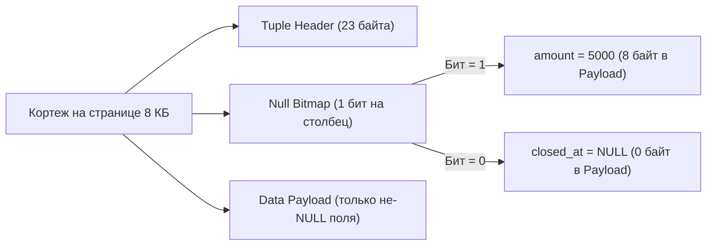

*Прикладной разбор `NULL` в запросах: функции `COALESCE` и `NULLIF`, сравнение через `IS DISTINCT FROM`, поведение `AVG` и `SUM` на неполных данных и три стратегии сканирования nullable-полей в Go 1.24.*

> «Не у каждого значения есть адрес, но у каждой переменной он есть.»  
> — Алан Донован и Брайан Керниган, *The Go Programming Language*

В императивных языках отсутствие значения предельно конкретно. В C макрос `NULL` или `nullptr` обозначает нулевой адрес, а в Go `nil` — нулевое значение для указателей, слайсов, мап и интерфейсов. Над ними определена обычная двузначная булева логика: сравнение `ptr == nil` всегда возвращает строго `true` или `false`.

В реляционных базах данных `NULL` — это не число ноль, не пустая строка и не адрес в памяти. Как мы выяснили в [[8. NULL и трёхзначная логика]], это мета-маркер состояния **«Неизвестно» (Unknown / Missing Information)**. Именно поэтому сравнение `NULL = NULL` не даёт ни `TRUE`, ни `FALSE` — оно даёт `UNKNOWN`.

Пока `NULL` лежит в таблице `accounts` или в необязательном столбце вроде `closed_at` и `parent_transaction_id`, он почти не мешает. Проблемы начинаются в тот момент, когда вы делаете арифметику, считаете средние значения, сортируете отчёт или сканируете результат в Go-структуру.

---

## Трёхзначная логика и её физика на диске

Чтобы уверенно комбинировать функции вроде `COALESCE` и `NULLIF`, важно держать перед глазами два факта: логический и физический.

На **логическом уровне** SQL опирается на **трёхзначную логику (3VL)**: `TRUE`, `FALSE` и `UNKNOWN`. Любая арифметическая операция с `NULL` даёт `NULL` (`1000 + NULL` → `NULL`), а любой оператор сравнения (`=`, `!=`, `<`, `>`) с участием `NULL` возвращает `UNKNOWN`. При этом `WHERE` и `HAVING` пропускают дальше по конвейеру **только строки с итоговым результатом строго `TRUE`**, отбрасывая и `FALSE`, и `UNKNOWN`.

| Выражение | Результат | Как это работает |
| :--- | :---: | :--- |
| `TRUE AND UNKNOWN` | `UNKNOWN` | Итог зависит от неизвестного операнда |
| `FALSE AND UNKNOWN` | `FALSE` | Ложь доминирует в конъюнкции (короткое замыкание) |
| `TRUE OR UNKNOWN` | `TRUE` | Истина доминирует в дизъюнкции (короткое замыкание) |
| `FALSE OR UNKNOWN` | `UNKNOWN` | Ложь не определяет исход дизъюнкции |
| `NOT UNKNOWN` | `UNKNOWN` | Отрицание неизвестности остаётся неизвестностью |

На **физическом уровне** хранение `NULL` в PostgreSQL устроено предельно экономно с точки зрения расхода памяти и дискового I/O:



Если в строке есть хотя бы один `NULL`, в заголовке кортежа сразу после 23 байт служебных метаданных транзакции (`xmin`, `xmax`, флаги) размещается компактная битовая карта **Null Bitmap** (`t_bits`) — по одному биту на каждый столбец таблицы. Если бит равен `0`, в полезную нагрузку строки (`Data Payload`) не записывается **ни одного байта**, даже если столбец объявлен как `TEXT` или `BIGINT`. Более того, проверка `IS NULL` в CPU сводится к чтению одного бита из карты заголовка, даже не трогая и не десериализуя тело строки.

---

## Инструментарий управления `NULL`

Поскольку обычные операторы `=` и `<>` при встрече с `NULL` возвращают `UNKNOWN`, стандарт SQL предоставляет четыре специализированных инструмента.

### 1. `IS NULL` и `IS NOT NULL`

Единственный корректный способ проверить сам факт отсутствия значения:

```sql
-- Верно: проверяет бит в Null Bitmap
SELECT id, external_id FROM accounts WHERE closed_at IS NULL;

-- Ошибка: всегда вычисляется в UNKNOWN и возвращает 0 строк
SELECT id, external_id FROM accounts WHERE closed_at = NULL;
```

### 2. `IS DISTINCT FROM` и `IS NOT DISTINCT FROM`

Бывает, нужно сравнить два столбца на равенство или неравенство так, чтобы два `NULL` считались равными друг другу, а `NULL` и любое значение — разными. Например, при сверке старого и нового значения необязательного поля перед записью в журнал аудита.

> [!tip] Собеседование [Middle]
> **Вопрос:** Как сравнить два nullable-столбца `a.currency_override` и `b.currency_override` так, чтобы при обоих `NULL` условие давало `TRUE`, а при `NULL` и `'USD'` — `FALSE`? Написать `a.col = b.col` нельзя, так как `NULL = NULL` даёт `UNKNOWN`.  
> **Ответ:** В стандарте ANSI SQL для этого есть предикаты **`IS NOT DISTINCT FROM`** (безопасное равенство) и **`IS DISTINCT FROM`** (безопасное неравенство):
> ```sql
> -- Безопасно сравнивает два значения, трактуя NULL как обычное состояние
> SELECT *
> FROM accounts_audit a
> JOIN accounts_snapshot b ON a.id = b.id
> WHERE a.closed_at IS DISTINCT FROM b.closed_at;
> ```
> В отличие от `a.closed_at <> b.closed_at`, предикат `IS DISTINCT FROM` вернёт `TRUE`, если один из столбцов `NULL`, а второй заполнен датой, и `FALSE`, если оба равны `NULL`. Это стандартный приём для поиска реальных изменений (diff) при обновлении записей.

### 3. `COALESCE`: цепочка подстановок

Функция `COALESCE(arg1, arg2, ...)` принимает переменное число аргументов одного (или приводимого) типа и возвращает **первый аргумент, отличный от `NULL`**. Если все аргументы равны `NULL`, функция вернёт `NULL`.

```sql
-- Подмена пустой суммы нулём
SELECT COALESCE(SUM(amount), 0) AS total_amount
FROM ledger_entries
WHERE account_id = 42;

-- Цепочка приоритета контактов: телефон, затем email, затем значение по умолчанию
SELECT COALESCE(phone, email, 'no-contact') AS primary_contact
FROM account_holders;
```

Как и `CASE`, функция `COALESCE` работает по принципу **короткого замыкания (Short-circuit)**: как только найден первый не-`NULL` аргумент, остальные выражения справа вообще не вычисляются. Более того, на уровне AST PostgreSQL `COALESCE(a, b)` является синтаксическим эквивалентом `CASE WHEN a IS NOT NULL THEN a ELSE b END`.

> [!warning] Ловушка типов и лишних вызовов в `COALESCE`
> 1. Все аргументы `COALESCE` обязаны приводиться к общему типу. Вызов `COALESCE(balance, '0')` в PostgreSQL пройдёт только потому, что строковый литерал `'0'` можно неявно привести к `BIGINT`, но `COALESCE(balance, 'N/A')` немедленно завершится ошибкой преобразования типов.
> 2. Не передавайте первым аргументом функцию с побочным эффектом (например, `nextval('seq')` или `random()`): так как `COALESCE` транслируется в `CASE WHEN expr IS NOT NULL THEN expr ...`, недетерминированное выражение в первом аргументе может вычислиться **дважды** — сначала для проверки `IS NOT NULL`, затем для возврата результата.

### 4. `NULLIF`: предохранитель от деления на ноль и пустых строк

Функция `NULLIF(a, b)` принимает ровно два аргумента:
* если `a = b`, возвращает `NULL`;
* в противном случае возвращает `a`.

У этой функции два главных сценария в продакшене:

**Сценарий А: защита от ошибки `Division by Zero`.** Это более короткая и выразительная альтернатива громоздкому `CASE WHEN denom = 0 THEN NULL ELSE num / denom END`:

```sql
-- Если cnt равен 0, NULLIF(cnt, 0) вернёт NULL.
-- Деление числа на NULL даёт NULL без падения запроса; COALESCE превращает его в 0.
SELECT
    account_id,
    COALESCE(SUM(amount) / NULLIF(COUNT(*), 0), 0) AS avg_amount
FROM ledger_entries
GROUP BY account_id;
```

**Сценарий Б: нормализация пустых строк при вставке.** Если клиентский сервис прислал пустую строку `""` вместо отсутствующего значения, выражение `NULLIF(TRIM($1), '')` превратит её в чистый `NULL`, не давая мусорным пустым строкам занимать место в полезных данных и ломать `UNIQUE`-ограничения.

---

## Ловушки агрегатов и сортировки с `NULL`

Агрегатные функции из [[7. GROUP BY и агрегатные функции]] ведут себя с `NULL` совершенно иначе, чем арифметические операторы. Они **молча игнорируют** строки со значением `NULL`.

Представьте таблицу начисленных комиссий `fees` по четырём операциям с колонкой `fee_amount`: `100`, `200`, `NULL`, `NULL`.

| Выражение | Результат | Почему именно столько |
| :--- | :---: | :--- |
| `COUNT(*)` | `4` | Считает физические строки целиком, не глядя внутрь столбцов |
| `COUNT(fee_amount)` | `2` | Считает только строки, где `fee_amount IS NOT NULL` |
| `SUM(fee_amount)` | `300` | Складывает известные значения (`100 + 200`), игнорируя `NULL` |
| `AVG(fee_amount)` | `150` | Делит `300` на **`2`** (количество не-`NULL` значений), а не на `4` |

Забытая разница между `AVG(fee_amount)` (`150`) и `SUM(fee_amount) / COUNT(*)` (`75`, или `AVG(COALESCE(fee_amount, 0))`) — классическая причина расхождения аналитических отчётов с бухгалтерией. Всегда уточняйте у бизнеса, означает ли `NULL` «комиссия равна нулю» или «комиссия ещё не рассчитана и не должна занижать среднее».

Ещё одна частая ошибка — ожидание нуля от пустой выборки:
* `COUNT(*)` на таблице без подходящих строк возвращает `0`.
* `SUM(amount)`, `AVG(amount)`, `MIN(amount)`, `MAX(amount)` на пустом наборе строк (или если все значения равны `NULL`) возвращают **`NULL`**, а не `0`.

Если Go-код читает сумму через `.Scan(&total)` в `int64`, не обёрнутый в `COALESCE(SUM(amount), 0)`, вызов завершится ошибкой времени выполнения.

### Поведение `NULL` при сортировке (`NULLS FIRST` / `NULLS LAST`)

В PostgreSQL значение `NULL` при сортировке считается «больше» любого конкретного значения:
* При `ORDER BY closed_at ASC` строки с `NULL` идут **в самом конце** (`NULLS LAST` по умолчанию).
* При `ORDER BY closed_at DESC` строки с `NULL` внезапно выпрыгивают **в самое начало** (`NULLS FIRST` по умолчанию).

Если вы строите ленту последних закрытых счетов с `ORDER BY closed_at DESC LIMIT 20`, без явного указания `ORDER BY closed_at DESC NULLS LAST` первые 20 строк окажутся активными счетами с `closed_at IS NULL`. Подробнее о влиянии `NULLS FIRST/LAST` на использование индексов мы говорили в [[4. ORDER BY, LIMIT и пагинация (OFFSET против keyset)]].

---

## Идиомы Go 1.24: три стратегии работы с `NULL`

На границе базы данных и Go сталкиваются трёхзначная логика SQL и строгая двузначная типизация Go. При чтении nullable-колонки (например, `closed_at TIMESTAMPTZ` или `parent_id BIGINT`) у разработчика есть три стратегии с разным влиянием на память и читаемость кода.

### Подход 1: указатели (`*int64`, `*time.Time`, `*string`)

Драйверы `database/sql` и `pgx` присваивают указателю `nil`, если в базе лежит `NULL`. На небольших HTTP DTO это удобно для JSON-сериализации с `omitempty`, но в горячих выборках у указателей есть высокая цена: передача `&acc.ParentID` (где `ParentID` имеет тип `*int64`) в `rows.Scan` мешает оптимизации компилятора (Escape Analysis). Каждое ненулевое значение аллоцируется отдельным объектом в куче (Heap), разрушая локальность данных в кэше CPU и нагружая сборщик мусора. Кроме того, по всей бизнес-логике расползаются проверки `if acc.ParentID != nil`.

### Подход 2: значимые типы `sql.Null[T]` и `sql.Null*` (Go 1.22–1.24)

В стандартном пакете `database/sql` есть готовые структуры `sql.NullString`, `sql.NullInt64`, `sql.NullTime`, а начиная с Go 1.22 — универсальный дженерик `sql.Null[T]`:

```go
package ledger

import (
	"context"
	"database/sql"
	"fmt"
	"time"
)

type AccountStats struct {
	AccountID  int64
	TotalFlows int64
	AvgAmount  sql.Null[int64] // NULL, если проводок по счёту ещё не было
	ClosedAt   sql.NullTime    // NULL, если счёт ещё открыт
}

func LoadAccountStats(ctx context.Context, db *sql.DB, accountID int64) (AccountStats, error) {
	const query = `
		SELECT
			a.id,
			COALESCE(SUM(le.amount), 0) AS total_flows,
			AVG(le.amount)::bigint AS avg_amount,
			a.closed_at
		FROM accounts a
		LEFT JOIN ledger_entries le ON le.account_id = a.id
		WHERE a.id = $1
		GROUP BY a.id, a.closed_at`

	var stats AccountStats
	err := db.QueryRowContext(ctx, query, accountID).Scan(
		&stats.AccountID,
		&stats.TotalFlows,
		&stats.AvgAmount,
		&stats.ClosedAt,
	)
	if err != nil {
		return AccountStats{}, fmt.Errorf("load stats for account %d: %w", accountID, err)
	}
	return stats, nil
}
```

Тип `sql.Null[int64]` — это плоская структура `struct { V int64; Valid bool }`. Она целиком лежит на стеке горутины или непрерывно в слайсе `[]AccountStats`, не создаёт лишних указателей для GC и точно разделяет «значение равно `0`» (`Valid: true, V: 0`) и «данных нет» (`Valid: false`). Чтобы не засорять доменную логику зависимостью от `database/sql`, такие структуры держат на уровне слоя репозитория и переводят в чистые доменные модели на границе пакета.

### Подход 3: устранение `NULL` через `COALESCE` в SQL

Если доменной модели не нужно различать «ноль» и «отсутствие значения», самый чистый путь — вообще не выпускать `NULL` за пределы SQL-запроса:

```sql
SELECT
    a.id,
    COALESCE(SUM(le.amount), 0) AS total_flows,
    COALESCE(a.description, '') AS description
FROM accounts a
LEFT JOIN ledger_entries le ON le.account_id = a.id
GROUP BY a.id, a.description;
```

Тогда в Go сканируются обычные примитивы `int64` и `string` — без указателей, без обёрток `Valid` и с нулевым риском паники или ошибки сканирования:

```text
AccountID=42 TotalFlows=0 AvgAmount={V:0 Valid:false} ClosedAt={Valid:false}
```

---

## Упражнения

### Упражнение 1 (Базовое)
В таблице `ledger_entries` для счёта `id = 7` есть три проводки с суммами `1000`, `-400`, `200`, а столбец `fee_amount` (дополнительная комиссия) содержит значения `(10, NULL, 20)`.
Вычислите точный результат каждого запроса:
1. `SELECT COUNT(*), COUNT(fee_amount), SUM(fee_amount), AVG(fee_amount) FROM ledger_entries WHERE account_id = 7;`
2. `SELECT COALESCE(NULL, fee_amount, 0) FROM ledger_entries WHERE account_id = 7 ORDER BY id;`
3. `SELECT SUM(amount) / NULLIF(COUNT(*) - 3, 0) FROM ledger_entries WHERE account_id = 7;`

> [!solution] Показать решение
> 1. `COUNT(*) = 3`, `COUNT(fee_amount) = 2`, `SUM(fee_amount) = 30`, `AVG(fee_amount) = 15`. Среднее делится на 2 не-`NULL` строки (`(10 + 20) / 2`), а не на 3.
> 2. Вернёт три строки: `10`, `0`, `20`. `COALESCE` пропускает первый `NULL`, затем проверяет `fee_amount` и для второй строки возвращает резервный `0`.
> 3. Вернёт **`NULL`** без ошибки деления на ноль: `COUNT(*) - 3` равно `0`, `NULLIF(0, 0)` возвращает `NULL`, а деление `800 / NULL` в SQL даёт `NULL`.

### Упражнение 2 (Практическое)
В `LedgerPulse` нужно получить список из 20 последних закрытых счетов, а если закрытых счетов меньше 20 — в конце списка показать активные счета (`closed_at IS NULL`), отсортированные по `id DESC`. Также в выборке нужно вывести средний чек проводки по каждому счёту (`SUM(amount) / COUNT(le.id)`), гарантируя `0` при отсутствии проводок.
Напишите корректный SQL-запрос с использованием `LEFT JOIN`, `COALESCE`, `NULLIF` и правильной директивой порядка `NULL`.

> [!solution] Показать решение
> ```sql
> SELECT
>     a.id,
>     a.external_id,
>     a.closed_at,
>     COALESCE(SUM(le.amount) / NULLIF(COUNT(le.id), 0), 0) AS avg_entry_amount
> FROM accounts a
> LEFT JOIN ledger_entries le ON le.account_id = a.id
> GROUP BY a.id, a.external_id, a.closed_at
> ORDER BY a.closed_at DESC NULLS LAST, a.id DESC
> LIMIT 20;
> ```
> **Разбор:**
> 1. `NULLS LAST` обязателен: без него при `DESC` активные счета с `closed_at IS NULL` оказались бы в начале списка вместо закрытых.
> 2. Используется `COUNT(le.id)`, а не `COUNT(*)`: для счёта без проводок после `LEFT JOIN` строка соединения одна, и `COUNT(*)` вернул бы `1`, тогда как `COUNT(le.id)` честно вернёт `0` (так как `le.id` будет `NULL`), а `SUM(le.amount)` даст `NULL`, превращая всё выражение через `COALESCE` в `0`.

### Упражнение 3 (Со звёздочкой `*`)
Перед массовым импортом обновлений тарифа из внешнего файла в таблицу `accounts` инженеру нужно обновлять строку **только если новое значение поля `tariff_code` (может быть `NULL`) действительно отличается от текущего в базе**, чтобы не плодить лишние мёртвые версии кортежей (MVCC bloat) и не писать лишний трафик в WAL.
Почему условие `WHERE accounts.tariff_code <> excluded.tariff_code` пропустит половину реальных изменений? Напишите правильное условие фильтрации для `UPDATE` (или `ON CONFLICT DO UPDATE`) с учётом `NULL` и проверьте его на всех четырёх комбинациях значений `(old, new)`: `('pro', 'pro')`, `('pro', NULL)`, `(NULL, 'pro')`, `(NULL, NULL)`.

> [!solution] Показать решение
> При обычном `<>` любые пары, где хотя бы одно значение равно `NULL` (`('pro', NULL)`, `(NULL, 'pro')`, `(NULL, NULL)`), вычисляются в `UNKNOWN`, поэтому строка не обновится даже тогда, когда тариф реально изменился с `NULL` на `'pro'` или сбросился с `'pro'` в `NULL`.
>
> Правильное условие использует стандартный оператор `IS DISTINCT FROM`:
> ```sql
> WHERE accounts.tariff_code IS DISTINCT FROM excluded.tariff_code
> ```
> Проверка всех четырёх комбинаций:
> * `('pro', 'pro')` → `FALSE` (данные не изменились — пропускаем запись в WAL).
> * `('pro', NULL)` → `TRUE` (данные изменились — обновляем строку).
> * `(NULL, 'pro')` → `TRUE` (данные изменились — обновляем строку).
> * `(NULL, NULL)` → `FALSE` (оба неизвестны — значения совпадают, обновление не требуется).

---

## Мостик к следующему уроку

Мы разобрали трёхзначную логику `NULL`, функции `COALESCE` и `NULLIF`, научились сравнивать пустоту через `IS DISTINCT FROM` и безопасно сканировать такие поля в Go 1.24 с помощью `sql.Null[T]`.

Теперь в нашем распоряжении почти весь базовый инструментарий SQL — от `SELECT` и `JOIN` до `EXISTS`, `CASE` и управления `NULL`. Остаётся закрыть последнюю базовую тему: почему таблицы SQL допускают одинаковые строки, как работают `DISTINCT`, `DISTINCT ON` и операции над множествами (`UNION`, `UNION ALL`, `INTERSECT`, `EXCEPT`), и как всё изученное в Модуле 2 складывается воедино в коде `project/step02/` системы `LedgerPulse`. Этой теме посвящена финальная глава модуля — [[13. DISTINCT, дубликаты и операции над множествами]].
