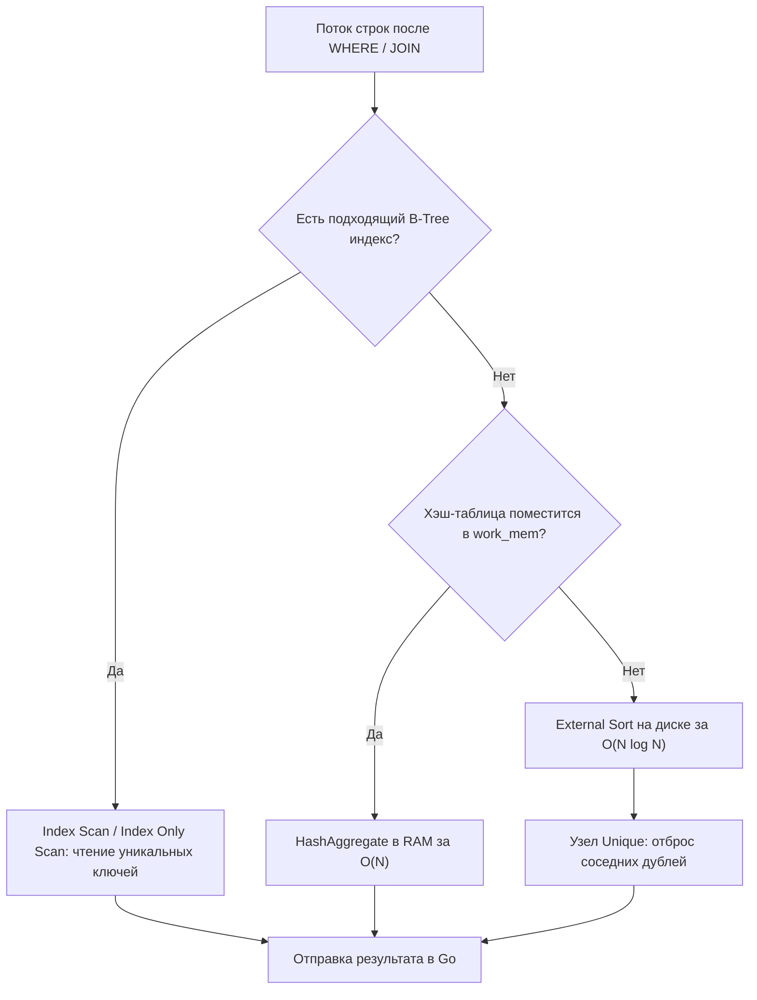

*Почему таблицы SQL работают как мультимножества, сколько стоит `DISTINCT` для памяти и диска, чем `UNION ALL` быстрее `UNION`, как решать задачи Top-1 через `DISTINCT ON` и как конструктор `project/step02/` собирает знания Модуля 2 в безопасный Go-код.*

> «Цель вычислений — понимание сути, а не числа.»  
> — Ричард Хэмминг

В классической теории множеств, на которой Эдгар Кодд построил реляционную модель (см. [[4. Реляционная модель данных — отношения, кортежи и множества]]), дубликаты невозможны по определению: множество `{1, 2, 2, 3}` тождественно множеству `{1, 2, 3}`.

Но стандарт ANSI SQL пошёл на осознанный инженерный компромисс: таблицы и результаты запросов в SQL — это не строгие множества, а **мультимножества (Bags / Multisets)**, где одинаковые кортежи могут повторяться. Если бы СУБД при каждом `INSERT` без уникального индекса проверяла новую строку на совпадение со всеми миллионами уже записанных строк, скорость записи упала бы в тысячи раз. Поэтому уникальность по умолчанию не поддерживается, а бремя устранения дубликатов переносится на момент чтения — на оператор `DISTINCT` и операции над множествами.

---

## Под капотом `DISTINCT`: сколько стоит дедупликация

Когда в проекции появляется `SELECT DISTINCT`, движок не просто «подчищает» вывод на лету. По физической стоимости `DISTINCT` практически эквивалентен группировке `GROUP BY` по всем перечисленным в `SELECT` столбцам (без агрегатных функций).

Оптимизатор выбирает одну из трёх стратегий исполнения:



1. **Чтение по индексу (`Index Scan` / `Index Only Scan`).** Самый дешёвый путь: если по столбцам проекции есть B-Tree индекс, движок считывает упорядоченные ключи без построения хэш-таблиц и сортировок.
2. **Хэш-агрегация (`HashAggregate`).** Движок строит в оперативной памяти хэш-таблицу (в пределах лимита `work_mem`) за $O(N)$. Повторные кортежи с тем же ключом сразу отбрасываются.
3. **Внешняя сортировка (`Sort` + `Unique`).** Если уникальных комбинаций слишком много и хэш-таблица не помещается в `work_mem`, СУБД переключается на внешнюю сортировку со сбросом временных файлов на диск (**Spill to Disk**), а затем линейный узел `Unique` оставляет по одной строке из каждой группы одинаковых соседей. На HDD (задержка ~10 мс) или даже NVMe (~100 мкс) это на порядки медленнее операций в RAM (~100 нс).

> [!warning] Ловушка: `DISTINCT` применяется ко всему кортежу целиком
> Ключевое слово `DISTINCT` всегда проверяет уникальность **всей комбинации столбцов** в списке `SELECT`, а не только первого столбца после него. Запись:
> ```sql
> SELECT DISTINCT id, currency, status FROM accounts;
> ```
> не отфильтрует ни одной строки: столбец `id` — первичный ключ, поэтому каждая строка уже уникальна. СУБД впустую потратит CPU и `work_mem`, прогнав всю таблицу через хэш-таблицу или сортировку.

---

## Антипаттерн: `DISTINCT` как заплатка для `JOIN`

В [[6. JOIN — INNER, LEFT, RIGHT, FULL и CROSS]] мы видели, как соединение «один ко многим» умножает строки родительской таблицы на число дочерних записей. Порой разработчик хочет получить список счетов `LedgerPulse`, по которым прошла хотя бы одна проведённая операция, пишет `JOIN` и, увидев дубликаты, механически добавляет `DISTINCT`:

```sql
-- Антипаттерн: сначала раздуваем миллионы строк, затем сжигаем память на дедупликацию
SELECT DISTINCT a.id, a.external_id
FROM accounts a
JOIN ledger_entries le ON le.account_id = a.id
WHERE le.amount < -500000;
```

Если у активного расчётного счёта 20 000 крупных списаний, движок сначала соберёт в памяти 20 000 одинаковых пар `(a.id, a.external_id)`, а потом потратит процессор и `work_mem` на уничтожение 19 999 лишних копий.

Инженерное решение — не порождать дубликаты вовсе, заменив `JOIN + DISTINCT` на полусоединение `EXISTS` из [[10. EXISTS и IN — семантика, NULL и производительность]]:

```sql
-- Идиоматично: короткое замыкание останавливается на первой подходящей проводке
SELECT a.id, a.external_id
FROM accounts a
WHERE EXISTS (
    SELECT 1
    FROM ledger_entries le
    WHERE le.account_id = a.id
      AND le.amount < -500000
);
```

Здесь дубликаты не возникают на физическом уровне: как только найдена первая крупная проводка счёта, поиск по нему прекращается.

---

## Расширение PostgreSQL: `DISTINCT ON` для задач Top-1 per Group

Стандартный `DISTINCT` удаляет повторы по всем полям проекции. Но в финансовых и продуктовых сервисах постоянно возникает задача класса **Top-1 per Group**: *получить детали самой последней проводки для каждого счёта*.

В PostgreSQL эту задачу элегантно решает нестандартное расширение `DISTINCT ON (...)`. Оно оставляет **первую** строку для каждой уникальной комбинации указанных в скобках выражений, сохраняя любые другие столбцы из этой строки:

```sql
-- Самая свежая проводка по каждому счёту в LedgerPulse
SELECT DISTINCT ON (account_id)
    account_id,
    id AS entry_id,
    transaction_id,
    amount,
    created_at
FROM ledger_entries
ORDER BY account_id, created_at DESC, id DESC;
```

На физическом уровне PostgreSQL сначала упорядочивает поток по `(account_id, created_at DESC, id DESC)` (при наличии подходящего индекса сортировка даже не требуется), а затем потоком забирает первую строку каждого нового `account_id`, отбрасывая все остальные строки с тем же `account_id` с минимальным расходом памяти.

> [!tip] Собеседование [Middle]
> **Вопрос:** Какие два правила нужно помнить при использовании `DISTINCT ON (col)` в PostgreSQL и что произойдёт, если забыть `ORDER BY`?  
> **Ответ:**
> 1. **Правило префикса:** ведущие выражения в `ORDER BY` обязаны совпадать со списком в `DISTINCT ON (...)` (иначе PostgreSQL вернёт синтаксическую ошибку: `SELECT DISTINCT ON expressions must match initial ORDER BY expressions`).
> 2. **Правило детерминизма:** если написать `DISTINCT ON (account_id) ... ORDER BY account_id`, опустив вторичную сортировку (`created_at DESC, id DESC`), PostgreSQL вернёт случайную, нестабильную строку для каждого счёта — в зависимости от физического расположения кортежей на страницах или выбранного плана сканирования.

---

## Дедупликация: на стороне СУБД или в Go

Когда нужно получить перечень уникальных валют или статусов, возникает выбор: выполнить `SELECT DISTINCT currency FROM accounts` в базе или прочитать все строки в Go и собрать множество `map[string]struct{}`?

В большинстве случаев побеждает дедупликация на стороне СУБД, если она даёт **существенное сжатие сетевого трафика** (в 5 раз и более). Если в `accounts` миллион счетов, а валют всего пять, передавать миллион строк по TCP ради того, чтобы драйвер Go миллион раз вызвал `Scan()`, а сборщик мусора потом освободил временные буферы, — прямое расточительство сети и CPU приложения.

Выносить дедупликацию в Go-воркер (`map[int64]struct{}`) оправдано только в редких сценариях: когда сам сервер базы данных упёрся в 100% CPU, а коэффициент сжатия невелик (например, почти все значения и так уникальны, и передавать по сети нужно примерно тот же объём).

---

## Операции над множествами: `UNION`, `UNION ALL`, `INTERSECT`, `EXCEPT`

Кроме удаления дубликатов внутри одного запроса, SQL позволяет комбинировать результаты нескольких независимых `SELECT`-запросов с помощью операций над множествами.

Чтобы два запроса можно было объединить, они должны быть **совместимы по структуре (Union-compatible)**:
1. Одинаковое количество столбцов в каждом `SELECT`.
2. Совместимые типы данных в соответствующих позициях (например, `BIGINT` и `INTEGER` приведут к `BIGINT`, а `BIGINT` и `TEXT` вызовут ошибку).
3. Имена столбцов итоговой таблицы берутся из **первого** `SELECT`.
4. Общие `ORDER BY` и `LIMIT` пишутся **один раз в самом конце** всего составного запроса (если сортировка или `LIMIT` нужны внутри отдельной ветки, эту ветку заключают в круглые скобки, как мы делали в упражнении 3 главы [[11. Выражения CASE и условная агрегация]]).

### `UNION` против `UNION ALL`: критическая разница в цене

* **`UNION ALL`** — это простое склеивание двух потоков строк один за другим (в плане выполнения отображается как узел `Append`). Движок не тратит память на хэш-таблицы и не сортирует строки: дополнительный расход RAM равен $O(1)$, а дубликаты сохраняются.
* **`UNION`** (без `ALL`) — склеивает результаты и **принудительно запускает полную дедупликацию** (`HashAggregate` или `Sort + Unique`), как если бы вы обернули результат в `SELECT DISTINCT`.

```sql
-- Быстро: ветки логически не пересекаются (status либо 'frozen', либо 'closed'),
-- поэтому склейка через UNION ALL не тратит память на поиск дублей
SELECT id, external_id, 'frozen' AS reason_group
FROM accounts
WHERE status = 'frozen'
UNION ALL
SELECT id, external_id, 'closed' AS reason_group
FROM accounts
WHERE status = 'closed'
ORDER BY id;
```

Инженерное правило: **по умолчанию всегда используйте `UNION ALL`**. Заменяйте его на `UNION` только тогда, когда между ветками действительно возможны пересечения и бизнес-задача требует их схлопнуть.

### `INTERSECT` и `EXCEPT`

Две другие операции стандарта SQL работают как пересечение ($A \cap B$) и разность ($A \setminus B$) множеств:
* **`INTERSECT`** возвращает только те строки, которые присутствуют в результатах **обоих** запросов.
* **`EXCEPT`** возвращает строки из первого запроса, которых **нет** во втором.

```sql
-- Найти счета, у которых есть хотя бы одна проводка в 2026 году,
-- НО нет ни одной комиссии (kind = 'fee')
SELECT account_id
FROM ledger_entries
WHERE created_at >= '2026-01-01'
EXCEPT
SELECT le.account_id
FROM ledger_entries le
JOIN transactions t ON t.id = le.transaction_id
WHERE t.kind = 'fee';
```

Важная тонкость стандарта SQL: при устранении дубликатов в `DISTINCT`, `GROUP BY`, `UNION`, `INTERSECT` и `EXCEPT` два значения `NULL` **считаются идентичными** (в отличие от оператора `=` в `WHERE`, который даёт `UNKNOWN`). То есть `UNION` оставит из двух строк с `NULL` ровно одну, а `INTERSECT` вернёт `NULL`, если он присутствует в обоих множествах.

Также у обоих операторов есть мультимножественные варианты `INTERSECT ALL` и `EXCEPT ALL`, учитывающие кратность повторения строк, но на практике их применяют редко. А при проверке разности больших таблиц часто эффективнее написать `NOT EXISTS` — тогда оптимизатор сразу строит `Anti Join` по первичному ключу, не материализуя и не сравнивая все поля строки целиком.

---

## Практический итог Модуля 2: разбор `project/step02/` в `LedgerPulse`

В течение тринадцати глав мы прошли путь от простейшего `SELECT` до фильтрации `WHERE`, пагинации, `JOIN`, `GROUP BY`, подзапросов, `EXISTS`, `CASE`, `NULL` и дедупликации. Посмотрим, как все эти правила сходятся в реальном Go-модуле `project/step02/query.go`, который строит безопасный запрос для ленты проводок `LedgerPulse`.

Откроем ключевые фрагменты `project/step02/query.go`:

```go
var ErrInvalidSortColumn = errors.New("sort column is not in allowlist")

var allowedOrderColumns = []string{"created_at", "id", "amount"}

// BuildEntriesQuery строит безопасный параметризованный запрос с keyset-пагинацией (created_at, id) < ($k, $k+1).
func BuildEntriesQuery(f EntryFilter) (BuiltQuery, error) {
	if f.AccountID <= 0 {
		return BuiltQuery{}, errors.New("account_id must be positive")
	}
	limit := f.Limit
	if limit <= 0 || limit > 200 {
		limit = 50
	}
	orderCol := "created_at"
	if f.OrderBy != "" {
		if !slices.Contains(allowedOrderColumns, f.OrderBy) {
			return BuiltQuery{}, fmt.Errorf("%w: %q", ErrInvalidSortColumn, f.OrderBy)
		}
		orderCol = f.OrderBy
	}
```

Разберём четыре инженерных решения, заложенных в этот конструктор:

1. **Строгая параметризация значений (`$1`, `$2`, ...).** Замыкание `addArg` складывает переданные значения в срез `Args []any` и подставляет в текст SQL только позиционный плейсхолдер `fmt.Sprintf("$%d", len(args))`. Никакая конкатенация пользовательского ввода вроде `f.Currency` в строку запроса не допускается — это закрывает SQL-инъекции в предикатах `WHERE` и `LIMIT`.
2. **Белый список для идентификаторов (`allowedOrderColumns`).** В PostgreSQL позиционные параметры `$1` работают только для значений данных, но **не могут** подставлять имена столбцов в `ORDER BY`. Если просто вставить `f.OrderBy` через `fmt.Sprintf`, злоумышленник передаст `"id; DROP TABLE accounts;--"` и сломает базу. Поэтому в `BuildEntriesQuery` встроен белый список `[]string{"created_at", "id", "amount"}` с проверкой через `slices.Contains` из стандартной библиотеки Go 1.21+.
3. **Keyset-пагинация вместо `OFFSET`.** Вспомним [[4. ORDER BY, LIMIT и пагинация (OFFSET против keyset)]]: глубокий `OFFSET 100000` заставляет движок читать и выбрасывать сто тысяч строк. Вместо этого конструктор формирует лексикографическое сравнение кортежей `(created_at, id) < ($4, $5)` и детерминированную сортировку `ORDER BY created_at DESC, id DESC`. Такой запрос ложится в один спуск по покрывающему индексу `idx_ledger_entries_account_created` (из `project/sql/migrations/002_indexes.sql`), работая за $O(\log N)$ на миллионной глубине ленты.
4. **Эталонная локальная модель `KeysetPage`.** В том же файле функция `KeysetPage` моделирует ту же логику сравнения кортежа `(CreatedAt, ID)` на срезе Go, наглядно показывая, как разрешаются коллизии при одинаковом времени `CreatedAt` с помощью `ID`.

Проверим работу модуля `step02` запуском теста `project/step02/query_test.go`:

```text
$ cd project && go test -v ./step02/...
=== RUN   TestBuildEntriesQueryAndKeyset
--- PASS: TestBuildEntriesQueryAndKeyset (0.00s)
PASS
ok  	github.com/UnrealTemplier/go-textbook-v2-vol2/project/step02	0.001s
```

Тест проверяет сразу три инварианта: корректную генерацию параметризованного SQL с курсором `(created_at, id) < ($4, $5)` и `LIMIT $6`, отклонение инъекции `"id; DROP TABLE accounts;--"` через `ErrInvalidSortColumn`, а также точное разбиение страниц `KeysetPage` при совпадении временных меток `CreatedAt`.

---

## Упражнения

### Упражнение 1 (Базовое)
В двух выборках есть следующие наборы идентификаторов `account_id`:
* Набор A: `(1, 2, 2, NULL)`
* Набор B: `(2, 3, NULL)`

Определите точный результат каждой операции над множествами (с точностью до количества повторов и наличия `NULL`):
1. `A UNION ALL B`
2. `A UNION B`
3. `A INTERSECT B`
4. `A EXCEPT B`

> [!solution] Показать решение
> 1. `A UNION ALL B` → `(1, 2, 2, NULL, 2, 3, NULL)` (7 строк: простая склейка потоков без удаления дубликатов).
> 2. `A UNION B` → `(1, 2, 3, NULL)` (4 строки: удаляются все дубликаты, причём два `NULL` склеиваются в один).
> 3. `A INTERSECT B` → `(2, NULL)` (2 строки: элементы, присутствующие в обоих наборах, без повторов; `NULL` присутствует в обоих и считается равным самому себе).
> 4. `A EXCEPT B` → `(1)` (1 строка: из A удаляются `2` и `NULL`, потому что они есть в B).

### Упражнение 2 (Практическое)
В `LedgerPulse` нужно получить список **всех активных счетов** (`status = 'active'`) и для каждого вывести сумму и дату его **самой последней по времени** проводки из `ledger_entries` (если у счёта несколько проводок созданы в одну миллисекунду, брать проводку с максимальным `id`). При этом счета, у которых ещё нет ни одной проводки, тоже должны попасть в итоговый отчёт (с `NULL` или `0`).
Напишите оптимальный запрос для PostgreSQL, используя `DISTINCT ON` в подзапросе (или без лишнего умножения строк).

> [!solution] Показать решение
> ```sql
> SELECT
>     a.id AS account_id,
>     a.external_id,
>     latest.id AS last_entry_id,
>     COALESCE(latest.amount, 0) AS last_amount,
>     latest.created_at AS last_entry_at
> FROM accounts a
> LEFT JOIN (
>     SELECT DISTINCT ON (account_id)
>         id,
>         account_id,
>         amount,
>         created_at
>     FROM ledger_entries
>     ORDER BY account_id, created_at DESC, id DESC
> ) latest ON latest.account_id = a.id
> WHERE a.status = 'active'
> ORDER BY a.id;
> ```
> **Разбор:** Подзапрос с `DISTINCT ON (account_id)` и строгим порядком `ORDER BY account_id, created_at DESC, id DESC` детерминированно выбирает не более одной самой свежей проводки на счёт. Затем `LEFT JOIN` присоединяет этот результат к активным счетам, сохраняя счета без проводок и не размножая строки. (В Модуле 3 вы также увидите альтернативу этому приёму через `LATERAL JOIN` и оконную функцию `ROW_NUMBER()`.)

### Упражнение 3 (Со звёздочкой `*`)
В `project/step02/query.go` конструктор `BuildEntriesQuery` сейчас поддерживает сортировку `OrderBy` по `"created_at"`, `"id"` или `"amount"`, но условие курсора жёстко зашито как `(created_at, id) < ($k, $k+1)`.
1. Объясните, что пойдёт не так, если пользователь передаст `OrderBy: "amount"` вместе с `CursorTime` и `CursorID`?
2. Как в `BuildEntriesQuery` (или в паре «индекс + SQL») правильно защититься от несогласованного курсора: либо запретить курсор при нестандартном `OrderBy`, либо поддержать keyset-пагинацию и для `amount`? Напишите короткий фрагмент кода на Go 1.24 для безопасной валидации или ветвления.

> [!solution] Показать решение
> 1. **В чём баг:** Keyset-курсор `(created_at, id) < ($k, $k+1)` корректен **только** при сортировке `ORDER BY created_at DESC, id DESC`. Если сортировать по `amount DESC, id DESC`, а фильтровать по `(created_at, id) < ...`, страницы начнут пропускать или дублировать проводки, потому что порядок фильтрации курсора противоречит порядку сортировки `ORDER BY`.
> 2. **Исправление в Go:** либо требовать, чтобы при `OrderBy != "created_at"` keyset-курсор соответствовал столбцу сортировки (`(amount, id) < ($k, $k+1)` при передаче `CursorAmount`), либо на уровне валидации `EntryFilter` возвращать ошибку при несоответствии:
> ```go
> // Вариант 1: явная валидация согласованности курсора и сортировки
> if (f.CursorTime != nil || f.CursorID != nil) && orderCol != "created_at" {
> 	return BuiltQuery{}, fmt.Errorf("keyset cursor requires order_by=created_at, got %q", orderCol)
> }
> ```
> А если пагинация по `amount` действительно нужна бизнесу — добавить `CursorAmount *int64` и формировать пару `(amount, id) < ($k, $k+1)` с соответствующим индексом `(account_id, amount DESC, id DESC)` на стороне БД.

---

## Мостик к следующему модулю

Мы завершили Модуль 2 «Базовый SQL с нуля». Теперь вы уверенно владеете языком запросов: понимаете логический порядок выполнения от `FROM` и `JOIN` до `WHERE`, `GROUP BY`, `HAVING` и `ORDER BY`, знаете цену `IN` и `EXISTS`, умеете строить отчёты через условную агрегацию `CASE`, безопасно обходить ловушки `NULL` и дубликатов, а в `project/step02/` видите, как эти принципы защищают Go-бэкенд от деградации `OFFSET` и SQL-инъекций.

Но как только аналитические требования усложняются — например, нужно рассчитать скользящее сальдо по каждой проводке в `ledger_entries` без схлопывания строк, построить иерархию счетов, проранжировать транзакции внутри каждой валюты или разбить многоступенчатый отчёт на читаемые именованные блоки вместо вложенной «лапши» подзапросов — базового SQL перестаёт хватать. Всё это — обобщённые табличные выражения (`CTE` / `WITH`), рекурсивные запросы, оконные функции `OVER (PARTITION BY ...)` и многомерные группировки `ROLLUP` и `CUBE` — мы разберём в **Модуле 3 «Продвинутый SQL и аналитика»**.
