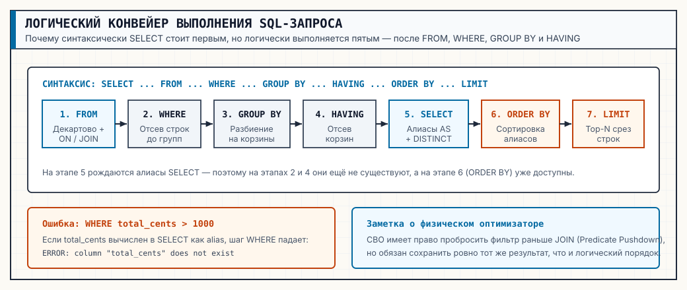
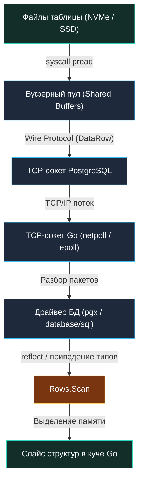

*Реляционная проекция $\pi$, истинный логический порядок выполнения SQL-запроса, вычисляемые столбцы с алиасами и безопасное сканирование строк из PostgreSQL в Go.*

> «Хорошее практическое правило проектирования интерфейсов: требуйте только то, что вам действительно нужно.»  
> — Алан Донован, Брайан Керниган, *The Go Programming Language*

Начинающий разработчик часто воспринимает `SELECT` как команду, с которой база данных начинает работу: сначала выбрать столбцы, потом проверить `FROM`, потом отфильтровать `WHERE`. Эта иллюзия ломается на первом же нетривиальном запросе — стоит объявить вычисляемый столбец в `SELECT` и попытаться отфильтровать по его псевдониму в `WHERE`. PostgreSQL немедленно отвечает ошибкой `ERROR: column "..." does not exist`.

Чтобы уверенно конструировать запросы любой сложности, нужно разделять синтаксический порядок записи SQL и реальную логическую последовательность его выполнения внутри движка.

---

## Проекция данных и логический порядок выполнения



В математических основаниях реляционной модели Эдгара Кодда операция извлечения строго заданного подмножества столбцов (атрибутов) из таблицы называется **проекцией** и обозначается греческой буквой $\pi$ (см. [[4. Реляционная модель данных — отношения, кортежи и множества]]). Если у таблицы `accounts` в `LedgerPulse` девять колонок, а сервису авторизации платежей нужны только идентификатор, баланс и валюта, запрос выглядит так:

```sql
SELECT id, balance, currency
FROM accounts;
```

На физическом уровне исполнитель читает 8-килобайтные страницы из буферного пула (`Shared Buffers`), извлекает только запрошенные смещения внутри каждого кортежа, упаковывает их в бинарные сообщения `DataRow` (тег `'D'` в протоколе PostgreSQL Wire Protocol) и отправляет в TCP-сокет Go-приложения. Чем меньше столбцов вы указали в `SELECT`, тем плотнее ложатся байты в сетевые фреймы и тем меньше памяти выделяется на стороне клиента.

### Почему синтаксис расходится с порядком исполнения

В тексте запроса ключевое слово `SELECT` стоит первым — так разработчики IBM в 1970-х приблизили синтаксис к английской фразе «Select these columns from this table where…». Но сам движок не способен выбрать столбцы из таблицы, пока не прочитал источник данных и не отфильтровал строки.

Логический порядок оценки разделов запроса устроен иначе:

```mermaid
flowchart LR
    classDef process fill:#1e293b,stroke:#38bdf8,stroke-width:1px,color:#f8fafc
    classDef data    fill:#132d29,stroke:#2dd4bf,stroke-width:1px,color:#f8fafc
    classDef warning fill:#78350f,stroke:#fbbf24,stroke-width:1px,color:#f8fafc

    F["1. FROM / JOIN<br>(источник кортежей)"]:::data --> W["2. WHERE<br>(фильтрация строк)"]:::process
    W --> G["3. GROUP BY<br>(схлопывание в группы)"]:::process
    G --> H["4. HAVING<br>(фильтрация групп)"]:::process
    H --> S["5. SELECT<br>(проекция и алиасы AS)"]:::warning
    S --> D["6. DISTINCT<br>(удаление дублей)"]:::process
    D --> O["7. ORDER BY<br>(сортировка результата)"]:::process
    O --> L["8. LIMIT / OFFSET<br>(срез итоговой пачки)"]:::data
```



Из этой последовательности вытекает важное правило области видимости: **алиасы столбцов, заданные на шаге 5 (`SELECT`), не существуют на шаге 2 (`WHERE`)**, но уже доступны на шаге 7 (`ORDER BY`). Попробуем проверить это на вычисляемом остатке:

```sql
-- Ошибка: на этапе WHERE псевдоним balance_rub ещё не вычислен
SELECT id, balance / 100.0 AS balance_rub
FROM accounts
WHERE balance_rub >= 500;
```

В терминале `psql` вы получите дословную ошибку:

```text
ERROR:  column "balance_rub" does not exist
LINE 3: WHERE balance_rub >= 500;
              ^
```

Правильный вариант либо повторяет выражение в `WHERE` (а лучше сравнивает исходный целочисленный `balance >= 50000`, чтобы не ломать индекс), либо использует псевдоним только в `ORDER BY`:

```sql
SELECT id, balance / 100.0 AS balance_rub
FROM accounts
WHERE balance >= 50000
ORDER BY balance_rub DESC;
```

*(Примечание: оптимизатор Cost-Based Optimizer на физическом уровне может переставлять операции и вычислять фильтры с помощью индекса ещё до чтения всей таблицы, но семантически запрос всегда обязан вести себя так, словно выполнен строго в приведённом порядке 1 → 8.)*

---

## Алиасы (`AS`) и вычисляемые столбцы

Оператор `SELECT` не просто копирует сырые байты колонок со страниц диска. Он работает как конвейер скалярных выражений: умеет выполнять арифметику, склеивать строки, приводить типы и вызывать встроенные функции. Чтобы у вычисляемого поля в результате было осмысленное имя вместо безликого `?column?` в PostgreSQL, применяют псевдоним (алиас) через ключевое слово `AS`:

```sql
SELECT
    id,
    owner_name || ' (' || currency || ')' AS account_label,
    balance / 100.0 AS balance_major,
    balance + 5000 AS balance_with_overdraft
FROM accounts;
```

Псевдонимы работают не только для формул, но и для обычных колонок (`owner_name AS client_name`), а также для сокращения имён таблиц (`FROM ledger_entries AS le`), что пригодится при соединении нескольких таблиц. Выражения вроде `account_label` и `balance_major` физически на диске не хранятся — СУБД вычисляет их «на лету» для каждой прошедшей фильтр строки и формирует виртуальный кортеж перед отправкой по сети.

> [!info] Под капотом: Вычисления в базе данных против бэкенда на Go
> Когда в SQL появляются конкатенация, форматирование дат и умножение на коэффициенты, возникает соблазн перенести в запрос всю презентационную логику. С точки зрения архитектуры и экономики ресурсов это опасная привычка.
>
> Сервер базы данных — единый разделяемый ресурс с ограниченным CPU, который сложно масштабировать горизонтально. Бэкенд-сервисы на Go, напротив, *stateless*: при росте трафика оркестратор поднимает десятки новых экземпляров за секунды.
>
> Отсюда простое инженерное правило:
> 1. **Вычисляйте в SQL**, если выражение участвует в **фильтрации, сортировке или группировке** на стороне БД (`WHERE`, `ORDER BY`, `GROUP BY`) и сокращает число передаваемых строк.
> 2. **Вычисляйте в Go**, если это **форматирование для UI или бизнес-правила** (склейка `owner_name` и `currency` в строку, перевод копеек в отображаемую десятичную дробь, форматирование даты). Дешевле передать сырые `owner_name`, `currency` и `int64` по сети, чем тратить такты процессора PostgreSQL на строковые аллокации.

---

## Жизненный цикл `SELECT` в Go

После того как исполнитель PostgreSQL сформировал результирующие кортежи, данные должны пройти через сетевой стек ядра Linux, асинхронный поллер рантайма Go (`netpoll` поверх `epoll`), бинарный парсер драйвера и аллокатор памяти:



При работе с множеством строк стандартная библиотека Go требует строгой дисциплины обращения с ресурсами. Ниже — идиоматичный шаблон Go 1.24 для чтения активных счетов `LedgerPulse`:

```go
package ledger

import (
	"context"
	"database/sql"
	"fmt"
	"time"
)

type AccountSummary struct {
	ID        int64
	Currency  string
	Balance   int64
	UpdatedAt time.Time
}

func ListActiveAccounts(ctx context.Context, db *sql.DB, expectedCap int) ([]AccountSummary, error) {
	const query = `
		SELECT id, currency, balance, updated_at
		FROM accounts
		WHERE status = 'active'`

	rows, err := db.QueryContext(ctx, query)
	if err != nil {
		return nil, fmt.Errorf("query active accounts: %w", err)
	}
	defer rows.Close()

	accounts := make([]AccountSummary, 0, max(expectedCap, 0))
	for rows.Next() {
		var acc AccountSummary
		if err := rows.Scan(&acc.ID, &acc.Currency, &acc.Balance, &acc.UpdatedAt); err != nil {
			return nil, fmt.Errorf("scan account row: %w", err)
		}
		accounts = append(accounts, acc)
	}

	if err := rows.Err(); err != nil {
		return nil, fmt.Errorf("iterate account rows: %w", err)
	}

	return accounts, nil
}
```

Разберём три критических узла этого кода, каждый из которых в продакшене отделяет надёжный сервис от ночного инцидента.

### Проверка `rows.Err()` после цикла

Цикл `for rows.Next()` завершается с `false` в двух совершенно разных случаях: либо строки действительно закончились, либо на середине потока оборвалось TCP-соединение или сработал таймаут контекста `ctx`. Если пропустить проверку `rows.Err()`, функция молча вернёт неполный список счетов, будто ошибок не было. Для биллинга `LedgerPulse` молчаливо обрезанная выписка — критический дефект целостности.

### Предварительное выделение ёмкости слайса

Конструкция `make([]AccountSummary, 0, max(expectedCap, 0))` задаёт нулевую длину и сразу резервирует память под ожидаемое число элементов. Без этого `append` при заполнении слайса вынужден многократно вызывать `runtime.growslice`, выделять новые массивы в куче, копировать старые структуры и нагружать сборщик мусора.

> [!warning] Ловушка: Утечка соединений при забытом `defer rows.Close()`
> Вызов `db.QueryContext` забирает одно физическое TCP-соединение из пула `database/sql` и монопольно привязывает его к объекту `*sql.Rows`. Соединение не вернётся в пул, пока `rows.Next()` не дойдёт до самого конца выборки или пока не будет вызван `rows.Close()`.
>
> Если внутри цикла `rows.Scan` вернёт ошибку, сработает ранний `return` или отменится контекст `ctx`, а `defer rows.Close()` забыт — соединение зависнет занятым. Под нагрузкой пул исчерпается за секунды, новые горутины встанут в бесконечное ожидание свободного коннекта, и сервис перестанет отвечать даже на health-пробы. Правило простое: ставьте `defer rows.Close()` сразу после проверки `err != nil` у `QueryContext`. Повторный вызов `Close()` безопасен и идемпотентен.

> [!info] Под капотом: Цена `Rows.Scan` и анализ побега
> Метод `rows.Scan(&acc.ID, ...)` принимает аргументы типа `...any`. Чтобы понять, куда записать байты из сетевого буфера, стандартный пакет `database/sql` на каждой строке запускает рефлексию (`reflect`) для проверки типов переданных указателей.
>
> Кроме процессорных затрат на `reflect`, срабатывает **анализ побега (*escape analysis*)** компилятора Go: адреса локальных полей уходят в вариативный срез интерфейсов `...any`, из-за чего структура `acc` часто «убегает» в кучу вместо размещения на стеке. На выборках в десятки тысяч строк это создаёт заметную нагрузку на GC. В высоконагруженных проектах эту проблему снимают статической кодогенерацией поверх `pgx` (например, инструментом `sqlc`, который мы подробно разберём в Модуле 10).

> [!tip] Собеседование [Junior]
> **Вопрос:** Какой метод `database/sql` используют для чтения ровно одной строки по первичному ключу, и почему ошибку отсутствия строки нельзя обрабатывать наравне со сбоем сети?  
> **Ответ:** Для одиночной строки применяют `db.QueryRowContext(ctx, query, id).Scan(...)`. Он автоматически возвращает соединение в пул сразу после `Scan`, избавляя от ручного `defer rows.Close()`.
> ```go
> var acc AccountSummary
> err := db.QueryRowContext(
>     ctx,
>     "SELECT id, currency, balance, updated_at FROM accounts WHERE id = $1",
>     accountID,
> ).Scan(&acc.ID, &acc.Currency, &acc.Balance, &acc.UpdatedAt)
> if err != nil {
>     if errors.Is(err, sql.ErrNoRows) {
>         return AccountSummary{}, ErrAccountNotFound
>     }
>     return AccountSummary{}, fmt.Errorf("fetch account %d: %w", accountID, err)
> }
> ```
> Если запрос вернул ноль строк, `Scan` возвращает маркерную ошибку `sql.ErrNoRows`. Это штатная доменная ситуация («счёт не найден», в HTTP-слое это статус `404 Not Found`), а не отказ базы данных (`500` или `503`). Её обязательно отлавливают через `errors.Is(err, sql.ErrNoRows)` и преобразуют в доменную ошибку, сохраняя реальные сетевые и синтаксические ошибки отдельным путём.

---

## Упражнения

### Базовое
Изучите запрос ниже и скажите, какие две строки вызовут ошибку компиляции в PostgreSQL при запуске (и почему), а какие сработают корректно:
```sql
SELECT
    id,
    amount AS delta_minor,
    amount / 100.0 AS delta_major
FROM ledger_entries
WHERE delta_minor > 0
ORDER BY delta_major DESC;
```

> [!solution] Показать решение
> Запрос упадёт на строке `WHERE delta_minor > 0` с ошибкой `ERROR: column "delta_minor" does not exist`.
> Причина — логический порядок выполнения SQL: секция `WHERE` оценивается **до** `SELECT`, поэтому алиас `delta_minor` в момент фильтрации ещё не существует.
> Строка `ORDER BY delta_major DESC` синтаксически корректна, потому что сортировка выполняется **после** этапа `SELECT`, когда алиас `delta_major` уже определён. Исправление простое: в `WHERE` нужно фильтровать по реальному столбцу `WHERE amount > 0`.

### Практическое
Напишите SQL-запрос к таблице `accounts` схемы `LedgerPulse`, который извлекает идентификатор `id`, внешний код `external_id`, валюту `currency` и два вычисляемых столбца:
1. `balance_cents` — остаток в копейках как копия `balance` (чтобы явно показать единицы измерения);
2. `is_empty` — логический признак (`balance = 0`).
Затем напишите функцию Go 1.24 `GetAccountBalance(ctx context.Context, db *sql.DB, externalID string) (int64, error)`, которая достаёт только `balance` по `external_id` через `QueryRowContext`, возвращает доменную ошибку `ErrAccountNotFound` при `sql.ErrNoRows` и оборачивает остальные ошибки через `%w`.

> [!solution] Показать решение
> ```sql
> SELECT
>     id,
>     external_id,
>     currency,
>     balance AS balance_cents,
>     (balance = 0) AS is_empty
> FROM accounts;
> ```
> ```go
> var ErrAccountNotFound = errors.New("account not found")
>
> func GetAccountBalance(ctx context.Context, db *sql.DB, externalID string) (int64, error) {
> 	const query = `SELECT balance FROM accounts WHERE external_id = $1`
> 	var balance int64
> 	err := db.QueryRowContext(ctx, query, externalID).Scan(&balance)
> 	if err != nil {
> 		if errors.Is(err, sql.ErrNoRows) {
> 			return 0, ErrAccountNotFound
> 		}
> 		return 0, fmt.Errorf("select balance for %q: %w", externalID, err)
> 	}
> 	return balance, nil
> }
> ```
> Здесь мы запрашиваем ровно один столбец `balance` (без `SELECT *`), освобождаем коннект сразу в `Scan` и чётко разделяем отсутствие записи и инфраструктурный сбой.

### Со звёздочкой (*)
Посмотрите на фрагмент кода Go, который собирает недавние проводки для счёта, и найдите в нём **три** скрытых дефекта (ресурсный, потоковый и по памяти):
```go
func LoadEntries(ctx context.Context, db *sql.DB, accountID int64) ([]int64, error) {
	rows, err := db.QueryContext(ctx, "SELECT amount FROM ledger_entries WHERE account_id = $1 LIMIT 100", accountID)
	if err != nil {
		return nil, err
	}
	var amounts []int64
	for rows.Next() {
		var amt int64
		if err := rows.Scan(&amt); err != nil {
			return nil, err
		}
		amounts = append(amounts, amt)
	}
	return amounts, nil
}
```

> [!solution] Показать решение
> 1. **Утечка соединения из пула:** отсутствует `defer rows.Close()`. Если `rows.Scan` вернёт ошибку на третьей строке или контекст отменится, TCP-соединение останется привязанным к незакрытому `*sql.Rows` и не вернётся в пул.
> 2. **Игнорирование `rows.Err()`:** после выхода из цикла `for rows.Next()` нет проверки `if err := rows.Err(); err != nil`. При сетевом обрыве посреди выборки функция вернёт `nil` в качестве ошибки и обрезанный срез проводок.
> 3. **Лишние реаллокации слайса:** слайс объявлен как `var amounts []int64` с нулевой ёмкостью, хотя запрос жёстко ограничен `LIMIT 100`. Замена на `amounts := make([]int64, 0, 100)` исключает серию вызовов `runtime.growslice` и копирование массивов в куче.

---

## Мостик к следующему уроку

Теперь вы знаете, что `SELECT` — это строгая реляционная проекция $\pi$, вычисляемая после отбора строк, и умеете без утечек принимать результат в Go.

Но выгружать всю таблицу `ledger_entries` ради десяти нужных проводок бессмысленно. В следующем уроке мы разберём секцию `WHERE`: узнаем, почему порядок `AND` и `OR` без скобок ломает логику фильтрации, как случайная функция слева от знака равенства выключает индекс и почему проверка `= NULL` всегда возвращает ноль строк — переходим к [[3. WHERE и фильтрация строк]].
