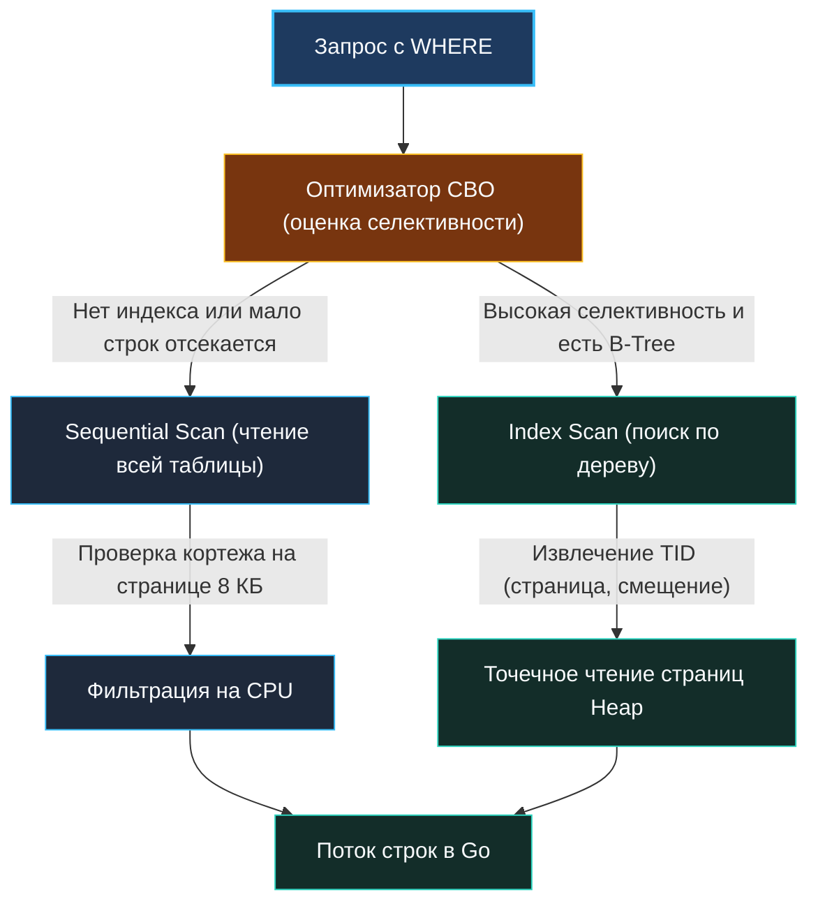

*Операция реляционной селекции $\sigma$, приоритет `AND` и `OR`, ловушки `BETWEEN` и `LIKE`, правило SARGability, передача слайса Go в `IN` и трёхзначная логика `NULL`.*

> «Пишите ясно — не умничайте.»  
> — Брайан Керниган, *UNIX: A History and a Memoir*

Выгружать из базы данных миллион проводок и отбирать нужные в цикле `for` внутри Go-сервиса — самый быстрый способ забить сетевой канал и уронить приложение по памяти. В реляционной алгебре операция отсечения лишних строк по логическому условию называется **селекцией** (или ограничением) и обозначается буквой $\sigma$. В SQL за неё отвечает секция `WHERE`.

Если проекция `SELECT` сжимает поток данных по ширине (оставляя нужные столбцы), то `WHERE` сжимает его по высоте (отбрасывая лишние кортежи). Раннее отсечение на стороне СУБД разгружает сразу три ресурса:

1. **Диск и память:** уменьшается число 8-килобайтных страниц, которые приходится поднимать с NVMe в `Shared Buffers`.
2. **Процессор сервера БД:** сокращается число кортежей, которые исполнитель разбирает и передаёт на следующие этапы плана.
3. **Сеть и рантайм Go:** в сетевой поллер `netpoll` не улетают мегабайты лишних записей.

---

## Как движок исполняет `WHERE`: Seq Scan против Index Scan

Увидев условие `WHERE`, парсер превращает предикат в узел синтаксического дерева, а стоимостной оптимизатор (CBO) выбирает один из двух базовых способов доступа к данным:



1. **Sequential Scan (последовательное сканирование):** СУБД подряд читает в буферный пул *каждую* страницу таблицы, просматривает каждый кортеж и проверяет предикат. Для таблицы из 50 миллионов проводок ради поиска одного счёта это пустая трата гигабайтов пропускной способности.
2. **Index Scan (сканирование по индексу):** СУБД спускается по сбалансированному дереву B-Tree за логарифмическое время $\mathcal{O}(\log N)$, находит на листовом уровне точные физические указатели **TID** (*Tuple Identifier* — номер страницы и смещение кортежа) и читает только целевые страницы таблицы (подробно архитектуру B-Tree мы разберём в Модуле 4).

> [!info] Под капотом: Короткое замыкание в SQL не гарантируется
> Разработчик Go привык, что в условии `if x != 0 && 100/x > 1` правая часть гарантированно не выполнится при `x == 0`. В SQL порядок вычисления предикатов `WHERE A AND B` **не фиксирован слева направо**.
>
> Оптимизатор CBO вправе переставить проверки местами, если статистика подсказывает, что второй предикат дешёвый или отсекает больше строк. Поэтому условие `WHERE divisor <> 0 AND total / divisor > 10` в PostgreSQL способно неожиданно упасть с ошибкой `division by zero`. Для безопасного порядка вычислений в SQL используют выражение `CASE WHEN` или функцию `NULLIF`, с которыми мы познакомимся в следующих главах этого модуля.

---

## Приоритет операторов, `BETWEEN` и `LIKE`

Базовые предикаты строятся из операторов сравнения (`=`, `<>` или `!=`, `<`, `<=`, `>`, `>=`), диапазона `BETWEEN`, списка `IN`, шаблонов `LIKE`/`ILIKE` и логических связок `NOT`, `AND`, `OR`. На практике здесь чаще всего ломаются три вещи.

### 1. Приоритет `NOT` > `AND` > `OR`

Оператор `AND` связывает условия теснее, чем `OR`. Если забыть скобки при фильтрации счетов `LedgerPulse`, запрос незаметно вернёт чужие записи:

```sql
-- Ошибка логики: вернёт активные RUB-счета И ВСЕ USD-счета (даже frozen и closed)
SELECT id, currency, status
FROM accounts
WHERE status = 'active' AND currency = 'RUB' OR currency = 'USD';

-- Верно: явные скобки фиксируют намерение
SELECT id, currency, status
FROM accounts
WHERE status = 'active' AND (currency = 'RUB' OR currency = 'USD');
```

Второй вариант можно записать ещё чище: `status = 'active' AND currency IN ('RUB', 'USD')`. Но привычка всегда ставить скобки вокруг `OR` спасает от тонких багов при добавлении новых условий.

### 2. Ловушка закрытых границ `BETWEEN` и времени

Выражение `x BETWEEN a AND b` строго эквивалентно `x >= a AND x <= b` — **обе границы включены**. На целых числах (`amount BETWEEN 100 AND 500`) это удобно, но на метках времени `TIMESTAMPTZ` приводит к потере данных в последний день периода:

```sql
-- Опасный шаблон: дата '2026-05-31' разворачивается в '2026-05-31 00:00:00+00'.
-- Все проводки за 31 мая с 00:00:01 по 23:59:59 выпадут из отчёта.
SELECT id, amount, created_at
FROM ledger_entries
WHERE created_at BETWEEN '2026-05-01' AND '2026-05-31';

-- Надёжный полуоткрытый интервал [начало, конец):
SELECT id, amount, created_at
FROM ledger_entries
WHERE created_at >= '2026-05-01 00:00:00+00'
  AND created_at <  '2026-06-01 00:00:00+00';
```

Полуоткрытый интервал `>= start AND < next_day` не зависит от точности долей секунды (`microseconds` в PostgreSQL) и избавляет от граничных гонок на стыке суток.

### 3. Поиск по шаблону `LIKE` и `ILIKE`

Оператор `LIKE` проверяет строку по маске с двумя спецсимволами: `%` (любая последовательность из нуля и более символов) и `_` (ровно один символ). В PostgreSQL также есть регистронезависимый вариант `ILIKE`.

Если в строке поиска пользователя встречается буквальный знак `%` или `_` (например, в коде `external_id` вида `corp_100%`), его экранируют явным символом через `ESCAPE`:

```sql
SELECT id, external_id
FROM accounts
WHERE external_id LIKE 'corp\_%' ESCAPE '\';
```

Без `ESCAPE` символ `_` совпал бы с любым символом на четвёртой позиции — от `corp-` до `corpA`.

---

## SARGability: как не сломать индекс одним выражением

Способность СУБД использовать индекс для быстрого поиска по условию `WHERE` называют **SARGability** (*Search ARGument ABLE*). На собеседованиях уровня Middle и выше этот вопрос задают постоянно, потому что одна лишняя функция в `WHERE` способна превратить 1-миллисекундный запрос в многоминутное сканирование диска.

Золотое правило SARGability: **индексированный столбец должен стоять слева от оператора сравнения в чистом, нетронутом виде**. Любая функция, арифметика, приведение типа или конкатенация над столбцом лишает B-Tree возможности выполнить бинарный спуск — дерево отсортировано по исходным значениям колонки, а не по результату вашей формулы.

```sql
-- ❌ Non-SARGable (индекс по created_at, balance и external_id игнорируется):
SELECT id FROM ledger_entries WHERE EXTRACT(YEAR FROM created_at) = 2026;
SELECT id FROM accounts       WHERE balance * 1.1 < 100000;
SELECT id FROM accounts       WHERE external_id LIKE '%-vip';

-- ✅ SARGable (B-Tree индекс используется напрямую):
SELECT id FROM ledger_entries WHERE created_at >= '2026-01-01' AND created_at < '2027-01-01';
SELECT id FROM accounts       WHERE balance < 100000 / 1.1;
SELECT id FROM accounts       WHERE external_id LIKE 'vip-%';
```

Обратите внимание на третий пример: префиксный шаблон `'vip-%'` позволяет спуститься по B-Tree к первому ключу, начинающемуся с `vip-` (в PostgreSQL для этого требуется операторный класс `text_pattern_ops` при не-`C` локали, о чём поговорим в Модуле 4). Ведущий же символ `%` в `'%-vip'` делает спуск невозможным, поскольку дерево упорядочено от начала строки, а не с конца.

> [!tip] Собеседование [Middle]
> **Вопрос:** На таблице `transactions` создан B-Tree индекс по столбцу `status`. Запрос `SELECT id, reference_id FROM transactions WHERE status <> 'reversed'` выполняется медленно, а план показывает полный `Seq Scan`. Почему оптимизатор проигнорировал готовый индекс?  
> **Ответ:** Операторы неравенства (`<>`, `!=`) обычно обладают крайне низкой **селективностью** (*low selectivity*). В реальном биллинге отменённых (`'reversed'`) транзакций может быть 2%, а остальных — 98%. Если движок пойдёт через индекс за 98% таблицы, ему придётся прочитать листовые страницы B-Tree, а затем для каждой строки совершить случайное чтение (*Random I/O*) страницы таблицы. Последовательное чтение всей таблицы одним потоком (*Sequential I/O*) оказывается в разы быстрее. B-Tree индекс выгоден, когда предикат отбирает малую долю строк (ориентировочно менее 5–10% таблицы). Проверить оценку числа строк оптимизатором позволяет `EXPLAIN (ANALYZE, BUFFERS)` (см. Модуль 4).

---

## Две ловушки `WHERE` при работе из Go

Переходя от интерактивной консоли `psql` к коду на Go, разработчики регулярно натыкаются на две проблемы: передачу слайса в `IN` и трёхзначную логику `NULL`.

### 1. Срез Go в операторе `IN (...)`

Попытка передать слайс `[]int64` напрямую в один плейсхолдер `$1` завершается ошибкой синтаксиса или неверного типа:

```go
// Ошибка: плейсхолдер $1 в стандартном протоколе принимает ровно одно скалярное значение, а не список.
ids := []int64{10, 20, 30}
rows, err := db.QueryContext(ctx, "SELECT id, balance FROM accounts WHERE id IN ($1)", ids)
```

Если нужно оставаться в рамках чистого `database/sql` без диалектных расширений, плейсхолдеры (`$1, $2, $3`) генерируют динамически по длине слайса:

```go
package ledger

import (
	"context"
	"database/sql"
	"fmt"
	"strings"
)

type AccountBalance struct {
	ID      int64
	Balance int64
}

func GetBalancesByIDs(ctx context.Context, db *sql.DB, ids []int64) ([]AccountBalance, error) {
	if len(ids) == 0 {
		// Быстрый возврат защищает от невалидного SQL "IN ()" и лишнего похода в БД.
		return nil, nil
	}

	placeholders := make([]string, len(ids))
	args := make([]any, len(ids))
	for i, id := range ids {
		placeholders[i] = fmt.Sprintf("$%d", i+1)
		args[i] = id
	}

	query := fmt.Sprintf(
		"SELECT id, balance FROM accounts WHERE id IN (%s)",
		strings.Join(placeholders, ", "),
	)

	rows, err := db.QueryContext(ctx, query, args...)
	if err != nil {
		return nil, fmt.Errorf("query balances by ids: %w", err)
	}
	defer rows.Close()

	res := make([]AccountBalance, 0, len(ids))
	for rows.Next() {
		var item AccountBalance
		if err := rows.Scan(&item.ID, &item.Balance); err != nil {
			return nil, fmt.Errorf("scan balance row: %w", err)
		}
		res = append(res, item)
	}
	if err := rows.Err(); err != nil {
		return nil, fmt.Errorf("iterate balance rows: %w", err)
	}
	return res, nil
}
```

> [!info] Под капотом: `ANY($1)` в PostgreSQL и `sqlc`
> Ручная генерация `$1, $2, ...` создаёт разный текст запроса для разной длины входного слайса, мешая переиспользованию подготовленных выражений. В PostgreSQL (особенно с драйвером `pgx`) эту проблему решают массивом: `WHERE id = ANY($1)`. Текст запроса остаётся постоянным при любом числе элементов, а слайс Go передаётся как один параметр массива. Подробнее о `pgx`, билдерах вроде `squirrel` и кодогенераторе `sqlc` мы поговорим в Модуле 10.

### 2. Трёхзначная логика и `NULL`

Вторая частая ошибка — попытка проверить отсутствие значения знаком равенства или неравенства:

```sql
-- Всегда вернёт 0 строк, даже если в таблице есть строки с closed_at IS NULL
SELECT id FROM accounts WHERE closed_at = NULL;
```

Как мы подробно разобрали в [[8. NULL и трёхзначная логика]], SQL опирается не на двузначную булеву алгебру, а на **трёхзначную логику (3VL)**: `TRUE`, `FALSE` и `UNKNOWN`. `NULL` означает «значение неизвестно или отсутствует». Нельзя утверждать, равно ли одно неизвестное другому, поэтому любое сравнение вида `col = NULL` или `col <> NULL` даёт `UNKNOWN`.

Предложение `WHERE` пропускает строку дальше **только при строгом результате `TRUE`**. Строки с `FALSE` и `UNKNOWN` отбрасываются. Чтобы проверить наличие или отсутствие значения, используют исключительно специализированные предикаты:

```sql
SELECT id, external_id FROM accounts WHERE closed_at IS NULL;
SELECT id, external_id FROM accounts WHERE closed_at IS NOT NULL;
```

Все тонкости `COALESCE`, `NULLIF` и агрегации при наличии `NULL` мы разберём в конце этого модуля.

---

## Упражнения

### Базовое
Проанализируйте предикат для выборки проводок `LedgerPulse` и укажите, какие две проблемы (логическая ошибка и потеря индекса) в нём скрыты. Перепишите запрос корректно:
```sql
SELECT id, account_id, amount
FROM ledger_entries
WHERE currency = 'RUB' OR currency = 'USD'
  AND amount > 0
  AND ABS(amount) >= 1000
  AND created_at BETWEEN '2026-06-01' AND '2026-06-30';
```

> [!solution] Показать решение
> 1. **Приоритет `AND` выше `OR`:** без скобок условие `currency = 'RUB'` оторвано от остальных фильтров — запрос вернёт *все* рублёвые проводки за всю историю, включая отрицательные и вне июня. Нужны скобки `(currency = 'RUB' OR currency = 'USD')` или `currency IN ('RUB', 'USD')`.
> 2. **Non-SARGable функция `ABS(amount)`:** раз `amount > 0` уже задано (либо если нужны обе стороны, лучше разбить на `amount >= 1000 OR amount <= -1000`), оборачивать `amount` в `ABS()` лишнее — это мешает использовать индекс по `amount`.
> 3. **Граница `BETWEEN`:** `'2026-06-30'` отрежет все проводки 30 июня после `00:00:00`. Исправленный запрос:
> ```sql
> SELECT id, account_id, amount
> FROM ledger_entries
> WHERE currency IN ('RUB', 'USD')
>   AND amount >= 1000
>   AND created_at >= '2026-06-01 00:00:00+00'
>   AND created_at <  '2026-07-01 00:00:00+00';
> ```

### Практическое
Допишите функцию на Go 1.24 `FindAccountsByExternalPrefix`, которая принимает `*sql.DB`, строковый префикс `prefix` и минимальный остаток `minBalance`, а возвращает список активных счетов (`status = 'active'`). Обязательно экранируйте спецсимволы `LIKE` (`\`, `%`, `_`) в пользовательском `prefix`, чтобы ввод вроде `100%` искался как буквальная подстрока, а не шаблон, и не допускайте SQL-инъекций.

> [!solution] Показать решение
> Чтобы пользователь не мог подменить шаблон через `%` или `_`, экранируем их до передачи в параметр `$1`:
> ```go
> func escapeLikePrefix(s string) string {
> 	r := strings.NewReplacer(`\`, `\\`, `%`, `\%`, `_`, `\_`)
> 	return r.Replace(s) + "%"
> }
>
> func FindAccountsByExternalPrefix(
> 	ctx context.Context,
> 	db *sql.DB,
> 	prefix string,
> 	minBalance int64,
> ) ([]AccountBalance, error) {
> 	const query = `
> 		SELECT id, balance
> 		FROM accounts
> 		WHERE status = 'active'
> 		  AND balance >= $1
> 		  AND external_id LIKE $2 ESCAPE '\'`
>
> 	rows, err := db.QueryContext(ctx, query, minBalance, escapeLikePrefix(prefix))
> 	if err != nil {
> 		return nil, fmt.Errorf("find accounts by prefix: %w", err)
> 	}
> 	defer rows.Close()
>
> 	var out []AccountBalance
> 	for rows.Next() {
> 		var item AccountBalance
> 		if err := rows.Scan(&item.ID, &item.Balance); err != nil {
> 			return nil, fmt.Errorf("scan account: %w", err)
> 		}
> 		out = append(out, item)
> 	}
> 	if err := rows.Err(); err != nil {
> 		return nil, fmt.Errorf("iterate accounts: %w", err)
> 	}
> 	return out, nil
> }
> ```
> Обратите внимание: здесь мы используем префиксный поиск (`prefix + "%"`), сохраняя SARGability условия при наличии подходящего B-Tree индекса.

### Со звёздочкой (*)
В таблице `transactions` есть необязательное поле `reviewed_by` (может быть `NULL`), а в сервисе `LedgerPulse` нужно выбрать все транзакции, которые проверил не модератор с `id = 42` (включая ещё не проверенные транзакции, где `reviewed_by IS NULL`). Разработчик написал:
```sql
SELECT id, reference_id FROM transactions WHERE reviewed_by <> 42;
```
Сколько непроверенных транзакций (`reviewed_by IS NULL`) вернёт этот запрос и почему? Предложите два способа переписать условие `WHERE` правильно.

> [!solution] Показать решение
> Запрос вернёт **0 непроверенных транзакций**.
> Причина в трёхзначной логике (3VL): выражение `NULL <> 42` вычисляется в `UNKNOWN`, а секция `WHERE` пропускает только строки, давшие `TRUE`.
> Исправить условие можно двумя способами:
> 1. Явная проверка `IS NULL`:
> ```sql
> SELECT id, reference_id
> FROM transactions
> WHERE reviewed_by <> 42 OR reviewed_by IS NULL;
> ```
> 2. Стандартный null-безопасный оператор сравнения PostgreSQL `IS DISTINCT FROM` (подробно разберём его в главе о `NULL` этого модуля):
> ```sql
> SELECT id, reference_id
> FROM transactions
> WHERE reviewed_by IS DISTINCT FROM 42;
> ```
> Оператор `IS DISTINCT FROM` всегда возвращает двузначное `TRUE` или `FALSE`: для `NULL` и `42` он вернёт `TRUE`.

---

## Мостик к следующему уроку

Мы научились отсеивать лишние строки на стороне СУБД без потерь точности и без поломки индексов.

Но отфильтрованная таблица в реляционной модели по-прежнему остаётся неупорядоченным множеством: при каждом запуске порядок строк может меняться из-за `VACUUM` или вытеснения страниц в буферном пуле. Как устроена сортировка в памяти `work_mem` и на диске, почему классический `OFFSET` обрушивает базу на миллионных страницах и как в `project/step02/query.go` устроена безопасная keyset-пагинация, разберём в следующей главе: [[4. ORDER BY, LIMIT и пагинация (OFFSET против keyset)]].
