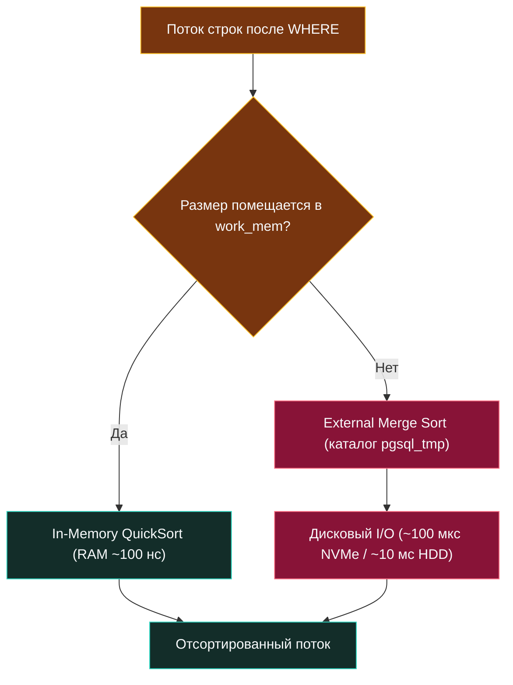
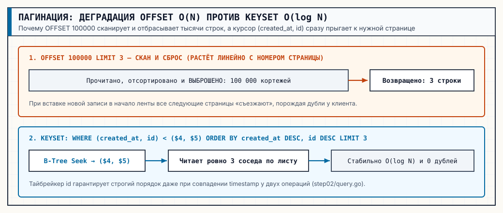

*Как устроена сортировка в `work_mem` и сброс на диск, зачем указывать `NULLS LAST`, почему `OFFSET` умирает на больших страницах и как в `project/step02/query.go` реализованы keyset-курсор и белый список сортировки.*

> «Блеск Unix заключался в выборе абстракции, достаточно общей, чтобы быть поразительно полезной, и при этом не слишком дорогой по производительности.»  
> — Брайан Керниган, *UNIX: A History and a Memoir*

На тестовой базе из двадцати счетов запрос `SELECT id, amount FROM ledger_entries` исправно возвращает строки в том порядке, в котором вы их добавили. Разработчик запоминает это поведение и начинает строить на нём постраничную выдачу. На продакшене спустя месяц строки в ленте операций внезапно перемешиваются, а кнопка «Страница 500» отвечает по восемь секунд.

В строгой реляционной модели Эдгара Кодда **таблица — неупорядоченное множество кортежей** (см. [[4. Реляционная модель данных — отношения, кортежи и множества]]). Без явного предложения `ORDER BY` СУБД вправе отдавать строки в любой последовательности. Физический порядок меняется от запуска к запуску в зависимости от того, какие 8-килобайтные страницы уже лежат в `Shared Buffers`, в каком порядке их обошли параллельные воркеры и куда фоновый процесс `VACUUM` записал свежие кортежи поверх освободившихся слотов мёртвых строк.

Единственный способ гарантировать воспроизводимый порядок результата — явно указать `ORDER BY`.

---

## Механика `ORDER BY`: память `work_mem`, диск и индекс B-Tree

Операция сортировки — одна из самых затратных по CPU и памяти во всём конвейере СУБД. Движок PostgreSQL исполняет её одним из двух принципиально разных путей: через явную сортировку кортежей или через чтение уже отсортированного индекса.

### 1. Сортировка в памяти и сброс на диск (*External Merge Sort*)

Если подходящего индекса нет, исполнитель собирает все отфильтрованные строки и сортирует их алгоритмами QuickSort или Radix Sort. Объём оперативной памяти, выделяемый под один узел сортировки внутри процесса-бэкенда, в PostgreSQL ограничивается параметром `work_mem` (по умолчанию всего **4 МБ**).



> [!warning] Ловушка: Spill to Disk и бездумное увеличение `work_mem`
> Когда объём сортируемых строк превышает `work_mem`, PostgreSQL не падает с ошибкой нехватки памяти. Вместо этого он переключается на **внешнюю сортировку слиянием** (*External Merge Sort*): режет поток на порции, сортирует каждую в RAM, сбрасывает временные файлы на диск в каталог `pgsql_tmp` и затем сливает их обратно. Доступ к данным замедляется на три-пять порядков — с наносекунд RAM до миллисекунд дискового ввода-вывода. В плане `EXPLAIN (ANALYZE, BUFFERS)` такой сброс сразу виден по строке `Sort Method: external merge Disk` (см. Модуль 4).
>
> При этом нельзя просто выставить `work_mem = 1GB` глобально в `postgresql.conf`. Этот лимит выделяется **на каждый узел сортировки или хеширования каждого активного запроса**. Сто параллельных соединений с тремя узлами сортировки попытаются занять $100 \times 3 \times 1\text{ ГБ} = 300\text{ ГБ}$ ОЗУ, после чего Linux OOM Killer безжалостно убьёт процесс базы данных.

### 2. Сортировка по индексу и `NULLS FIRST / LAST`

Лучшая сортировка — та, которую вообще не пришлось выполнять. Листовые страницы B-Tree уже хранят ключи в строго упорядоченном виде и связаны между собой двусвязным списком. При наличии индекса на `(created_at)` запрос с `ORDER BY created_at ASC` просто идёт по листьям слева направо (*Forward Index Scan*), а `ORDER BY created_at DESC` — справа налево (*Backward Index Scan*) с околонулевыми затратами CPU.

Отдельная тонкость сортировки в PostgreSQL — поведение `NULL`:
* при сортировке по возрастанию (`ASC`) `NULL` по умолчанию идёт **в конце** (`NULLS LAST`);
* при сортировке по убыванию (`DESC`) `NULL` по умолчанию оказывается **в начале** (`NULLS FIRST`).

Если вы сортируете счета по необязательному полю `closed_at DESC` и не хотите видеть незакрытые счета (`NULL`) наверху списка, указывайте поведение явно:

```sql
SELECT id, external_id, closed_at
FROM accounts
ORDER BY closed_at DESC NULLS LAST, id DESC;
```

Явные `NULLS FIRST` и `NULLS LAST` также важны при проектировании составных индексов: направление индекса должно совпадать с порядком `NULL` в запросе, иначе планировщик откажется от Index Scan.

---

## `LIMIT`, Top-N Heapsort и преаллокация слайса в Go

Директива `LIMIT N` (в стандарте ANSI SQL также пишется как `FETCH FIRST N ROWS ONLY`) даёт исполнителю право раннего выхода (*Early Stop*): набрав `N` строк, конвейер немедленно останавливает чтение.

В паре с `ORDER BY` без индекса `LIMIT N` включает важную оптимизацию — **Top-N Heapsort**. Допустим, вы запрашиваете 10 самых крупных проводок за сутки из таблицы на 20 миллионов строк (`ORDER BY amount DESC LIMIT 10`). Вместо полной сортировки с неизбежным сбросом на диск PostgreSQL заводит в оперативной памяти ограниченную двоичную кучу (*Bounded Heap*) ровно на 10 элементов. Проходя по строкам, движок удерживает только 10 текущих максимумов и вытесняет всё меньшее. Временные файлы на диске не создаются.

На стороне Go знание `LIMIT` даёт прямой выигрыш по памяти: вы заранее знаете верхнюю границу длины слайса.

```go
// Вместимость известна заранее: append не вызовет runtime.growslice ни разу.
entries := make([]EntrySummary, 0, limit)

rows, err := db.QueryContext(ctx, query, args...)
if err != nil {
	return nil, fmt.Errorf("query entries: %w", err)
}
defer rows.Close()

for rows.Next() {
	var e EntrySummary
	if err := rows.Scan(&e.ID, &e.Amount, &e.CreatedAt); err != nil {
		return nil, fmt.Errorf("scan entry: %w", err)
	}
	entries = append(entries, e)
}
```

Если объявить `var entries []EntrySummary` без `make(..., 0, limit)`, `append` будет многократно перевыделять массивы в куче при росте выборки, увеличивая нагрузку на сборщик мусора.

---

## Почему `OFFSET` убивает производительность

Подавляющее большинство веб-приложений начинают с классической постраничной навигации через `LIMIT` и `OFFSET`:

```sql
SELECT id, account_id, amount, created_at
FROM ledger_entries
WHERE account_id = 7
ORDER BY created_at DESC, id DESC
LIMIT 50 OFFSET 100000;
```

На первой странице (`OFFSET 0`) запрос отрабатывает за доли миллисекунды. Но чем глубже пользователь уходит в историю операций, тем стремительнее растёт задержка.


> [!tip] Собеседование [Middle]
> **Вопрос:** Почему запрос `ORDER BY created_at DESC LIMIT 50 OFFSET 100000` резко замедляется на глубоких страницах, даже если по `(account_id, created_at)` построен идеальный B-Tree индекс?  
> **Ответ:** `OFFSET` физически **не может перепрыгнуть через записи** в дереве индекса или файле таблицы. Из-за многоверсионного контроля конкурентности (**MVCC**, подробно разберём в Модуле 5) в индексе и на страницах кучи присутствуют кортежи, которые уже удалены или ещё не видны снимку текущей транзакции. Поэтому исполнитель вынужден честно прочитать каждую из первых 100 000 записей, проверить её видимость для текущего снимка, отбросить — и только потом собрать нужные 50 строк. Сложность пагинации через `OFFSET` линейно растёт с глубиной страницы: $\mathcal{O}(N)$. Вдобавок при добавлении новых проводок на ходу строки сдвигаются, и пользователь на следующей странице видит дубликаты.

---

## Keyset-пагинация и разбор `project/step02/query.go`



Промышленная альтернатива глубокому `OFFSET` — **keyset-пагинация** (курсорный метод, *Seek Method*). Вместо номера смещения клиент передаёт значения сортировочных ключей *последней* строки предыдущей страницы, а SQL-запрос фильтрует через `WHERE`:

```sql
-- Страница 1:
SELECT id, transaction_id, account_id, amount, currency, created_at
FROM ledger_entries
WHERE account_id = $1
ORDER BY created_at DESC, id DESC
LIMIT $2;

-- Страница 2 (получив последнюю строку с created_at = '2026-05-01 12:00:00+00', id = 42):
SELECT id, transaction_id, account_id, amount, currency, created_at
FROM ledger_entries
WHERE account_id = $1 AND (created_at, id) < ($2, $3)
ORDER BY created_at DESC, id DESC
LIMIT $4;
```

Сравнение кортежей `(created_at, id) < ($2, $3)` в PostgreSQL работает лексикографически и эквивалентно условию:
`created_at < $2 OR (created_at = $2 AND id < $3)`.
При наличии составного индекса `(account_id, created_at DESC, id DESC)` движок выполняет точечный спуск *Index Seek* за $\mathcal{O}(\log N)$ прямо к позиции `(created_at, id)` и забирает следующие `50` записей. Время ответа остаётся стабильным (< 1 мс) как на второй странице, так и на двухмиллионной.

Зачем в кортеже обязательно присутствует `id`? В высоконагруженном биллинге в одну микросекунду могут записаться десятки проводок с одинаковым `created_at`. Без уникального замыкающего ключа `id` условие `created_at < $2` безвозвратно потеряло бы часть строк, попавших на границу страницы.

Посмотрим, как эта механика вместе с защитой от SQL-инъекций реализована в нашем сквозном проекте — файле `project/step02/query.go`.

### Конструктор `BuildEntriesQuery`: параметры, курсор и белый список сортировки

Полный конструктор из `project/step02/query.go` объединяет динамические фильтры `WHERE`, keyset-курсор и безопасную подстановку столбца сортировки:

```go
var allowedOrderColumns = []string{"created_at", "id", "amount"}

// BuildEntriesQuery строит безопасный параметризованный запрос с keyset-пагинацией (created_at, id) < ($k, $k+1).
func BuildEntriesQuery(f EntryFilter) (BuiltQuery, error) {
	if f.AccountID <= 0 {
		return BuiltQuery{}, errors.New("account_id must be positive")
	}
	limit := f.Limit
	if limit <= 0 || limit > 200 {
		limit = 50
	}
	orderCol := "created_at"
	if f.OrderBy != "" {
		if !slices.Contains(allowedOrderColumns, f.OrderBy) {
			return BuiltQuery{}, fmt.Errorf("%w: %q", ErrInvalidSortColumn, f.OrderBy)
		}
		orderCol = f.OrderBy
	}

	var where []string
	var args []any
	addArg := func(v any) string {
		args = append(args, v)
		return fmt.Sprintf("$%d", len(args))
	}

	where = append(where, "account_id = "+addArg(f.AccountID))
	if f.Currency != "" {
		where = append(where, "currency = "+addArg(strings.ToUpper(f.Currency)))
	}
	if f.MinAmount != nil {
		where = append(where, "amount >= "+addArg(*f.MinAmount))
	}
	if f.CursorTime != nil && f.CursorID != nil {
		pTime := addArg(*f.CursorTime)
		pID := addArg(*f.CursorID)
		where = append(where, fmt.Sprintf("(created_at, id) < (%s, %s)", pTime, pID))
	}

	pLimit := addArg(limit)
	query := fmt.Sprintf(
		"SELECT id, transaction_id, account_id, amount, currency, created_at\n"+
			"FROM ledger_entries\n"+
			"WHERE %s\n"+
			"ORDER BY %s DESC, id DESC\n"+
			"LIMIT %s",
		strings.Join(where, " AND "),
		orderCol,
		pLimit,
	)

	return BuiltQuery{SQL: query, Args: args}, nil
}
```

Разберём четыре инженерных решения, заложенных в `BuildEntriesQuery`:

1. **Автоматическая нумерация плейсхолдеров через замыкание `addArg`.** Когда число фильтров динамически меняется (`Currency` и `MinAmount` необязательны), жёстко зашитые номера `$1`, `$2` быстро разъезжаются. Замыкание `addArg` синхронно добавляет значение в срез `args` и возвращает точный токен `$N` — номера параметров и их аргументы никогда не рассинхронизируются.
2. **Жёсткое ограничение `Limit`.** При значении `<= 0` или `> 200` размер пачки сбрасывается на безопасные `50`. Это защищает сервер БД и память Go-процесса от клиентского запроса `?limit=10000000`.
3. **Белый список (*allowlist*) для `ORDER BY`.** В протоколе PostgreSQL параметры `$1`, `$2` связывают только **значения**, но не идентификаторы — передать имя колонки через `ORDER BY $1 DESC` невозможно (СУБД воспримет `$1` как строковую константу, а не имя столбца). Поэтому `orderCol` вынужденно подставляется в шаблон через `fmt.Sprintf`. Если доверить сюда сырую строку из HTTP-запроса, злоумышленник передаст `"id; DROP TABLE accounts;--"` и выполнит SQL-инъекцию. Проверка `slices.Contains(allowedOrderColumns, f.OrderBy)` из стандартной библиотеки Go 1.24 пропускает строго разрешённые имена столбцов и возвращает сентинель-ошибку `ErrInvalidSortColumn` на любую другую строку.
4. **Ограничение учебного шага по курсору.** Заметьте важную деталь: кортеж курсора `(created_at, id) < ($4, $5)` математически согласован с сортировкой `ORDER BY created_at DESC, id DESC`. Если клиент выберет `OrderBy: "amount"` одновременно с курсором по `created_at`, в реальном продакшене курсор тоже должен переключаться на `(amount, id) < ($k, $k+1)` — об этом стоит помнить при расширении фильтра.

### Проверка семантики в `KeysetPage` и запуск тестов

Вторая функция из `project/step02/query.go` — `KeysetPage` — воспроизводит логику кортежного сравнения `(created_at, id) < (*cursorTime, *cursorID)` в чистом Go без поднятия PostgreSQL:

```go
func KeysetPage(rows []EntryRow, accountID int64, cursorTime *time.Time, cursorID *int64, limit int) []EntryRow {
	var filtered []EntryRow
	for _, r := range rows {
		if r.AccountID != accountID {
			continue
		}
		if cursorTime != nil && cursorID != nil {
			if r.CreatedAt.After(*cursorTime) {
				continue
			}
			if r.CreatedAt.Equal(*cursorTime) && r.ID >= *cursorID {
				continue
			}
		}
		filtered = append(filtered, r)
	}
	slices.SortFunc(filtered, func(a, b EntryRow) int {
		if a.CreatedAt.After(b.CreatedAt) {
			return -1
		}
		if a.CreatedAt.Before(b.CreatedAt) {
			return 1
		}
		return int(b.ID - a.ID)
	})
	if limit > 0 && len(filtered) > limit {
		return filtered[:limit]
	}
	return filtered
}
```

Строки кода `r.CreatedAt.After(*cursorTime)` и `r.CreatedAt.Equal(*cursorTime) && r.ID >= *cursorID` наглядно раскрывают, что именно делает PostgreSQL при оценке `(created_at, id) < ($4, $5)`: сначала сравнивает время, а при точном равенстве меток времени отсекает строки с `id >= cursorID`.

Запустим модульный тест `project/step02/query_test.go`, который проверяет генерацию параметров `$1`..`$6`, блокировку SQL-инъекции через `ErrInvalidSortColumn` и корректный переход со страницы 1 на страницу 2 при совпадении `CreatedAt`:

```text
$ cd project && go test -v ./step02/...
=== RUN   TestBuildEntriesQueryAndKeyset
--- PASS: TestBuildEntriesQueryAndKeyset (0.00s)
PASS
ok  	github.com/UnrealTemplier/go-textbook-v2-vol2/project/step02	0.001s
```

---

## Упражнения

### Базовое
Запрос к таблице проводок строится с пагинацией по возрастанию времени:
```sql
SELECT id, account_id, amount, created_at
FROM ledger_entries
WHERE account_id = 7
ORDER BY created_at ASC, id ASC
LIMIT 50;
```
Вы получили первую страницу, последняя строка которой имеет `created_at = '2026-05-01 10:15:00+00'` и `id = 815`. Запишите SQL-запрос для получения **второй** страницы через keyset-пагинацию без использования `OFFSET`. Какой знак сравнения должен стоять между кортежем `(created_at, id)` и курсором при направлении `ASC`?

> [!solution] Показать решение
> Поскольку сортировка идёт по возрастанию (`ASC`), на следующей странице нужны строки, которые строго **больше** последнего кортежа текущей страницы:
> ```sql
> SELECT id, account_id, amount, created_at
> FROM ledger_entries
> WHERE account_id = 7
>   AND (created_at, id) > ('2026-05-01 10:15:00+00', 815)
> ORDER BY created_at ASC, id ASC
> LIMIT 50;
> ```
> Условие `(created_at, id) > (...)` развернётся в `created_at > '2026-05-01 10:15:00+00' OR (created_at = '2026-05-01 10:15:00+00' AND id > 815)`, сохранив детерминированность при коллизии времени.

### Практическое
В `project/step02/query.go` добавьте поддержку направления сортировки `SortDir` (`"asc"` или `"desc"`, по умолчанию `"desc"`) в `EntryFilter` и `BuildEntriesQuery`:
1. Защитите `SortDir` таким же белым списком (ошибка при попытке передать `"DESC; --"`).
2. При `SortDir == "asc"` условие keyset-курсора должно автоматически меняться с `<` на `>`, а `ORDER BY` — использовать выбранное направление.

> [!solution] Показать решение
> Определяем белый список направлений и выбираем знак сравнения кортежа:
> ```go
> dir := "DESC"
> op := "<"
> if f.SortDir != "" {
> 	switch strings.ToLower(f.SortDir) {
> 	case "asc":
> 		dir = "ASC"
> 		op = ">"
> 	case "desc":
> 		dir = "DESC"
> 		op = "<"
> 	default:
> 		return BuiltQuery{}, fmt.Errorf("invalid sort direction: %q", f.SortDir)
> 	}
> }
> ```
> Далее при добавлении курсора подставляем `op`:
> ```go
> where = append(where, fmt.Sprintf("(created_at, id) %s (%s, %s)", op, pTime, pID))
> ```
> И в `ORDER BY`: `ORDER BY %s %s, id %s` (для `orderCol`, `dir`, `dir`). Важно применять одно и то же направление к обоим столбцам, иначе B-Tree не сможет отдать индексный скан без пересортировки в памяти.

### Со звёздочкой (*)
Предположим, вы добавили в `project/step02/query.go` поддержку сортировки по сумме проводки `OrderBy: "amount"` (причём суммы бывают и положительными, и отрицательными). Почему текущий курсор `(created_at, id) < ($k, $k+1)` сломает пагинацию при `OrderBy: "amount"`, и как должен выглядеть правильный keyset-курсор для `ORDER BY amount DESC, id DESC`? Заодно проверьте формулу `return int(b.ID - a.ID)` в `KeysetPage`: при каких значениях `ID` типа `int64` эта разность переполнится на 32-битной архитектуре или при огромных идентификаторах, и как записать её безопасно через `cmp.Compare`?

> [!solution] Показать решение
> 1. **Несогласованный курсор:** при `ORDER BY amount DESC, id DESC` строки упорядочены по убыванию `amount`, а не `created_at`. Условие `(created_at, id) < (...)` отфильтрует записи по времени и молча пропустит более старые или новые проводки с подходящей суммой. Корректный курсор обязан повторять столбцы сортировки в точном порядке: `(amount, id) < ($k, $k+1)` с передачей `CursorAmount` и `CursorID`.
> 2. **Риск переполнения `int(b.ID - a.ID)`:** если разница `b.ID - a.ID` превысит `math.MaxInt32` (на 32-битных системах) или `math.MaxInt64` (при сравнении крайних `int64`), вычитание переполнится со сменой знака, и порядок сортировки нарушится. В Go 1.21+ для безопасного сравнения любых упорядочиваемых типов используют `cmp.Compare(b.ID, a.ID)` — оно не выполняет вычитания и никогда не переполняется.

---

## Мостик к следующему уроку

Мы разобрали весь базовый контур чтения данных в SQL: от декларативной проекции `SELECT` и логического порядка выполнения до SARGable-предикатов `WHERE`, сортировки в `work_mem` и устойчивой keyset-пагинации из `project/step02/`.

Но база данных нужна не только для чтения. В следующей главе мы перейдём к изменению состояния таблиц — командам `INSERT`, `UPDATE`, `DELETE`, обработке конфликтов `ON CONFLICT` и атомарному возврату изменённых строк через `RETURNING`.
