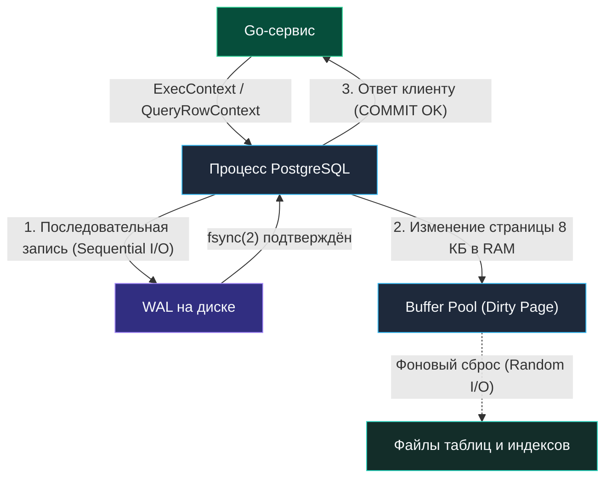

*Как изменять состояние базы данных, не теряя байты при сбое питания, не заваливая пул соединений утечками и не ломая финансовый учёт LedgerPulse.*

> «Мы пишем, а позже читаем. Сохраняем, а позже извлекаем. Храним, а позже обращаемся к сохранённому. Назначение памяти — уберечь информацию без искажений между двумя этими событиями.»  
> — Чарльз Петцольд, *Code: The Hidden Language of Computer Hardware and Software*

Запрос `SELECT` из [[2. SELECT — выборка, проекция и вычисляемые столбцы]] оставляет состояние базы данных нетронутым. Тройка команд **DML** (*Data Manipulation Language*) — `INSERT`, `UPDATE` и `DELETE` — делает обратное: она мутирует персистентное состояние хранилища.

Для бэкенд-инженера дисциплина записи на порядок строже дисциплины чтения. Ошибка в условии `SELECT` покажет пользователю кривой отчёт. Пропущенный или неверный предикат `WHERE` в `UPDATE` или `DELETE` за одну миллисекунду перезапишет или уничтожит всю таблицу — классический инцидент *Mass Update / Mass Delete*, от которого не спасает даже репликация, мгновенно копирующая ошибочную команду на реплики.

---

## INSERT: рождение строк, батчи и ON CONFLICT

Базовая вставка в таблицу `accounts` (см. [[15. ER-диаграммы и моделирование схемы LedgerPulse]]) перечисляет столбцы и кортеж значений:

```sql
INSERT INTO accounts (external_id, owner_name, currency)
VALUES ('acc-ext-101', 'Иван Петров', 'RUB');
```

Поля со значением `DEFAULT` (`balance`, `status`, `metadata`, `created_at`, `updated_at`) опускаем — база подставит их сама, как и автоинкрементный `id`.

### Пакетная вставка против цикла в Go

При импорте выписки или пачки событий из брокера новички часто вызывают одиночный `INSERT` в цикле `for`:

```go
// АНТИПАТТЕРН: N сетевых раунд-трипов и N неявных транзакций
for _, acc := range batch {
	if _, err := db.ExecContext(ctx,
		`INSERT INTO accounts (external_id, owner_name, currency) VALUES ($1, $2, $3)`,
		acc.ExternalID, acc.OwnerName, acc.Currency,
	); err != nil {
		return err
	}
}
```

На каждой итерации сервис оплачивает сетевой раунд-трип TCP, переключение контекста ОС, неявную транзакцию, разбор запроса и сброс журнала на диск (`fsync`). Пропускная способность падает с десятков тысяч строк в секунду до сотен.

Промышленный стандарт — многострочный `INSERT` (Bulk Insert), выполняемый в одном пакете и одной транзакции:

```sql
INSERT INTO accounts (external_id, owner_name, currency)
VALUES
    ('acc-ext-101', 'Иван Петров', 'RUB'),
    ('acc-ext-102', 'ООО Вектор', 'RUB'),
    ('acc-ext-103', 'Анна Соколова', 'USD');
```

> [!warning] Ловушка протокола: лимит 65 535 параметров
> В бинарном протоколе PostgreSQL число позиционных параметров (`$1`, `$2`, ...) в одном подготовленном запросе ограничено беззнаковым 16-битным целым: **65 535** ($2^{16} - 1$). При вставке 5 столбцов предел равен $\lfloor 65535 / 5 \rfloor = 13\,107$ строк; 13 108 строк уже вернут ошибку протокола. В Go слайсы нарезают чанками по 500–2000 строк, а миллионы записей заливают через потоковый `COPY` (подробнее в Модуле 4).

### Идемпотентная вставка: ON CONFLICT (UPSERT)

Вебхуки и сообщения из очереди нередко приходят дважды. В `LedgerPulse` внешние ключи `accounts.external_id` и `transactions.reference_id` защищены ограничением `UNIQUE`, поэтому повторный `INSERT` падает с кодом `23505`. Конструкция `ON CONFLICT` превращает вставку в атомарный **UPSERT** (*Update or Insert*) без гонок:

```sql
-- Безопасный пропуск дубликата транзакции
INSERT INTO transactions (reference_id, kind, status, description)
VALUES ('tx-ref-9001', 'transfer', 'pending', 'Оплата заказа 42')
ON CONFLICT (reference_id) DO NOTHING
RETURNING id;

-- Обновление имени владельца при повторной синхронизации
INSERT INTO accounts (external_id, owner_name, currency)
VALUES ('acc-ext-101', 'Иван С. Петров', 'RUB')
ON CONFLICT (external_id) DO UPDATE
SET owner_name = EXCLUDED.owner_name,
    updated_at = now()
RETURNING id, updated_at;
```

Псевдотаблица `EXCLUDED` хранит отклонённую строку. Учтите: при срабатывании `DO NOTHING` блок `RETURNING id` вернёт 0 строк, и вызов `QueryRowContext(...).Scan(&id)` в Go завершится ошибкой `sql.ErrNoRows` — это штатный признак того, что запись уже существовала.

---

## Атомарный возврат строк: RETURNING и Go 1.24

Сервису почти всегда сразу нужен сгенерированный `id` или серверное время `created_at`. Метод `res.LastInsertId()` в PostgreSQL не поддерживается: при конкурентных и многострочных вставках понятие «последнего ID» на соединении неоднозначно.

Стандартное решение — конструкция **`RETURNING`**, работающая в `INSERT`, `UPDATE` и `DELETE`:

```go
type CreatedAccount struct {
	ID        int64
	CreatedAt time.Time
}

func CreateAccount(ctx context.Context, db *sql.DB, extID, owner, currency string) (CreatedAccount, error) {
	const query = `
		INSERT INTO accounts (external_id, owner_name, currency)
		VALUES ($1, $2, $3)
		RETURNING id, created_at`

	var res CreatedAccount
	// Запрос с RETURNING возвращает строку, поэтому вызываем QueryRowContext
	if err := db.QueryRowContext(ctx, query, extID, owner, currency).Scan(&res.ID, &res.CreatedAt); err != nil {
		return CreatedAccount{}, fmt.Errorf("create account %q: %w", extID, err)
	}
	return res, nil
}
```

Один сетевой запрос одновременно создаёт строку и возвращает её автоинкрементный ключ.

---

## Физика записи: WAL, Buffer Pool и диск

Если бы при каждом `INSERT` база сразу писала строку в основной файл таблицы на диске, её пропускная способность рухнула бы. Доступ к RAM занимает ~**100 нс**, случайная запись на NVMe SSD — ~**100 мкс** (в 1 000 раз медленнее), а на HDD — ~**10 мс** (в 100 000 раз медленнее). Случайная запись (*Random Write*) в разбросанные 8-килобайтные страницы таблиц и B-Tree индексов быстро забила бы очередь накопителя.

Поэтому СУБД разделяют путь записи на две фазы:



1. **WAL (*Write-Ahead Log*).** Ни один байт изменённой страницы данных не попадёт на диск раньше записи в WAL. Запись в журнал идёт строго последовательно (*Sequential I/O*) в конец файла. После вызова `fsync(2)` СУБД гарантирует долговечность (*Durability*) и отвечает клиенту.
2. **Buffer Pool (`shared_buffers`).** Сами кортежи обновляются в 8 КБ страницах в RAM, а страница помечается как «грязная» (*Dirty Page*).
3. **Фоновый сброс.** Процессы `bgwriter` и `checkpointer` асинхронно переносят грязные страницы на диск, сглаживая пики I/O. При сбое питания данные в RAM пропадут, но при перезапуске **Crash Recovery** (*Redo Replay*) восстановит все подтверждённые транзакции из WAL (см. Модуль 5).

---

## UPDATE: многоверсионность и проверка RowsAffected

Синтаксис обновления строк знаком каждому:

```sql
UPDATE accounts
SET balance = balance + 5000,
    updated_at = now()
WHERE id = 7 AND status = 'active'
RETURNING balance;
```

Но под внешне простым `UPDATE` в разных СУБД скрывается разная физика хранения. Движок MySQL InnoDB старается изменять байты прямо на месте (*in-place update*), если обновлённая строка помещается в прежний слот страницы, а старую версию выносит в журнал отката (*Undo Log*).

В PostgreSQL действует бескомпромиссная модель **MVCC** (*Multi-Version Concurrency Control*): физические кортежи в куче (*Heap*) **иммутабельны**. Выполняя `UPDATE`, PostgreSQL не перезаписывает старую строку на месте. Вместо этого ядро:

1. Проставляет в заголовке старой версии кортежа идентификатор текущей транзакции в системное поле `xmax` (логическое удаление).
2. Записывает рядом или на другой 8-килобайтной странице **новую физическую версию кортежа** с новым `xmin` и обновлёнными значениями.

Отсюда прямое эксплуатационное следствие: частые обновления одних и тех же строк в PostgreSQL (например, горячих балансов в `accounts`) приводят к накоплению «мёртвых» версий кортежей и раздуванию таблиц и индексов (**Table Bloat**). Место внутри страниц освобождает только фоновый процесс `Autovacuum` (см. Модули 5 и 6).

### Идиома Go: ошибка nil и проверка RowsAffected

> [!tip] Собеседование [Middle]
> **Вопрос:** В таблице `accounts` нет счёта с `id = 99999`. Приложение на Go вызывает `db.ExecContext(ctx, "UPDATE accounts SET status = 'frozen' WHERE id = $1", 99999)`. Какую ошибку вернёт `ExecContext`?  
> **Ответ:** Ошибки не будет, `err` окажется строго равен `nil`. С точки зрения реляционного ядра запрос синтаксически и семантически корректен: СУБД честно нашла 0 строк под предикатом `WHERE` и изменила 0 строк. Чтобы различить «счёт заморожен» и «счёт не найден» (например, для ответа HTTP 404), инженер обязан проверить `res.RowsAffected()`.

```go
var ErrAccountNotFound = errors.New("account not found")

func FreezeAccount(ctx context.Context, db *sql.DB, accountID int64) error {
	const query = `
		UPDATE accounts
		SET status = 'frozen', updated_at = now()
		WHERE id = $1 AND status <> 'closed'`

	// Для мутаций без RETURNING вызываем строго ExecContext
	res, err := db.ExecContext(ctx, query, accountID)
	if err != nil {
		return fmt.Errorf("freeze account %d: %w", accountID, err)
	}

	affected, err := res.RowsAffected()
	if err != nil {
		return fmt.Errorf("rows affected for account %d: %w", accountID, err)
	}
	if affected == 0 {
		return fmt.Errorf("%w: id=%d", ErrAccountNotFound, accountID)
	}
	return nil
}
```

> [!warning] Ловушка: вызов `QueryContext` для `UPDATE` или `DELETE`
> Если по ошибке выполнить `UPDATE` без `RETURNING` через `db.QueryContext` и отбросить результат (`_, err := db.QueryContext(...)`), запрос выполнится на сервере БД, но возвращённый `*sql.Rows` удержит TCP-соединение из пула открытым. Без вызова `rows.Close()` соединения быстро утекут, пул исчерпается, и весь сервис зависнет в ожидании свободного коннекта. Правило простое: мутация с `RETURNING` — через `QueryRowContext` / `QueryContext` с закрытием `rows`, мутация без `RETURNING` — строго через `ExecContext`.

---

## DELETE, каскады и паттерн Soft Delete

Удаление строк выглядит лаконично:

```sql
DELETE FROM transactions
WHERE id = 42 AND status = 'failed'
RETURNING reference_id;
```

На физическом уровне СУБД при `DELETE` не затирает байты на диске нулями и не сжимает файл таблицы. PostgreSQL лишь записывает номер удаляющей транзакции в заголовок `xmax` кортежа (а InnoDB взводит бит удаления). Страница сохраняет прежний размер 8 КБ, а освободившееся место позже переиспользуется после сборки мусора.

### Ссылочная целостность и каскады

Когда на строку ссылаются внешние ключи (см. [[6. Первичные и внешние ключи]]), поведение `DELETE` задаёт правило внешнего ключа:

* `ON DELETE RESTRICT` (`NO ACTION`) — запрещает удалять родителя при наличии потомков. В `LedgerPulse` на `ledger_entries` стоит `ON DELETE RESTRICT`, поэтому удаление счёта с проводками вернёт `foreign_key_violation` (`23503`).
* `ON DELETE CASCADE` — автоматически удаляет все дочерние строки. Опасно для финансов: удаление счёта сотрёт половину парных проводок и сломает баланс.
* `ON DELETE SET NULL` — обнуляет внешний ключ у потомков (для nullable-колонок).

### Hard Delete против Soft Delete

В биллингах физическое удаление (`Hard Delete`) применяют редко ради аудита. Вместо `DELETE` переводят статус в `'closed'` или ставят метку **Soft Delete**:

```sql
ALTER TABLE accounts ADD COLUMN deleted_at TIMESTAMPTZ NULL;

UPDATE accounts
SET deleted_at = now(), updated_at = now()
WHERE id = 7 AND deleted_at IS NULL;
```

Все рабочие выборки после этого обязаны фильтровать `WHERE deleted_at IS NULL`.

> [!tip] Собеседование [Middle]
> **Вопрос:** На `external_id` висит `UNIQUE`, добавлена колонка `deleted_at` для Soft Delete. Клиент удалил счёт и через месяц регистрируется снова с тем же `external_id`. Что произойдёт при `INSERT` и как это исправить?  
> **Ответ:** `INSERT` упадёт с нарушением уникальности, потому что обычный B-Tree индекс включает и «удалённые» строки. В PostgreSQL задачу решает **частичный индекс** (*Partial Index*, см. Модуль 4):
> ```sql
> CREATE UNIQUE INDEX idx_accounts_external_id_active
> ON accounts (external_id)
> WHERE deleted_at IS NULL;
> ```
> Строки с непустым `deleted_at` не попадают в индекс, сохраняя историю и не мешая повторной регистрации.

---

## Упражнения

### Базовое
В системе `LedgerPulse` клиент с `external_id = 'ext-user-55'` по ошибке отправил запрос на закрытие счёта дважды, либо вообще передал несуществующий `id = 404`.
1. Напишите один SQL-запрос `UPDATE`, который переводит активный счёт в статус `'closed'` и сразу возвращает его `id`, `balance` и `updated_at`.
2. Что вернёт в Go вызов `db.QueryRowContext(ctx, query, id).Scan(...)`, если счёт с таким `id` уже был закрыт или не существует?

> [!solution] Показать решение
> 1. Используем фильтрацию в `WHERE` и суффикс `RETURNING`:
> ```sql
> UPDATE accounts
> SET status = 'closed', updated_at = now()
> WHERE id = $1 AND status <> 'closed'
> RETURNING id, balance, updated_at;
> ```
> 2. Если строка не подошла под `WHERE`, база изменит и вернёт 0 строк. Метод `Scan(...)` в `database/sql` вернёт ошибку `sql.ErrNoRows`. Проверив `errors.Is(err, sql.ErrNoRows)`, Go-обработчик сможет отличить отсутствие доступного для закрытия счёта от сетевого сбоя БД.

### Практическое
Реализуйте вставку пакета проводок или счетов в Go так, чтобы защитить сервис от лимита 65 535 параметров протокола PostgreSQL.
Напишите функцию `InsertAccountsBatch(ctx context.Context, db *sql.DB, items []AccountInput) error`, которая принимает произвольный слайс счетов (с полями `ExternalID`, `OwnerName`, `Currency`), разбивает его на чанки по `500` элементов (или меньше, чтобы $500 \times 3 = 1500 \ll 65535$) и для каждого чанка формирует многострочный `INSERT ... ON CONFLICT (external_id) DO NOTHING` внутри одной транзакции или последовательных батчей.

> [!solution] Показать решение
> ```go
> type AccountInput struct {
> 	ExternalID string
> 	OwnerName  string
> 	Currency   string
> }
>
> func InsertAccountsBatch(ctx context.Context, db *sql.DB, items []AccountInput) error {
> 	const batchSize = 500
> 	for start := 0; start < len(items); start += batchSize {
> 		end := min(start+batchSize, len(items))
> 		chunk := items[start:end]
>
> 		var sb strings.Builder
> 		sb.WriteString("INSERT INTO accounts (external_id, owner_name, currency) VALUES ")
> 		args := make([]any, 0, len(chunk)*3)
>
> 		for i, acc := range chunk {
> 			if i > 0 {
> 				sb.WriteString(", ")
> 			}
> 			base := i*3 + 1
> 			fmt.Fprintf(&sb, "($%d, $%d, $%d)", base, base+1, base+2)
> 			args = append(args, acc.ExternalID, acc.OwnerName, acc.Currency)
> 		}
> 		sb.WriteString(" ON CONFLICT (external_id) DO NOTHING")
>
> 		if _, err := db.ExecContext(ctx, sb.String(), args...); err != nil {
> 			return fmt.Errorf("insert batch [%d:%d]: %w", start, end, err)
> 		}
> 	}
> 	return nil
> }
> ```
> При размере чанка 500 и 3 параметрах на строку каждый запрос передаёт не более 1500 плейсхолдеров, что в 40 раз ниже лимита протокола, но сокращает количество сетевых раунд-трипов в 500 раз по сравнению с поштучным циклом. (Встроенная функция `min` доступна начиная с Go 1.21.)

### Со звёздочкой (*)
В `LedgerPulse` поступил платёж: нужно идемпотентно зарегистрировать транзакцию в `transactions` по `reference_id`, причём если транзакция уже была создана ранее, необходимо всё равно получить её существующий `id` и `status` в одном SQL-выражении (без двух отдельных раунд-трипов `INSERT` + `SELECT`).
Вспомните про особенность `ON CONFLICT DO NOTHING RETURNING`: при конфликте она возвращает 0 строк. Какой приём с `ON CONFLICT ... DO UPDATE` позволяет вернуть `id` и `status` даже при совпадении `reference_id`, не портя при этом реальные данные? И какой побочный эффект на таблице и WAL у такого приёма есть в PostgreSQL?

> [!solution] Показать решение
> ```sql
> INSERT INTO transactions (reference_id, kind, status, description)
> VALUES ($1, $2, 'pending', $3)
> ON CONFLICT (reference_id) DO UPDATE
> SET reference_id = EXCLUDED.reference_id
> RETURNING id, status, (xmax = 0) AS inserted;
> ```
> При конфликте срабатывает фиктивный `DO UPDATE`, который присваивает столбцу его же значение, но заставляет `RETURNING` вернуть существующую строку; системное выражение `(xmax = 0)` дополнительно подскажет Go-коду, была ли строка только что вставлена (`true`) или уже лежала в таблице (`false`).
>
> **Скрытая цена (побочный эффект):** из-за модели MVCC даже «пустой» `DO UPDATE` в PostgreSQL создаёт новую версию кортежа, пишет запись в WAL, потребляет идентификатор транзакции XID и увеличивает количество мёртвых кортежей для `Autovacuum`. Если конфликты происходят часто (более нескольких процентов запросов), выгоднее сначала выполнить обычный `SELECT id, status FROM transactions WHERE reference_id = $1`, а к `INSERT ... ON CONFLICT DO NOTHING` переходить только при отсутствии записи.

---

## Мостик к следующему уроку

Мы научились создавать, обновлять и удалять строки внутри отдельных таблиц, понимая цену каждой мутации на уровне WAL, Buffer Pool и MVCC.

Но в нормализованной схеме `LedgerPulse` информация о движении денег распределена между тремя таблицами: `accounts`, `transactions` и `ledger_entries`. Чтобы построить выписку по счёту с именем владельца и назначением платежа, таблицы нужно соединять на лету. Как работают `INNER`, `LEFT`, `RIGHT`, `FULL` и `CROSS JOIN`, почему круги Эйлера-Венна здесь врут и какая ловушка с `NULL` превращает `LEFT JOIN` в `INNER JOIN` — разбираем в следующей главе: [[6. JOIN — INNER, LEFT, RIGHT, FULL и CROSS]].
