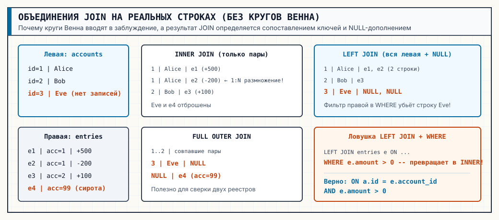
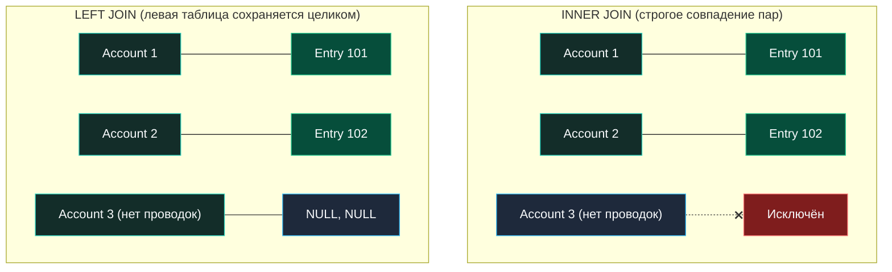
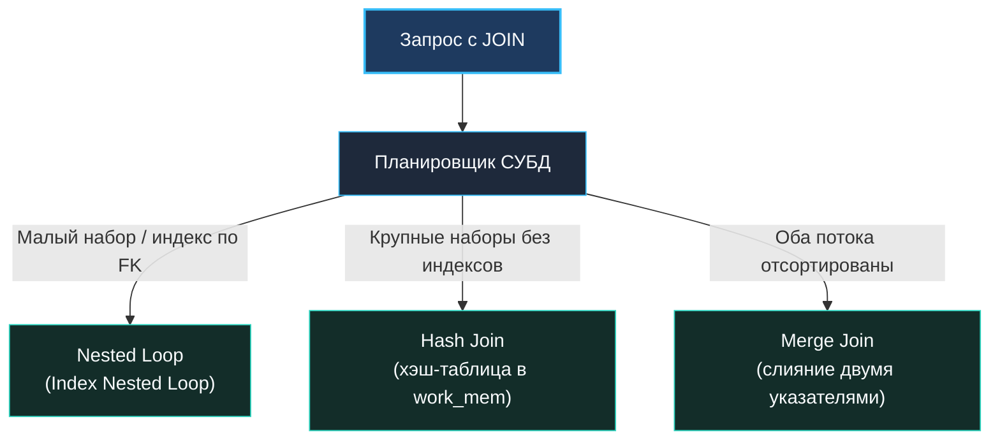
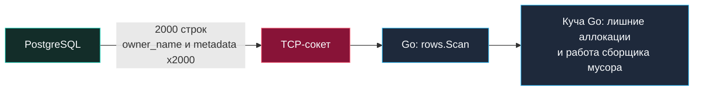

*Как собирать нормализованные таблицы LedgerPulse воедино, не путая умножение кортежей с кругами Венна и не сжигая CPU в декартовом взрыве.*

> «Блеск Unix заключался в выборе абстракции, достаточно общей, чтобы быть поразительно полезной, и при этом не слишком дорогой по производительности.»  
> — Брайан Керниган, *UNIX: A History and a Memoir*

В идеальном, но нежизнеспособном мире все данные хранились бы в одной гигантской плоской таблице. На практике такое хранение мгновенно приводит к аномалиям обновления (см. [[9. Нормализация — зачем избавляться от аномалий]]): если имя владельца счёта продублировано в миллионе строк проводок, смена имени превратится в тяжёлую операцию перезаписи, а сбой на полпути оставит базу в противоречивом состоянии.

Поэтому в схеме `LedgerPulse` сущности разнесены по трём независимым таблицам: `accounts`, `transactions` и `ledger_entries`. Операция **`JOIN`** — это механизм реляционной алгебры, который динамически склеивает нормализованные строки обратно в момент выполнения запроса.

---

## Декартова основа и почему круги Венна врут

В популярных статьях операции `JOIN` часто рисуют в виде пересекающихся кругов Эйлера-Венна. Для разработчика это вредная аналогия. Круги описывают операции над плоскими множествами (`UNION`, `INTERSECT`), но совершенно не объясняют природу умножения строк. Глядя на два пересекающихся круга, невозможно понять, почему при соединении 10 счетов и 50 проводок на выходе получается 50 строк, а не 10.

Математически любое соединение вырастает из **`CROSS JOIN`** — декартова произведения двух отношений. Если в таблице `A` лежит 1 000 строк, а в таблице `B` — 2 000 строк, то `A CROSS JOIN B` образует виртуальную таблицу из $1000 \times 2000 = 2\,000\,000$ пар кортежей, где каждая строка `A` скомбинирована с каждой строкой `B`:

```sql
-- Декартово произведение всех счетов на фиксированный список расчётных валют
SELECT a.id AS account_id, c.code AS target_currency
FROM accounts a
CROSS JOIN (VALUES ('RUB'), ('USD'), ('EUR')) AS c(code);
```

Когда осознанный `CROSS JOIN` нужен? Для построения отчётных матриц: например, чтобы получить пару «каждый активный счёт × каждый день отчётного периода» и не потерять дни без оборота. Во всех остальных случаях условие **`ON`** выступает фильтром, оставляющим из потенциального декартова произведения только осмысленные пары (например, `a.id = e.account_id`). Современный оптимизатор не материализует в памяти миллионы лишних пар, но пропущенное или всегда истинное условие `ON` способно положить сервер мгновенным комбинаторным взрывом.

---

## Анатомия соединений: INNER, LEFT, RIGHT и FULL





### 1. INNER JOIN (внутреннее соединение)

Оставляет в результирующем потоке только те пары строк, для которых предикат в `ON` вычислился строго в `TRUE`. Если у нового счёта в `accounts` ещё нет ни одной проводки в `ledger_entries`, он исчезнет из результата:

```sql
SELECT a.id, a.owner_name, e.id AS entry_id, e.amount
FROM accounts a
INNER JOIN ledger_entries e ON a.id = e.account_id;
```

### 2. LEFT JOIN (левое внешнее соединение)

`LEFT JOIN` (полная форма `LEFT OUTER JOIN`) гарантирует, что **каждая строка из левой таблицы** (`accounts`) попадёт в результат. Если для конкретного счёта не нашлось ни одной проводки по условию `ON`, СУБД вернёт строку счёта и заполнит все столбцы таблицы `ledger_entries` значениями `NULL`:

```sql
SELECT a.id, a.owner_name, e.id AS entry_id, e.amount
FROM accounts a
LEFT JOIN ledger_entries e ON a.id = e.account_id;
```

### 3. RIGHT JOIN (правое внешнее соединение)

`RIGHT JOIN` зеркально симметричен: он сохраняет все строки правой таблицы и подставляет `NULL` в поля левой.

> [!tip] Собеседование [Junior]
> **Вопрос:** В чём разница между `LEFT JOIN` и `RIGHT JOIN` на уровне плана выполнения, и какой из них стоит использовать в промышленном коде?  
> **Ответ:** Физически и математически разницы нет: `A RIGHT JOIN B` эквивалентен `B LEFT JOIN A`, и оптимизатор строит для них одинаковый план. Но в продакшене `RIGHT JOIN` считается плохим тоном. Инженер читает запрос сверху вниз и слева направо: в `FROM` ставят главную сущность (`accounts`), а затем последовательно присоединяют зависимые таблицы через `LEFT JOIN`. Использование `RIGHT JOIN` переворачивает поток чтения и легко путает команду при ревью сложных запросов с тремя-четырьмя соединениями.

### 4. FULL OUTER JOIN (полное внешнее соединение)

`FULL OUTER JOIN` (или кратко `FULL JOIN`) сохраняет **все** несовпавшие строки из обеих таблиц, подставляя `NULL` туда, где пары не нашлось.

Классический сценарий в финтехе — сверка (*reconciliation*) внутренних проводок `ledger_entries` и выписки от внешнего платёжного провайдера `provider_settlements` по `reference_id`:

```sql
SELECT
    t.reference_id       AS internal_ref,
    s.provider_ref       AS external_ref,
    s.settled_amount
FROM transactions t
FULL OUTER JOIN provider_settlements s ON t.reference_id = s.provider_ref
WHERE t.id IS NULL OR s.provider_ref IS NULL;
```

Один запрос сразу находит обе аномалии сверки: транзакции, которые есть в нашей базе, но потерялись у провайдера (`s.provider_ref IS NULL`), и чужие списания из выписки, которых нет в `LedgerPulse` (`t.id IS NULL`).

---

## Физика JOIN: Nested Loop, Hash Join и Merge Join

SQL декларативен: вы пишете *какие* таблицы соединить, но не указываете *как*. Физический алгоритм выбирает стоимостной оптимизатор СУБД на основе размеров таблиц, статистики и наличия индексов (глубокий разбор с планами `EXPLAIN` ждёт нас в Модуле 4).



1. **Nested Loop (`O(N * M)` и `O(N * log M)`).** СУБД берёт строку внешнего (левого) набора и ищет совпадения во внутреннем (правом). Без индексов это квадратичный перебор `O(N * M)`, сжигающий CPU. Но если по внешнему ключу `ledger_entries(account_id)` построен B-Tree индекс, ядро для каждой из $N$ выбранных строк счёта делает быстрый спуск по дереву за $O(\log M)$. **Index Nested Loop** — главный рабочий алгоритм для OLTP-запросов, где внешняя выборка содержит единицы или десятки строк.
2. **Hash Join (`O(N + M)`).** Когда соединяются крупные неиндексированные наборы данных, СУБД работает в две фазы:
   * *Build Phase:* берёт меньший набор и строит по ключу соединения хэш-таблицу в оперативной памяти (в рамках лимита `work_mem`).
   * *Probe Phase:* потоком сканирует большую таблицу, вычисляет хэш ключа и проверяет попадание за `O(1)`.
   Если хэш-таблица не помещается в `work_mem`, ядро сбрасывает временные батчи на диск (*Hybrid Hash Join*), и скорость падает с памяти (~100 нс) до дискового I/O (~100 мкс на NVMe).
3. **Merge Join (`O(N + M)`).** Если оба потока строк уже отсортированы по ключу соединения (считаны из B-Tree индексов или прошли предварительную сортировку), СУБД ставит два указателя на начала потоков и сдвигает их параллельно, как застёжку-молнию. Алгоритм потребляет минимум RAM и отлично ложится на последовательный доступ к кэш-линиям процессора.

---

## Две фатальные ловушки разработчиков

### Ловушка 1: фильтр правой таблицы в WHERE ломает LEFT JOIN

Инженеру нужно вывести все активные счета `accounts` и их приходные проводки (`amount > 0`). Счета без приходных проводок тоже должны остаться в отчёте с `NULL`.

**ОШИБКА — фильтрация правой таблицы в `WHERE`:**

```sql
SELECT a.id, a.owner_name, e.amount
FROM accounts a
LEFT JOIN ledger_entries e ON a.id = e.account_id
WHERE e.amount > 0;
```

Что происходит по этапам конвейера? Сначала `LEFT JOIN` честно оставляет счета без проводок, проставляя `e.amount = NULL`. Затем отрабатывает `WHERE`. По правилам трёхзначной логики из [[8. NULL и трёхзначная логика]] выражение `NULL > 0` даёт не `FALSE`, а `UNKNOWN`, и `WHERE` безжалостно выкидывает такие строки. Ваш `LEFT JOIN` незаметно превратился в `INNER JOIN`.

**РЕШЕНИЕ — перенос условия правой таблицы в `ON`:**

```sql
SELECT a.id, a.owner_name, e.amount
FROM accounts a
LEFT JOIN ledger_entries e
    ON a.id = e.account_id AND e.amount > 0;
```

Условие внутри `ON` оценивается в момент сопоставления строк правой таблицы: отсеиваются только неподходящие проводки, а сами счета из левой таблицы сохраняются неприкосновенными.

### Ловушка 2: дублирование данных по сети и давление на GC в Go

Пусть у одного счёта в `LedgerPulse` накопилось 2 000 проводок, и запрос соединяет `accounts` и `ledger_entries`:

```sql
SELECT a.id, a.owner_name, a.metadata, e.id, e.amount
FROM accounts a
INNER JOIN ledger_entries e ON a.id = e.account_id
WHERE a.id = 7;
```

Протокол SQL возвращает плоскую прямоугольную таблицу. Из-за этого строка `owner_name` и тяжёлый объект `metadata` (JSONB) счёта `id = 7` будут переданы по TCP и аллоцированы в куче Go **ровно 2 000 раз** — по копии на каждую проводку.



При выгрузке крупных связей `1:N` с тяжёлыми родительскими полями часто выгоднее выполнить два коротких запроса (`SELECT ... FROM accounts WHERE id = ANY($1)` и `SELECT ... FROM ledger_entries WHERE account_id = ANY($1)`), собрав дерево в памяти Go без дублирования мегабайт текста по сети.

---

## JOIN в контексте Go 1.24

Стандартный `database/sql` отдаёт плоский курсор `*sql.Rows` и ничего не знает о вложенных структурах. Чтобы собрать `Account` со слайсом `Entries []LedgerEntry` из одного `LEFT JOIN`, используют мапу для дедупликации по `account.id`, отдельный слайс для сохранения порядка из `ORDER BY` и nullable-типы `sql.NullInt64` для колонок правой таблицы:

```go
package repository

import (
	"context"
	"database/sql"
	"fmt"
)

type LedgerEntry struct {
	ID     int64
	Amount int64
}

type AccountWithEntries struct {
	ID        int64
	OwnerName string
	Entries   []LedgerEntry
}

func ListAccountsWithEntries(ctx context.Context, db *sql.DB) ([]*AccountWithEntries, error) {
	const query = `
		SELECT a.id, a.owner_name, e.id, e.amount
		FROM accounts a
		LEFT JOIN ledger_entries e ON a.id = e.account_id
		ORDER BY a.id, e.id`

	rows, err := db.QueryContext(ctx, query)
	if err != nil {
		return nil, fmt.Errorf("query accounts join entries: %w", err)
	}
	defer rows.Close()

	byID := make(map[int64]*AccountWithEntries)
	var result []*AccountWithEntries

	for rows.Next() {
		var (
			accID   int64
			owner   string
			entryID sql.NullInt64 // Может быть NULL из-за LEFT JOIN
			amount  sql.NullInt64
		)
		if err := rows.Scan(&accID, &owner, &entryID, &amount); err != nil {
			return nil, fmt.Errorf("scan account entry row: %w", err)
		}

		acc, ok := byID[accID]
		if !ok {
			acc = &AccountWithEntries{
				ID:        accID,
				OwnerName: owner,
			}
			byID[accID] = acc
			result = append(result, acc)
		}

		if entryID.Valid {
			acc.Entries = append(acc.Entries, LedgerEntry{
				ID:     entryID.Int64,
				Amount: amount.Int64,
			})
		}
	}

	if err := rows.Err(); err != nil {
		return nil, fmt.Errorf("iterate account rows: %w", err)
	}
	return result, nil
}
```

> [!info] Под капотом: ORM, ленивая загрузка и проблема N+1
> Многие ORM пытаются спрятать ручной маппинг плоских строк. При небрежной конфигурации ленивой подгрузки (*Lazy Loading*) ORM делает 1 запрос на получение $N$ счетов, а затем при обращении к полю `acc.Entries` в цикле отправляет ещё $N$ отдельных запросов `SELECT * FROM ledger_entries WHERE account_id = $1`. Это классическая **проблема `N+1`**, которая превращает один 3-миллисекундный запрос в сотни сетевых раунд-трипов (подробно методы её диагностики и устранения мы разберём в Модуле 4).

---

## Упражнения

### Базовое
Перед вами запрос, который должен вернуть **все** активные счета `LedgerPulse` и сумму проведённых операций по каждому из них за сегодня, включая счета, по которым сегодня операций не было:
```sql
SELECT a.id, a.external_id, e.amount, t.status
FROM accounts a
LEFT JOIN ledger_entries e ON a.id = e.account_id
INNER JOIN transactions t ON e.transaction_id = t.id
WHERE a.status = 'active'
  AND t.status = 'posted';
```
Найдите две причины, по которым этот запрос тихо потеряет активные счета без сегодняшних проводок, и исправьте его.

> [!solution] Показать решение
> Причина 1: второй `INNER JOIN transactions t ON e.transaction_id = t.id` отсекает строки, где `e.transaction_id` равен `NULL` (потому что `NULL = t.id` даёт `UNKNOWN`). После `LEFT JOIN` все последующие соединения в той же цепочке тоже должны быть `LEFT JOIN` (либо сгруппированы скобками в `LEFT JOIN (ledger_entries e JOIN transactions t ...)`).
>
> Причина 2: фильтр `t.status = 'posted'` стоит в `WHERE` и отбрасывает счета с `NULL` в правой таблице. Его нужно перенести в `ON`. Фильтр `a.status = 'active'` относится к левой таблице, поэтому в `WHERE` он абсолютно корректен:
> ```sql
> SELECT a.id, a.external_id, e.amount, t.status
> FROM accounts a
> LEFT JOIN ledger_entries e ON a.id = e.account_id
> LEFT JOIN transactions t
>     ON e.transaction_id = t.id
>    AND t.status = 'posted'
> WHERE a.status = 'active';
> ```
> Ещё точнее — соединить `ledger_entries` и `transactions` внутренним соединением внутри правого подвыражения, чтобы не получать проводки от отклонённых транзакций со значением `t.status = NULL`:
> ```sql
> SELECT a.id, a.external_id, e.amount, t.status
> FROM accounts a
> LEFT JOIN (
>     ledger_entries e
>     INNER JOIN transactions t
>         ON t.id = e.transaction_id AND t.status = 'posted'
> ) ON a.id = e.account_id
> WHERE a.status = 'active';
> ```

### Практическое
В таблице `accounts` хранятся счета, в `ledger_entries` — проводки. Напишите SQL-запрос, который находит **только те счета, у которых вообще нет ни одной проводки** (например, «спящие» счета для отчёта комплаенса), используя `LEFT JOIN` и проверку на `NULL`. Почему в `WHERE` нужно проверять именно `e.id IS NULL`, а не, скажем, необязательное nullable-поле правой таблицы?

> [!solution] Показать решение
> ```sql
> SELECT a.id, a.external_id, a.owner_name, a.created_at
> FROM accounts a
> LEFT JOIN ledger_entries e ON a.id = e.account_id
> WHERE e.id IS NULL;
> ```
> Проверять необходимо именно столбец, который гарантированно имеет ограничение `NOT NULL` в правой таблице — лучше всего её `PRIMARY KEY` (`e.id`) или столбец ключа соединения (`e.account_id`). Если проверить столбец, допускающий `NULL` по схеме, в результат ошибочно попадут счета, у которых проводка существует, но это необязательное поле не заполнено. (Позже, в главе 10 этого модуля, вы сравните этот паттерн с `NOT EXISTS`.)

### Со звёздочкой (*)
В двойной записи `LedgerPulse` каждая транзакция типа `'transfer'` обычно состоит ровно из двух проводок по разным счетам: списание (`amount < 0`) со счёта отправителя и зачисление (`amount > 0`) на счёт получателя.
Напишите **самосоединение (Self-Join)** таблицы `ledger_entries` вместе с `transactions` и `accounts`, которое для всех проведённых переводов (`t.kind = 'transfer' AND t.status = 'posted'`) выводит таблицу пар: `reference_id`, `from_account_external_id`, `to_account_external_id` и переведённую сумму (положительное число). Следите, чтобы каждая пара счётов в рамках одной транзакции попала в отчёт ровно один раз.

> [!solution] Показать решение
> ```sql
> SELECT
>     t.reference_id,
>     src.external_id AS from_account_external_id,
>     dst.external_id AS to_account_external_id,
>     e_in.amount     AS transfer_amount
> FROM transactions t
> INNER JOIN ledger_entries e_out
>     ON e_out.transaction_id = t.id AND e_out.amount < 0
> INNER JOIN ledger_entries e_in
>     ON e_in.transaction_id = t.id AND e_in.amount > 0
> INNER JOIN accounts src ON src.id = e_out.account_id
> INNER JOIN accounts dst ON dst.id = e_in.account_id
> WHERE t.kind = 'transfer'
>   AND t.status = 'posted';
> ```
> Разделение условий `e_out.amount < 0` и `e_in.amount > 0` гарантирует направленность пары «отправитель → получатель» и исключает самопересечение строки с самой собой или дублирование в обратном порядке. Если у сложного перевода бывают ещё и комиссии (третья проводка), потребуется дополнительная фильтрация по типу или равенству `e_in.amount = -e_out.amount`.

---

## Мостик к следующему уроку

Мы научились объединять нормализованные таблицы через `INNER`, `LEFT`, `RIGHT`, `FULL` и `CROSS JOIN` и разобрались, как защитить сетевой стек от дублирования данных.

Но часто сервису вообще не нужны тысячи строк отдельных проводок: финансовому отчёту или проверке лимитов требуется всего одна цифра — суммарный оборот по счёту, средний чек или количество транзакций за сутки. Как свернуть миллионы строк прямо на стороне БД с помощью `GROUP BY` и агрегатных функций и почему `SUM()` над пустым множеством роняет `Scan` в Go — разберём в следующей главе: [[7. GROUP BY и агрегатные функции]].
